# The top bar follows the chosen accent

Branch `claude/accent-follows-appearance`, based on `origin/main` at `5fb9801` (the merge of PR #36,
October 20, 2026). These are local commits only: nothing is pushed, merged or deployed.

Freddy's ruling (October 20, 2026) supersedes the one from earlier the same day that kept the top bar
in Disc Atlas lime while the accent stayed in My Bag. In his words, lightly cleaned up: earlier we said
to keep the line green at the top, but the Appearance should match. The bar should match whatever
accent the user has chosen; it will look cleaner.

## What changed

Two entries in the accent's scope in `public/display-palette.js`. The first is the page's own header,
`body>header`, which holds the primary nav and the site menu. The second, added after Freddy's review
the same day, is the Appearance sheet's Done button,
`#appearanceDialog [data-appearance-close].primary` (see
[The Appearance sheet's Done button](#the-appearance-sheets-done-button)). Everything else follows
from the module that already owned the accent:

- **No second setting and no second path.** The same `disc-atlas-display` key in `localStorage`, the
  same `<style id="display-palette">` written during head parsing, the same `atlas-palette-change`.
- **Before first paint.** The scoped tokens are in the head before the stylesheets load, so a reload
  never shows lime first (measured below).
- **At once.** A tap in Appearance rewrites that style, and the bar changes in the same document.
- **Untouched means untouched.** Lime writes nothing, as before. A visitor who never chose an accent
  gets no style element at all, and the bar is today's bar, computed color for computed color and
  pixel for pixel (below).
- **Contrast comes from the curated accent family.** Each accent already carries its own fill, ink
  (the label on the fill) and dark-theme values. No value was changed.

`body>header` is deliberately exact: a bare `header` would also reach headers inside dialogs and
sheets. `tests/display-palette.mjs` holds that.

The Appearance sheet's row was called "Bag accent". It reaches the top bar now too, so it is called
"Accent". This is the one change outside the bar. It's one word in `public/appearance.js` and easy to
revert if you'd rather keep the old name.

## Step 0: what in the top bar was lime

Every top-bar lime came from the shared Stitch accent tokens (`--lime`, `--accent-fill`,
`--accent-ink`, `--accent-glow`), set on `:root` per theme in `public/stitch.css`. Nothing in the bar
had a hard-coded lime hex. That's why scoping the tokens to the header is the whole change.

### 1. Interactive chrome: now follows the accent

| Element | Rule | Token |
| --- | --- | --- |
| Active nav pill: fill, label, glow | `stitch.css` `header nav button.active` | `--accent-fill`, `--accent-ink`, `--accent-glow` |
| Active nav underline bar (`::after`) | `cosmic.css` `header nav button::after`, recolored by `stitch.css` | `--accent-fill` |
| Theme toggle and menu button, hover icon | `stitch.css` `.theme-toggle:hover,.site-menu-button:hover` | `--lime` |
| Focus ring on the menu button and every menu item | `cosmic.css` `.site-menu-button:focus-visible,.site-menu [role^="menuitem"]:focus-visible` | `--lime` |
| Focus ring on the home link and the filter-context title | `cosmic.css` `.context-title:focus-visible,.header-identity .logo:focus-visible` | `--lime` |
| Theme and Default map check marks in the site menu | `cosmic.css` `.theme-choice-check` | `--lime` |

The focus ring around the home link is in this list because it's a keyboard focus indicator, not part
of the logo.

Rules that name an accent token but are overridden or match no markup, so they paint nothing:
`style.css` `nav button.active` and `.theme-toggle:hover` (`--selected`; overridden by `stitch.css`
and `cosmic.css`), `style.css` `.theme-toggle[aria-checked="true"] .switch-track` (the old switch
markup is gone), and `cosmic.css` `.orbit` (no such element). Under the scope they would follow the
accent too, if they ever painted.

### 2. Brand artwork: unchanged

- **The logo mark and the wordmark** are painted from `brand/site.css`'s own tokens (`--da-ink`,
  `--da-accent`, `--da-plate`), which `brand/symbols.svg` reads as fills. These are brand tokens, not
  the accent, and nothing here touches them.
- **`stitch.css` `.logo svg { color:var(--lime) }`** looks like it paints the logo from the accent, but
  it doesn't. Nothing in `symbols.svg` uses `currentColor`, so that `color` reaches no pixel. The rule
  was left alone, as the brief asks.

  **Measured.** The evidence run compares the logo's box under Mint, Gold, Silver and Pink against
  Lime: 32 comparisons, across Light, Midnight, Paper and Dusk, on desktop and phone.

  - **Desktop, and phone in Paper:** identical.
  - **Phone, Midnight and Dusk:** one pixel differs, the box's bottom-right corner, by 1/255. That
    pixel is background, not artwork: the active nav pill's soft glow (its color is the accent's)
    reaches that corner. A separate probe in Midnight switched the glow off, and the box was then
    identical for every accent.
  - **Phone, Light:** the four accents are byte-identical to each other. Only the Lime reference
    differs from them, by 6 anti-aliased pixels of at most 3/255 on the wordmark's bottom row. Lime
    is the first shot after the theme switch. A separate probe repeated the same sequence and retook
    Lime after a menu cycle; Light then matched exactly. So this is capture state, not the accent.
  - One earlier run of the same script showed a one-off 186-pixel difference (Pink, Dusk, phone). It
    didn't recur in two later runs. That run screenshotted 250 ms after the change, inside the
    pill's transitions on a loaded machine; the script now waits 700 ms.
- The header's surface and hairline (`--glass`, `--bg`, `--hairline`) are not lime and are unchanged.

### 3. Lime elsewhere: out of scope, unchanged

- The atlas's explore tools (search focus, the Filters toggle, the pressed type chips, the map lens),
  the directory's sort bar, the dropdown indicators, the Atlas Coach, and the map and reading panels.
  They stay on the root lime; `tests/display-customization-browser.mjs` checks the root and the
  Filters toggle.
- **The dark themes' faint lime wash at the top of the page** (`stitch.css`, a 3.5% radial gradient
  on `body`). It sits behind the bar, but it's the page background, which the brief keeps out.
- **The information pages (About, Privacy, Terms, account).** Their header has no nav and no site
  menu, only the logo, Sign in and the theme toggle, so their only lime is the toggle's hover and the
  focus rings. Those pages don't load `display-palette.js`, and loading it there would also apply
  class colors, such as the About hero's clay disc, which reads `--distance`. So they keep lime for
  now. This is a separate decision for you; it isn't done here.

## Evidence

Produced by `node tests/accent-follows-appearance-evidence.mjs`. The `--before` run was made in a clean
checkout of `origin/main` at `5fb9801`; the plain run was made on this branch, which compares itself
against it. The browser is headless Chromium on the Mac with `--enable-gpu` (Metal), through
`tests/display-harness.mjs`.

### Default: exactly today's bar

For a visitor who never chose an accent, the test compares 36 states (six themes × desktop 1440 and
phone 390 × at rest, hovered, and menu open from the keyboard). In each one it reads every element in
the bar, with its `::before` and `::after`, recording 15 painted properties apiece, plus the accent
and brand tokens.

| Check against `origin/main` | Result |
| --- | --- |
| Computed colors, all 36 states (2,484 element readings) | 0 differences |
| Pixels (the bar at rest and hovered, the open menu), all 36 states | 0 differing pixels |
| `#display-palette` style element | Absent, as before |

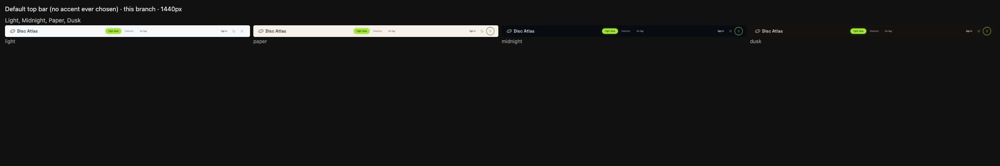
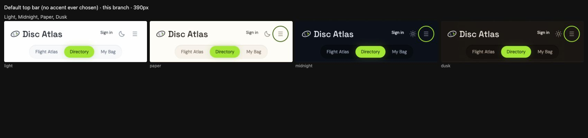

### Chosen accents across Light, Midnight, Paper and Dusk

Each cell shows the bar at rest, then the site menu opened from the keyboard. Focus is on About, so
both the focus ring and the current theme's check mark show. All nine accents sit at the same OKLCH
lightness (about .84), so "lightest" and "darkest" go by WCAG luminance: **Mint** is the lightest
(.641) and **Pink** the darkest (.567). Gold and Silver are the other two. On a phone the atlas opens
in the Directory, so that's the active pill there. From the second column on, the menu button also
shows a focus ring at rest: closing the previous cell's menu returned focus to it, so it shows the
button's ring in each accent too.

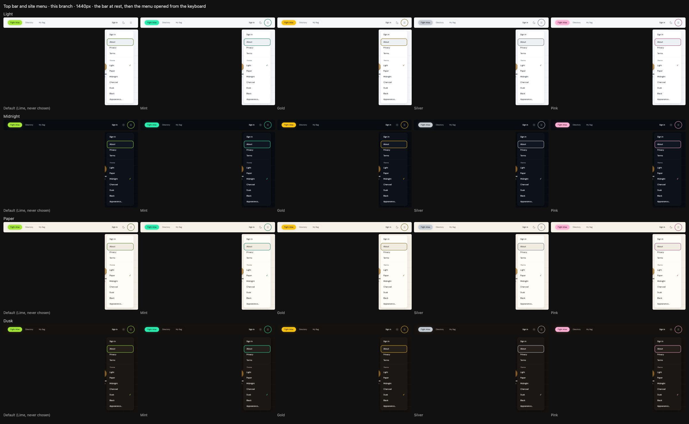
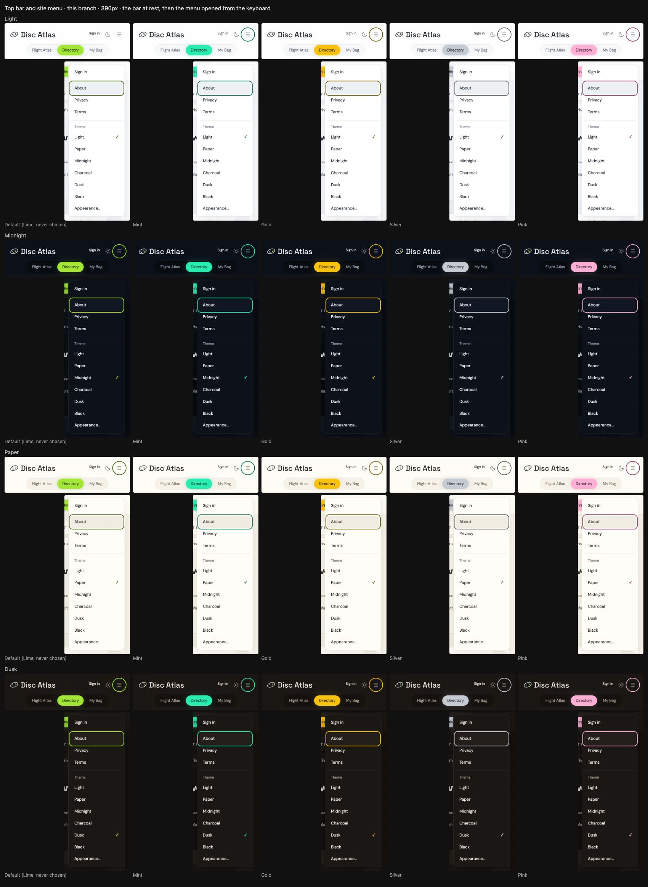

On `origin/main` the same choices leave the bar lime:
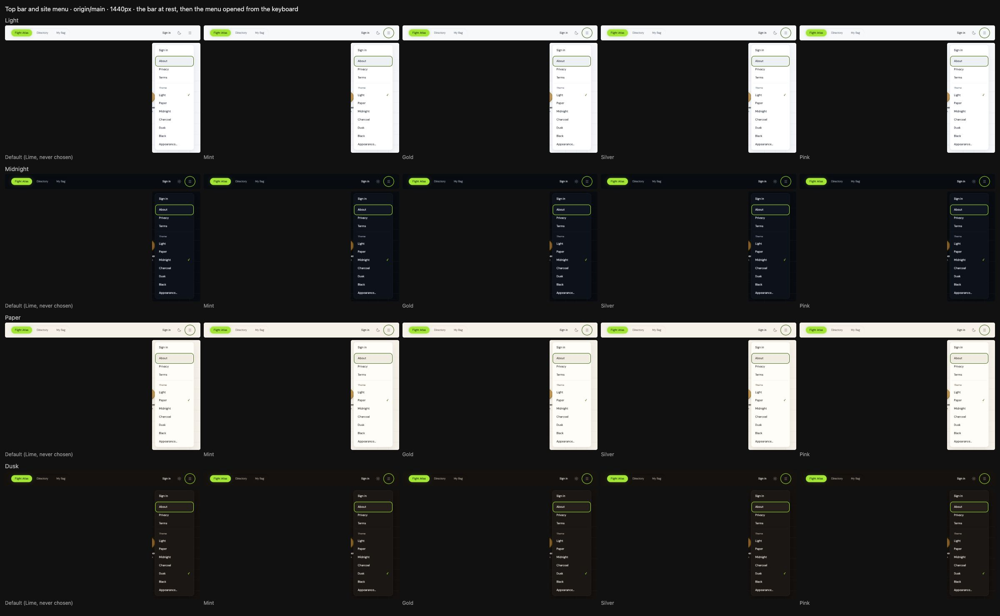
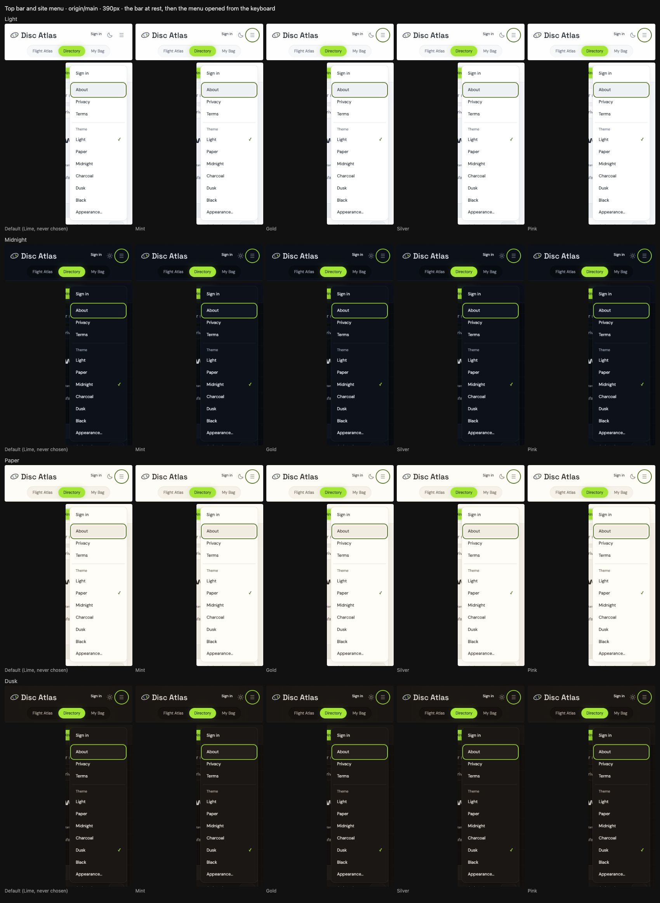

### An accent change lands at once, and stays after a reload

In Light, the test opens the Appearance sheet from the site menu and taps Violet.

| | `origin/main` | This branch |
| --- | --- | --- |
| Active pill, before the tap | `rgb(163, 230, 53)` lime | `rgb(163, 230, 53)` lime |
| Right after the tap (no reload, same document) | lime | `rgb(206, 192, 255)` Violet, within 172 ms |
| After a reload | lime | `rgb(206, 192, 255)` Violet |
| Stored | `{"accent":"violet", ...}` | `{"accent":"violet", ...}` |

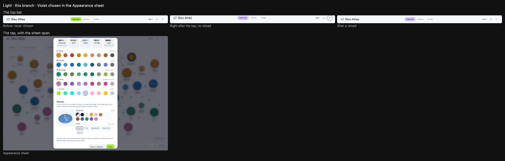

The middle strip is framed a few pixels higher than the other two because the sheet had just closed.
Focus has returned to the menu button, so its ring shows in Violet.

The sheet's **Done** button, still lime in the picture above, is now in scope too. That was added
afterwards; see [The Appearance sheet's Done button](#the-appearance-sheets-done-button).

### Page load: no lime frame

The test throttles the CPU 4× and records the load two ways:

1. **A screencast of every frame.** Each frame's nav area is scanned for lime pixels (within 36 of
   `#a3e635`).
2. **A frame-by-frame computed read.** It starts from the moment `#mapTab` exists, checking the
   pill and its underline bar each animation frame.

With the accent never chosen, the same scan finds lime in almost every frame, which proves the
detector works.

| Load | Painted frames | Frames with lime | Computed reads | Lime reads | First read |
| --- | --- | --- | --- | --- | --- |
| `origin/main`: Violet chosen, Midnight | 82 | 82 | 86 | 86 | lime, at 34 ms |
| `origin/main`: Violet chosen, Light | 85 | 85 | 85 | 85 | lime, at 35 ms |
| `origin/main`: Never chosen (Lime), Midnight | 82 | 82 | 86 | 86 | lime, at 33 ms |
| This branch: Violet chosen, Midnight | 89 | 0 | 77 | 0 | violet, at 34 ms |
| This branch: Violet chosen, Light | 82 | 0 | 85 | 0 | violet, at 35 ms |
| This branch: Never chosen (Lime), Midnight | 81 | 80 | 86 | 86 | lime, at 40 ms |

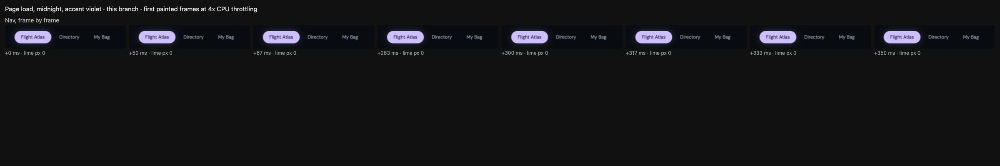
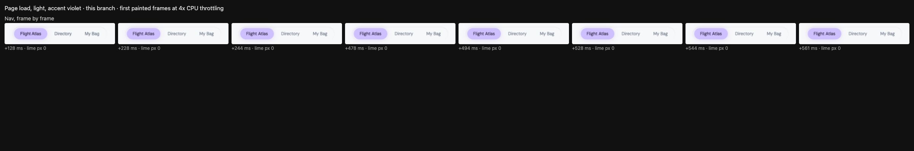
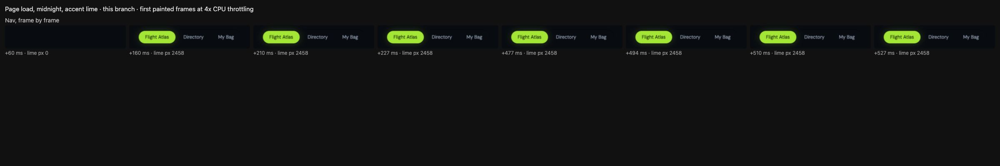
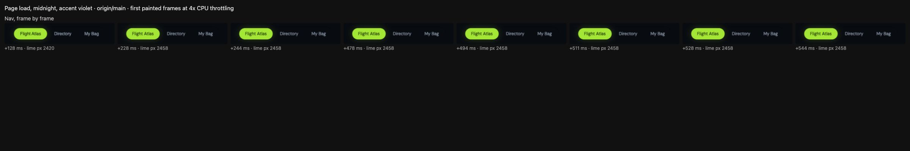

### Contrast: every accent in all six themes

The test reads WCAG ratios from the rendered tokens in the bar. Translucent surfaces are composited
over the page. The table shows Lime, and the lowest of the other eight accents in each theme. The
floors are 4.5:1 for the pill's label (text) and 3:1 for icons, rings and check marks.

| Theme | Accent | Pill label on fill | Hover icon on hover chip | Focus ring on bar | Ring and check on menu | Check on focused row |
| --- | --- | --- | --- | --- | --- | --- |
| Light | Lime (default) | 9.69 | 6.24 | 6.66 | 7.08 | 6.24 |
| Light | lowest of 8 | 10.08 (Pink) | 5.69 (Mint) | 6.07 (Mint) | 6.45 (Mint) | 5.69 (Mint) |
| Paper | Lime (default) | 9.69 | 6.01 | 6.34 | 6.96 | 6.01 |
| Paper | lowest of 8 | 10.08 (Pink) | 5.48 (Mint) | 5.78 (Mint) | 6.34 (Mint) | 5.48 (Mint) |
| Midnight | Lime (default) | 11.27 | 11.91 | 13.07 | 12.54 | 11.91 |
| Midnight | lowest of 8 | 10.08 (Pink) | 10.55 (Pink) | 11.57 (Pink) | 11.11 (Pink) | 10.55 (Pink) |
| Charcoal | Lime (default) | 11.27 | 10.44 | 12.53 | 11.66 | 10.44 |
| Charcoal | lowest of 8 | 10.08 (Pink) | 9.24 (Pink) | 11.10 (Pink) | 10.32 (Pink) | 9.24 (Pink) |
| Dusk | Lime (default) | 11.27 | 10.82 | 12.47 | 11.81 | 10.82 |
| Dusk | lowest of 8 | 10.08 (Pink) | 9.59 (Pink) | 11.04 (Pink) | 10.46 (Pink) | 9.59 (Pink) |
| Black | Lime (default) | 11.27 | 12.11 | 13.93 | 13.13 | 12.11 |
| Black | lowest of 8 | 10.08 (Pink) | 10.73 (Pink) | 12.33 (Pink) | 11.63 (Pink) | 10.73 (Pink) |

The lowest is 5.48:1, for Mint on Paper. In the light themes the bar's icon, rings and check marks
wear each accent's ink (OKLCH L .47); in the dark themes they wear its fill. That's the same split
My Bag already uses.

## The Appearance sheet's Done button

The first pass left the sheet's own Done button lime whatever the accent; it flagged that as outside
the brief. Freddy ruled to add it before he pushes.

The change is a second scope entry, made the same way as `body>header`:
`#appearanceDialog [data-appearance-close].primary`. That's the Done button and nothing else. The
sheet's `×` close button shares `data-appearance-close` but isn't `.primary`; Reset, the swatches, the
packs, the theme control and the stamp preview stay out. The button was already painted from the
accent tokens (`stitch.css` `.pill-button.primary`: `--accent-fill`, `--accent-ink`, `--accent-glow`;
and the focus ring, `--lime`). Scoping those tokens to it is the whole change. `tests/display-palette.mjs`
holds that the button is the sheet's only scope entry.

Evidence: `node tests/accent-done-button-evidence.mjs`. Its `--before` run was made in a clean
checkout of the previous tip, `ba5e98b`, and the plain run on this branch compares against it.

| Check | Result |
| --- | --- |
| Default (never chosen), six themes × desktop 1440 and phone 390: computed colors of every other element in the sheet (242 readings each; the live 3D stamp preview is left out) | 0 differences |
| Default: the Done button's paint at rest, hovered and focused from the keyboard | Identical |
| Default: pixels of the Reset and Done row | 0 differing pixels |
| Violet chosen, the same 12 combinations: every other element in the sheet | 0 differences: only Done moves |
| Violet chosen: Done's fill | `rgb(163, 230, 53)` lime → `rgb(206, 192, 255)` Violet, all 12 |
| A tap on Violet in the open sheet | Done turns Violet within 181 ms, same document, sheet still open (previous tip: stays lime) |
| After a reload | Violet (previous tip: lime) |

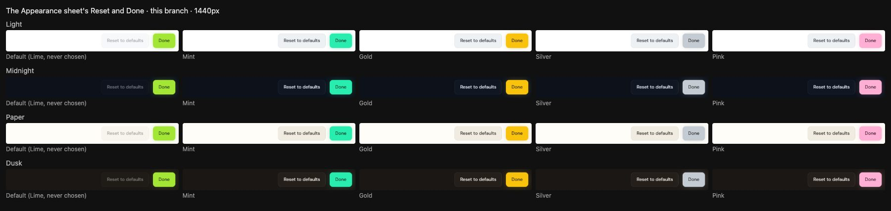
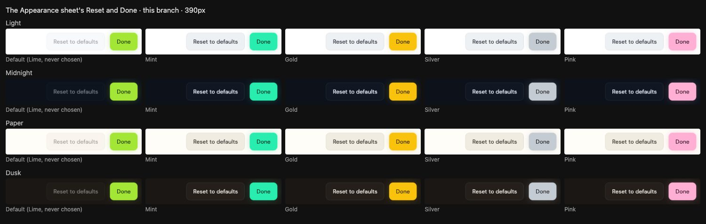
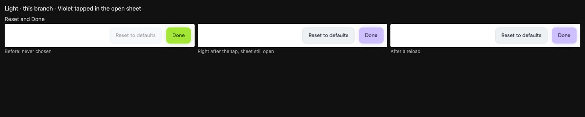

On the previous tip the same choices left Done lime:
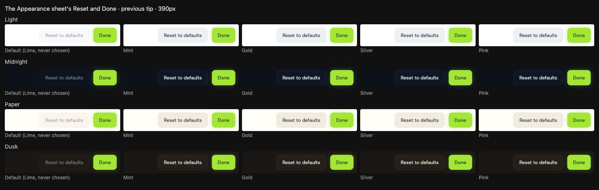

Contrast covers all nine accents in all six themes. The label is the accent's ink on its fill (text,
4.5:1). The keyboard focus ring is the accent's `--lime` on the sheet's surface (3:1).

| Theme | Label, Lime | Label, lowest of 8 | Focus ring, Lime | Focus ring, lowest of 8 |
| --- | --- | --- | --- | --- |
| Light | 9.69 | 10.08 (Pink) | 7.08 | 6.45 (Mint) |
| Paper | 9.69 | 10.08 (Pink) | 6.96 | 6.34 (Mint) |
| Midnight | 11.27 | 10.08 (Pink) | 12.54 | 11.11 (Pink) |
| Charcoal | 11.27 | 10.08 (Pink) | 11.66 | 10.32 (Pink) |
| Dusk | 11.27 | 10.08 (Pink) | 11.81 | 10.46 (Pink) |
| Black | 11.27 | 10.08 (Pink) | 13.13 | 11.63 (Pink) |

The lowest label ratio is 10.08:1 (Pink) and the lowest ring is 6.34:1 (Mint on Paper).

One thing for test authors: in the open sheet, Done's background has a .18 s transition. A read
taken the instant after a tap still returns the start value. `tests/display-customization-browser.mjs`
waits for the new value (up to 1 s) before asserting.

## Tests

| Suite | Result |
| --- | --- |
| `node --test tests/display-palette.mjs` | 21 / 21 pass (scope assertions for the bar and the Done button) |
| `node tests/display-customization-browser.mjs` | Pass. It asserts the bar and Done wear the accent (Done live, in the open sheet, and after a reload), the root, the atlas and the rest of the sheet keep lime, and Reset brings both back to lime |
| `ATLAS_URL=https://localhost:8861 node tests/palette.mjs` | Pass (rerun with the Done button change) |
| `node tests/brand-browser.mjs` | Pass: 40 page/width/theme combinations, logo `--da-accent` unchanged |
| `node tests/dropdown-indicator-browser.mjs` | Pass: 9 checks, 66 screenshots |
| `node --test tests/disc-appearance-browser.mjs` | 8 / 8 pass |
| `node tests/accent-follows-appearance-evidence.mjs` | The top-bar evidence above |
| `node tests/accent-done-button-evidence.mjs` | The Done-button evidence above |

Only three suites ever choose an accent (`display-palette`, `display-customization-browser`,
`palette`), and all three were rerun with the Done button change. Every other theme-sensitive suite
runs in the default state, where neither change writes anything. Brand, dropdown-indicator and
disc-appearance ran with the top-bar change.

## Fences kept

No class colors, packs, swatches or accent values changed. No account storage, no migration. No
site-wide lime sweep: the atlas, directory, coach, page backdrop and information pages are as they
were. Graphify is refreshed (AST-only) and committed with the work.
