# Atlas backdrop removal

October 20, 2026 · PC · branch `codex/atlas-backdrop-removal` · base `8e91dc7` (fetched current `origin/main`, includes PR #27 and all six themes). Local worktree: `C:/Users/user/.codex/worktrees/atlas-backdrop-removal/disc-atlas`.

The immersive atlas now shares the header/page base color. Its ambient panel wash is removed, including the page wash exposed in the small gap beneath the header. The atlas keeps its grid, axes, numbers, labels, marker art, legend, pills and controls.

## Characterization before editing

The final cascade matters: `web/index.html` loads `cosmic.css` and then `stitch.css` (among the other component sheets).

| Treatment | Exact source before this change | Scope and decision |
| --- | --- | --- |
| Map backdrop fill / ambient glow | `public/cosmic.css`'s final generic `#map` background: radial ambient gradient at 55%/35%, radial fairway tint at 12%/82%, over `--map-bg`. Earlier generic map background rules are superseded. | Shared with embedded maps. Add `background:var(--bg)` to the existing `body[data-view="map"]:not(.my-bag-mode) #map` rule; specificity overrides only the immersive atlas. A plain page-colored fill preserves a real background for the intro repaint. |
| Apparent edge under the header | Earlier header borders in `cosmic.css` are already overridden by `stitch.css`'s atlas-only transparent bottom border. The immersive `#map` already has zero border, square corners and no box shadow. | No global border/shadow removal. The visible separation comes from differing paint, not an active panel border. |
| Remaining top-edge glow | `public/stitch.css`'s dark `body` background adds a lime radial wash plus a faint page grid. On desktop, the header ends at y=68 and the map begins at y=80: the exposed 12px page strip retains that wash. | Flatten the body background only under `:root body[data-view="map"]:not(.my-bag-mode)`. The map's own grid is retained. This closes the exposed strip as well as the main map/header transition. |
| Map furniture and its own glow/shadow | `#map::before` in `stitch.css` supplies the neutral 48px grid, faded at its top. `atlas-map.js` draws the flight grid, axes/tick numbers and discs. Pills, selected markers and navigation have their own surface/glow styles. | All retained. The scoped changes do not alter furniture rules or rendering code. |

Every theme already gives `--map-bg` and `--bg` the same base. The gradients and exposed page strip made those otherwise matching bases read as separate surfaces:

| Theme | Shared base | Former ambient token |
| --- | --- | --- |
| Light | `#f7f8fa` | `#809bea12` |
| Midnight | `#080b10` | `#526c9820` |
| Charcoal | `#101113` | `#ffffff03` |
| Black | `#000000` | `#0000` (the second fairway tint still existed) |
| Paper | `#f6f2ea` | `#c8956a14` |
| Dusk | `#14110f` | `#ffb38a08` |

Directory, My Bag and standalone pages retain their existing backgrounds and borders. There is no shared-shell redesign. No data/catalog/pipeline, score ordering, tiers, colorblind-law, palette or intro code changed.

## Evidence and reproduction

`tests/atlas-backdrop-evidence.mjs --before` captures base `8e91dc7`'s two stylesheets with the current identical app/catalog. Without the flag it captures the working tree and compares against that baseline. The first baseline was also captured before the CSS edit. It uses the real atlas, a static session return (intro already seen), loaded fonts/art, 1440×900 desktop and 390×844 touch phone at DPR 1. Each PNG is the full-width top section including the header, gap, controls and map grid (340px desktop / 420px phone), with no overlays or image editing.

Run from the worktree with `PLAYWRIGHT_MODULE` pointing at an installed Playwright package:

```powershell
node tests/atlas-backdrop-evidence.mjs --before
node tests/atlas-backdrop-evidence.mjs
```

The JSON records full computed backgrounds, geometry and marker positions. The harness requires no map or body gradient, identical map/header/body base color, zero map border/shadow, and unchanged map pseudo-grid, furniture styles, geometry and curated marker coordinates. Directory and My Bag exclusions are checked by comparing computed map/header/body styles under their mode selectors; these are style-scope checks, not a substitute for their navigation suites.

[Baseline measurements](images/atlas-backdrop-removal/before.json) · [Final measurements](images/atlas-backdrop-removal/after.json) · [Seam pixel samples](images/atlas-backdrop-removal/seam-pixels.json) · [Strict intro measurements](images/atlas-backdrop-removal/intro-measurements.json)

## Verification

All requested checks passed on the final source. [Machine-readable results](images/atlas-backdrop-removal/verification.json).

| Check | Result |
| --- | --- |
| Intro unit + unchanged browser suite | **PASS, strict 0 changed pixels desktop and phone.** Raw `#map` PNGs are byte-identical for reveal vs direct and reduced motion vs direct. 3D art ready on both; camera, labels, tiers, marker geometry, framing and input takeovers pass. |
| Atlas organic, depth, 3D, persist, stamps, speed band, My Map | **PASS**, all seven browser suites; the organic suite also reran after the final body override. My Map's real authenticated hand-offs and return to the shared atlas pass. |
| Relevant atlas unit suites | **59 passed, 0 failed** across intro, organic, depth, LOD, targets, stamp cache, speed band, personal lens and personal worker. |
| Six themes × desktop/phone | **PASS**, 24 before/after seam PNGs, matching geometry/marker positions and furniture styles. The final pixel sample spans the header edge, entire exposed page gap and first map rows at clear columns: identical RGB in every sampled row, all 12 cases. |
| Atlas 3D perf gate | **PASS**, default 7 desktop / 3 phone warm repetitions per configuration plus cold diagnostics, serial and alternating 2D/3D order. All six median/paired-excess verdicts pass; 162.27 s. No concurrent task-owned browser tests, graph rebuilds or reviewers during measurement. |
| Independent review / diff checks | **PASS** after closing the exposed page-strip finding; `git diff --check` clean. |

`settleAtlas()` is unchanged. The map still has an opaque, borderless page-colored background, so `border-box` and `padding-box` draw alike and the existing clip flip still causes a real repaint. The intro tests and their strict equality assertion were not weakened or edited. Final raw proof PNGs: [desktop reveal](images/atlas-backdrop-removal/intro-desktop-reveal.png), [desktop direct](images/atlas-backdrop-removal/intro-desktop-direct.png), [desktop reduced](images/atlas-backdrop-removal/intro-desktop-reduced.png), [phone reveal](images/atlas-backdrop-removal/intro-phone-reveal.png), [phone direct](images/atlas-backdrop-removal/intro-phone-direct.png), [phone reduced](images/atlas-backdrop-removal/intro-phone-reduced.png).

The unchanged perf gate measures 3D versus 2D overhead on this PC. Full cold/warm repetitions and verdicts are saved in [perf.json](images/atlas-backdrop-removal/perf.json).

| Device | Metric | 2D median | 3D median | Limit | Paired median excess |
| --- | --- | ---: | ---: | ---: | ---: |
| Desktop | Flight p95, ms | 3.30 | 3.70 | 5.295 | -1.58 |
| Desktop | 1x p95, ms | 0.70 | 1.00 | 2.305 | -1.305 |
| Desktop | Long tasks | 0 | 0 | 1 | -1 |
| Phone (emulated, 4× CPU) | Flight p95, ms | 10.80 | 11.30 | 15.42 | -3.54 |
| Phone (emulated, 4× CPU) | 1x p95, ms | 2.40 | 3.50 | 5.76 | -2.39 |
| Phone (emulated, 4× CPU) | Long tasks | 4 | 5 | 5 | 0 |

Environment setup: the sandbox initially prevented Node test child processes (`spawn EPERM`); the authorized rerun passed all 59. My Map's first attempt stopped before browser checks because the new worktree lacked `node_modules/wrangler`; a local junction to the existing installed dependencies resolved it and the unchanged suite passed 10 checks. No package install, manifest change or test relaxation. The My Map run also passed the catalog artwork gate and public asset build. Existing suites' regenerated historical screenshots were restored; final proof is kept under this change's own evidence directory.

Commands (with `PLAYWRIGHT_MODULE` set to the bundled installed package):

```powershell
node --test tests/atlas-intro-reveal.mjs tests/atlas-organic.mjs tests/atlas-depth.mjs tests/atlas-lod.mjs tests/atlas-targets.mjs tests/atlas-stamp-cache.mjs tests/atlas-speed-band.mjs tests/personal-lens.mjs tests/personal-map-worker.mjs
node tests/atlas-intro-reveal-browser.mjs
node tests/atlas-organic-browser.mjs
node tests/atlas-depth-browser.mjs
node tests/atlas-3d-browser.mjs
node tests/atlas-persist-browser.mjs
node tests/atlas-stamps-browser.mjs
node tests/atlas-speed-band-browser.mjs
node tests/my-map-browser.mjs
node tests/atlas-3d-perf.mjs --self-test
node tests/atlas-3d-perf.mjs
```

## Graphify and delivery

Ran `graphify update .` in this worktree after the code/evidence changes, with the existing `.graphifyignore` exclusions for `.env*`, `.dev.vars*`, credentials and generated outputs retained. AST-only, no semantic/deep extraction or model calls. Refreshed graph: **2,659 nodes, 5,579 edges, 149 communities**, no missing edge endpoints or sensitive sources. The extractor reported 16 code files with no modeled symbols and 200 unclassified paths; its documented CSS/theme-event gaps remain. Generated graph artifacts are included with this work, not owed to another machine.

Local commit only on the requested task branch. No push, PR or deployment.

## Screenshots — before / after

Both images in each row use the same viewport, theme and resting camera. The pill glow and map grid remain intentional; the backdrop wash and exposed page band are removed.

### Light

| Device | Before | After |
| --- | --- | --- |
| Desktop | 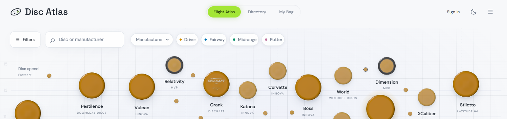 | 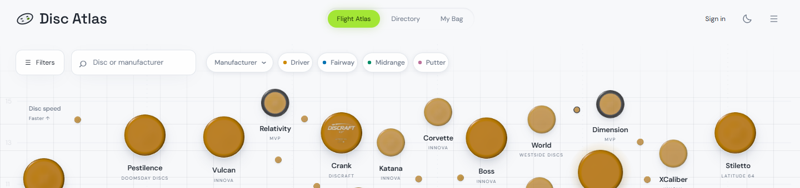 |
| Phone | 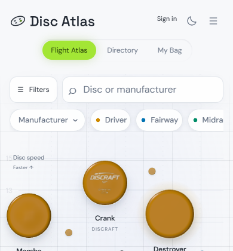 |  |

### Midnight

| Device | Before | After |
| --- | --- | --- |
| Desktop | 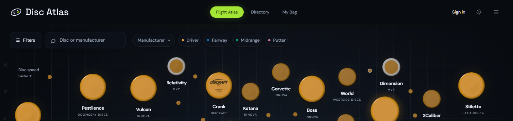 | 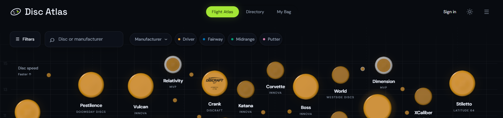 |
| Phone | 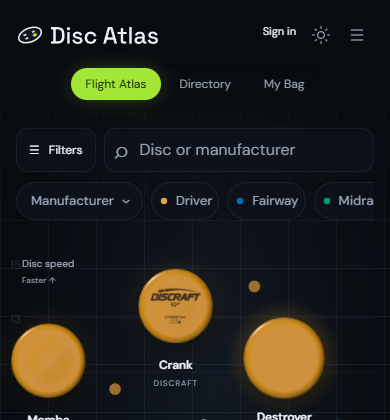 | 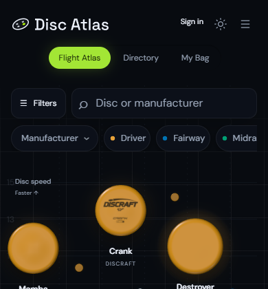 |

### Charcoal

| Device | Before | After |
| --- | --- | --- |
| Desktop | 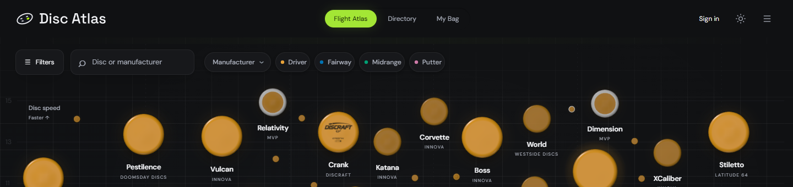 | 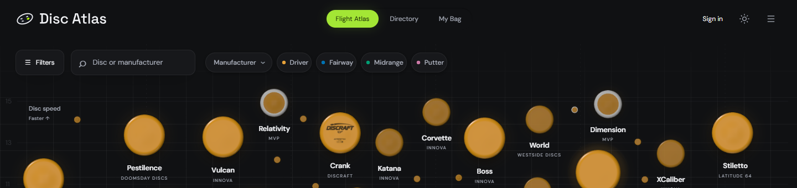 |
| Phone |  |  |

### Black

| Device | Before | After |
| --- | --- | --- |
| Desktop |  | 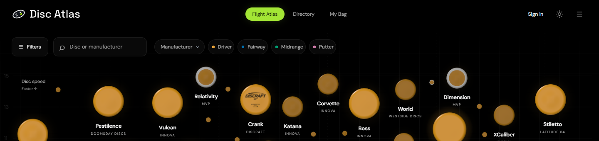 |
| Phone | 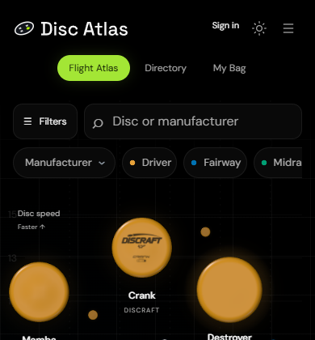 | 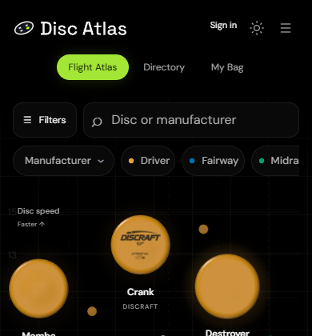 |

### Paper

| Device | Before | After |
| --- | --- | --- |
| Desktop | 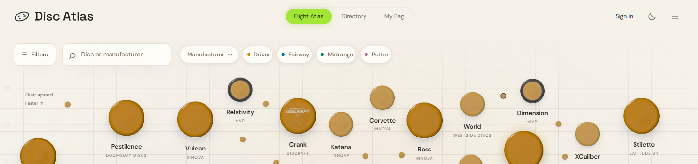 | 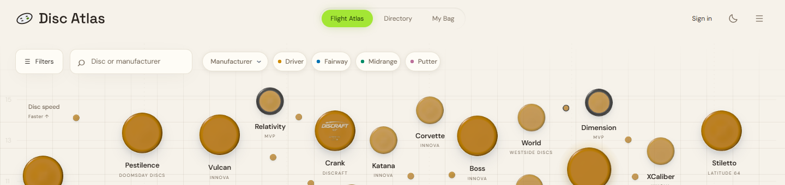 |
| Phone |  | 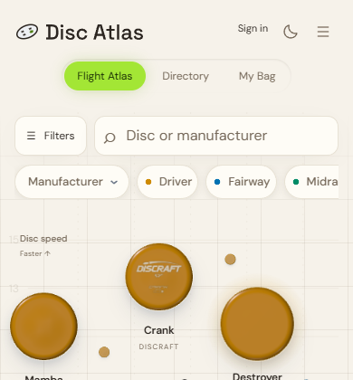 |

### Dusk

| Device | Before | After |
| --- | --- | --- |
| Desktop | 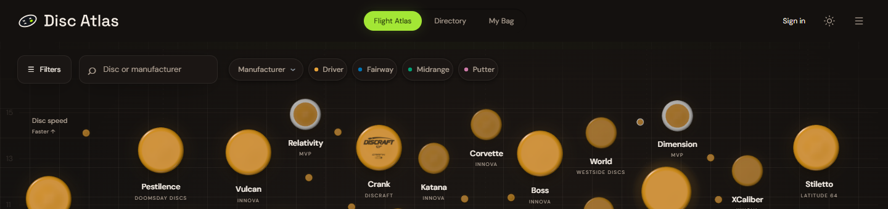 | 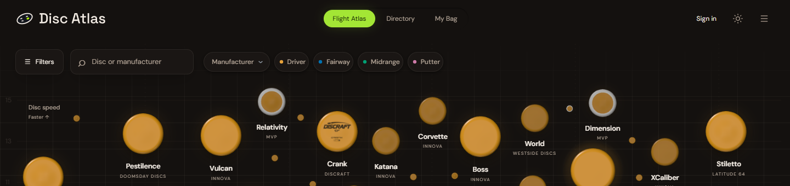 |
| Phone | 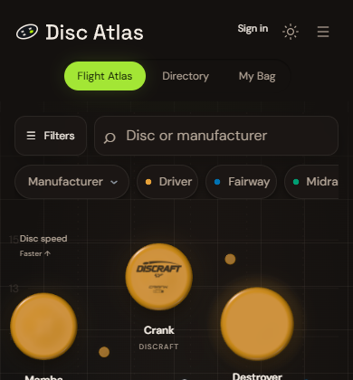 | 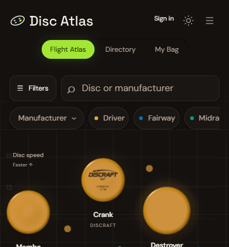 |
