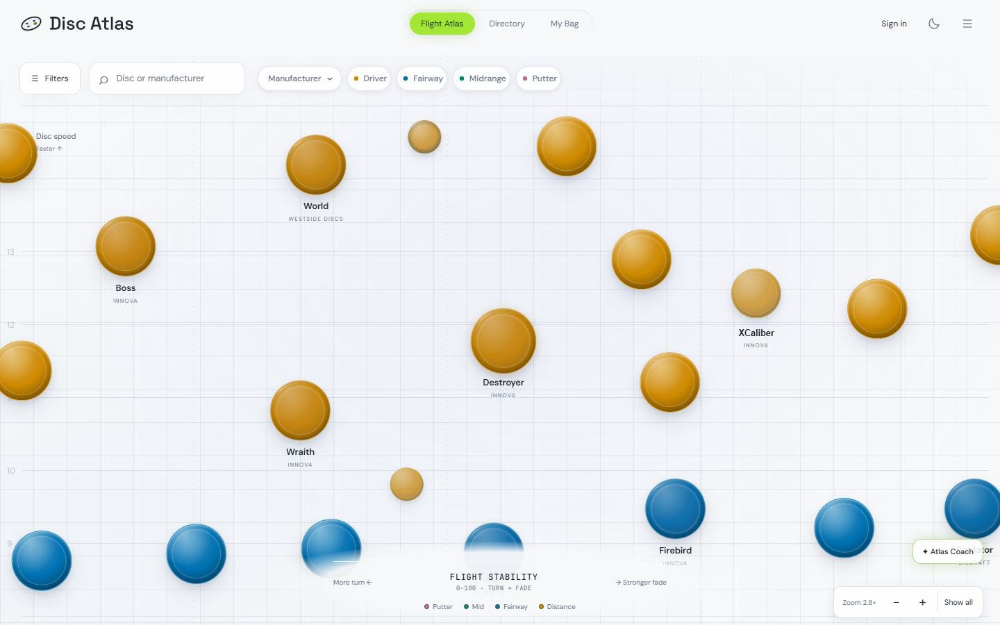
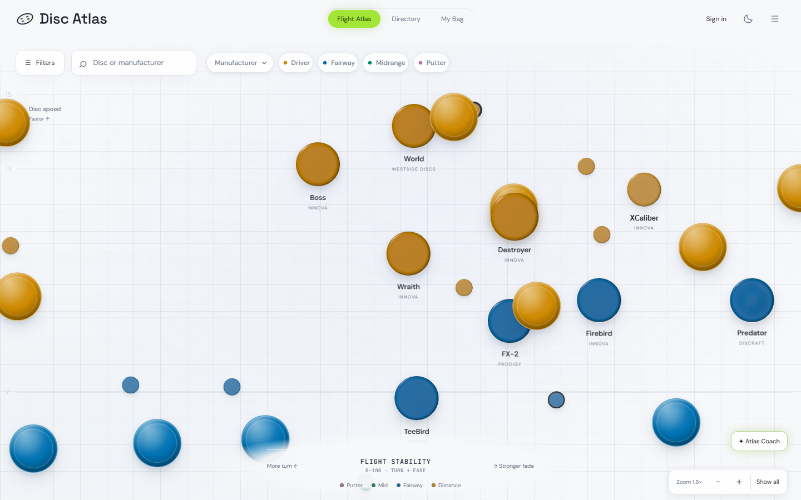
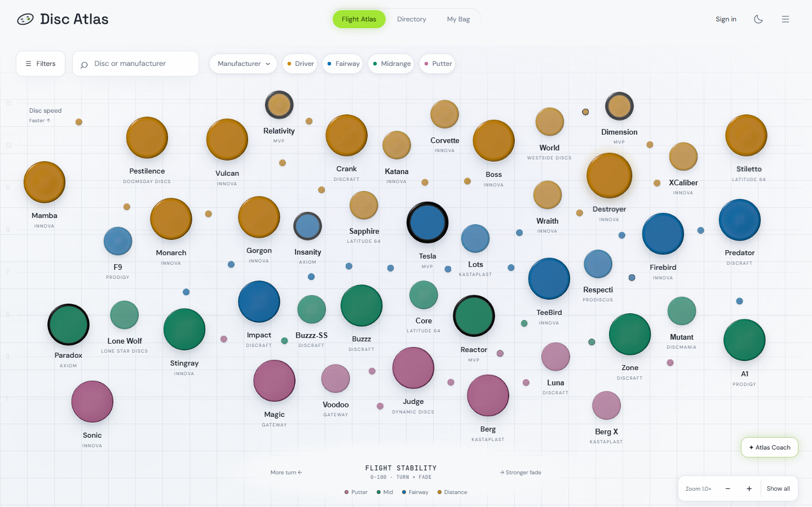
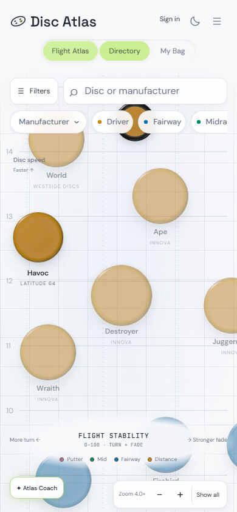
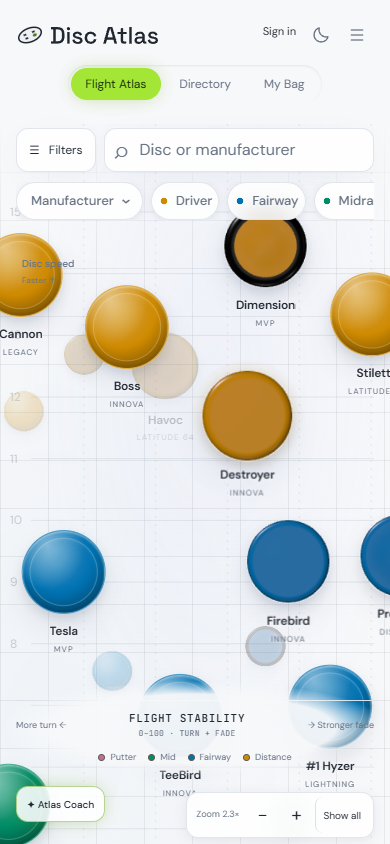
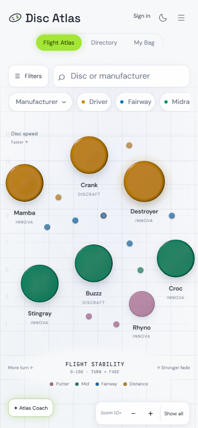

# Atlas opening: whole-atlas reveal

Branch `codex/atlas-intro-reveal`, based on `main` at `38a8c4a0`. Commit only; no push, merge or deployment. **Acceptance is incomplete:** strict resting-frame pixel equality and a green local performance gate remain unmet.

The first shared Atlas presentation establishes the Destroyer neighborhood, holds briefly, then retreats to the complete atlas. Desktop starts on page load. Phone still starts in Directory and consumes the reveal only when Flight Atlas first appears. Returning to Flight Atlas or reloading within the same browser-tab session opens directly at the fitted view.

## Camera and lifecycle

- The start uses the existing `focusFeatured()` camera unchanged: 2.8× desktop, 4× phone. The first animation frame retains this camera even when startup work delays that frame.
- `AtlasLayout.fit()` derives zoom and center from the actual displayed positions and viewport bounds, reserving 36px for art. It respects the existing 1–9× zoom range. The full catalog reaches the existing 1× floor; the existing curated overview supplies its footprint and chrome clearance. No catalog positions, grouping, spacing, rendering tiers, label rules or zoom limits change.
- The existing critically damped camera spring owns the entire move, its destination, velocity, RAF scheduling and LOD hold. The intro gives that same spring a slower response and a finite landing time. There is no second tween.
- Timing uses the existing motion tokens: one `--dur-ui` breath (180ms), followed by five `--dur-surface` units (1,400ms), totaling **1,580ms**. The completion lands on the exact fitted camera and clears the intro, destination and velocity. Ordinary wheel, drag, pinch and flick spring parameters remain unchanged.
- Document capture catches pointerdown, wheel, keydown and click before controls, markers or ordinary camera handlers see the intro destination. Events continue to their usual handlers. A tap catches without clicking through; a drag, wheel, pinch or key immediately works from the live camera. This also works during the breath.
- Reduced motion never starts the intro. Enabling it mid-reveal finishes directly at the fitted camera. Existing reduced-motion rules for user-driven camera movement remain unchanged.
- `sessionStorage['atlas-intro-seen']` records the first real presentation. In-memory state remains available if storage is blocked. A fresh reload still initializes the default Destroyer selection without replaying the reveal; later same-page presentations retain user selection.
- The atlas-side background bag-color refresh preserves an active intro. This avoids a startup refresh canceling the reveal. Actual user input still cancels before filtering. No bag files were edited.

## Proof frames

The browser test freezes only RAF advancement for these captures and calls the production `stepCamera()` at the indicated times. It also measures an uninterrupted reveal separately in real time. The end frames allow normal renderer settling after the camera lands.

| View | Start | Mid-reveal | End |
| --- | --- | --- | --- |
| Desktop, 1440 × 900 | 0ms, 2.8× | 400ms | 1,580ms, 1× |
| Phone, 390 × 844 | 0ms, 4× | 400ms | 1,580ms, 1× |

### Desktop

Start:

Mid-reveal:

End:

### Phone

Start:

Mid-reveal:

End:

## Verification

`npm run test:atlas:intro` runs camera tests and the browser proof harness. It covers actual-extent fitting at desktop and phone sizes, exact completion/no-animation camera equality, initial framing, interruption, reduced motion, session return/reload, delayed first paint and refresh-rate independence. The browser compares all final marker-art and label rectangles, transforms and canvas tier states against a direct no-animation opening; the resting geometry matches exactly. It also checks that no visible marker art or readable label crosses the map edges.

The input checks exercise actual pointer, wheel, touch/pinch and keyboard event handlers, including zoom controls and an otherwise unhandled key. They verify that a catch clears the intro and that normal handlers retain camera ownership.

The 3D browser suite's LOD-threshold setup now explicitly approaches from below. An opening pull-back can already have populated mid-LOD history; the test still uses every original threshold, hysteresis and rendering assertion.

The uninterrupted browser capture measured **1,583.3ms desktop / 1,583.2ms phone**. Full frame state and clipping results are in [measurements.json](assets/atlas-intro-reveal/measurements.json).

### First-frame measurements

Five alternating pairs used fresh browser contexts and the local static server. The old-opening comparison restores the two original opening call sites in the same served build. Phone uses 4× CPU throttling. These are navigation-to-first-Atlas-frame medians, including the first switch from Directory on phone; they are local diagnostics, not production network timings.

| Device | Old opening | Reveal | Difference |
| --- | ---: | ---: | ---: |
| Desktop | 336.7ms | 326.7ms | −10.0ms |
| Phone, 4× CPU | 2,278.9ms | 2,424.3ms | +145.4ms |

The phone now draws the requested close-up before retreating; its extra first-frame work is measurable. Input listeners are installed before catalog loading and there is no input lock or timer delaying presentation. Every sample is retained in [load-measurements.json](assets/atlas-intro-reveal/load-measurements.json); the navigation-to-frame values above are the comparison metric.

### Performance gate: failed locally, unchanged

The full `test:atlas:3d:perf` gate ran with its original 7 desktop / 3 phone warm repetitions, 241 flight frames and 120 overview frames per repetition. No gate code, thresholds, allowances or repetition defaults changed.

| Isolated reveal run | 2D median | 3D median | Allowed | Result |
| --- | ---: | ---: | ---: | --- |
| Desktop flight p95 | 4.1ms | 4.9ms | 6.215ms | Pass |
| Desktop 1× p95 | 0.9ms | 1.4ms | 2.535ms | Pass |
| Desktop long tasks | 0 | 0 | 1 | Pass |
| Phone flight p95 | 17.4ms | 17.5ms | 23.01ms | Pass |
| Phone 1× p95 | 3.0ms | 3.7ms | 6.45ms | Pass |
| Phone long tasks | 7 | 9 | 8 | **Fail** |

The same gate with the old opening restored also failed the phone long-task check: 2D median 7, 3D median 10, allowance 8; paired excess 3. All its frame-time checks passed. Thus this machine did not establish a green gate even without the reveal, and the failure cannot be attributed solely to the reveal.

Reports retain every cold and warm repetition: [isolated reveal](assets/atlas-intro-reveal/perf-isolated.json), [old opening](assets/atlas-intro-reveal/perf-old-opening.json). The earlier [contended run](assets/atlas-intro-reveal/perf-contended.json) overlapped a unit-test run and is retained for transparency, not used as the causal comparison.

### Remaining pixel discrepancy

Exact camera coordinates, all marker art and label rectangles/transforms, and canvas tier/size/position/fade/LOD states match the direct no-animation opening. **Raw resting-frame PNG equality does not pass on either desktop or phone.** The browser harness retains that failing assertion and saves both frames; it does not silently replace it with a geometry-only check. The comparison frames are [desktop completed](assets/atlas-intro-reveal/desktop-pixel-finished.png), [desktop direct](assets/atlas-intro-reveal/desktop-pixel-direct.png), [phone completed](assets/atlas-intro-reveal/phone-pixel-finished.png), and [phone direct](assets/atlas-intro-reveal/phone-pixel-direct.png).

The existing organic-layout browser suite passed its layout, clearance, coverage, cap and neighborhood checks, then failed `desktop full: same pixels`. Its old-opening diagnostic baseline passed all six checks, including fresh-page pixel determinism. This remains a reveal-related acceptance issue.

Review identified different canvas and DOM paint orders retained from camera history; canvas shadow rectangles can overlap even when disc/label footprints do not. Diagnostics that restored ordering and preserved entry state did not establish full PNG equality. No speculative change to marker rendering, labels, positions or disc-art modules was shipped.

### Other checks

- All **236 non-browser unit tests** run together passed, including seven focused intro camera tests.
- The 3D browser suite passed 11 checks, including tiers, full renders, themes, filters, selection, WebGL fallback and LOD hysteresis.
- The readable/clickable persistence suite passed 13 checks, including cursor anchoring, the 9× cap, pointer holds and fading pins.
- The speed-band browser suite checked 991 drawn discs without a position regression.
- The Apple camera/design browser suite passed 16 checks, including pan/pinch, momentum, catches, ordinary reduced-motion behavior and theme transitions.
- Repository lint reported 40 errors and 1,548 warnings in its full run. Comparing changed files against `main` found no added diagnostics; [comparison](assets/atlas-intro-reveal/lint-comparison.json). Existing lint errors were left untouched.
- Read-only review caught and verified the session-reload selection fix. The strict pixel issue and local perf gate are explicitly unresolved.

Further fix attempts stopped under the Map QA skill's two-strikes rule. This commit is reviewable work with recorded acceptance failures, not a claim that every requested gate is green.

## Feel check after a future deployment

No deployment was performed. On a real phone and desktop, cold-open a new session, confirm the close-up and breath, then grab the atlas during the retreat. It should be the player's immediately. Phone must still open in Directory. This local browser proof does not replace Freddy's real-device feel check.
