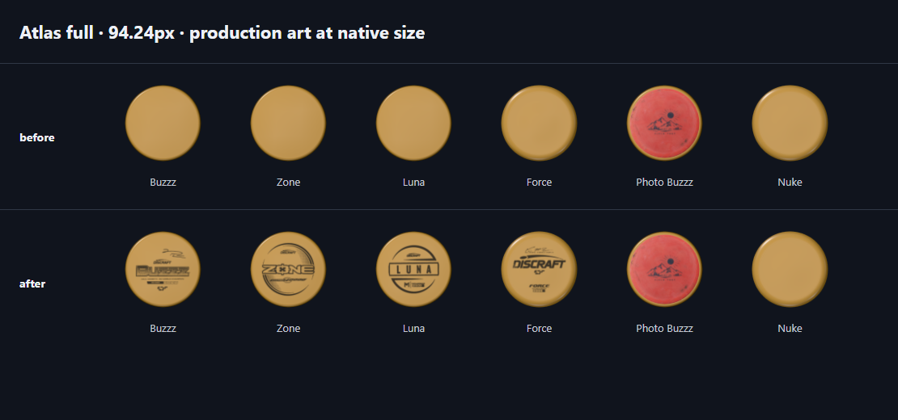

# Atlas stock stamps

## Surface audit and rendering contract

Base: `origin/main` **6e53bc8b629c63ac04777fe8400609cfc23cb2f3**, fetched October 16, 2026.
Branch: `codex/atlas-stamps`. Isolated worktree: `C:/Users/user/.codex/worktrees/atlas-stamps/disc-atlas`.
No push, merge, or deployment.

| Atlas surface | Display size / zoom | Personalized photo today | Official catalog stamp today | Work |
| --- | --- | --- | --- | --- |
| Curated, selected, pinned and satellite DOM disc art on neutral Atlas | 76–94.24px before existing selection/hover scaling; organic dots scale the same art from 50.67px upward | Full photo texture when the personal lens supplies one | Mold-shaped plate only; name/brand below | Add official stamp to full art |
| Canvas small discs | 50.67–94.24px across 1–9×; mid/full LOD | Photo-capable renderer (neutral lens itself supplies no owner photo) | Mold-shaped plate only; name rendered separately | Add official stamp at mid/full LOD |
| Canvas minis above low LOD | >24–94.24px; growing with zoom; mid/full held with existing hysteresis | Full photo texture when supplied | Mold-shaped plate only; labels fade in from 54px | Add official stamp at mid/full LOD |
| Canvas low-LOD minis | 12–24px nominal, with existing LOD hold/hysteresis | Renderer actually retains a downsampled photo; there is no photo cutoff | Plate only | Preserve existing pixels, keys and loading behavior |
| My Map large / satellite disc art | 68px art scaled by existing camera; full source image | Owner photo wins | Plate only | Official stamp only when there is no photo |
| My Map dots | 12px, low LOD | Downsampled photo actually renders | Plate only | Preserve existing tiny tiers |
| WebGL unavailable / disabled, pending first art | Existing CSS orb / canvas sprite | No photo texture | No stock artwork | Already parity; unchanged |
| Bag / collection thumbnails (reference, outside Atlas) | Visible row width | Full photo | Existing 2D official overlay | Already parity; unchanged |
| Detail and pop-out viewer (reference) | Existing live 3D mesh | Full photo, suppresses stamp | Official stock stamp or generated name design | Unchanged |

**Audit discrepancy:** the existing photo path is not readability-gated: `photoOf()` is called even for low LOD. The small-end preservation requirement takes precedence for this change: low LOD remains byte-for-byte as before, including existing owner photos. Freddy confirmed on October 17, 2026: preserve the ≤24px tiers and add official stamps above the existing 24px low-LOD boundary, without changing photo behavior. No new photo cutoff or name cutoff is introduced.

**Precedence:** an owner photo suppresses official artwork, including while the photo is loading. Otherwise, only a valid catalog `stampAsset` may produce Atlas artwork. No official asset means the current body and separate name/brand label. Generated rings, lettering and underline never enter the Atlas scene. Nuke is the explicit unstamped control; Force is a positive control. The baseline catalog carries 33 official assets; no mold names are used by production logic.

## Pipeline and cost findings

`atlas-map.js` routes DOM art through `syncMarkerArt → discArt`, canvas tiers through `drawGaps → discArt`, and idle warming through `warmArt`. All use the singleton `getAtlasArt()`. `photoDisc()` supplies the owner's URL only on My Map / a personal lens. `atlas-art.mjs` resolves the mold shape, renders an orthographic top view with one offscreen Three.js renderer, then stores a canvas image. DOM markers attach that image; canvas tiers blit it. Grouping, positions, click targets, label drawing and CSS sizes are independent.

Before this change, `thumbnails.mjs` already imports `catalogStampAsset`, `catalogStampPlacement` and `stampTexture`. It resolves official assets per visible host, tints their alpha at runtime, and overlays them at measured per-mold placement on a copy of the shared bare image. It never decorates the shared Atlas cache. The detail viewer independently uses the same stamp helpers plus `stampGeometry` and `stampMaterial`; the generated design is its immediate fallback. This is the point where Atlas and bag/viewer diverge.

Body image keys are disc ID, LOD, resolved plate color, resolved rim color, and photo URL. Pending photos have a separate pending key. Shape and geometry caches are separate. Images use a byte-capped LRU (64MB fine-pointer / 24MB coarse-pointer in the singleton; 48MB factory default), geometry has a 400-entry cap, and photo surfaces retain eight ready entries while allowing in-flight loads to finish. LOD source images are 24/64/96 CSS pixels at DPR capped to 2.

**Final result:** official stamp imagery is implemented at mid/full LOD; owner photos, unstamped controls, low-LOD pixels, labels and positions are preserved. All declared product regression commands have passing coverage, 231/231 JavaScript unit tests pass, the Workers build passes, and the final default perf gate passes. Three historical Python audit methods still fail identically on the untouched base (details below). Local commit authorized by Freddy on October 17, 2026; no push, merge or deployment.

## Implementation plan and execution record

This is a bounded change to the existing renderer, following the supplied parity spec. Implemented inline; local commit authorized by Freddy on October 17, 2026.

- [x] Trace marker, gap, thumbnail and viewer paths; record the table above.
- [x] Write the production GPU test; observe the expected missing-Buzzz-art failure.
- [x] Add an explicit sixth `official` argument (default false) to shared art `get/has/render`; opt in only from Atlas rendering and idle warming.
- [x] Reuse `catalogStampAsset`, `catalogStampPlacement`, `stampTexture`, `stampGeometry` and `stampMaterial`. Only a decoded official texture is attached to the scene.
- [x] Keep bare/photo/low keys unchanged. Decorated keys additionally include asset and placement. Loading and failed official assets show a bare plate, never generated artwork.
- [x] Add real-marker, owner-map, loading/error, low-pixel, and Nuke-viewer checks; capture native-size proof sheets.
- [x] Run the default performance gate before/after; retain the initial failed after run and the passing quiet rerun.
- [x] Finish every declared regression suite; preserve initial failures and record their verified resolutions.
- [x] Obtain independent code review; fix its single P2 resource-lifetime finding with two RED→GREEN async cache tests.

Review focus: personal photo while loading; failed stock assets; shrinking zoom borrowing cached art; future assets and placement changes; unchanged labels/click targets. The integration test exercises each except broad navigation, which is covered by the existing Atlas QA suites.

### Render cost and payload

Stock decoration is baked into the existing image: one additional stamp mesh draw when an uncached decorated image is produced, then the existing DOM attachment or canvas blit. It adds no per-frame live 3D scene. The image dimensions and byte cap are unchanged. Stamp geometry shares the existing 400-slot geometry LRU. Ready tinted stamp textures retain eight entries (512×512 RGBA, 1MiB each before GPU mipmaps); in-flight entries may temporarily exceed eight so loads can finish. The existing stamp helper retains at most twelve completed decoded masks.

The catalog's 33 approved PNGs already ship with the site: 2,940,518 bytes total, 15,093–258,385 bytes per asset. Atlas loads only the official assets it encounters above low LOD, using the existing same-origin asset path and browser cache. Buzzz 41,139 bytes; Zone 32,006; Luna 17,545; Force 190,554. No new artwork, catalog fields or vendor dependencies are added. Atlas adds the existing stamp module to its module dependency path.

The GPU integration benchmark measures 40 cold color variants at full LOD/DPR 2 after shape/shader warmup, including tint creation, rendering and canvas capture. It also checks that a cached image causes zero new renders. See `assets/atlas-stamps/measurements.json` for raw timings; these are diagnostic costs, not the performance acceptance gate.

### Default performance gate — final source

Unmodified `node tests/atlas-3d-perf.mjs`: desktop seven / phone three warm repetitions, one cold diagnostic flight per page, alternating 2D/3D order, 241 zoom frames plus 120 overview frames each; phone CPU 4×. No overrides or margin changes.

| Metric | Before | Initial after | Initial quiet rerun | Final after cache fix | Final limit |
| --- | ---: | ---: | ---: | ---: | ---: |
| Desktop 3D flight p95 | 3.7ms | 3.8ms | 3.8ms | 4.5ms | 6.1ms |
| Desktop 3D overview p95 | 1.1ms | 1.0ms | 1.1ms | 1.4ms | 2.535ms |
| Desktop 3D long tasks (median) | 0 | 0 | 0 | 0 | 1 |
| Phone 3D flight p95 | 10.7ms | **15.1ms, FAIL** | 10.8ms | 11.5ms | 15.42ms |
| Phone 3D overview p95 | 2.7ms | 3.3ms | 2.9ms | 3.6ms | 5.875ms |
| Phone 3D long tasks (median) | 5 | 4 (paired excess **+1, FAIL**) | 3 (paired excess −1) | 3 (paired excess −1) | 4 |

The first after run failed phone flight (limit 14.5ms, paired excess +0.7ms) and paired long tasks; the required quiet rerun passed every median and paired gate. Full distributions: `perf-before.json`, `perf-after-first.json`, `perf-after-quiet.json` in `assets/atlas-stamps/`. The final source passed on its first final run; no additional quiet rerun was needed. Final distributions: `perf-after-final.json` (also retained as `perf-after-final-first.json`). Before/after is 3D versus 3D; each gate also compares its own 2D control. Desktop 2D flight p95 moved from 3.3 to 4.0ms and phone 2D from 9.7 to 10.8ms across runs, so absolute before/after timings include machine variation. Final paired excess: desktop flight −1.585ms, phone flight −4.14ms, long tasks −1 on each device.

### Evidence and verification

- `full-parity.png`, `mid-parity.png`, `mini-readable-parity.png`: Buzzz, Zone, Luna, Force, a photo of Buzzz on the same mold geometry, and Nuke, before/after at native CSS size. The photo fixture is the existing approved test photo; its artwork need not depict Buzzz to test the owner-photo projection and size.
- `tiny-parity.png`, `low-boundary-parity.png`: unchanged tiny controls.
- `before/after-<mold>-atlas-full.png`: actual largest Atlas markers and their existing name/brand labels.
- `before/after-nuke-viewer.png`: untouched generated viewer artwork.
- `before/after-atlas.png`: actual Atlas view.
- `tests/atlas-stamps-browser.mjs`: production pixel checks, real `discArt` and `photoDisc` calls, label/position/size equality, cache identity, source-error behavior and Nuke viewer texture equality.
- 231/231 JavaScript unit tests pass in the final full run, including both cache-lifetime regressions, photo-editor races and photo-textures. `regression.json` retains the initial full-suite run; `final-checks.json` retains targeted reruns and final verification.

AST-only graph refreshed in the owning worktree after code changes; no other agent was modifying it. Existing `.env*`, `.dev.vars*`, credentials and document exclusions were checked. No semantic extraction, labeling, API key, push, merge or deployment. Freddy's post-deploy feel check remains for the authorized deployment stage.

### Independent review

A fresh read-only reviewer found one P2 in the new stamp-cache lifetime: completed bursts could retain more than eight ready textures, and insertion could dispose the current ready texture while older loads were pending. Both cases were reproduced against the production cache logic with controlled async completion boundaries in `tests/atlas-stamp-cache.mjs` (33 retained instead of eight; returned texture already disposed). Both pass after the single fix pass: trim on completion and insertion, protect the current key, and allow other pending loads to finish. No other actionable functional issue was found. The final full-unit, GPU proof, Workers build and default performance runs all passed against this fix.

The reviewer did not independently rerun GPU/performance suites, and source-verified loading-photo suppression because the integration photo is preloaded for the owner-map call. Broad interactions use the existing regression suites. The low-tier product discrepancy remains explicitly documented above.

### Historical audit baseline

Bundled Python with Pillow/NumPy runs 21 tests: 18 pass, with these three historical pre-merge `stamp_fraction_audit_test.py` failures:

- `test_all_artwork_and_renderers_are_byte_identical`: compares all current assets against `ba081fd`, which predates Anax and other later assets.
- `test_catalog_identity_and_only_fourteen_placement_additions`: asserts the old catalog and exactly fourteen placements.
- `test_exactly_fourteen_backfills_and_other_entries_unchanged`: disallows the later pilot placement additions.

The same three fail on the untouched recorded base checkout (`6e53bc8b629c63ac04777fe8400609cfc23cb2f3`): five audit methods run, two fail, one errors. They are pre-existing, not a green suite, and were not weakened or rewritten in this imagery change. The initial system-Python run additionally lacked image libraries; the bundled-runtime result is the meaningful Python result.

Catalog validation passed in UTF-8 mode: all 2,434 approvals, 1,182 flight matches and 33 official stock stamp assets/rights records. No catalog or art asset changed.

## Final regression disposition and proof

All 44 declared test commands are covered: the 41 distinct original product suites, the new `test:atlas:stamps`, the unchanged default `test:atlas:3d:perf`, and the duplicate pop-out alias covered by the aggregate `test:disc3d`. Three initial browser failures were investigated and resolved in test assumptions, with production layout/menu code unchanged:

- `test:atlas:organic`: exact fresh-page pixel equality now waits for finished model/stamp images and their fade rather than assuming a fixed 450ms delay implies asset readiness. Exact equality remains required. Rerun passed.
- `test:atlas:3d`: the old brand-color sample fell on Buzzz's new official ink. The assertion now measures exposed plate pixels identified against the bare body reference; the independent palette token and original `off < 60` threshold remain, with at least 32 exposed samples required. Rerun passed.
- `test:lens:corner`: its immediate visibility checks ignored the existing 150ms `display: allow-discrete` menu exit. Escape, second-click, outside-click and Tab now assert `hidden` immediately, then wait for visibility to finish; the original closing and focus expectations remain. The first partial timing repair reached a later equivalent assertion; all equivalent close assertions were then updated together. The full four-width / three-theme suite passed.

All photo suites passed: textures/editor races, phone workflows, rim colors, viewer edge and Atlas edge. Atlas depth, persistence/targets, interaction suites, filtering, directory, detail/pop-out and bag regressions passed. Final build: `node scripts/build-workers.mjs` exited 0. Final AST refresh exited 0, producing 2,434 nodes / 4,938 edges / 148 communities, without LLM labeling or API calls.

Diagnostic full-size per-disc cost after warmup: official stamp **0.655ms** versus bare body **0.128ms** (40 cold color variants, DPR 2); cache-hit renders **0**. This is separate from the unchanged macro perf gate.

[Mid tier](assets/atlas-stamps/mid-parity.png) · [Growing mini](assets/atlas-stamps/mini-readable-parity.png) · [Tiny](assets/atlas-stamps/tiny-parity.png) · [24px boundary](assets/atlas-stamps/low-boundary-parity.png)

| Actual largest Atlas marker | Before | After |
| --- | --- | --- |
| Buzzz | [Before](assets/atlas-stamps/before-buzzz-atlas-full.png) | [After](assets/atlas-stamps/after-buzzz-atlas-full.png) |
| Zone | [Before](assets/atlas-stamps/before-zone-atlas-full.png) | [After](assets/atlas-stamps/after-zone-atlas-full.png) |
| Luna | [Before](assets/atlas-stamps/before-luna-atlas-full.png) | [After](assets/atlas-stamps/after-luna-atlas-full.png) |
| Force | [Before](assets/atlas-stamps/before-force-atlas-full.png) | [After](assets/atlas-stamps/after-force-atlas-full.png) |
| Nuke, name retained, no stamp artwork | [Before](assets/atlas-stamps/before-nuke-atlas-full.png) | [After](assets/atlas-stamps/after-nuke-atlas-full.png) |

Nuke's unchanged generated viewer stamp: [before](assets/atlas-stamps/before-nuke-viewer.png) / [after](assets/atlas-stamps/after-nuke-viewer.png).

The low-LOD rule is confirmed by Freddy (October 17, 2026): preserve ≤24px tiers, including existing downsampled owner photos; official stamps start above the existing low-LOD boundary. Existing LOD hold/hysteresis and photo behavior remain unchanged. The implementation already followed this choice; confirmation requires no rendering change.

Local commit authorized by Freddy on October 17, 2026 in the isolated branch. No push, merge or deployment; Freddy's requested live zoom/feel check remains for the deployment stage.
