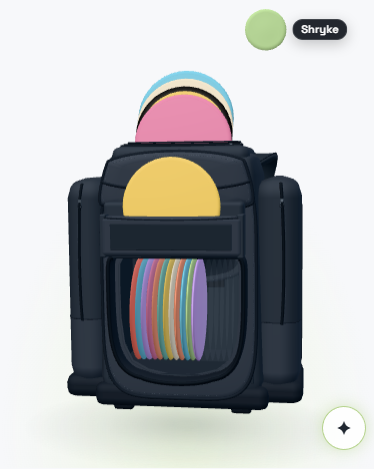
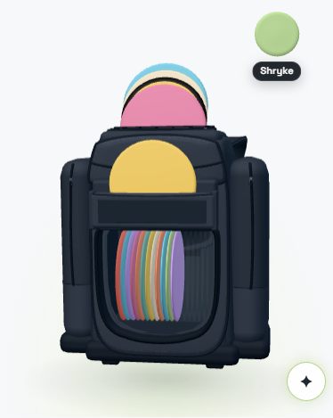
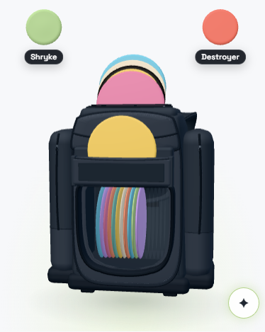
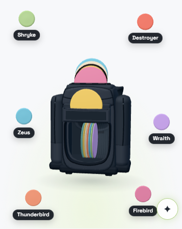
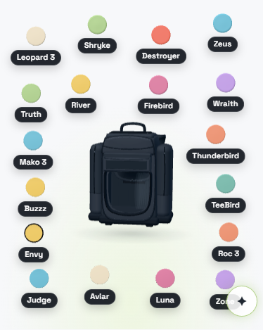
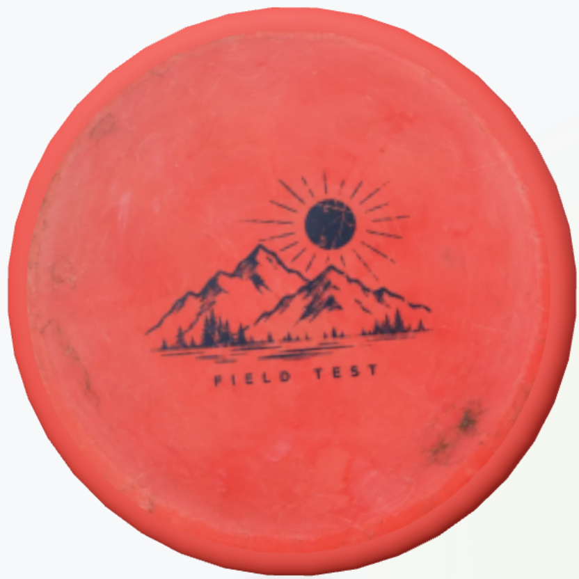
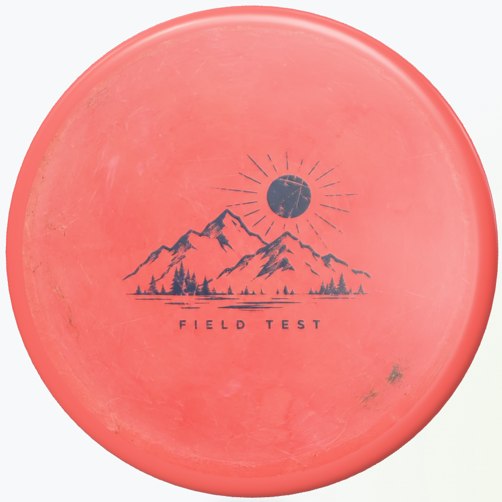
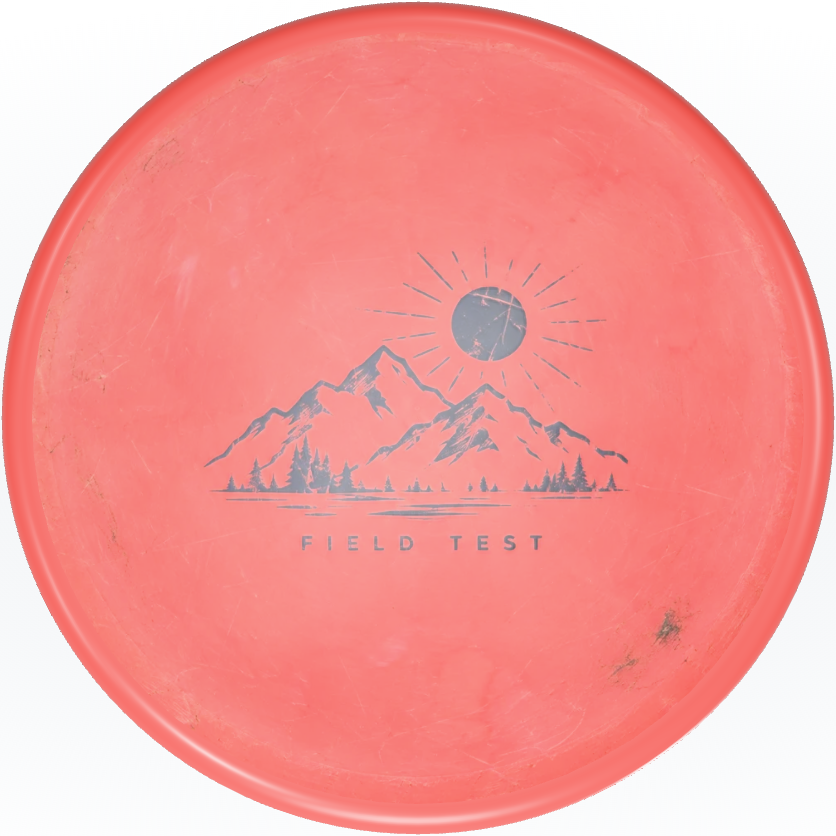
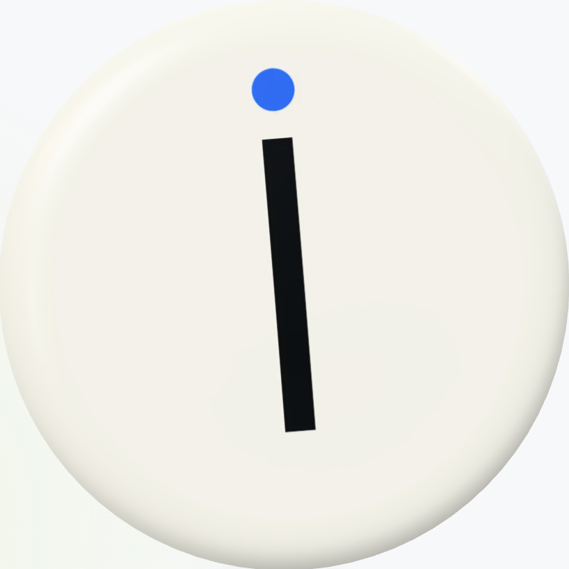
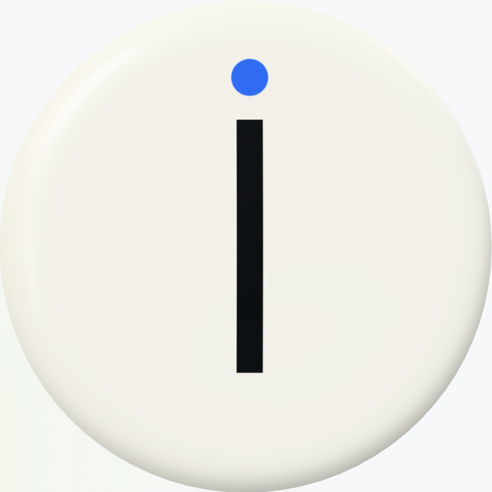

# My Bag: pulled discs — sizing, quality, upright

October 15, 2026. Branch `codex/bag-pulled-disc-sizing`, based on `main` at `522df14`.
Codex Sol built the desktop sizing (`c5d6d7e`); Claude Opus took the branch over,
reviewed it, fixed its floor, and added the quality and upright work in the commits
after it. Nothing is pushed, merged or deployed: Freddy reviews the screenshots first.

## For Freddy, in short

- **Sizing** (Sol's design, kept): 1–2 discs out ≈ 410 px, shrinking smoothly as more
  come out. **Changed:** a whole bag out now lands on **124.45 px, the size pulled
  discs had before** (Sol landed it on 85.83 px, which made 11–18 out *smaller* than
  before). At 1440 × 1000 no count is smaller than it used to be.
- **Quality:** a large pulled disc is now drawn the 3D viewer's way: the viewer's
  1024 px photo with its relief, the viewer's finer disc shape and plastic, rendered
  at full screen resolution. Before, it was a 256 px photo stretched to 816 screen
  pixels from a 581 px render. [Side by side below](#quality-pulled-vs-the-3d-viewer).
- **Look:** large pulled discs now wear the viewer's premium plastic, so beside the bag's matte discs they read glossier and a touch lighter, as they do in the viewer. A whole bag out keeps the bag's matte look.
- **Upright:** stamps now stand straight: **−4.6° → 0.00°**. Two causes, both fixed:
  the turn that faces the disc to the camera also rolled it, and the bag's idle float
  rocked and bobbed the pulled discs with it.
- **Phone** (your pick of option 2, narrowed after measuring): one or two discs out grow
  into the room above the bag, **41.4 → 50.3 px at 390 px wide** and up to the 80 px cap on
  wider phones. Three or more out keep today's layout exactly. Details
  [below](#phone-one-or-two-out-grow-above-the-bag).

## Review of Sol's sizing

Verdict: **the design is sound and the code is careful; one real defect (the floor),
plus two smaller findings.** Re-run, not assumed:

| Check | Result |
| --- | --- |
| Curve monotonic, endpoints pinned | ✔ Unit tests (8/8 in `tests/bag-pulled-sizing.mjs`) and measured: every count 1–18 below, at two desktop sizes. One→two out is an intentional plateau (one disc per side). |
| Labels follow during the 300 ms glide | ✔ Browser suite samples every frame; glide reaches its size in ≈298 ms. |
| No overlap: discs, names, bag, edges | ✔ 0 overlaps at all 18 counts, at 1440 × 1000 and 1280 × 900 (own sweep, rest boxes). But see the float bob below: the drawn disc could drift 8 px off its rest box. Fixed. |
| **Floor = size before the change** | ✘ **Fixed.** See next section. |
| Phone | Left unchanged by Sol. Now grows one or two discs out (below). |
| Legacy `bag-interactions` failure | Pre-existing on `main`; left alone (evidence kept, see Verification). |

Smaller findings:

1. **Measured diameters were 0.3% low.** The rectangles Sol measured (and this doc's
   old tables) sample the rim at 24 points; with the disc rolled ~4.6° (the upright bug)
   the samples miss the circle's extremes. Sol's 124.05 / 85.55 px are really
   **124.45 / 85.83 px** drawn. All numbers here are measured upright.
2. **The doubled Destroyer** in Sol's all-out screenshot is not a second disc. After
   details close with Escape, focus returns to the Destroyer's hit target, which draws
   a green focus ring at the disc's rest position; the bag's idle float had bobbed the
   disc itself 8 px up from there, so its red edge peeked out above the ring. Pulled
   discs now hold still (Upright, below), so disc, ring and name line up.
3. Sol's commit swept in an unrelated reformat of `wrangler.public.jsonc` (same JSON,
   tabs instead of spaces). Restored to `main`'s file in its own commit.

### The floor

Freddy's rule: all-out ends at the size discs had before this change, never smaller.
The original planner drew every pulled disc at **124.45 px** (1440 × 1000) until the
bag got crowded, then shrank them: 111.57 px at 14–16 out and 85.83 px at 17–18.
Sol took that crowded all-out size as the floor, so counts 11–18 ended up smaller
than they used to be. Sol's own side-zone packer fits all 18 at 124.45 px with no
overlap and no camera pull-back, so the old shrinking was the old planner's limit,
not the screen's.

The floor is now the original planner's **uncrowded** size. Where the page camera
cannot pack every count at that size, the floor is the largest size that does,
never below the original all-out size. Every disc of the 18-disc demo, by count
(measured, upright, px):

| Out | Before (original) | Sol | Now | | Before, 1280 × 900 | Now, 1280 × 900 |
| ---: | ---: | ---: | ---: | --- | ---: | ---: |
| 1–2 | 124.45 | 409.54 | 409.54 | | 109.81 | 359.00 |
| 3 | 124.45 | 267.32 / 409.54 | 283.83 / 409.54 | | 109.81 | 243.72 / 359.00 |
| 4 | 124.45 | 267.32 | 283.83 | | 109.81 | 243.72 |
| 5 | 98.70 | 204.31 / 267.32 | 228.33 / 283.83 | | 87.09 | 192.65 / 243.72 |
| 6 | 124.45 | 204.31 | 228.33 | | 109.81 | 192.65 |
| 8 | 124.45 | 166.75 | 195.33 | | 109.81 | 162.20 |
| 10 | 124.45 | 141.12 | 172.84 | | 109.81 | 141.42 |
| 12 | 124.45 | **122.20** | 156.26 | | 109.81 | 126.09 |
| 14 | 111.57 | **107.50** | 143.39 | | 98.45 | 114.17 |
| 16 | 111.57 | **95.64** | 133.03 | | 87.09 | 104.56 |
| 18 (all) | 85.83 | 85.83 | **124.45** | | 75.73 | **96.60** |

Odd counts list both sides (the side with fewer discs is larger). Bold: Sol below the
original. 0 overlaps and no camera pull-back in every row of both sizes.

**1280 × 900 constraint, in numbers:** nine discs plus names per side do not pack at
the uncrowded 109.81 px in the side zones at the page camera; the largest that does
is **96.60 px** (the planner's own packing, binary-searched). Holding 109.81 would
mean pulling the camera back and shrinking the bag at full count, which neither
planner does for this; so 1280 lands at 96.60, still 28% larger than its original
75.73 px all-out, and every count stays larger than before. The 32-disc test bag
likewise lands at 88.67 px, above its original 65.58 px floor.

(The original planner's 5-out dip to 98.70 px is its own quirk, reproduced on its code.)

### Phone: one or two out grow above the bag

You picked option 2 on October 15 (grow above the bag, 50–80 px for one or two out,
shrinking to today's sizes, never below them). Measuring before building changed two
assumptions, and you then narrowed it to **one or two out only, every other count exactly
as today, no smooth-shrink requirement**. That is what is built.

**What the measurements found:**

1. **The putters stand above the bag.** The write-up's 115 px "bag top" was the bag body.
   The putters standing in their pocket reach **y ≈ 70 px** (390 wide, one out), across the
   middle of the bag. What is free above the bag is the two corners beside them: 82 px tall
   after the 12 px edge and 24 px bag clearance, about 100 px wide. A name beside the disc
   leaves it ~30 px; a name under it leaves **50 px**. So 390 lands at the band's floor, not
   in its middle.
2. **Today's phone sizes are not a smooth 27–41 px range.** The original scatter picks a
   different camera pull-back at each count, so its sizes jump (390 wide: 41, 41, **47, 47**,
   41, 34, 33, 32, **43, 43**, 34, 33, 23, 23, 25, 32, 23, 27 for 1–18 out). With "never
   below today", a smooth shrink would have had to hold counts 1–10 at 43 px or more, and
   each count's future size depends on which discs come out next. Hence the narrower build.

**What was built** (`public/bag3d/pulled-sizing.mjs`, phone half; the viewer's
`stageDiscs`; the phone opt-in in `bag-scene.js`):

- On a phone (≤ 700 px), with **one or two discs out**, the original scatter runs first, as
  today, and fixes the camera. The phone planner then lays the discs in rows, top first,
  on their stability side, faster higher. It keeps clear of the **bag body and each standing
  disc apart** (24 px), 12 px from the canvas edges, and 12 px between footprints. Each disc
  is drawn as large as fits, with its name under it or beside it, whichever is larger, up
  to 80 px.
- It runs at **the camera the scatter chose**, so the bag is pixel-for-pixel the size it was
  (the suite asserts the same pull-back and bag box at every count). It is used only if it
  beats today's size, and each layout is also projected for real at that camera (bag body
  and standing discs apart) before it is taken; otherwise today's layout stays.
- **Three or more out:** the planner does not run; today's scatter, sizes and positions,
  exactly (asserted at 6 and all out, at three widths).
- **Upright holds:** grown discs use the same facing and hold-still as everything else on
  this branch. The phone stamp reads **0.000°** at three moments across the float (3× display).
- **Texture:** a phone pulled disc stays on the bag's own path (it is far below the 128 px
  detail-look threshold), whose photo is the 256 px tier. 80 px × 3 = 240 device px, so 256
  covers it. The cap is also `256 / devicePixelRatio`, so a denser display gets a smaller
  cap instead of an upscaled photo. Measured on a 3× phone: a grown photo disc at 77.7 px
  = 233 device px on the 256 photo. No second quality path.

**Per count, before → after** (px, measured upright, 18-disc demo;
[all counts](assets/bag-pulled-disc-sizing/phone-per-count.json)):

| Out | 360 wide | 390 wide | 430 wide |
| ---: | ---: | ---: | ---: |
| 1 | 38.17 → **40.39** | 41.42 → **50.31** | 39.66 → **80.00** |
| 2 | 38.22 → **40.25** | 41.29 → **50.67** | 39.66 → **80.00** |
| 3 | 28.49 | 46.91 | 52.46 |
| 6 | 27.10 | 33.67 | 33.67 |
| 9 | 38.45 | 42.82 | 43.07 |
| 18 (all) | 20.81 | 27.28 | 32.68 |

Counts 3–18 are unchanged, by design. **Where the band landed:** 50.3–50.7 px at 390
(height-bound: the name under the disc in a corner beside the putters), the 80 px cap at
430 (the scatter's own camera sits further back there), and a 2 px gain at 360, where the
demo's two first names (55 and 72 px) just fit a corner (the widest name, 85 px, would not).

**Left undone, deliberately:**

- **No smooth shrink** (your call). So at 390, 3 out (46.9, today's size) is a little
  smaller than 2 out (50.7), and some later counts are larger than earlier ones, as today.
- **Collapsed putter pocket:** with the putters down, the space above the bag is the
  full width, and the scatter already draws one out at 54.9 px. The planner uses whatever
  is free, so it grows that further, to ~68 px at 390 (measured on the prototype, not
  asserted by the suite).
- The phone canvas still draws at most 2× on a 3× display (the bag's pixel budget, as
  before): a grown disc is rendered at 2× and its 256 photo covers that.
- Larger growth on a 390 phone would need the putters moved, the names placed elsewhere,
  or the camera pulled back (rejected option 3).

| One out, before (41.4 px) | One out, now (50.3 px) | Two out (50.7 px) |
| --- | --- | --- |
|  |  |  |

| Six out (unchanged, 33.7 px) | All out (unchanged, 27.3 px) | Upright on a 3× phone |
| --- | --- | --- |
|  |  |  |

## Quality: pulled vs the 3D viewer

Diagnosis, measured on a 2× (Retina) display at 1440 × 1000, the same photo disc
(Buzzz with the Plan 22 stamped-disc fixture) pulled at the max tier vs the viewer's
pop-out from the top at the same on-screen size:

| | Pulled, before | Pulled, now | 3D viewer |
| --- | --- | --- | --- |
| Photo texture | **256 px** (bag thumbnail tier), no relief | **1024 px + relief** | 1024 px + relief |
| Canvas pixel ratio | **1.42** (bag's 2.4 M-pixel cap) | **2** | 2 |
| Disc rendered / shown (device px) | **581 / 816** (upscaled 1.4×) | 819 / 819 | 819 / 819 |
| Lathe | 40 steps, half profile detail | 80 steps, full detail | 80 (panel) / 128 (pop-out) |
| Material | bag GLB disc: matte standard, no clearcoat | viewer's premium plastic (physical, clearcoat) | premium plastic |
| Room light on the plastic | 0.55 × exposure 0.75 | matched to the viewer's 0.85 | 0.85 |

Three things stacked up: the texture tier (4× too few pixels), the canvas budget
(rendered at 71% of display size, then stretched), and the cheaper bag-interior
material. All three are closed for large pulled discs.

**What changed** (no second quality implementation):

- `public/disc3d/quality.mjs` (new) holds the viewer's quality settings: lathe steps
  (80, or 56 on touch), profile detail, the 2× pixel-ratio cap, room-light strength,
  and Plan 22's photo tiers. The 3D viewer now reads its numbers from there (same
  values; its rendering is unchanged, `test:disc3d` passes). The pulled disc reads
  the same ones, so the two cannot drift apart.
- A pulled disc **larger than the old pulled size (> 128 px)** is drawn the viewer's
  way: the viewer's lathe, the viewer's default premium plastic lit as strongly as the
  viewer lights it, and `photoSurface` called exactly as the viewer calls it (relief
  on; the viewer's default 1024 size for a large disc). While any such disc is out, the
  bag canvas draws at the viewer's pixel ratio.
- **Quality scales with size.** Over 256 px (the max tiers): the viewer's own 1024
  photo on any display. 129–256 px: the smallest tier that covers its device pixels
  (e.g. 6 of 12 out at 206 px on a 2× display: 512). At or below the old size (a whole
  bag out): the bag's own lighter path, unchanged, and the canvas returns to its pixel
  budget. A photo only trades up while its disc is out, keeps showing the old photo
  until the new one is decoded, and shares the viewer's texture cache (opening details
  for that disc reuses the decoded photo). Discs change back once they have shrunk
  (after the size glide) or are home in their pocket. Software (low-quality) rendering
  is untouched.
- Cost: with a large disc out on a 2× display, the bag canvas draws 2784 × 1700
  (4.7 M px) instead of 1982 × 1210 (2.4 M px). It returns to the budget when the large
  discs go. Frame time at 4.7 M px was not measured on your hardware.
- **First pull stall, found and fixed.** The two new shader programs (premium plate;
  photo with relief) compiled on first use cost two ~150–180 ms main-thread tasks on
  the first large pull (Sol's code: none). On a desktop page the bag now compiles them
  in the background 1.5 s after it loads (`compileAsync`). Measured three times since:
  no long task on the first pull, the second, or while idle.

| Pulled, before | Pulled, now | 3D viewer, same size |
| --- | --- | --- |
|  |  |  |

**Remaining gap, deliberately not closed:** lighting direction. The viewer lights the
disc with its own studio lights from above; the pulled disc stands in the bag's scene
and is lit by the bag's lights. So the relief ink reads silvery in the viewer and
navy beside the bag, and highlights fall differently. Matching that would mean a
second light rig or render pass for pulled discs; ask if you want it. A pulled disc
off to the side also shows a sliver of its rim wall: its face is kept exactly
parallel to the screen (so the stamp is never keystoned), and in perspective that
shows a little of the side, like a coin seen off-centre.

## Upright: diagnosis and fix

Fixture: a generated disc photo whose only stamp is one vertical bar with a blue dot
above it, uploaded through the real photo pipeline. Its orientation is known, so the
rendered bar's angle *is* the presentation's roll (measured from the pixels: principal
axis of the bar, + = clockwise). In the 3D viewer it reads **0.000°**.

Pulled out of the bag (before): **−4.0° to −5.1°**, depending on the moment. Two
presentation causes, no texture cause:

1. **Facing roll, −4.6°.** A pulled disc is turned to face the camera with the
   shortest turn from its face axis to the view axis. Because the page camera looks
   from above and to one side, that shortest turn also rolls the disc about its face.
   Fixed with `uprightFacing`: the face still lies exactly parallel to the screen, and
   the disc's up is now the screen's up. This is **the identical hunk** already on
   `codex/photo-glare-orientation` (applied verbatim), so the two branches merge
   cleanly.
2. **The idle float, ±0.57° and ±8 px.** The bag gently bobs and rocks, and pulled
   discs, being in the same group, bobbed and rocked with it, while their names, hit
   targets and focus rings stay at rest. A pulled disc now holds still against the
   float (it fades in with the travel out). This also removes the "doubled Destroyer".

After: **−0.004°** at four moments across the float cycle; the drawn stamp moves
0.00 device px between them.

| Before (old facing) | Now |
| --- | --- |
|  |  |

**Separate from this fix:** a photo that was shot or aligned crooked has its tilt in
the texture itself. This branch does not re-level textures; that is the "Level stamp"
work on `codex/photo-glare-orientation` (built, not landed). With both, a level stamp
reads level in the bag, the panel and the pop-out.

Scope: My Bag's pulled discs only (desktop and phone, since both are My Bag's pulled
view). The atlas, Storage racks, the bag interior and the 3D viewer's own poses are
untouched.

## Sizing screenshots (desktop, 1440 × 1000, 18-disc demo)

| One out | Two out (max tier) |
| --- | --- |
|  |  |

| Six out | All 18 out (124.45 px, the size before) |
| --- | --- |
|  |  |

Phone: [above](#phone-one-or-two-out-grow-above-the-bag).

Pre-change evidence (Sol's captures of the original planner):
[18 out](assets/bag-pulled-disc-sizing/baseline-1440-18.png),
[6 out](assets/bag-pulled-disc-sizing/baseline-1440-6.png),
[reference pair](assets/bag-pulled-disc-sizing/reference-1440-2.png),
[phone, one out](assets/bag-pulled-disc-sizing/baseline-390-1.json),
[phone, all out](assets/bag-pulled-disc-sizing/baseline-390-18.json).

## How the sizing works (Sol's design)

`public/bag-scene.js` gathers the pulled IDs, Atlas stability/speed, and measured
HTML labels. Only `BagScene.stageOut()` at viewport widths above 700 px enables
`desktopSizing`; every other caller keeps the original planner, except a phone with one or
two discs out ([phone](#phone-one-or-two-out-grow-above-the-bag)).
`assignSides()` ranks the pulled set by stability: the less overstable half left,
the more overstable half right; faster discs higher on each side. A pixel-space
planner in `public/bag3d/pulled-sizing.mjs` packs complete disc + name footprints
beside the bag and the viewer projects their centres back onto the disc plane.

For each side, `n` is its current count and `N` its count with the complete bag out:

```text
w(n, N, p) = (n^(-p) - N^(-p)) / (1 - N^(-p))
diameter(n) = floor + (max - floor) * w(clamp(n, 1, N), N, p)
```

`p = 0.5` by default (inverse square root): area pressure drops quickly as neighbours
arrive, then approaches the floor gently. Continuous and strictly decreasing from
`diameter(1) = max` to `diameter(N) = floor`. If a dense bag needs faster decay, the
least exponent in 0.5–8 that fits every count is used. Max and exponent are frozen
against the complete bag, so camera pull-back can never make discs grow as more come
out. The planner keeps 12 px from canvas edges, 24 px from the bag's projected
silhouette, each label's measured size plus a 6 px name gap, and 12 px between
footprints. Where the floor cannot be held at all, the original planner is kept.

Size changes glide over **300 ms** (cubic ease-in-out), depth-compensated so the
650 ms restage of the centre does not stretch them; names and hit targets follow the
live rim; reduced motion stays instant.

## Verification

All on this machine, GPU Chromium (`--use-angle=d3d11`), October 15.

| Check | Result |
| --- | --- |
| `npm run test:bag` (unit) | ✔ 69 passed (68 before + the tier rule) |
| `npm run test:bag:pulled-quality` (new) | ✔ Max tier: detail look, 1024 + relief, 80 steps, pixel ratio 2, rendered = shown (818.4 / 818.4 px); 512 tier at 206 px; all out back on the bag path (256, 40 steps, ratio 1.42); home again: nothing left on the detail look; stamp −4.57° with the old facing (control) → −0.004°, 0.00 px drift across the float; viewer pop-out at the same size wears the same photo tier and pixel ratio |
| `npm run test:bag:pulled-sizing` (Sol's, floor updated) | ✔ All checks, final code: sizes, bounds, labels following the live rim, 300 ms glide (reached in 305 ms), return, turned bag, details open/close, 1280, 32-disc bag (full count 88.67 px, above its original 65.58); phone: see below |
| Other bag suites | ✔ staging (13 checks, counts 1–24, three themes), demo, 3D, scene, spin/pocket, popup, switch/dump, map controls, overmold, pockets. bag-3d failed once inside a parallel run (its colour crop hit the bag behind a disc still mid-way; it also tripped its phone idle long-task gate under the run's CPU load) and passed 5 of 5 alone, including on the final code. |
| 3D viewer and photo suites | ✔ `test:disc3d` units + browser + pop-out (the viewer reads the shared constants with unchanged values); `test:photo-textures` units + browser; `test:photo-rim` |
| `tests/bag-interactions-browser.mjs` (legacy, unregistered) | ✘ as before: times out at line 159 waiting for details on the first disc click, the October 5 behaviour Sol documented as reproducing on `522df14`. Not registered in `package.json`; left alone. |
| ESLint, changed files | 0 errors; 2 pre-existing warnings in the viewer's `renderNow` |

Tests added: the tier rule (unit, `tests/bag-pulled-sizing.mjs`), and
`tests/bag-pulled-quality-browser.mjs` (quality tier by size, pixel ratio vs display,
upright stamp within 0.5° with a control that must see the old roll, stillness).
Sol's suite now asserts the new floor (all out = 124.45 px at 1440; 1280 above its
original all-out; the 32-disc bag never below its original floor).

**Phone growth, re-verified on the final code** (same machine and flags):

| Check | Result |
| --- | --- |
| `npm run test:bag` (unit) | ✔ 71 passed (+2: the phone planner keeps 24 px off the bag body and each standing putter, lands 50 px in the 390 corners with names under, stops at the 80 px cap, and reports no room where a 99 px name cannot fit a 360 corner) |
| `npm run test:bag:pulled-sizing` | ✔ Desktop as before, plus phone at **360, 390 and 430** wide, 1, 2, 6 and all out, each against a live "before" page with the phone opt-in switched off: never smaller; same camera pull-back and bag box at every count; 1–2 out ≥ 50 px and above the bag at 390 and 430, ≤ 80 px and ≤ 256 / 3; 6 and all out exactly where they were (every disc within 0.2 px); zero overlaps among discs, names, bag, standing discs, canvas edges and the phone's controls |
| `npm run test:bag:pulled-quality` | ✔ As before, plus a 390 px phone at 3×: grown photo disc 77.7 px (from 51.8), bag path, 256 photo, 233 device px; fixture stamp **0.000°** at three moments across the float |
| `npm run test:bag:staging` | ✔ 13 checks, after one update: its side check assumed every phone disc rests beside the bag at the original common scale. It now accepts a grown phone disc (above the bag, in its side's half). Its 360 px sweep (1–24 out, three themes) also passes: nothing overlapping, the bag's standing discs and controls included. |
| Other bag suites, run one after another | ✔ demo, 3D, scene, spin/pocket, popup, switch/dump, map controls, overmold, bag browser, collections, memorial, v13; `test:disc3d` |
| `test:photo-phone` | Not run: this machine lacks Playwright's WebKit build (`webkit-2359`); the suite fails at launch. Photo code is untouched. |
| ESLint, changed files | 0 errors |

## Deliberately not changed

- Lighting of pulled discs (bag scene, not the viewer's studio): see Quality.
- Phone, three or more out: today's layout, by your call (see Phone).
- Discs at or below the old size (a whole bag out) keep the bag's cheaper path and
  its 2.4 M-pixel canvas budget, so on a 2× display they are still drawn at 1.42× as
  before this change. They are no worse than before; they are not viewer quality.
- The bag's zoom (up to 3×) magnifies pulled discs beyond their settled size without
  changing their tier.
- Photo pipeline, aligner, re-levelling, the 3D viewer's rendering, atlas, Storage,
  bag interior: untouched.
- The legacy `bag-interactions` script's obsolete expectation.
