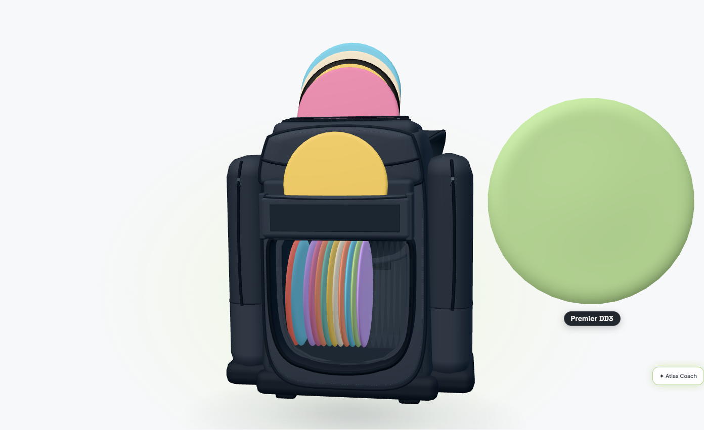
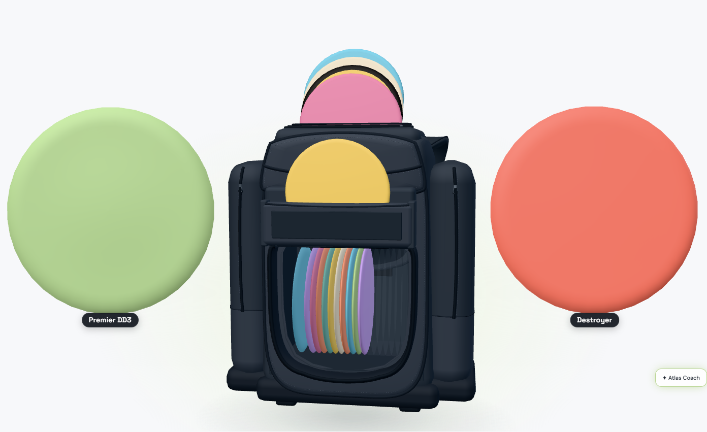
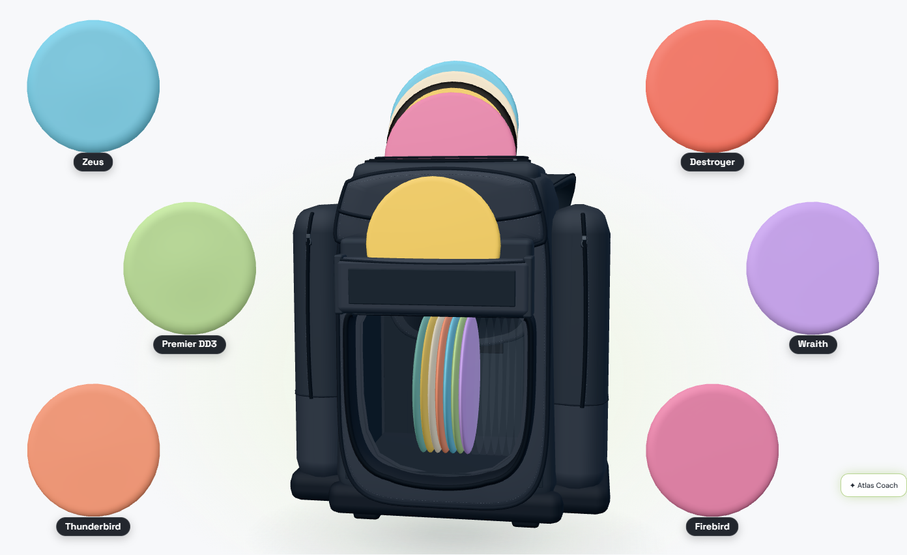
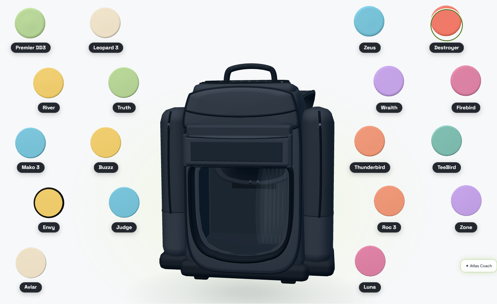
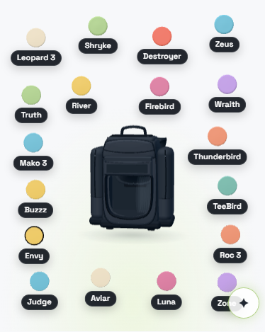

# My Bag: desktop pulled-disc sizing

October 15, 2026. Local branch `codex/bag-pulled-disc-sizing`, based on freshly
fetched `origin/main` at `522df14`. No push or deploy; changes remain uncommitted.

Freddy approved adjusting pulled-disc positions where needed, then narrowed this
iteration to **desktop**. Phone sizing and layout stay on the existing path.
The original marked-up screenshot was described but not attached; the reference
composition below recreates Premier DD3 + Destroyer with demo colors.

## Current layout findings

`public/bag-scene.js` gathers the pulled IDs, Atlas stability/speed, and measured
HTML labels. `public/bag3d/viewer.mjs` projects the viewport and bag silhouette
into the disc plane and calls `scatterFrame()` in `public/bag3d/bag-layout.mjs`.
That original planner remains intact.

`assignSides()` ranks the currently pulled set by stability: the less-overstable
half goes left, the more-overstable half right. An odd median joins its closer
neighbor, choosing right on a tie. A lone disc rests right. Equal stability ranks
resolve by disc ID. Faster discs tend higher on each side. The original scatter
is deterministic by ID; changing the pulled set already changes positions and
can change side assignment. Phone layouts can extend above/below the bag, use
staggered rows, and pull the camera back.

**Today's original size was not constant across counts.** The planner tries
scales `.58`, `.52`, `.46`, `.40`, largest first. Camera pullback further changes
their pixel diameters. In the 18-disc demo at 1440 × 1000, the original 1/2/6-out
diameter was 124.05 px, and the all-out diameter was 85.55 px.

## Desktop implementation and scope

Only `BagScene.stageOut()` at viewport widths above 700 px enables the new
`desktopSizing` option. Other users of the bag viewer receive the original
behavior. Atlas, Storage, the individual 3D viewer/pop-out, and the bag's interior
placements do not opt in.

The desktop path retains side assignment and orders each side by speed,
stability, then ID. It measures every physical bag disc's name so its largest
label is included in planning, excluding Storage and empty slots. A pixel-space
planner in `public/bag3d/pulled-sizing.mjs` places the enlarged footprints beside
the bag, alternating their horizontal lean when several occupy one column.
Dense sides can use more than one column. Centers are projected back onto the
same 3D plane. The original meshes, stamps, colors, photo surfaces, clay,
materials, pocket geometry, and pull/return paths are reused.

At full count, the original all-out **diameter** is retained. Centers use the new
side zones so even larger bags stay outside the inner boundary. The floor calculation
uses the original planner with the complete bag, every measured label, and
original projected-fit checks. The cached result includes the bag silhouette,
viewport, and label/flight data, so changed geometry invalidates it.

## Count curve and hard bounds

For each side, let `n` be its current count and `N` its count with the complete bag
out, using the same relative-side assignment. Odd bags therefore have distinct
left/right capacities. Define:

```text
w(n, N, p) = (n^(-p) - N^(-p)) / (1 - N^(-p))
diameter(n) = floor + (max - floor) * w(clamp(n, 1, N), N, p)
```

The default exponent is `p = 0.5` (inverse square root). This reduces area pressure quickly as neighbors arrive,
then approaches the existing dense-bag floor gently. For `N > 1` and `max > floor`, it is continuous
and strictly decreasing between 1 and N; it pins `diameter(1) = max` and
`diameter(N) = floor`. The unit test pins the hand-calculated case
`N=9, max=420, floor=84`: `diameter(4)=168`.

One or two globally pulled discs occupy one disc per used side, so both belong
to the maximum tier. Strict decrease is asserted as a **side's** count grows;
one-to-two global discs is intentionally a plateau. If a side's complete
capacity is one, its only disc is already at that side's floor.

The planner reserves:

- 12 px inside the canvas edges;
- 24 px outward from the bag's projected silhouette at each side's inner edge;
- each label's actual measured width and height, plus the existing name padding
  and 6 px disc/name gap;
- 12 px between neighboring disc/name footprints.

These margins interpret the requested inner boundary using the measured bag;
they are not traced coordinates from the unavailable red ticks.

For every possible side count, the planner calculates the largest diameter
that packs complete disc/name footprints into the side rectangle. It keeps the
largest one-disc maximum. If a dense bag needs more rapid decay, it finds the
least exponent between 0.5 and 8 that fits every count at the calibration camera.
The unit test includes a 32-disc geometry that needs this adjustment.

The maximum and exponent are then **frozen across count and camera changes**.
This prevents camera pullback or a packing-mode change from increasing diameter.
The maximum is also bounded by the side widths at the original home camera. The
camera only pulls further back when the current count needs that room; a few
discs beside an open details panel do not inherit a future full-bag pullback. No
footprint can overlap a neighbor, its own name, the bag, or the canvas edge in a
settled layout.

When an unusually narrow or crowded desktop cannot hold the preserved floor in
its side zones, the new planner declines the layout and retains the original
planner instead of reducing the floor. Existing zoom, turntable, top-view,
popup, and pull/return interactions keep their existing policies. The geometric
proof concerns settled staging; the original travel arcs and zoom behavior are
not redesigned in this change.

## Size animation

Existing pulled discs interpolate their screen diameter over **300 ms**, using
the viewer's existing cubic ease-in-out. Depth is compensated during the center's
motion, so perspective does not stretch the size glide to the existing 650 ms
restage duration. Interrupted glides start from the current pose and size.
Center motion and pull/return timings retain their existing durations.

Desktop size glides expose live circular bounds to hit targets and HTML labels,
and refresh them during rendering. Labels therefore follow their discs. Reduced
motion remains instant. Phone keeps its existing target-bound behavior.

## Measured result

Signed-out 18-disc demo, reference fixture Premier DD3 + Destroyer. Dimensions
are measured circular bounds after settling, not nominal world scales.

| Desktop viewport | Pulled count | Before diameter | After diameter |
| --- | ---: | ---: | ---: |
| 1440 × 1000 | 1 | 124.05 px | 408.23 px |
| 1440 × 1000 | 2 | 124.05 px | 408.23 px each |
| 1440 × 1000 | 6 | 124.05 px | 203.66 px each |
| 1440 × 1000 | all 18 | 85.55 px | 85.55 px each |
| 1280 × 900 | 6 | — | 178.84 px each |
| 1280 × 900 | all 18 | — | 75.49 px each |

The reference max tier is **3.29×** its original diameter, within the requested
3–4× range. Both side zones are bounded by their actual free width; the smaller
side determines the shared maximum. At odd partial counts, sides with different
loads can have different diameters. For example, at three out the one-disc side
is 408.23 px and the two-disc side is 266.47 px.

Frame sampling of the rendered circular rim measured the 300 ms shrink glide
reaching within 1 px of its target in approximately **285–315 ms** across runs,
with intermediate diameters and the label visible and following the live rim.
Newly arriving names fade in after their disc lands.

Phone comparison at 390 × 1000 matches the original centers and diameters:
41.30 px at one out, 41.18 px at two, 33.57 px at six, and 27.20 px at all 18.
The original phone above/below-bag zones are deliberately retained.

## Verification

- `npm run test:bag`: includes the new sizing tests alongside existing bag,
  layout, data, and collection unit suites. Tests cover curve endpoints,
  continuous monotonic decrease, bounds, floor preservation, odd side capacities,
  all 1–18 footprint counts, determinism, an infeasible side zone, dense-bag
  camera changes, and partial-bag framing beside a details panel.
- `npm run test:bag:pulled-sizing`: browser checks at 1440 and 1280 px, the named
  reference pair, 1/2/3/6/all out, zero settled disc/bag/disc/name/viewport overlap,
  rendered size animation, visible moving labels, return-one/return-all, a rotated
  enlarged pair, a 32-disc DOM fixture across camera pullback, and unchanged
  390 px phone geometry. The first run against the old implementation failed on
  the required 3× maximum tier.
- Existing staging suite: 1–24 counts, mixed and overstable sets, three themes,
  motion, relative sides, deterministic placement, zoom/details, return-all,
  type buttons, reduced motion, and phone resize.

Final results:

| Check | Result |
| --- | --- |
| `npm run test:bag` | 68 passed, 0 failed |
| `npm run test:bag:pulled-sizing` | Passed: desktop sizes/bounds/labels/animation, rotated pair, details open/close, 32-disc camera regression, unchanged phone |
| `tests/bag-staging-browser.mjs` | Passed: 13 checks, 59 screenshots; counts 1–24, three themes, desktop and phone |
| Existing demo, 3D, scene, spin/pocket, popup, switch/dump, map-controls, overmold, and pockets browser suites | All nine passed |
| Changed product code and new tests: targeted ESLint | 0 errors, 0 warnings |
| Independent code review | No remaining actionable findings |

The final set is **11 passing browser suites**, counting the new sizing suite
and ten existing suites. Targeted lint including the existing staging test has
one pre-existing unused `width` parameter warning; it is outside this change.

One additional **legacy** script, `tests/bag-interactions-browser.mjs`, fails at
line 159 waiting for details to open on the first disc click. Its assertion
explicitly describes the old October 5 behavior; current behavior opens details
through a name's popup. The same failure was reproduced against base `522df14`
by serving that revision's original bag scene, viewer, layout, and CSS. This
script is not registered in `package.json`. Its obsolete expectation was left
unchanged; no product behavior was altered to satisfy it.

The staging test now waits for the actual restored canvas width and settled
animation after closing details. Its earlier fixed-delay check could observe a
later ResizeObserver restage before it finished. The final full sweep passes
with the same width assertion, after waiting for that observable state.

[Rendered measurements and animation samples](assets/bag-pulled-disc-sizing/metrics.json)
include the 32-disc fixture's preserved 65.39 px floor and count-by-count sizes
across camera pullback. The desktop acceptance test also verifies visible label
tracking throughout every sampled frame of the shrink glide.

The atlas performance gate is untouched. The new planner is reached only from
the lazily mounted My Bag viewer and only when that page opts into desktop
sizing. Atlas marker, camera, clustering, rendering, and performance-test code
are unchanged; no atlas performance run is claimed.

## Desktop screenshots

### One Premier DD3 out



### Premier DD3 + Destroyer: max tier



### Six out



### All 18 out: original floor



### Phone: unchanged



## Baseline evidence

[Original reference-pair screenshot](assets/bag-pulled-disc-sizing/reference-1440-2.png),
[measured reference rectangles](assets/bag-pulled-disc-sizing/reference-1440-2.json),
[original phone, one out](assets/bag-pulled-disc-sizing/baseline-390-1.json), and
[original phone, all out](assets/bag-pulled-disc-sizing/baseline-390-18.json).

Keeping the original phone centers would not satisfy a strict full-height side
boundary: in the one-disc baseline the center is X=265.79 px while the bag right
edge is X=303.65 px. Freddy explicitly deferred that phone change and authorized
desktop repositioning. The earlier fixed-center desktop cap of roughly 242 px
for the reference pair therefore no longer limits this implementation.

The pre-existing `wrangler.public.jsonc` edit is outside this work and preserved.
