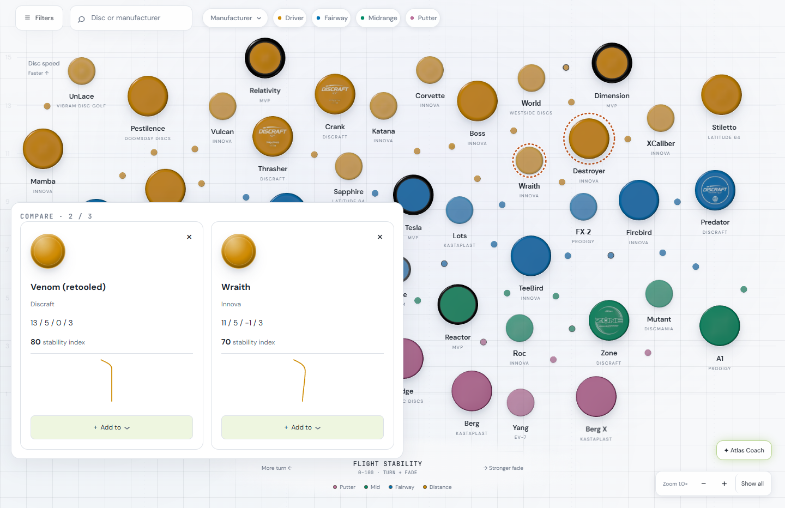
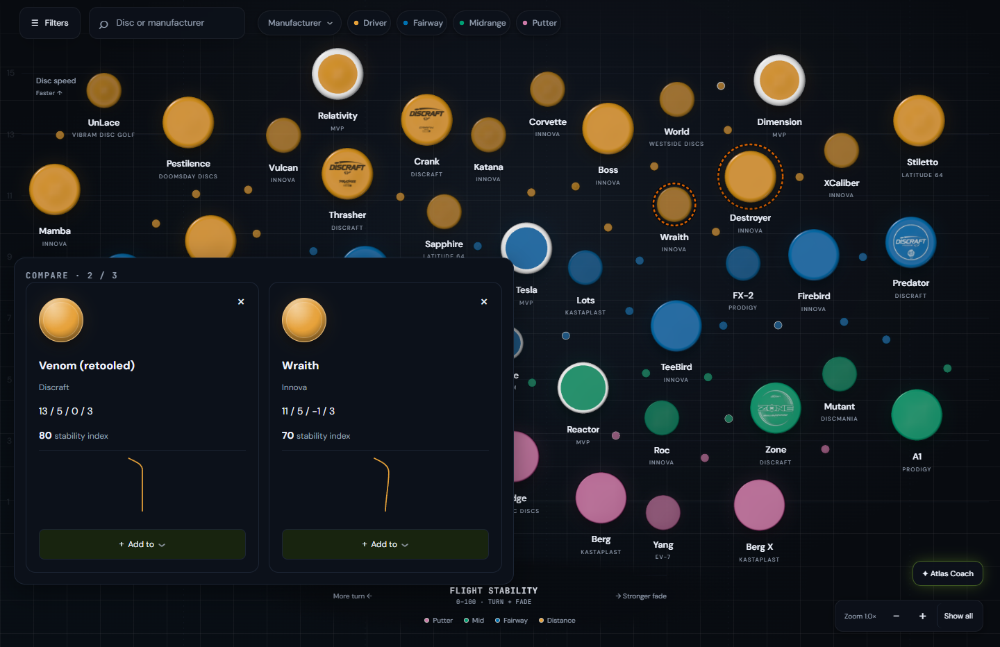
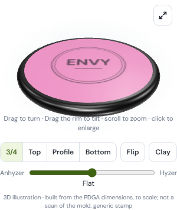
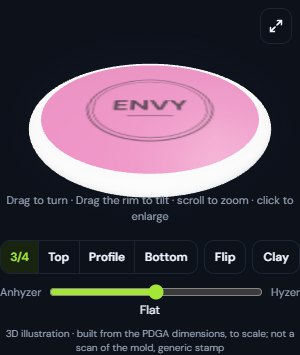
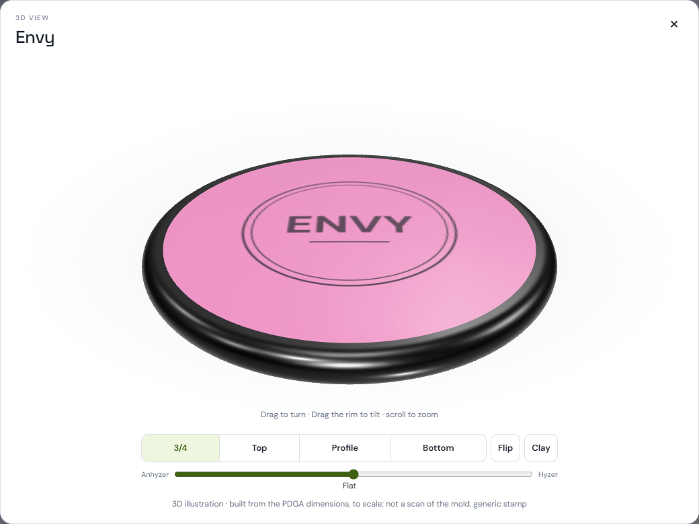
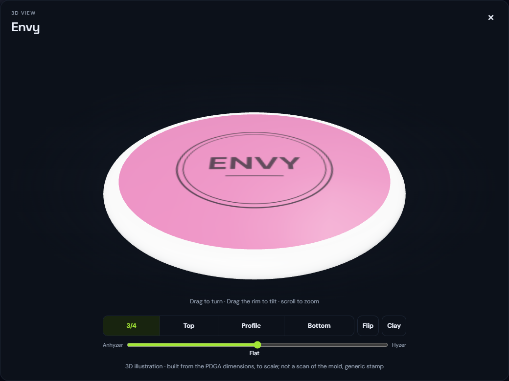

# Compare highlighting and viewer theme rims

October 17, 2026. Local verification and regression coverage; no push, merge, or deployment.

## Base and result

- Fetched `origin/main` before creating `codex/compare-viewer-polish` at **`e59e67e10f263718a47ca4fd842a70db630d5987`**.
- Own managed worktree: `C:/Users/user/.codex/worktrees/compare-viewer-polish/disc-atlas`.
- **Both requested product behaviors already exist in this base.** They were introduced by ancestor **`aa4ffa1923159cd2c87f84ec3cb38d054dca997c`** (`compare update`). The original three polish tests passed before this run changed any files.
- This branch adds two browser regressions, settled sidebar/pop-out proof images, this report, and the required AST graph refresh. Product JS/CSS remains identical to the recorded base. No artificial visual change was introduced to make the screenshots differ.

## Confirmed behavior

`public/app.js:renderCompare()` schedules a map redraw even when the tray becomes empty. `public/atlas-map.js:drawCompareHighlights()` matches comparison membership by disc ID and paints a steady dashed terracotta ring with a background separator, in screen pixels. It covers DOM markers, canvas small discs/minis, and any compared member inside a displayed group. Thus a tray item hidden behind a group's lead highlights that group: the screenshots show Venom (retooled) inside Destroyer's group, plus Wraith. A group's ring clears only when no compared member remains. The dashed silhouette distinguishes membership from the soft disc-colored hover glow without relying on red/green color discrimination. Positions and grouping are untouched.

`public/disc3d/viewer.mjs:update()` reads `document.documentElement.dataset.theme`: light uses `#0a0a0a`, and midnight/charcoal/black use `#ffffff` as the default overmold rim. Explicit rim colors take priority; plate-only overrides retain the theme default. The existing `atlas-theme-change` handler updates materials and requests a render, preserves pose and controls, and is removed on disposal. Both sidebar and pop-out use this factory through `public/disc3d.js`. Existing saved/photo-rim precedence is preserved.

The two added regressions exercise:

1. Three independently highlighted groups; real pointer hover and focus on an unobscured marker; a fourth compare click retaining the three-disc cap; tray removal clearing one ring while preserving the other two.
2. The actual Enlarge dialog and sidebar repainting together through all four themes without forced test rendering; an explicit white rim transferred from sidebar props into the pop-out remaining white after switching to light; closing the dialog and changing theme without errors. The existing factory test separately covers custom colors in every theme, plate-only colors, pose preservation, and listener disposal.

## Before / after proof

**Before** means the recorded base's product files. **After** means the same product files with the additional tests and documentation. Matching appearance is expected because the requested behavior was already shipped. Images are fresh browser captures, not reconstructed mockups, and theme cross-fades finish before capture. Proof viewport: 1440 × 1000, DPR 1, reduced motion enabled. The atlas image crops to the map; sidebar images crop to its viewer; dialog images crop to the enlarged viewer.

| Surface | Before | After |
| --- | --- | --- |
| Compare, light |  |  |
| Compare, midnight |  |  |
| Sidebar rim, light |  |  |
| Sidebar rim, midnight |  |  |
| Pop-out rim, light |  |  |
| Pop-out rim, midnight |  |  |

## Verification

Windows, Node **24.21.0**, bundled Playwright Chromium, headless, GPU flags `--use-angle=d3d11 --enable-gpu`. Browser suites ran serially; a unit run overlapped part of the first browser sequence. They are functional checks, not performance evidence. **The performance gate was not run; no performance claim is made.**

Set `PLAYWRIGHT_MODULE` to the bundled Playwright installation if the checkout has no local install. Optional `POLISH_OUTPUT` selects the proof-image output directory (default remains `outputs/compare-viewer-polish`). No application dependencies or lockfiles were changed.

| Command / surface | Result |
| --- | --- |
| `node --test tests/compare-viewer-polish-browser.mjs` / compare + shared viewer | **5 passed**. Four themes × 1/3/5/7/9× zoom, DOM + canvas paint/removal, no repositioning, desktop + phone controls, custom/default rims, and the two added cases. |
| `node --test tests/disc-appearance-browser.mjs` / bag + atlas appearance | **8 passed**. Real GPU materials, saved plate/rim fixture integration, theme defaults, custom rim precedence, My Map updates, and thumbnails. Local API fixtures; no live account or D1 mutation. |
| `node tests/disc3d-browser.mjs` / sidebar viewer | **Passed**, including rim materials, mold geometry, presets, hand/tilt, clay, gestures, phone layout, and no page errors. |
| `node tests/disc3d-popout-browser.mjs` / shared pop-out | **Passed**, including pose/material transfer, gestures, focus, close/disposal, desktop/phone/landscape, clay, and no page errors. |
| `node tests/atlas-3d-browser.mjs` / atlas | **11 checks passed**, including desktop + phone, light + dark, 1/3/9×, complete brand views, hover, filters, unchanged 2D positions/sizes/labels, selection, LODs, and WebGL fallback. |
| `node tests/atlas-organic-browser.mjs` / atlas layout | **6 checks passed**, including neighborhoods/order, no overlaps, deterministic pixels, full/Putter/Axiom/search views, three themes, landing/5/9×, and selection without reshuffling. |
| Selected existing unit matrix below | **221 passed, 0 failed**. |
| Mutation check: suppress `drawCompareHighlights()` | Added comparison case **failed** at “each compared group has a ring.” |
| Mutation check: remove viewer theme listener | Added actual sidebar/pop-out case **failed** waiting for a new modal frame after theme change. |

Mutation changes were temporary and restored byte-for-byte before the final green polish run. `git diff` confirms no product-code changes. Logs remain locally in `outputs/polish-validation/` (ignored). An independent read-only review found no actionable issues; it checked the diff, ancestry, logs, mutation failures, and all six after-proof surfaces without rerunning the suites.

Unit command:

```powershell
node --test tests/auth.mjs tests/coach.mjs tests/bag.mjs tests/bag-values.mjs tests/bag-3d-layout.mjs tests/bag-pulled-sizing.mjs tests/bag-demo.mjs tests/collection-layout.mjs tests/atlas-layout.mjs tests/atlas-groups.mjs tests/atlas-organic.mjs tests/atlas-depth.mjs tests/atlas-lod.mjs tests/atlas-targets.mjs tests/atlas-stamp-cache.mjs tests/apple-camera.mjs tests/disc3d-shape.mjs tests/disc3d-molds.mjs tests/disc3d-overmold.mjs tests/disc3d-profile.mjs tests/personal-lens.mjs tests/personal-map-worker.mjs tests/photo-textures.mjs tests/photo-math.mjs tests/photo-albedo.mjs tests/photo-editor-races.mjs
```

Initial validation notes: `auth.mjs`, `bag.mjs`, and `coach.mjs` initially could not load `jose` in the fresh checkout (187 other tests passed). Installed the repository-specified `jose@6.2.12` under ignored test output, linked it locally, then reran the whole matrix green. An exploratory filter assertion in the new comparison test twice assumed the same visible groups would return after regrouping; it was removed from this bounded regression rather than treated as evidence of a product defect. The first hover fixture sat behind the tray; it now targets the unobscured right side and explicitly verifies native `:hover`.

## Graph and scope

Before `graphify update .`, tested the actual ignore predicate on existing empty fixtures for environment files (including nested/suffixed names), `.dev.vars`, private keys/certificates, `credentials.json`, and `.aws/credentials`. Added explicit `.aws/` exclusion alongside the existing secret exclusions. This also avoids relying on the tool's sensitive-file heuristic. The first probe incorrectly used nonexistent directory fixtures; Graphify documents this API as requiring existing paths, so the final probe uses a temporary fixture tree. No credential contents were read.

Graph refresh is AST-only, with docs, proof images, generated output, environment files, credentials, and vendored code excluded. No deep/semantic extraction, LLM labeling, or model API key. The command completed successfully and reported **no code-graph topology changes**, leaving committed graph outputs untouched. Anonymous test callbacks do not add graph symbols; no artificial graph diff was created.

No product behavior was changed, so deployment and live-site QA are outside this local commit-only run. The recorded browser suites cover the requested touched surfaces; other browser suites and the performance gate were not run.
