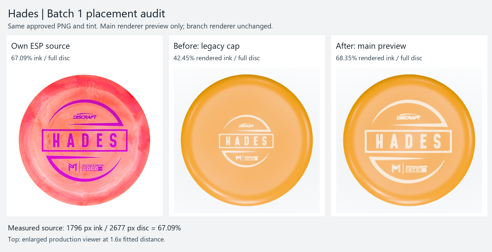
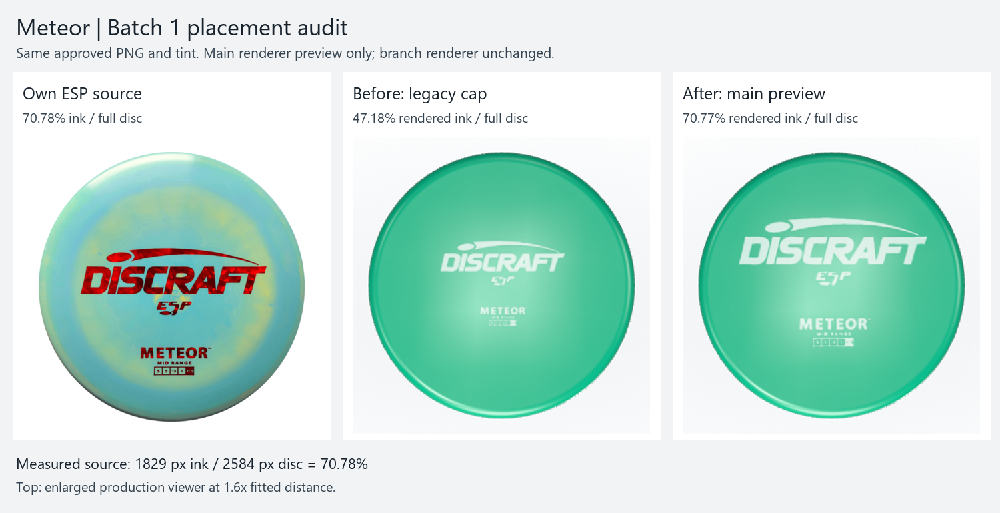
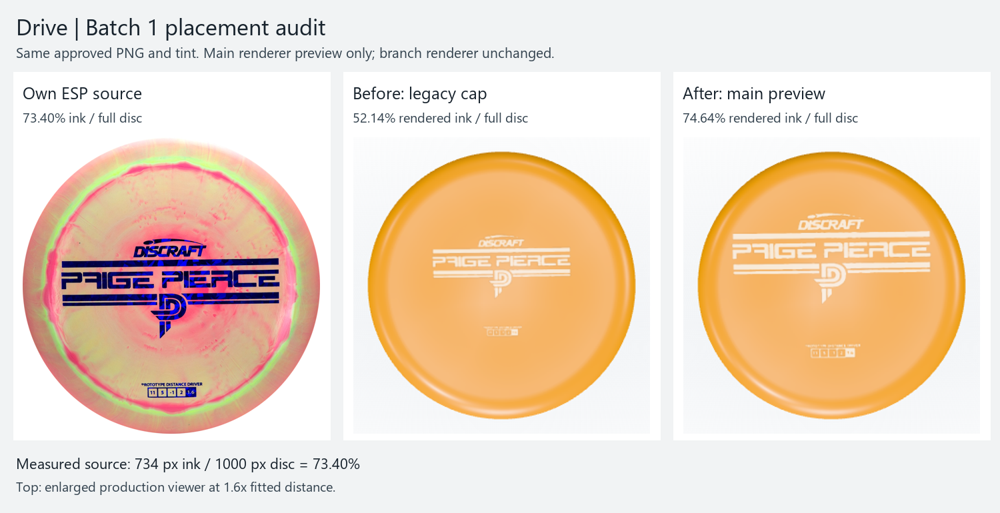
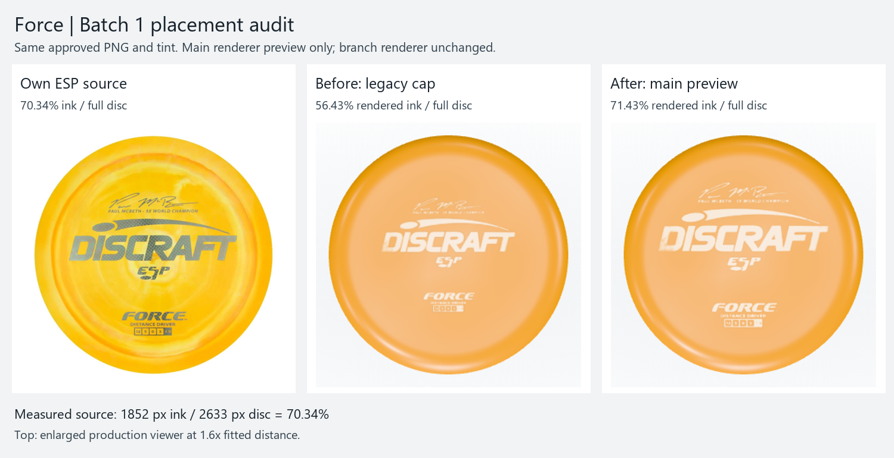

# Batch 1 full-disc fraction audit — October 16, 2026

**14 / 14 measured and backfilled. No artwork, assignment, ink or renderer changes. No merge or push.** All 14 lacked numeric runtime placement metadata; every row adds it in main's exact two-field shape. Banger Top stays rejected and uses its generated fallback.

“Before” below is the effective physical ink/full-disc fraction under the existing 6.2 cm cap, independently checked in the browser. The stored numeric placement was **absent** on all 14. “After” is the measured source fraction now stored, applied in the isolated main-renderer preview; this branch keeps its old rendering until Batch 2 merges main. Delta is after minus legacy effective scale, in percentage points (pp).

| Mold | Source fraction (re-measured) | Placement before | Placement after | Delta |
| --- | ---: | ---: | ---: | ---: |
| Avenger | 72.1823% | absent; legacy 56.5190% | 72.1823% | +15.6633 pp |
| Avenger SS | 72.2557% | absent; legacy 56.2535% | 72.2557% | +16.0022 pp |
| Comet | 65.5786% | absent; legacy 50.3077% | 65.5786% | +15.2709 pp |
| Drive | 73.4000% | absent; legacy 51.0480% | 73.4000% | +22.3520 pp |
| Flash | 72.8938% | absent; legacy 56.9551% | 72.8938% | +15.9386 pp |
| Force | 70.3380% | absent; legacy 55.3038% | 70.3380% | +15.0342 pp |
| Hades | 67.0900% | absent; legacy 42.1166% | 67.0900% | +24.9735 pp |
| Heat | 69.0130% | absent; legacy 52.1738% | 69.0130% | +16.8393 pp |
| Meteor | 70.7817% | absent; legacy 46.7168% | 70.7817% | +24.0649 pp |
| Predator | 71.2247% | absent; legacy 56.7842% | 71.2247% | +14.4405 pp |
| Pulse | 72.6824% | absent; legacy 57.8854% | 72.6824% | +14.7970 pp |
| Thrasher | 69.9433% | absent; legacy 52.4712% | 69.9433% | +17.4721 pp |
| XL | 73.2099% | absent; legacy 57.1300% | 73.2099% | +16.0799 pp |
| Zeus | 65.0639% | absent; legacy 56.4849% | 65.0639% | +8.5790 pp |

All 14 differences from the legacy effective scale exceed two points. There is no already-correct numeric source fraction to retain: Batch 1 recorded source crops, ink bounds, square sizes and paste offsets, rather than diameter fractions. Those historical measurements remain unchanged. This is a metadata backfill, not a claim that 14 previously stored fractions were wrong.

## Source measurements

Baseline: `ba081fd`, on `codex/discraft-stamp-sweep` in the existing sweep worktree. The unresolved merge from the previous chat turn was still present despite the handoff saying it was aborted; this run aborted it to restore the requested clean baseline. No commit from main was merged. Standard and schema were read from `origin/main` at `3abd397caba4591eb97486e967c428277c4018ef`.

Exactly 14 objects satisfy `batch == 1 && verdict == "extracted"`. Every source is that object's recorded Infinite Discs ESP original, found in the existing temporary review cache and SHA-256 verified against its manifest. Each is a nearly circular top view; no alternate design, crop estimate, rendered measurement or other mold supplies its fraction.

The denominator is the larger full outer rim-to-rim centre-axis silhouette span. RGB sources separate the colored disc from the pale background with chroma > .08 and minimum RGB < .95. Hades uses main's exact independently verified predicate, chroma > .12 and minimum RGB < .85. Drive uses its original alpha > 127; its tightly trimmed silhouette spans the complete 1000 px source width, rather than treating black transparent padding as plastic. Teal measurement axes were visually checked against each full outer rim, including the smaller landscape images. These are raster-edge measurements, not subpixel metrology; source bounds and predicates are retained for review.

The numerator is the larger dimension of the complete nonzero approved PNG alpha bounds, mapped to native source coordinates using that mold's existing crop and paste offset. Every mapped bound equals the recorded extraction bound. No reclassification, redraw, padding change or PNG save occurs. `diameterFraction = sourceInkDiameterPx / sourceDiscDiameterPx`; `assetInkFraction = assetInkDiameterPx / assetSquareSidePx`. Numeric precision is retained; every diameter fraction is <= its asset ink fraction, so every texture square fits the full disc.

[Exact bounds, predicates, full-precision fractions and source/asset hashes](../assets/discraft-stamp-sweep/batch-1-fraction-audit/measurements.json). Reproduce without artwork writes:

```powershell
python -B -X utf8 scripts/audit-discraft-batch1-fractions.py --sources <originals-folder>
```

| Mold | Full disc px | Complete ink px | Ink / PNG square | Source measurement proof |
| --- | ---: | ---: | ---: | --- |
| Avenger | 834 | 602 | 96.6292% | [outer rim + ink bounds](../assets/discraft-stamp-sweep/batch-1-fraction-audit/avenger-measurement.jpg) |
| Avenger SS | 829 | 599 | 97.0827% | [outer rim + ink bounds](../assets/discraft-stamp-sweep/batch-1-fraction-audit/avenger-ss-measurement.jpg) |
| Comet | 2696 | 1768 | 88.4442% | [outer rim + ink bounds](../assets/discraft-stamp-sweep/batch-1-fraction-audit/comet-measurement.jpg) |
| Drive | 1000 | 734 | 86.8639% | [outer rim + ink bounds](../assets/discraft-stamp-sweep/batch-1-fraction-audit/drive-measurement.jpg) |
| Flash | 819 | 597 | 96.9156% | [outer rim + ink bounds](../assets/discraft-stamp-sweep/batch-1-fraction-audit/flash-measurement.jpg) |
| Force | 2633 | 1852 | 94.1057% | [outer rim + ink bounds](../assets/discraft-stamp-sweep/batch-1-fraction-audit/force-measurement.jpg) |
| Hades | 2677 | 1796 | 71.3264% | [outer rim + ink bounds](../assets/discraft-stamp-sweep/batch-1-fraction-audit/hades-measurement.jpg) |
| Heat | 2614 | 1804 | 88.7795% | [outer rim + ink bounds](../assets/discraft-stamp-sweep/batch-1-fraction-audit/heat-measurement.jpg) |
| Meteor | 2584 | 1829 | 81.0009% | [outer rim + ink bounds](../assets/discraft-stamp-sweep/batch-1-fraction-audit/meteor-measurement.jpg) |
| Predator | 841 | 599 | 97.0827% | [outer rim + ink bounds](../assets/discraft-stamp-sweep/batch-1-fraction-audit/predator-measurement.jpg) |
| Pulse | 2632 | 1913 | 98.9653% | [outer rim + ink bounds](../assets/discraft-stamp-sweep/batch-1-fraction-audit/pulse-measurement.jpg) |
| Thrasher | 2645 | 1850 | 89.2857% | [outer rim + ink bounds](../assets/discraft-stamp-sweep/batch-1-fraction-audit/thrasher-measurement.jpg) |
| XL | 810 | 593 | 97.2131% | [outer rim + ink bounds](../assets/discraft-stamp-sweep/batch-1-fraction-audit/xl-measurement.jpg) |
| Zeus | 2662 | 1732 | 96.1154% | [outer rim + ink bounds](../assets/discraft-stamp-sweep/batch-1-fraction-audit/zeus-measurement.jpg) |

## Pipeline and schema conformance

Both source manifests carry the new numbers for these same 14 assignments. `source-data/stamp-manifest.json` uses exactly `placement: {diameterFraction, assetInkFraction}`. The recon manifest retains its extraction-history fields and adds the same fractions to its existing placement object. `prepare_data.py` emits `stampPlacement` through the existing pipeline; `public/data.json` was generated, never hand-edited.

This pre-merge pipeline accepts absent placement only because the three pilots are explicitly outside this audit. Any supplied placement uses main's exact finite/non-boolean/(0,1] checks and texture-fit inequality; validate checks exact manifest/catalog correspondence. Main will make the field mandatory for all 17 when merged and supply its own three pilot placements. The audit did not copy, modify or re-measure any pilot data on disk.

`scripts/verify-discraft-fraction-schema.py` executes main's strict validator in memory, combining only this branch's previously reviewed Infinite ESP provenance check. Placement validation and correspondence code remain exactly main's. It validates the 14 audit entries plus main's existing three pilots as 17 future assignments, reuses six applicable main tests unchanged, and verifies that deleting placement from any of the 14 is rejected. Main's fixed-three count assertion is replaced by a direct 17-assignment assertion in this isolated check; its pilot-measurement test is excluded because this audit does not re-audit pilots. An initial harness attempt exposed the fixed-three assertion (`17 != 3`); this was a test-scope issue, not schema acceptance failure.

For Batch 2's merge: retain both sets of manifest metadata; take main's mandatory placement validation and renderer; retain the reviewed Infinite source gate; regenerate data with prepare. Existing manifest tests retain the dynamic assignment count and strip both stamp fields in the identity invariant. Main's pilot-receipt loop must remain scoped to the three pilot entries because its receipt file describes those pilots (and one isolated Hades diagnosis), while the 14 audit receipts are checked by the audit test. These are explicit mechanical integration choices, not new visual judgments. The merge itself has not been attempted here.

## Before / after evidence

**After images are an isolated preview, not this branch's live renderer.** The browser routes the six renderer files byte-for-byte from main `3abd397c` in memory, with this branch's generated 14 placements. No renderer file is written or merged. Before uses `ba081fd`; a third pass uses the actual branch after backfill and proves its render is unchanged until main lands. Pilot metadata is held at the unchanged branch values in all preview comparisons, so Buzzz/Zone/Luna remain audit controls. Main owns their later scale change.

Top proofs use the production enlarged viewer at 1.6x its fitted Top camera distance, with identical poses. Crops normalize full disc size for comparison; raw context screenshots remain alongside each board. Bag proofs use the ordinary production desktop staged-disc pose. The rendered fraction is measured against an identical bare render with only the stamp hidden; the >3 channel-level ink difference rejects GPU readback noise. Top disc bounds use silhouette alpha >127; bag bounds project the full disc mesh. All 14 physical viewer fractions match their stored source fraction within 1e-6; all 14 Top and all 14 bag screen fractions are within two points of source. Original extracted pixels and runtime ink textures remain identical.

| Mold | Source | Preview Top | Preview bag |
| --- | ---: | ---: | ---: |
| Avenger | 72.18% | 72.70% | 72.77% |
| Avenger SS | 72.26% | 73.76% | 73.35% |
| Comet | 65.58% | 66.67% | 66.09% |
| Drive | 73.40% | 74.64% | 74.10% |
| Flash | 72.89% | 74.29% | 73.81% |
| Force | 70.34% | 71.43% | 70.98% |
| Hades | 67.09% | 68.35% | 67.68% |
| Heat | 69.01% | 70.50% | 69.78% |
| Meteor | 70.78% | 70.77% | 70.48% |
| Predator | 71.22% | 72.86% | 72.03% |
| Pulse | 72.68% | 73.76% | 73.53% |
| Thrasher | 69.94% | 71.07% | 70.78% |
| XL | 73.21% | 74.46% | 74.14% |
| Zeus | 65.06% | 66.43% | 65.83% |

### Hades — largest move; Freddy's evidence pair

Own source 1796 / 2677 = **67.0900%**. Legacy effective **42.1166%**; increase **24.9735 pp**. Same approved alpha and ink.

The exact approved Hades source measures **67.09%, rather than the earlier ~75% visual estimate**. This reproduces main's separate Hades receipt exactly (1796 / 2677). Its wide transparent PNG padding reduced the legacy physical footprint to 42.12%; the preview Top is 68.35%, with the small perspective/raster difference reported rather than compensated in metadata. This board puts the real ESP photo beside both renders.



[Full bag comparison](../assets/discraft-stamp-sweep/batch-1-fraction-audit/proof-hades-bag.png) · [raw before context](../assets/discraft-stamp-sweep/batch-1-fraction-audit/before-hades-viewer.png) · [raw preview context](../assets/discraft-stamp-sweep/batch-1-fraction-audit/preview-hades-viewer.png)

### Meteor — second-largest move

Own source 1829 / 2584 = **70.7817%**. Legacy effective **46.7168%**; increase **24.0649 pp**. Same approved alpha and ink.



[Full bag comparison](../assets/discraft-stamp-sweep/batch-1-fraction-audit/proof-meteor-bag.png) · [raw before context](../assets/discraft-stamp-sweep/batch-1-fraction-audit/before-meteor-viewer.png) · [raw preview context](../assets/discraft-stamp-sweep/batch-1-fraction-audit/preview-meteor-viewer.png)

### Drive — third-largest move

Own source 734 / 1000 = **73.4000%**. Legacy effective **51.0480%**; increase **22.3520 pp**. Same approved alpha and ink.



[Full bag comparison](../assets/discraft-stamp-sweep/batch-1-fraction-audit/proof-drive-bag.png) · [raw before context](../assets/discraft-stamp-sweep/batch-1-fraction-audit/before-drive-viewer.png) · [raw preview context](../assets/discraft-stamp-sweep/batch-1-fraction-audit/preview-drive-viewer.png)

### Force — named approved-art control

Own source 1852 / 2633 = **70.3380%**. Legacy effective **55.3038%**; increase **15.0342 pp**. Same approved alpha and ink.

Freddy's approved Force artwork stays byte-identical. Its own 5x signature, champion line, mold name and number strip supply the measurement; only its placement number is added.



[Full bag comparison](../assets/discraft-stamp-sweep/batch-1-fraction-audit/proof-force-bag.png) · [raw before context](../assets/discraft-stamp-sweep/batch-1-fraction-audit/before-force-viewer.png) · [raw preview context](../assets/discraft-stamp-sweep/batch-1-fraction-audit/preview-force-viewer.png)

## Controls and validation

All 17 existing PNGs remain byte-identical to `ba081fd`; all assignments, brand/rights metadata and ink rules are unchanged. Banger Top has no stamp assignment or PNG and retains fallback. All 31 ready recon objects, risky/no entries and catalog gaps are object-identical. No atlas marker/cache or lazy-loading code changed; atlas startup makes zero stamp requests.

Buzzz, Zone and Luna are unchanged and were not re-audited. Banger Top (still-fallback Discraft) and Innova Destroyer are unchanged. In all five controls, texture hashes, geometry hashes and measured bounds/fractions match both before→branch and before→isolated preview. All 14 branch-only captures likewise match their pre-audit numbers/textures/geometry. Screenshot readback retains Batch 1's existing bound: maximum one channel level in <=0.01% of pixels. On the accepted rerun, 21 comparisons are pixel-identical; the other three each differ by one level in one pixel out of 550,676 (Avenger/Zeus branch and Banger Top preview).

One initial preview run stopped on an exact Avenger SS canvas-hash comparison after the 14 Top/bag fraction checks had passed. A single rerun measured the pixels under the inherited Batch 1 bound and passed; exact texture/geometry checks were retained. This screenshot-readback handling does not change the performance gate. [Initial log](../assets/discraft-stamp-sweep/batch-1-fraction-audit/preview-run-1.log) · [single rerun](../assets/discraft-stamp-sweep/batch-1-fraction-audit/preview-run-2.log) · [raw preview/control verification](../assets/discraft-stamp-sweep/batch-1-fraction-audit/verification.json).

Prepare and validate: clean, **2,434 approval records, 1,182 flight matches, 17 Discraft stamps**. The catalog is object-identical to `ba081fd` after stripping only `stampPlacement`; exactly 14 fields were added, with all stampAsset values, identities, ordering and metadata unchanged. Stamp manifest/brand/rights tests: **7/7**. Audit receipt/scope tests: **5/5**. Main strict-schema applicable tests: **6/6**, plus the 17-assignment check and 14 missing-placement mutations. The numeric-validation regression first failed on the old pipeline (seven expected rejection failures), then passed after the minimal backfill support.

## Browser and performance results

All existing suites passed on their first run in this audit: Batch 1 stock stamps (14 assignments, six controls); production viewer; pop-out desktop/phone; bag 3D (8 checks, 38 screenshots); photo textures (including real HEIC editor choose/use/save/reload/replace and private local D1/R2). Geometry/profile/overmold, LOD, bag/storage layout and photo node regressions: **91/91**. The catalog artwork/rights gate passes for all **2,434** records. The bag/photo test setup's normal public-worker build passes. No bag timeout or editor-dialog flake occurred. Historical Batch 1 proofs were preserved by redirecting new regression captures to ignored output.

**Default performance gate: PASS on the first run, 158.72 seconds.** Seven desktop / three phone warm repetitions, one cold warm-up per configuration, original 241 flight frames and 120 still frames, original 1.15x allowance, desktop 1.5 ms / phone 3 ms slack and +1 long-task allowance. Both aggregate and paired checks pass; no environment repetition override, threshold, workload, CPU profile or gate file changed. All other agent-owned browser work had finished before the gate. External machine activity was not controlled. This is a passing local run, not a statistical-stability claim.

[Full cold/warm measurements and gate decisions](../assets/discraft-stamp-sweep/batch-1-fraction-audit/perf.json) · [first-run log](../assets/discraft-stamp-sweep/batch-1-fraction-audit/perf-run-1.log). Times below are milliseconds, except task counts. The last column compares independent runs with Batch 1's earlier report; it is observational, not a causal speed claim.

| Device / metric | 2D median | 3D median | 3D − 2D | Limit | Paired excess | 3D − Batch 1 3D |
| --- | ---: | ---: | ---: | ---: | ---: | ---: |
| desktop flight p95 | 3.200 | 3.500 | +0.300 | 5.180 | -1.680 | +0.000 |
| desktop 1x p95 | 0.600 | 0.900 | +0.300 | 2.190 | -1.290 | +0.000 |
| desktop long tasks | 0.000 | 0.000 | +0.000 | 1.000 | -1.000 | +0.000 |
| phone flight p95 | 10.000 | 10.100 | +0.100 | 14.500 | -3.940 | -0.900 |
| phone 1x p95 | 2.900 | 4.000 | +1.100 | 6.335 | -1.990 | +0.600 |
| phone long tasks | 0.000 | 0.000 | +0.000 | 1.000 | -1.000 | -1.000 |

Phone still-view 3D p95 rose **0.6 ms** versus that earlier Batch 1 run (3.4 → 4.0 ms), while phone flight p95 fell 0.9 ms (11.0 → 10.1 ms). Both pass the unchanged default gate. No stamps are loaded onto atlas markers. Runtime PNG payload is unchanged: **1,272.709 KB** for the 14 Batch 1 assets, **1,363.399 KB** including the three pilots; no asset bytes were added by this audit.

The default shell Python lacks NumPy/Pillow; these checks used the bundled Python at `C:/Users/user/.cache/codex-runtimes/codex-primary-runtime/dependencies/python/python.exe` with `-B -X utf8`. Browser tools used bundled Playwright and Chromium headless shell 1243 with Windows ANGLE D3D11. No dependency installation was needed.

Independent read-only review found no actionable Critical, Important or Minor issues, inspected all 14 silhouette overlays, and independently reproduced every original hash/span/fraction plus fresh 5/5 audit and 6/6 strict-schema tests. Pending browser/perf results from that review are now resolved by the successful serial runs above. Previously approved extraction quality and the future main merge remain outside this placement audit.

**Handoff:** review this report. Keep this branch/worktree for Batch 2; do not land or push it yet. The audit-specific snapshot tests intentionally verify this pre-merge state against `ba081fd`; after main lands, its pilot placements and renderer are expected to change through that separate merge. Batch 2 owns that integration and any newly encountered non-mechanical conflict. No main merge, push, landing or deployment occurred in this audit.
