# Discraft stamp sweep — Batch 1

**Review update — October 16, 2026:** Freddy approved Force and rejected the Zone GT / Banger Top extraction on quality (assignment confirmed correct). That asset is pulled; Banger Top uses the generated fallback. **14 Batch 1 stamps remain shipped.** Original extraction evidence below is retained as history; see [fix checks](batch-1-fix.md).

**15 / 15 extracted and assigned, including Force. Added PNG payload: 1283.561 KB (decimal, bytes / 1000).** All three pilot assets retain their exact bytes. No push, merge or deployment. Freddy reviews these proofs before the normal landing drill.

| Mold | Source retailer | Asset KB | Outcome |
| --- | --- | ---: | --- |
| Avenger | Infinite Discs | 27.557 | extracted |
| Avenger SS | Infinite Discs | 21.281 | extracted |
| Comet | Infinite Discs | 99.922 | extracted |
| Drive | Infinite Discs | 19.313 | extracted |
| Flash | Infinite Discs | 23.761 | extracted |
| Force | Infinite Discs | 190.554 | extracted — foil proof below |
| Hades | Infinite Discs | 199.236 | extracted |
| Heat | Infinite Discs | 91.615 | extracted |
| Meteor | Infinite Discs | 98.998 | extracted |
| Predator | Infinite Discs | 28.669 | extracted |
| Pulse | Infinite Discs | 227.385 | extracted |
| Thrasher | Infinite Discs | 111.281 | extracted |
| XL | Infinite Discs | 33.672 | extracted |
| Zeus | Infinite Discs | 99.465 | extracted |
| Zone GT | Infinite Discs | 10.852 | extracted — Banger Top only |

## Scope and method

October 16, 2026. Continued in the existing `codex/discraft-stamp-sweep` worktree at `771e8da`, preserving the source-expansion recon already stacked after `1287ac8`. The extraction set is the 15 ready objects from `1287ac8`; the 31 expansion upgrades, other verdicts, gaps and Nuke were not extracted or altered. Every source is that entry's own recorded Infinite ESP image, decoded at the recorded dimensions. Source originals were downloaded to temporary review storage. The disc crops here are review evidence requested for this batch and are never runtime textures.

Each source was visually checked before extraction: one foil colour per stamp, including patterned/reflected foil; no independent second ink was observed. Each mask uses its own measured region and channel separation. No drawing, inpainting, vector replacement, signature borrowing, or morphological filling occurs. Every RGB pixel is white; only extracted alpha survives runtime tinting. Native source pixel masks are retained, including source softness; larger canvas dimensions do not imply sharper optical detail.

**Built-reality notes:** the pilot has no per-mold runtime placement fields or renderer transforms. Its extraction crops the alpha bounding box, preserves aspect/relative placement and pads it into a circle-safe square. This batch uses that same method, recording each source bound, output size and paste offset below and in the manifest. The renderer remains byte-unchanged. The pilot source gate accepted only official Discraft pages; its recon explicitly anticipated a narrow Infinite ESP provenance extension. That extension is tested without relaxing brand, exact catalog identity, rights, free-resource, local-path or file checks.

Zone GT assignment is an evidence-based inference limited to `4a6dfb045c65`, **Zone GT (Banger Top)**. The [manufacturer stock form](https://discgolf.discraft.com/forms/stock.pdf), page 9, identifies ESP Zone GT with Banger Top. [Infinite](https://infinitediscs.com/discraft-zone-gt/esp) gives a 1.3cm rim depth matching the [Banger Top PDGA approval](https://www.pdga.com/technical-standards/equipment-certification/discs/zone-gt-banger-top), while the Ringer record is 1.2cm; the photo shows the broad inner groove and First Run stamp. Ringer `8b507b3cabd4` remains unassigned.

## Checks

Prepare and validate run with `python -X utf8` on Windows. `validate_data.py` validates **2,434 approval records and 18 Discraft stamp assignments**. Stamp/rights tests: **7 / 7 pass**; Infinite provenance test was observed failing before the validator change, then passing. All 2,434 records and metadata match pre-batch data after stripping `stampAsset`; exactly 15 records acquire that field. [Raw invariants](../assets/discraft-stamp-sweep/batch-1/invariants.json).

The Batch 1 browser suite passes for all **15 own-mold assignments**, all five controls, runtime tint switching, brand rejection, loading/failure fallback, disposal cancellation, large bag pulls, storage, thumbnails, photo precedence and clay. **Atlas startup stamp requests: 0.** Control stamp/storage textures are byte-identical. Buzzz, Zone, Luna and Nuke bag controls are byte-identical. Final presented viewer captures are identical except Buzzz: one channel level in one pixel out of 95,700; Zone, Luna, Nuke and Destroyer are exact. [Raw browser verdicts](../assets/discraft-stamp-sweep/batch-1/verification.json).

Two initial exact screenshot comparisons stopped on isolated GPU readback quantization (Zone on the first, Buzzz on the second; each one pixel / one channel level). The presentation helper now decodes screenshots and permits at most one channel level in 0.01% of pixels, while retaining exact stamp texture, storage, photo, clay and unchanged-thumbnail checks. Independent review accepted that tightly bounded measurement handling. This does **not** change the performance gate.

Existing browser suites pass: `disc3d-browser.mjs`, `disc3d-popout-browser.mjs`, `bag-3d-browser.mjs` (8 checks / 38 screenshots), and `photo-textures-browser.mjs`. Neither known bag timeout nor editor save-dialog flake occurred; no rerun was needed for those suites. Geometry, mold/profile/overmold, LOD, bag sizing/layout, collection layout and photo regressions: **91 / 91 pass**. The inherited `photo-editor-races.mjs` adds 8 passes and two harness failures because it removes only the first import from the pilot's thumbnail module. Main already fixes that harness in `229c036`; its exact test logic, temporarily rebased to this worktree's public sources, passes **10 / 10**. This branch's photo test/code was not changed to absorb that unrelated fix. The rights gate passes for all 2,434 records, and the browser setup's normal public worker build passes.

**Unchanged performance gate: PASS on its first run, 158.54 seconds.** Defaults retained: 7 desktop / 3 phone warm repetitions, 241 flight frames and 120 full-view frames, 1.15× frame allowance, 1.5ms desktop / 3ms phone slack, +1 long task; both independent and paired median checks. No repetition, threshold, workload, browser CPU profile, atlas renderer or gate file changed. Agent-owned browser/test jobs were finished before this run; external machine activity was not controlled. [Full cold/warm raw report](../assets/discraft-stamp-sweep/batch-1/perf.json) · [run log](../assets/discraft-stamp-sweep/batch-1/perf-run-1.log).

Times below are milliseconds, except long-task counts. The last column compares with the pilot's separately measured report; these are observational differences across runs, not a causal speedup claim.

| Device / metric | 2D median | 3D median | 3D − 2D | Limit | Paired excess | 3D − pilot 3D |
| --- | ---: | ---: | ---: | ---: | ---: | ---: |
| desktop flight p95 | 3.100 | 3.500 | +0.400 | 5.065 | -1.550 | -0.700 |
| desktop 1x p95 | 0.600 | 0.900 | +0.300 | 2.190 | -1.290 | -0.300 |
| desktop long tasks | 0.000 | 0.000 | +0.000 | 1.000 | -1.000 | +0.000 |
| phone flight p95 | 10.200 | 11.000 | +0.800 | 14.730 | -3.730 | -2.700 |
| phone 1x p95 | 2.600 | 3.400 | +0.800 | 5.990 | -2.590 | -0.200 |
| phone long tasks | 0.000 | 1.000 | +1.000 | 1.000 | 0.000 | -2.000 |

The phone long-task median is **1 against a limit of 1**, with paired excess 0: it passes at the boundary. One passing run does not establish statistical stability. New PNGs add **1,283.561 KB**; the full 18-asset library is **1,374.251 KB**, fetched only on eligible visible surfaces. Per-asset sizes are listed above. No stamps enter atlas markers or the shared atlas cache.

Independent read-only review of the changed code, data and all 15 source/background proof pairs found no Critical or Important issues.

## Avenger

**Source crop → extracted alpha → runtime-tinted context.** [Infinite ESP page](https://infinitediscs.com/discraft-avenger/esp) · [recorded original](https://infinitediscs.com/Inf_Uploads/DiscProducts/d3a50f3-4c91-430f-bb8b-a4a55037c5d3Avenger-ESP.Webp). Source 1200×900 px; one foil verified; PNG **27.557 KB**, 623×623 px.

Source ink bounds `[left, top, right, bottom]`: `[294, 150, 896, 748]`. Paste offset `[x, y]`: `[10, 12]`. Full placement/recipe/hash: [extraction.json](../assets/discraft-stamp-sweep/batch-1/extraction.json).

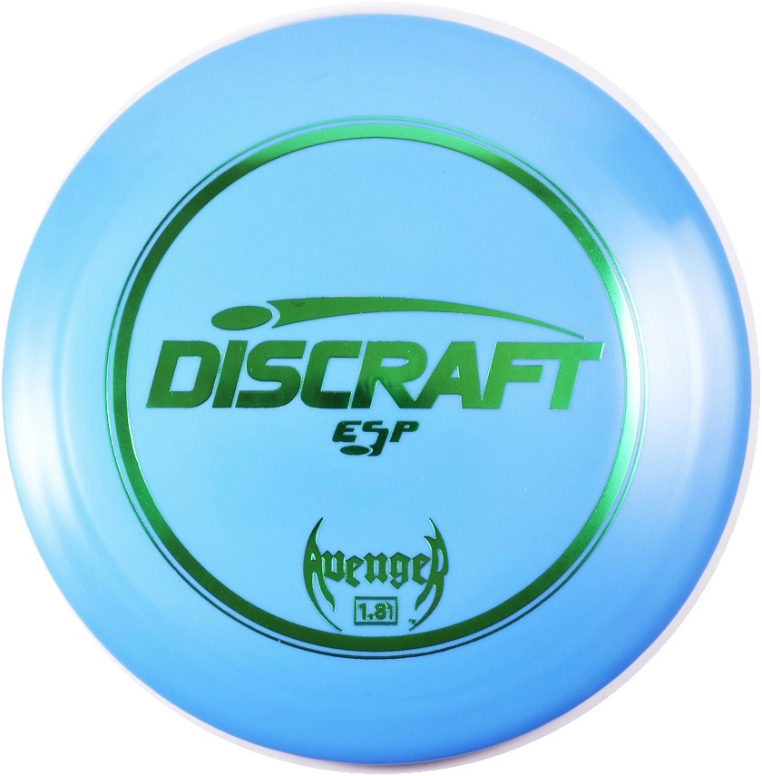

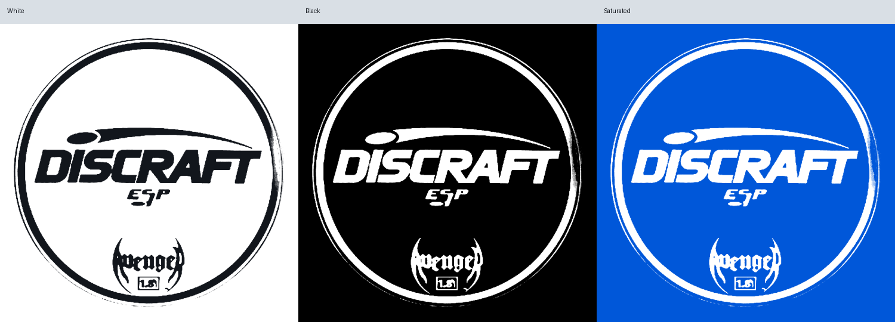

[Large pulled bag render](../assets/discraft-stamp-sweep/batch-1/after-avenger-bag.png)

## Avenger SS

**Source crop → extracted alpha → runtime-tinted context.** [Infinite ESP page](https://infinitediscs.com/discraft-avenger-ss/esp) · [recorded original](https://infinitediscs.com/Inf_Uploads/DiscProducts/0226-dbb6-4d5e-9296-5b7f2fcd08e3Avenger-SS-ESP.Webp). Source 1200×900 px; one foil verified; PNG **21.281 KB**, 617×617 px.

Source ink bounds `[left, top, right, bottom]`: `[295, 136, 894, 734]`. Paste offset `[x, y]`: `[9, 9]`. Full placement/recipe/hash: [extraction.json](../assets/discraft-stamp-sweep/batch-1/extraction.json).

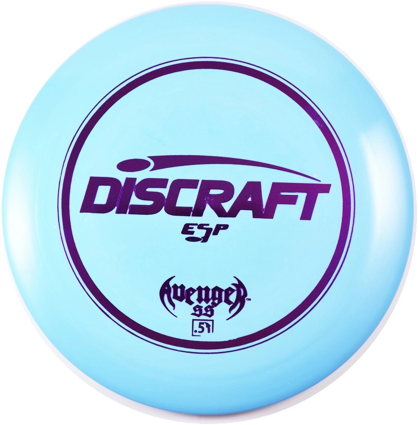

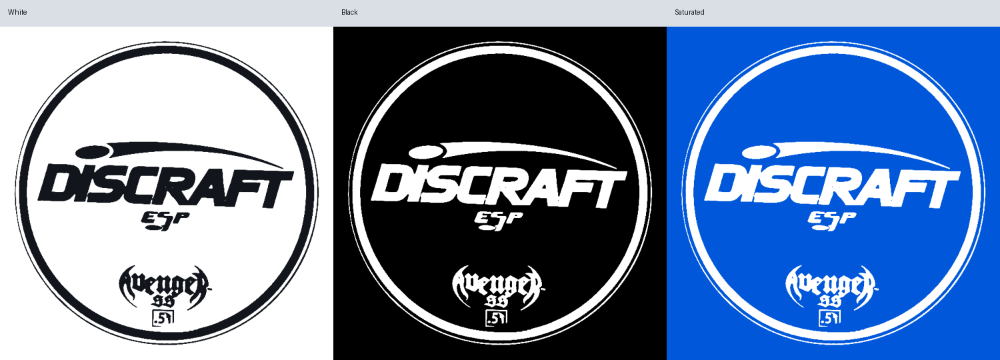

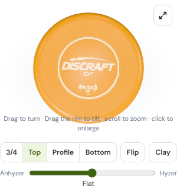

[Large pulled bag render](../assets/discraft-stamp-sweep/batch-1/after-avenger-ss-bag.png)

## Comet

**Source crop → extracted alpha → runtime-tinted context.** [Infinite ESP page](https://infinitediscs.com/discraft-comet/esp) · [recorded original](https://infinitediscs.com/Inf_Uploads/DiscProducts/Comet325.Webp). Source 2970×2970 px; one foil verified; PNG **99.922 KB**, 1999×1999 px.

Source ink bounds `[left, top, right, bottom]`: `[581, 984, 2349, 2236]`. Paste offset `[x, y]`: `[115, 373]`. Full placement/recipe/hash: [extraction.json](../assets/discraft-stamp-sweep/batch-1/extraction.json).

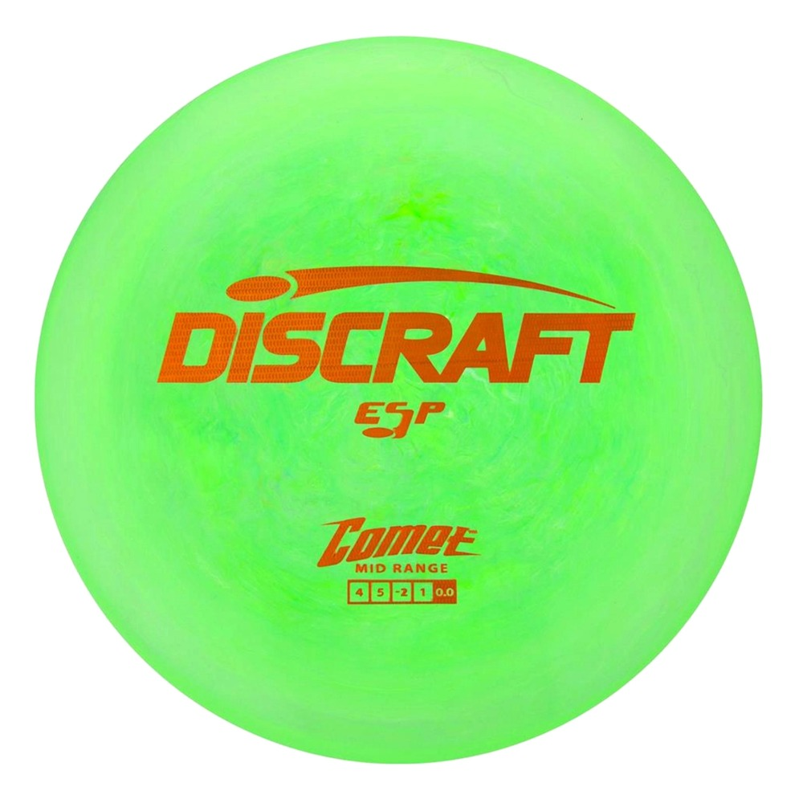

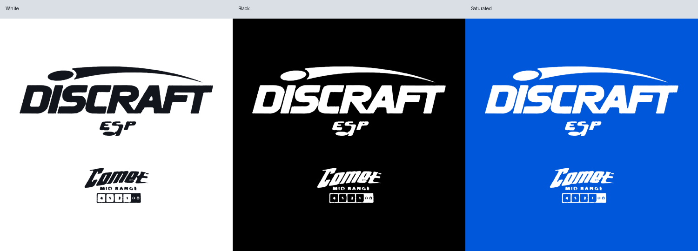

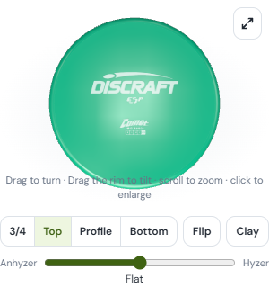

[Large pulled bag render](../assets/discraft-stamp-sweep/batch-1/after-comet-bag.png)

## Drive

The source itself has a damaged first glyph in the tiny PROTOTYPE line. The mask preserves those photographed pixels; no replacement letter was drawn.

**Source crop → extracted alpha → runtime-tinted context.** [Infinite ESP page](https://infinitediscs.com/discraft-drive/esp) · [recorded original](https://infinitediscs.com/Inf_Uploads/DiscProducts/20240422100344898_unnamed20-e095becc97a4.webp). Source 1000×997 px; one foil verified; PNG **19.313 KB**, 845×845 px.

Source ink bounds `[left, top, right, bottom]`: `[130, 341, 864, 876]`. Paste offset `[x, y]`: `[55, 155]`. Full placement/recipe/hash: [extraction.json](../assets/discraft-stamp-sweep/batch-1/extraction.json).

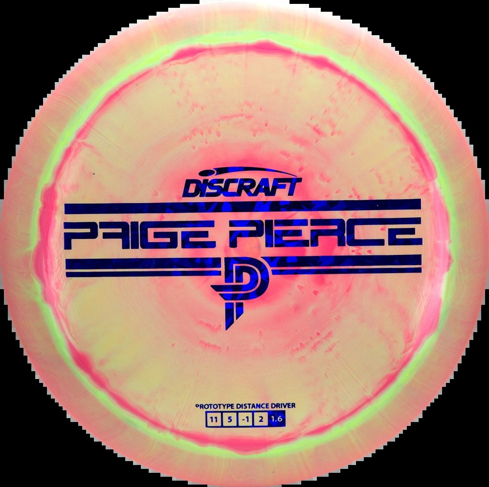

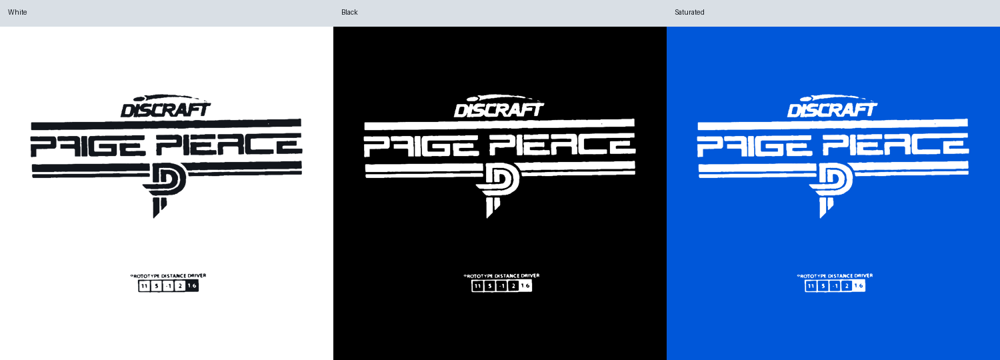

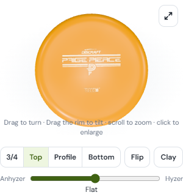

[Large pulled bag render](../assets/discraft-stamp-sweep/batch-1/after-drive-bag.png)

## Flash

**Source crop → extracted alpha → runtime-tinted context.** [Infinite ESP page](https://infinitediscs.com/discraft-flash/esp) · [recorded original](https://infinitediscs.com/Inf_Uploads/DiscProducts/3c44a3c4-f742-46c0-9bcc-a67e3be2a021Flash-ESP.Webp). Source 1200×900 px; one foil verified; PNG **23.761 KB**, 616×616 px.

Source ink bounds `[left, top, right, bottom]`: `[296, 150, 892, 747]`. Paste offset `[x, y]`: `[10, 9]`. Full placement/recipe/hash: [extraction.json](../assets/discraft-stamp-sweep/batch-1/extraction.json).

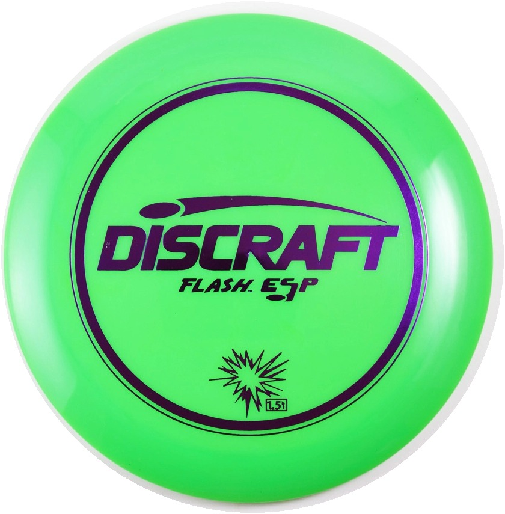

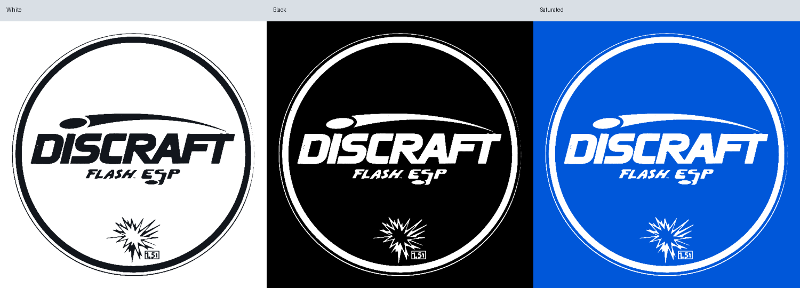

[Large pulled bag render](../assets/discraft-stamp-sweep/batch-1/after-flash-bag.png)

## Force — dedicated foil fidelity judgment

**Source crop → extracted alpha → runtime-tinted context.** [Infinite ESP page](https://infinitediscs.com/discraft-force/esp) · [recorded original](https://infinitediscs.com/Inf_Uploads/DiscProducts/Force431.Webp). Source 2970×2970 px; one foil verified; PNG **190.554 KB**, 1968×1968 px.

Source ink bounds `[left, top, right, bottom]`: `[555, 797, 2407, 2377]`. Paste offset `[x, y]`: `[58, 194]`. Full placement/recipe/hash: [extraction.json](../assets/discraft-stamp-sweep/batch-1/extraction.json).

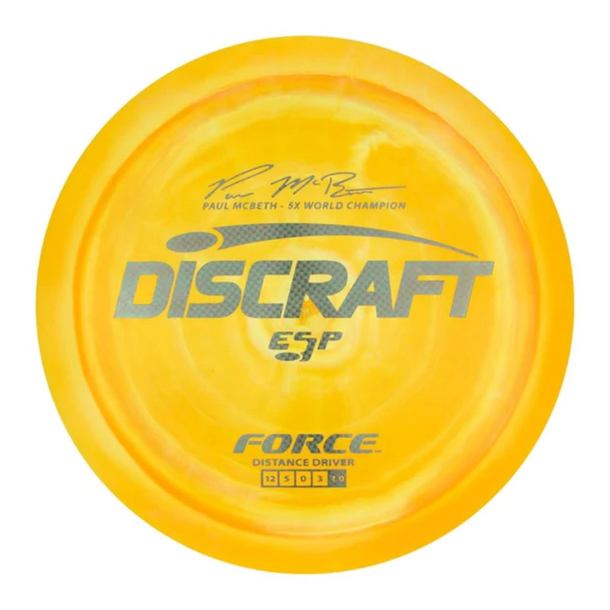

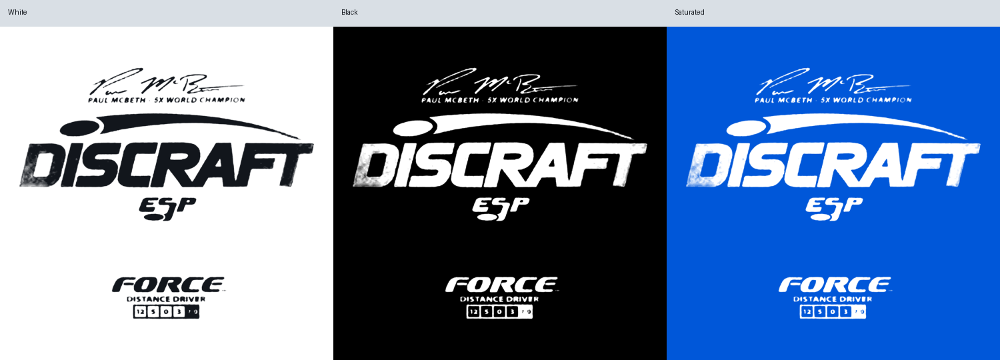

[Large pulled bag render](../assets/discraft-stamp-sweep/batch-1/after-force-bag.png)

**Force verdict: extracted for Freddy's specific review.** Its own 5× signature, champion line, Discraft/ESP marks, Force label and flight strip survive. Patterned silver foil yields uneven alpha inside some broad strokes; the source has soft lettering. No missing shape was redrawn, and no 6× artwork was substituted. Compare the source crop and the native asset when judging those details.

## Hades

**Source crop → extracted alpha → runtime-tinted context.** [Infinite ESP page](https://infinitediscs.com/discraft-hades/esp) · [recorded original](https://infinitediscs.com/Inf_Uploads/DiscProducts/Hadescf0.Webp). Source 2970×2970 px; one foil verified; PNG **199.236 KB**, 2518×2518 px.

Source ink bounds `[left, top, right, bottom]`: `[610, 595, 2406, 2338]`. Paste offset `[x, y]`: `[361, 387]`. Full placement/recipe/hash: [extraction.json](../assets/discraft-stamp-sweep/batch-1/extraction.json).

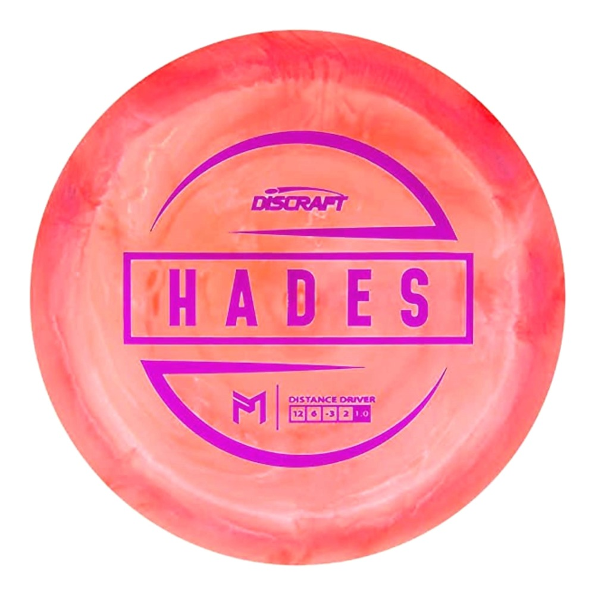

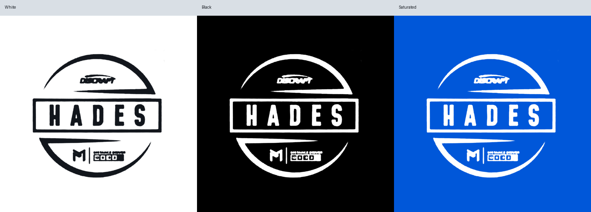

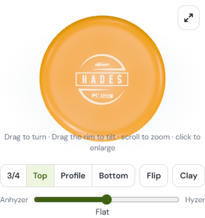

[Large pulled bag render](../assets/discraft-stamp-sweep/batch-1/after-hades-bag.png)

## Heat

**Source crop → extracted alpha → runtime-tinted context.** [Infinite ESP page](https://infinitediscs.com/discraft-heat/esp) · [recorded original](https://infinitediscs.com/Inf_Uploads/DiscProducts/Heatefb7.Webp). Source 2970×2970 px; one foil verified; PNG **91.615 KB**, 2032×2032 px.

Source ink bounds `[left, top, right, bottom]`: `[578, 1029, 2382, 2311]`. Paste offset `[x, y]`: `[114, 375]`. Full placement/recipe/hash: [extraction.json](../assets/discraft-stamp-sweep/batch-1/extraction.json).

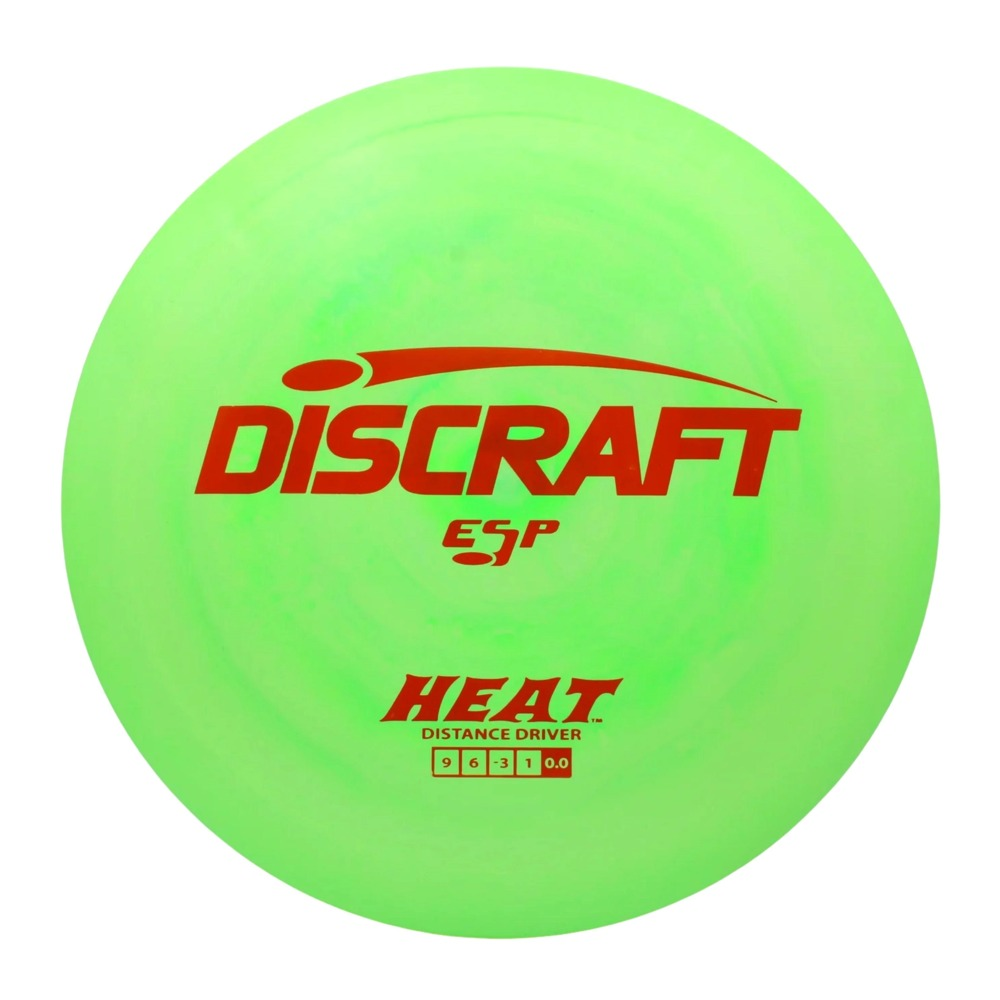

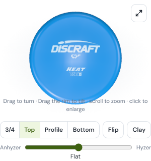

[Large pulled bag render](../assets/discraft-stamp-sweep/batch-1/after-heat-bag.png)

## Meteor

**Source crop → extracted alpha → runtime-tinted context.** [Infinite ESP page](https://infinitediscs.com/discraft-meteor/esp) · [recorded original](https://infinitediscs.com/Inf_Uploads/DiscProducts/Meteor_4.Webp). Source 2970×2970 px; one foil verified; PNG **98.998 KB**, 2258×2258 px.

Source ink bounds `[left, top, right, bottom]`: `[576, 1108, 2405, 2406]`. Paste offset `[x, y]`: `[214, 480]`. Full placement/recipe/hash: [extraction.json](../assets/discraft-stamp-sweep/batch-1/extraction.json).

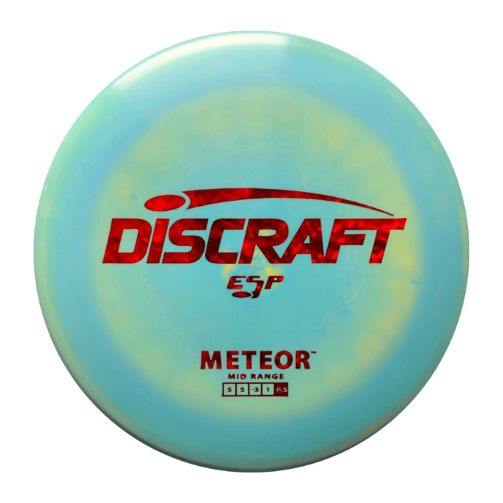

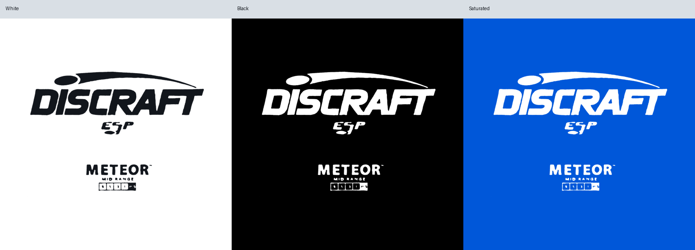

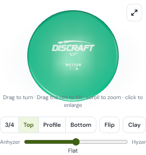

[Large pulled bag render](../assets/discraft-stamp-sweep/batch-1/after-meteor-bag.png)

## Predator

**Source crop → extracted alpha → runtime-tinted context.** [Infinite ESP page](https://infinitediscs.com/discraft-predator/esp) · [recorded original](https://infinitediscs.com/Inf_Uploads/DiscProducts/bc7844-6097-4cc5-8c7d-b12d00a600c5Predator-ESP.Webp). Source 1200×900 px; one foil verified; PNG **28.669 KB**, 617×617 px.

Source ink bounds `[left, top, right, bottom]`: `[297, 142, 895, 741]`. Paste offset `[x, y]`: `[9, 9]`. Full placement/recipe/hash: [extraction.json](../assets/discraft-stamp-sweep/batch-1/extraction.json).

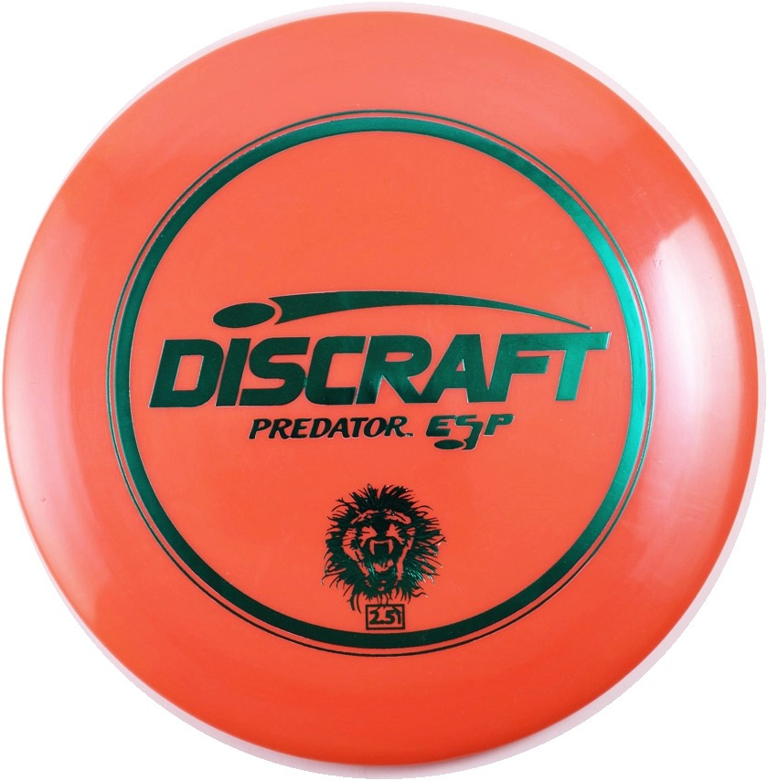

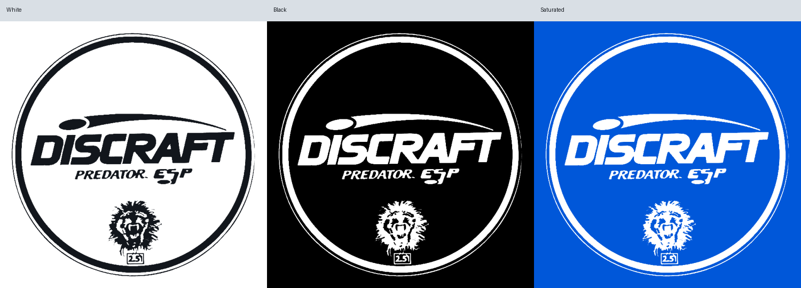

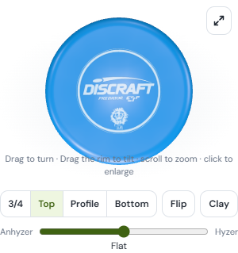

[Large pulled bag render](../assets/discraft-stamp-sweep/batch-1/after-predator-bag.png)

## Pulse

**Source crop → extracted alpha → runtime-tinted context.** [Infinite ESP page](https://infinitediscs.com/discraft-pulse/esp) · [recorded original](https://infinitediscs.com/Inf_Uploads/DiscProducts/Pulse0f0.Webp). Source 2970×2970 px; one foil verified; PNG **227.385 KB**, 1933×1933 px.

Source ink bounds `[left, top, right, bottom]`: `[541, 511, 2454, 2422]`. Paste offset `[x, y]`: `[10, 11]`. Full placement/recipe/hash: [extraction.json](../assets/discraft-stamp-sweep/batch-1/extraction.json).

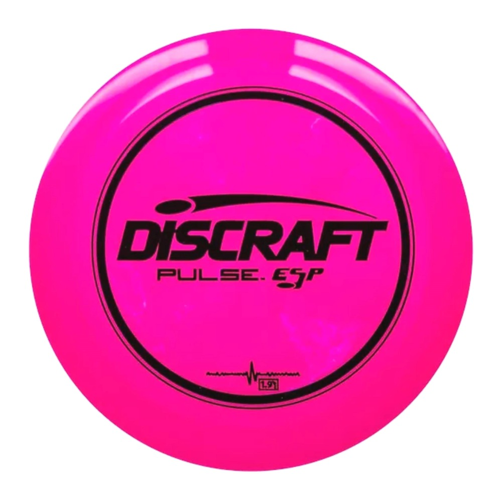

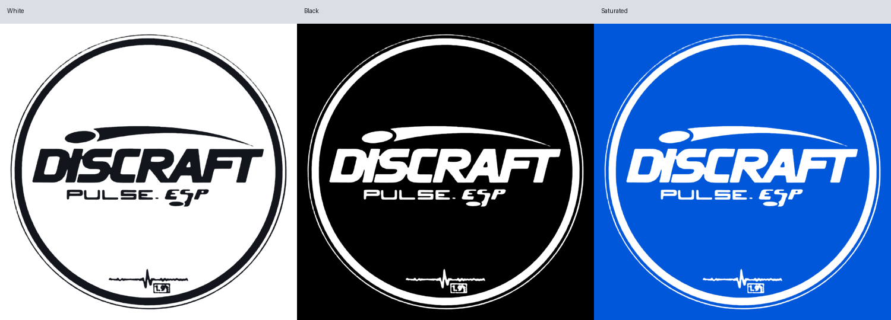

[Large pulled bag render](../assets/discraft-stamp-sweep/batch-1/after-pulse-bag.png)

## Thrasher

**Source crop → extracted alpha → runtime-tinted context.** [Infinite ESP page](https://infinitediscs.com/discraft-thrasher/esp) · [recorded original](https://infinitediscs.com/Inf_Uploads/DiscProducts/Thrasher_3.Webp). Source 2970×2970 px; one foil verified; PNG **111.281 KB**, 2072×2072 px.

Source ink bounds `[left, top, right, bottom]`: `[541, 1068, 2391, 2366]`. Paste offset `[x, y]`: `[111, 387]`. Full placement/recipe/hash: [extraction.json](../assets/discraft-stamp-sweep/batch-1/extraction.json).

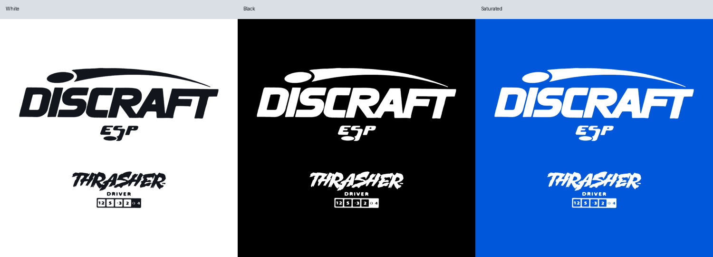

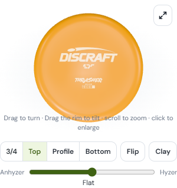

[Large pulled bag render](../assets/discraft-stamp-sweep/batch-1/after-thrasher-bag.png)

## XL

**Source crop → extracted alpha → runtime-tinted context.** [Infinite ESP page](https://infinitediscs.com/discraft-xl/esp) · [recorded original](https://infinitediscs.com/Inf_Uploads/DiscProducts/0c9b55ab-7d23-4945-a03f-dc35179a6ab0XL-ESP.Webp). Source 1200×900 px; one foil verified; PNG **33.672 KB**, 610×610 px.

Source ink bounds `[left, top, right, bottom]`: `[300, 152, 893, 738]`. Paste offset `[x, y]`: `[8, 12]`. Full placement/recipe/hash: [extraction.json](../assets/discraft-stamp-sweep/batch-1/extraction.json).

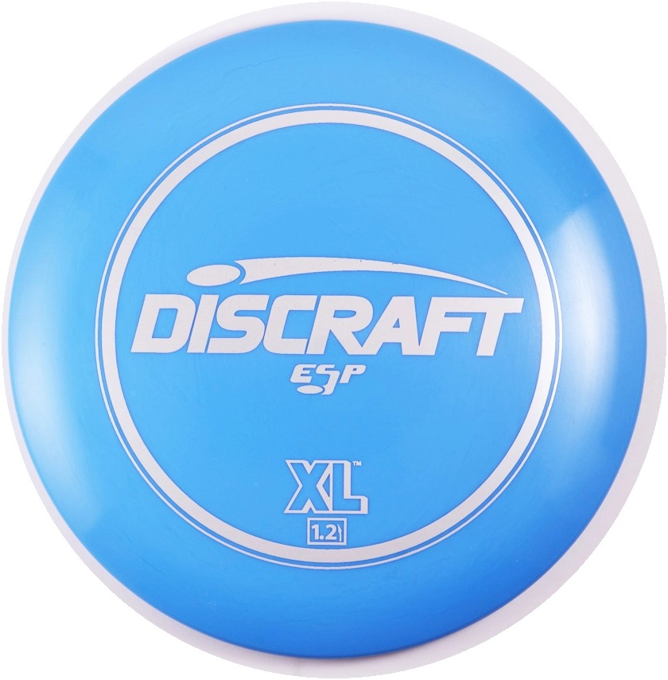

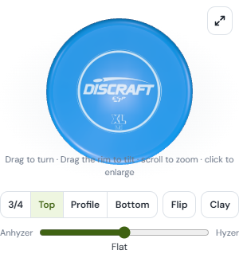

[Large pulled bag render](../assets/discraft-stamp-sweep/batch-1/after-xl-bag.png)

## Zeus

**Source crop → extracted alpha → runtime-tinted context.** [Infinite ESP page](https://infinitediscs.com/discraft-zeus/esp) · [recorded original](https://infinitediscs.com/Inf_Uploads/DiscProducts/Zeusa3be.Webp). Source 2970×2970 px; one foil verified; PNG **99.465 KB**, 1802×1802 px.

Source ink bounds `[left, top, right, bottom]`: `[608, 655, 2340, 2309]`. Paste offset `[x, y]`: `[35, 74]`. Full placement/recipe/hash: [extraction.json](../assets/discraft-stamp-sweep/batch-1/extraction.json).

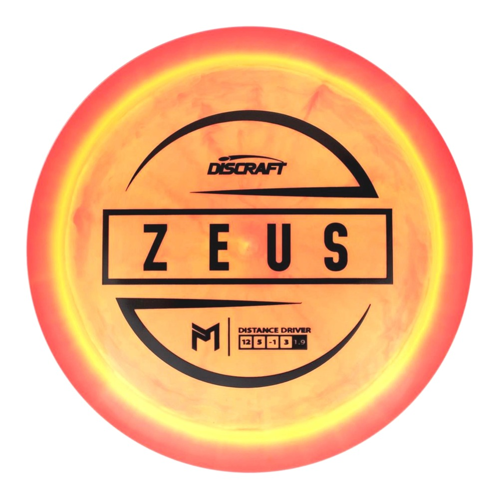

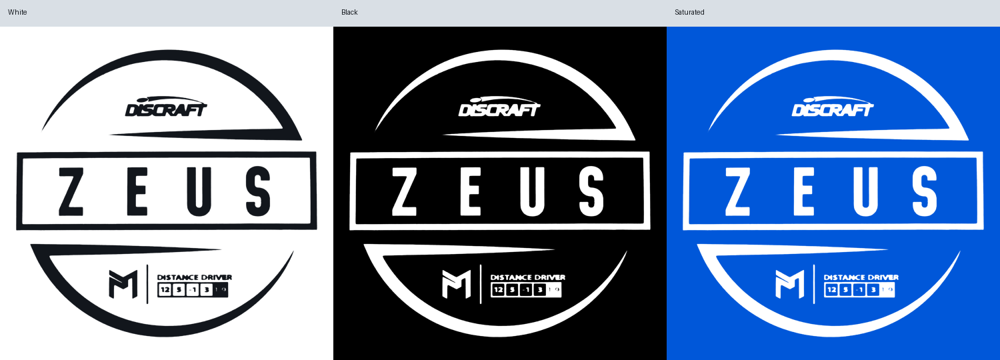

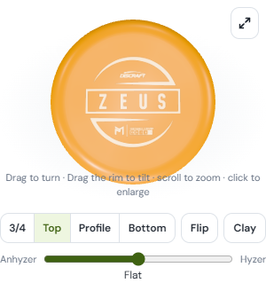

[Large pulled bag render](../assets/discraft-stamp-sweep/batch-1/after-zeus-bag.png)

## Zone GT

**Source crop → extracted alpha → runtime-tinted context.** [Infinite ESP page](https://infinitediscs.com/discraft-zone-gt/esp) · [recorded original](https://infinitediscs.com/Inf_Uploads/DiscProducts/20240402095019925_unnamed19-adfcd303cb9d.webp). Source 1000×992 px; one foil verified; PNG **10.852 KB**, 605×605 px.

Source ink bounds `[left, top, right, bottom]`: `[215, 387, 735, 810]`. Paste offset `[x, y]`: `[42, 91]`. Full placement/recipe/hash: [extraction.json](../assets/discraft-stamp-sweep/batch-1/extraction.json).

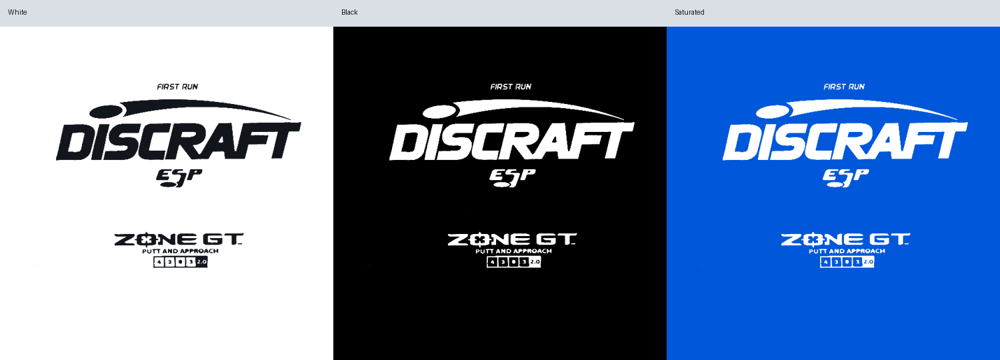

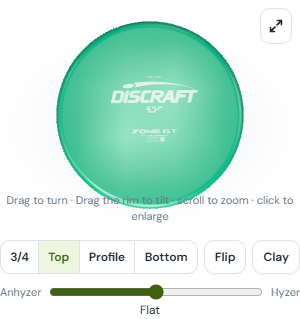

[Large pulled bag render](../assets/discraft-stamp-sweep/batch-1/after-zone-gt-bag.png)

## Unchanged controls

| Control | Before | After |
| --- | --- | --- |
| Buzzz | [viewer](../assets/discraft-stamp-sweep/batch-1/before-buzzz-viewer.png) | [viewer](../assets/discraft-stamp-sweep/batch-1/after-buzzz-viewer.png) |
| Zone | [viewer](../assets/discraft-stamp-sweep/batch-1/before-zone-viewer.png) | [viewer](../assets/discraft-stamp-sweep/batch-1/after-zone-viewer.png) |
| Luna | [viewer](../assets/discraft-stamp-sweep/batch-1/before-luna-viewer.png) | [viewer](../assets/discraft-stamp-sweep/batch-1/after-luna-viewer.png) |
| Nuke | [viewer](../assets/discraft-stamp-sweep/batch-1/before-nuke-viewer.png) | [viewer](../assets/discraft-stamp-sweep/batch-1/after-nuke-viewer.png) |
| Destroyer | [viewer](../assets/discraft-stamp-sweep/batch-1/before-destroyer-viewer.png) | [viewer](../assets/discraft-stamp-sweep/batch-1/after-destroyer-viewer.png) |
