# Discraft stamp sweep — Batch 2

**31 reviewed: 16 extracted · 12 fallback · 3 existing pilots retained. New production PNG payload: 1577.119 KB.** Nuke remains fallback: its recorded G3T source has distinct blue and black inks; no single-ink flattening was made. All foil-risk outcomes are explicitly labelled below. No push or deployment.

| Mold | Source retailer actually used | Asset KB | Outcome |
| --- | --- | ---: | --- |
| Anax | Marshall Street | 86.434 | Extracted |
| Ares | Marshall Street | 130.924 | Extracted |
| Athena | Marshall Street | 67.321 | Extracted |
| Buzzz | Discraft (existing pilot) | 41.139 | Retained unchanged* |
| Buzzz OS | Marshall Street | 0.000 | Fallback — unverified ink count |
| Buzzz SS | Marshall Street | 0.000 | Fallback — two inks |
| Cicada | Marshall Street | 229.131 | Extracted |
| Cigarra | OTB Discs | 0.000 | Fallback — two inks |
| Crank | Reaper Discs | 20.230 | Extracted |
| Drone | Reaper Discs | 0.000 | Fallback — fidelity failed |
| Flick | Reaper Discs | 15.093 | Extracted |
| Hallux | Marshall Street | 0.000 | Fallback — unverified ink count |
| Joy | Marshall Street | 134.937 | Extracted |
| Luna | Discraft (existing pilot) | 17.545 | Retained unchanged* |
| Malita | Marshall Street | 73.000 | Extracted |
| Malta | Marshall Street | 0.000 | Fallback — fidelity failed |
| Nuke | Gotta Go Gotta Throw | 0.000 | Fallback — two inks |
| Nuke OS | Marshall Street | 0.000 | Fallback — fidelity failed |
| Nuke SS | Marshall Street | 130.700 | Extracted |
| Raptor | Marshall Street | 113.365 | Extracted |
| Scorch | Reaper Discs | 18.024 | Extracted |
| Sled | Marshall Street | 67.966 | Extracted |
| Sol | Marshall Street | 0.000 | Fallback — unverified ink count |
| Stalker | Reaper Discs | 25.731 | Extracted |
| Swarm | Marshall Street | 95.381 | Extracted |
| Undertaker | Marshall Street | 258.385 | Extracted |
| Venom | Marshall Street | 0.000 | Fallback — fidelity failed |
| Vulture | Reaper Discs | 0.000 | Fallback — fidelity failed |
| Zone | Discraft (existing pilot) | 32.006 | Retained unchanged* |
| Zone OS | Reaper Discs | 0.000 | Fallback — fidelity failed |
| Zone SS | Marshall Street | 110.497 | Extracted |

*The expansion’s exact 31 `ready` rows include Buzzz, Zone and Luna. Their approved pilot designs/placements were preserved as required controls; alternate revisions were inspected but not extracted. Their existing KB are excluded from the new-payload total. `0.000 KB` on a fallback row means no new runtime asset, not an empty PNG.

## Baseline and method

First commit of this run: **`4005a8c`**, merging `origin/main` **`3abd397`** into the existing `codex/discraft-stamp-sweep` worktree after `472db6c`. Conflicts were mechanical: main’s mandatory scale schema + the existing 14 Batch 1 placements + the three pilot placements. `public/data.json` was regenerated through prepare; no hand edits. Batch 1 art and the completed fraction audit remain untouched.

The ready-count gate returned exactly **31** before extraction. Every original’s decoded dimensions were checked against its recorded winning-source manifest. SHA-256 receipts are in [extraction.json](../assets/discraft-stamp-sweep/batch-2/extraction.json). Downloads remain local under ignored `outputs/discraft-batch2-sources/`; the committed crops are review evidence, never runtime photography.

Ink count was reviewed per source before extraction. Distinct blue/black or pink/black imprints are not flattened. Ambiguous ink count is reported as unverified. Single metallic foils may vary in brightness/hue, but a source that cannot yield its complete design without plastic or missing fine marks is rejected. No redraw, tracing, generative repair, dilation, replacement lettering, or cross-mold elements.

Per-mold channel classifiers retain original source pixels and arrangement. White RGB + alpha only. Each square uses the pilot’s circular-fit transparent padding. Full-disc diameter is the larger rim-to-rim centre-axis span on that same head-on source; stamp diameter is the complete nonzero source alpha’s larger width/height. `diameterFraction = sourceInkDiameterPx / sourceDiscDiameterPx`; `assetInkFraction = sourceInkDiameterPx / assetSquarePx`. No flight-plate denominator or 6.2 cm cap.

Marshall Street’s tinted tabletop requires measured edge transitions rather than a white-background chroma test: median 5px centre bands, inspected outer-rim edges. Joy’s bottom tabletop seam is excluded. Reaper’s white backdrop uses the full outer centre-axis silhouette. Measurement proofs mark disc bounds cyan and ink bounds red. All assignments pass the existing full-disc renderer’s fraction/mesh checks without renderer changes.

Wiring stays source manifest → `prepare_data.py` → `validate_data.py`. Alternate provenance now requires the exact reviewed own-mold ID/page/image/retailer/hash tuple, as well as the existing Discraft/rights/path/placement checks. Atlas markers and lazy loading are unchanged.

## Verification

Fresh data validation: **33 assigned stamps, 2,434 identities, 1,182 flight matches, 0 local photos**. Manifest tests **10/10**; Batch 2 invariants **6/6**; geometry/atlas/bag/collection/photo Node regressions **101/101**. Existing 17 assignment objects and all their PNG bytes equal the post-merge baseline; meta, record ordering and all non-stamp catalog fields are identical. The 8 risky and 48 no entries, rejected GT/Banger Top and all Batch 1 sweep objects remain unchanged.

The dedicated pixel proof uses deterministic SwiftShader WebGL after native D3D11 returned small raster/compositor differences on unchanged controls. It runs the same production modules, shaders, masks and poses. Separate placement, existing viewer/pop-out/bag/photo browser suites and the unmodified performance gate use native D3D11. Browser proof suite checks all 16 new viewer textures, own-mold assignments and pulled bag/storage changes; every pilot and Batch 1 control; Nuke, still-no Archer and non-Discraft Destroyer; all other Batch 2 fallbacks; unchanged photo/clay precedence and thumbnails; cancellation/failure fallback, brand gate and zero atlas stamp requests. Texture, geometry and camera controls are exact. Viewer controls require byte-identical production frames, textures, geometry and camera; bag presentation retains the original one-level / 0.01% quantization bound. Browser-composited viewer screenshot deltas are recorded separately with a maximum one-channel-level bound: the prior 0.01% changed-pixel fraction proved unstable despite identical production frames. No production renderer or perf margin changed. [Browser receipt](../assets/discraft-stamp-sweep/batch-2/verification.json). Native thumbnail verification independently shows **16 new designs / 20 unchanged controls** and zero atlas stamp requests before selection: [receipt](../assets/discraft-stamp-sweep/batch-2/native-thumbnails.json), [comparison](../assets/discraft-stamp-sweep/batch-2/native-thumbnails.png).

Native D3D11 cross-context controls showed small raster/compositor differences (1–2 channel levels) on unchanged assets/geometry/camera. Pixel proofs therefore use deterministic SwiftShader; all 61 final control production frames are byte-identical, with composited screenshot maximum delta 1. The early Buzzz SS/Buzzz-SS alias selection error was fixed by recorded catalog IDs. Software thumbnail testing correctly hit the existing atlas software-fallback guard, so thumbnail checks were moved to the separate native suite without changing the guard. These proof-harness issues were investigated and corrected, not counted as product failures or quietly discarded.

Other browser suites: Batch 2 deterministic viewer/bag/storage proof, native Batch 2 physical placement and thumbnails, native disc3d viewer, native pop-out, native bag 3D, native photo editor/textures. All existing native suites passed on their first final run. Neither the known bag 3D timeout nor the editor save-dialog non-close occurred.

Independent review found and corrected Ares arc, Raptor final R/champion line, Stalker first S, and a newly admitted Ares plastic fragment. Independent source-coordinate pixel regressions preserve the edge elements and reject the fragment. Exact alternate-source validation was hardened after a deliberately wrong page/missing image/hash test first failed. Final read-only recheck: no remaining important findings.

## Performance — unchanged default gate

Both baseline and final pass at **7 desktop / 3 phone warm repetitions**, original **1.15×**, **1.5 / 3 ms** slack and **+1 long task**, including aggregate and paired checks. Baseline 99.12s; final 105.87s. No PERF_REPS or margin override. No quiet failure discarded. Raw [before](../assets/discraft-stamp-sweep/batch-2/perf-before.json) / [after](../assets/discraft-stamp-sweep/batch-2/perf-after.json).

| Device / metric | Baseline 2D | Baseline 3D | Final 2D | Final 3D | 3D delta | Final limit | Paired excess |
| --- | ---: | ---: | ---: | ---: | ---: | ---: | ---: |
| desktop flight p95 | 3.300 | 3.600 | 3.400 | 4.000 | +0.400 | 5.410 | -1.340 |
| desktop 1x p95 | 0.700 | 1.100 | 0.900 | 1.400 | +0.300 | 2.535 | -1.220 |
| desktop long tasks | 0.000 | 0.000 | 0.000 | 0.000 | +0.000 | 1.000 | -1.000 |
| phone flight p95 | 11.200 | 12.000 | 11.200 | 12.400 | +0.400 | 15.880 | -2.280 |
| phone 1x p95 | 2.100 | 2.300 | 2.100 | 2.800 | +0.500 | 5.415 | -2.615 |
| phone long tasks | 2.000 | 1.000 | 1.000 | 1.000 | +0.000 | 2.000 | -1.000 |

One full measured baseline and one full measured final default gate passed; no measured perf failure or rerun. Deltas are observed warm run-to-run medians, not a causal estimate of stamp cost. The atlas never requests these assets.

The following proof sections are the local fidelity verdicts. Freddy’s visual judgment remains available for every labelled foil-risk section; no human approval is claimed.

## Nuke — DEDICATED NUKE HOLDOUT — FOIL-RISK — FALLBACK

Recorded alternate: **Gotta Go Gotta Throw**, [page](https://gottagogottathrow.com/products/discraft-esp-nuke-paige-pierce-5x-distance-driver-golf-disc) · [original](https://gottagogottathrow.com/cdn/shop/files/DCESP-PP_Nuke.jpg?v=1790780682&width=1000); verified 1000×1000 px. Source SHA-256 `230abc84b0527ff3cabc09a05f49a412457e061941a4c040496de6a36543a2c9`.

**Fallback retained. Ink count: 2. New asset: 0.000 KB; no placement assigned.** Two distinct solid inks: blue PP mark and champion line; black Discraft, NUKE, flight strip and ESP. Single-ink flattening prohibited; fallback retained.

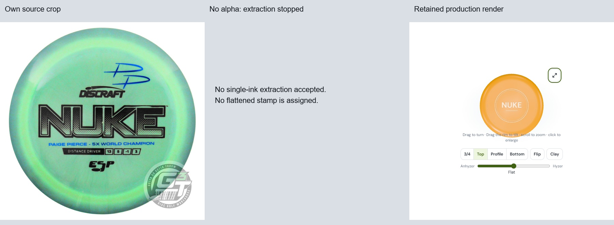

[Source crop](../assets/discraft-stamp-sweep/batch-2/nuke-source-crop.jpg) · [Production viewer](../assets/discraft-stamp-sweep/batch-2/after-nuke-viewer.png)

## Anax — FOIL-RISK — EXTRACTED

Recorded alternate: **Marshall Street**, [page](https://www.marshallstreetdiscgolf.com/product/esp-anax-paul-mcbeth) · [original](https://s3.amazonaws.com/media.marshallstreetdiscgolf.com/wp-content/uploads/2025/12/15093614/Anax_ESP_PM_00-scaled-1.webp); verified 2539×2560 px. Source SHA-256 `135b0b9e929617a5003a38f468c3b81d045eac82c9c895674ed51d1dcdea2893`.

**One ink verified. 86.434 KB.** Full disc 2451 px; complete ink 1577 px; target **64.341085%** of full disc. Asset square 1644 px; ink/asset 95.924574%. Source ink bounds `[499, 513, 2076, 2035]`; source centre axes `[[50, 2478], [55, 2506]]`. Native renderer physical fraction 64.341088% (within 0.0002 percentage points).

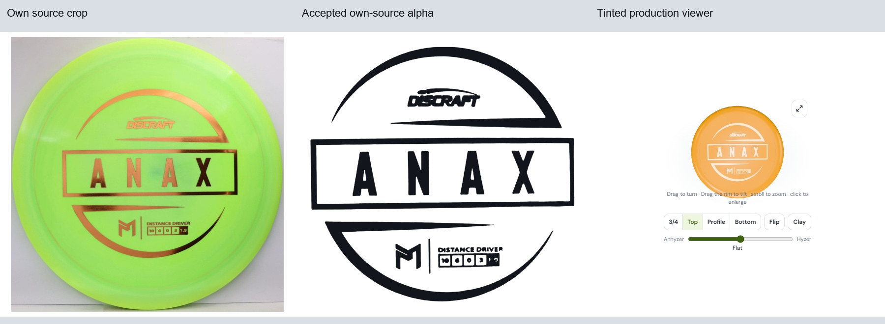

[Source crop](../assets/discraft-stamp-sweep/batch-2/anax-source-crop.jpg) · [Production viewer](../assets/discraft-stamp-sweep/batch-2/after-anax-viewer.png)

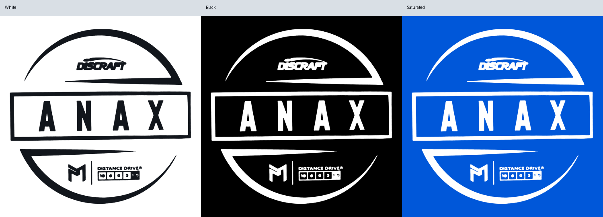

[Measurement bounds](../assets/discraft-stamp-sweep/batch-2/anax-measurement.jpg) · [Source ink detail](../assets/discraft-stamp-sweep/batch-2/anax-ink-detail.jpg) · [Alpha PNG](../../public/stamps/discraft/anax.png)

## Ares — FOIL-RISK — EXTRACTED

Recorded alternate: **Marshall Street**, [page](https://www.marshallstreetdiscgolf.com/product/esp-ares-paul-mcbeth-first-run) · [original](https://s3.amazonaws.com/media.marshallstreetdiscgolf.com/wp-content/uploads/2026/07/02081530/Ares_First-Run_Paul-McBeth_00-scaled-7.webp); verified 2560×2485 px. Source SHA-256 `90953a4da33542848782e5d889a681ef89e0595487a7f560a1928b86da6051a0`.

**One ink verified. 130.924 KB.** Full disc 2384 px; complete ink 1571 px; target **65.897651%** of full disc. Asset square 1641 px; ink/asset 95.734308%. Source ink bounds `[493, 424, 2064, 1923]`; source centre axes `[[70, 2454], [39, 2418]]`. Native renderer physical fraction 65.897653% (within 0.0002 percentage points).

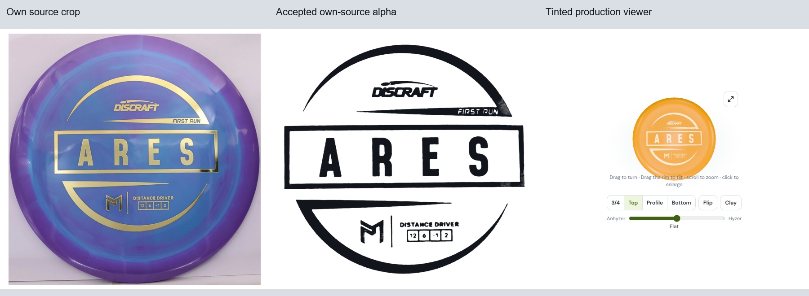

[Source crop](../assets/discraft-stamp-sweep/batch-2/ares-source-crop.jpg) · [Production viewer](../assets/discraft-stamp-sweep/batch-2/after-ares-viewer.png)

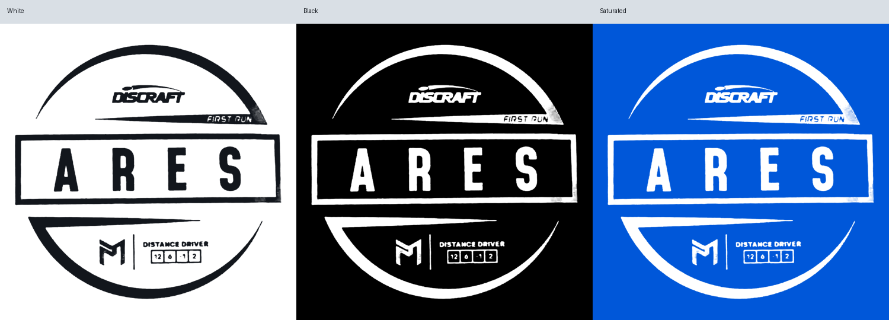

[Measurement bounds](../assets/discraft-stamp-sweep/batch-2/ares-measurement.jpg) · [Source ink detail](../assets/discraft-stamp-sweep/batch-2/ares-ink-detail.jpg) · [Alpha PNG](../../public/stamps/discraft/ares.png)

## Athena — FOIL-RISK — EXTRACTED

Recorded alternate: **Marshall Street**, [page](https://www.marshallstreetdiscgolf.com/product/esp-athena-paul-mcbeth) · [original](https://s3.amazonaws.com/media.marshallstreetdiscgolf.com/wp-content/uploads/2026/02/16083535/Athena_ESP_Paul-McBeth_00-scaled-1.webp); verified 2560×2457 px. Source SHA-256 `1cf0efd59d37e488a48bfd37b0b77fe73d99cadab8da9b917c9a436f2e228e5d`.

**One ink verified. 67.321 KB.** Full disc 2308 px; complete ink 1496 px; target **64.818024%** of full disc. Asset square 1554 px; ink/asset 96.267696%. Source ink bounds `[525, 524, 2021, 1945]`; source centre axes `[[119, 2427], [109, 2411]]`. Native renderer physical fraction 64.818027% (within 0.0002 percentage points).

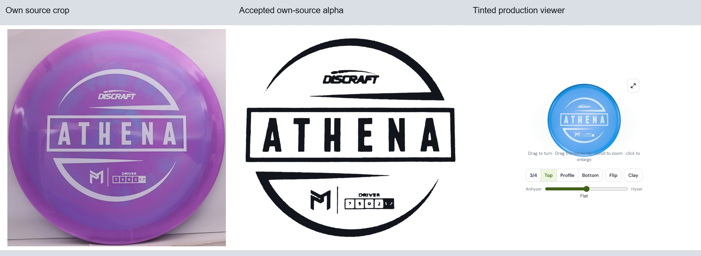

[Source crop](../assets/discraft-stamp-sweep/batch-2/athena-source-crop.jpg) · [Production viewer](../assets/discraft-stamp-sweep/batch-2/after-athena-viewer.png)

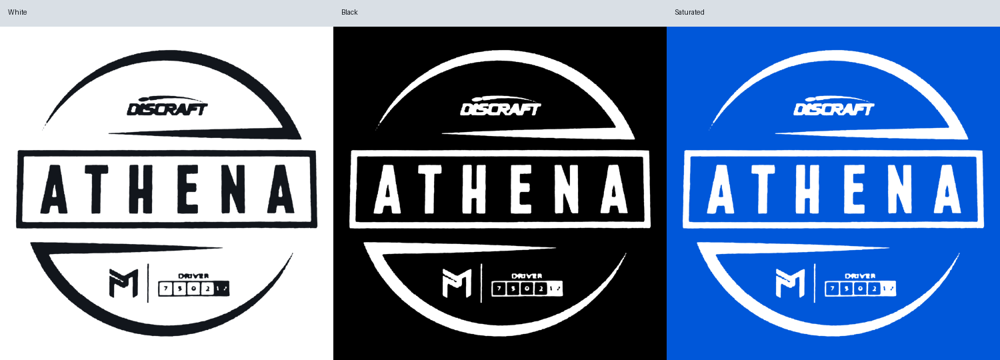

[Measurement bounds](../assets/discraft-stamp-sweep/batch-2/athena-measurement.jpg) · [Source ink detail](../assets/discraft-stamp-sweep/batch-2/athena-ink-detail.jpg) · [Alpha PNG](../../public/stamps/discraft/athena.png)

## Buzzz — FOIL-RISK — CONTROL-UNCHANGED

Recorded alternate: **Marshall Street**, [page](https://www.marshallstreetdiscgolf.com/product/esp-buzzz-paul-mcbeth-6x-7) · [original](https://s3.amazonaws.com/media.marshallstreetdiscgolf.com/wp-content/uploads/2026/09/21120740/Buzzz_ESP_Paul%20McBeth%206X_00-scaled.webp); verified 2560×2520 px. Source SHA-256 `034dce61191d0db5934575bf2e2ab8a335ef60875a8cb1c5500c6c16720af938`.

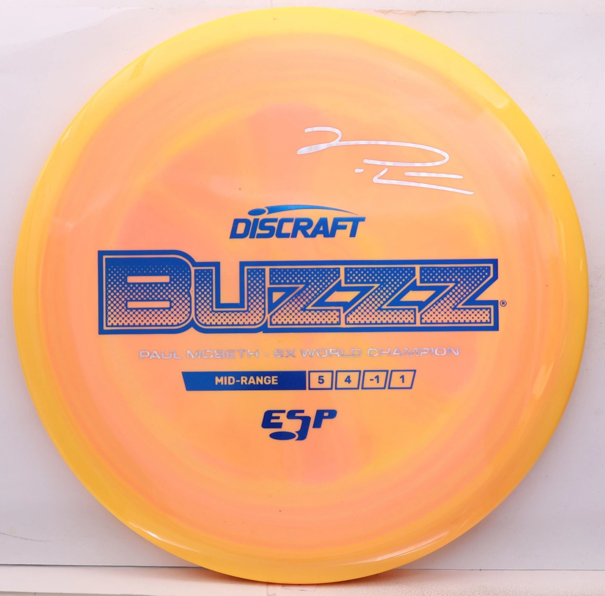

Actual retained provenance: **Discraft**, [approved pilot page](https://www.discraft.com/paul-mcbeth-6x-esp-buzzz-signature-series-pmebuzzz). Alternate revision above was not transferred. Existing placement 71.191406%; asset 41.139 KB, unchanged.

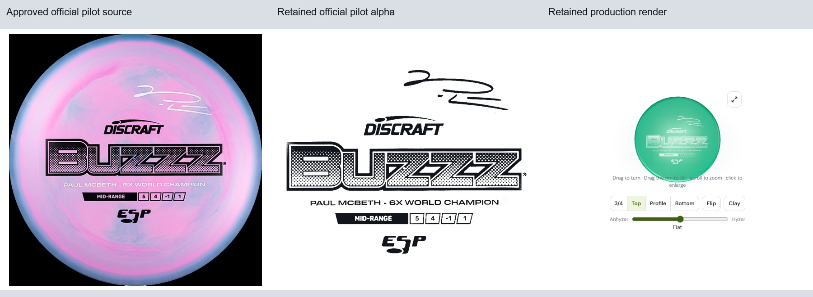

[Source crop](../assets/discraft-stamp-sweep/batch-2/buzzz-source-crop.jpg) · [Production viewer](../assets/discraft-stamp-sweep/batch-2/after-buzzz-viewer.png)

## Buzzz OS — FOIL-RISK — FALLBACK

Recorded alternate: **Marshall Street**, [page](https://www.marshallstreetdiscgolf.com/product/esp-buzzz-os-paige-pierce) · [original](https://s3.amazonaws.com/media.marshallstreetdiscgolf.com/wp-content/uploads/2026/09/21120928/Buzzz%20OS_ESP_Paige%20Pierce%205X_00-scaled.webp); verified 2560×2515 px. Source SHA-256 `a64bea873f3ca32ae66b9c348c77862085500044f9cae4b2c7a0389dd23f5415`.

**Fallback retained. Ink count: unverified. New asset: 0.000 KB; no placement assigned.** White PP signature and gold/black main foil have independently different appearance; cannot verify a genuinely single-ink design from this source. Fallback retained.

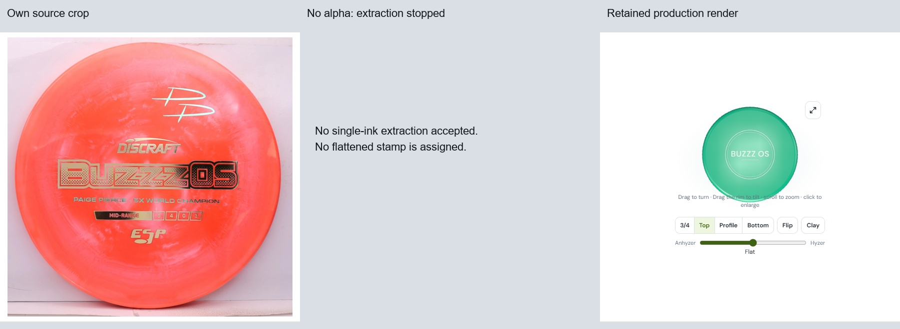

[Source crop](../assets/discraft-stamp-sweep/batch-2/buzzz-os-source-crop.jpg) · [Production viewer](../assets/discraft-stamp-sweep/batch-2/after-buzzz-os-viewer.png)

## Buzzz SS — FOIL-RISK — FALLBACK

Recorded alternate: **Marshall Street**, [page](https://www.marshallstreetdiscgolf.com/product/esp-buzzz-ss-paul-mcbeth-6x) · [original](https://s3.amazonaws.com/media.marshallstreetdiscgolf.com/wp-content/uploads/2026/09/21120419/Buzzz%20SS_ESP_Paul%20McBeth%206X_00-scaled.webp); verified 2560×2532 px. Source SHA-256 `3f542cec56dc18ee6588daf7fad2d631fb561db2b9c672004e65dde1426c0f4a`.

**Fallback retained. Ink count: 2. New asset: 0.000 KB; no placement assigned.** Pink McBeth signature/champion line and black main stamp are distinct inks. Single-ink flattening prohibited; fallback retained.

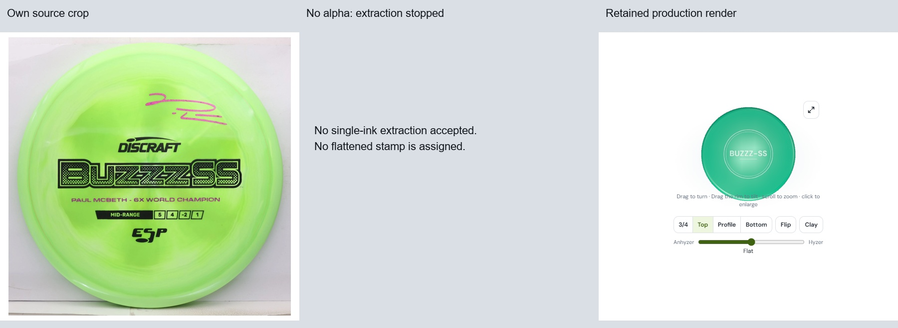

[Source crop](../assets/discraft-stamp-sweep/batch-2/buzzz-ss-source-crop.jpg) · [Production viewer](../assets/discraft-stamp-sweep/batch-2/after-buzzz-ss-viewer.png)

## Cicada — EXTRACTED

Recorded alternate: **Marshall Street**, [page](https://www.marshallstreetdiscgolf.com/product/esp-cicada) · [original](https://s3.amazonaws.com/media.marshallstreetdiscgolf.com/wp-content/uploads/2026/09/21114638/Cicada_ESP_00-scaled.webp); verified 2560×2550 px. Source SHA-256 `2df3626aeae914a9c7ede3b7a02150b762b0c07abf76331d9a5f56c0d25fd090`.

**One ink verified. 229.131 KB.** Full disc 2454 px; complete ink 1772 px; target **72.208639%** of full disc. Asset square 1806 px; ink/asset 98.117386%. Source ink bounds `[401, 761, 2173, 1879]`; source centre axes `[[51, 2500], [64, 2518]]`. Native renderer physical fraction 72.208641% (within 0.0002 percentage points).

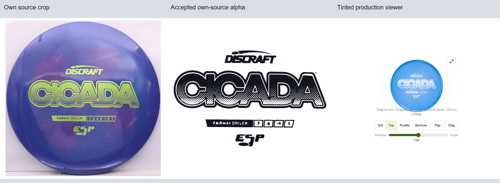

[Source crop](../assets/discraft-stamp-sweep/batch-2/cicada-source-crop.jpg) · [Production viewer](../assets/discraft-stamp-sweep/batch-2/after-cicada-viewer.png)

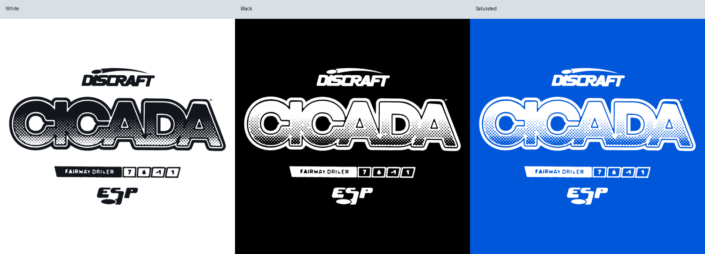

[Measurement bounds](../assets/discraft-stamp-sweep/batch-2/cicada-measurement.jpg) · [Source ink detail](../assets/discraft-stamp-sweep/batch-2/cicada-ink-detail.jpg) · [Alpha PNG](../../public/stamps/discraft/cicada.png)

## Cigarra — FOIL-RISK — FALLBACK

Recorded alternate: **OTB Discs**, [page](https://otbdiscs.com/product/refresh-anthony-barela-esp-cigarra/) · [original](https://otbdiscs.b-cdn.net/wp-content/uploads/2030/09/26_R_Cigarra_2-1.png); verified 1077×1077 px. Source SHA-256 `ddb997994e0b95efe98813ab78bebf6685b0f2120d7e1b7876a91225385b3d4d`.

**Fallback retained. Ink count: 2. New asset: 0.000 KB; no placement assigned.** Blue AB signature/champion line and black main stamp are distinct inks. Single-ink flattening prohibited; fallback retained.

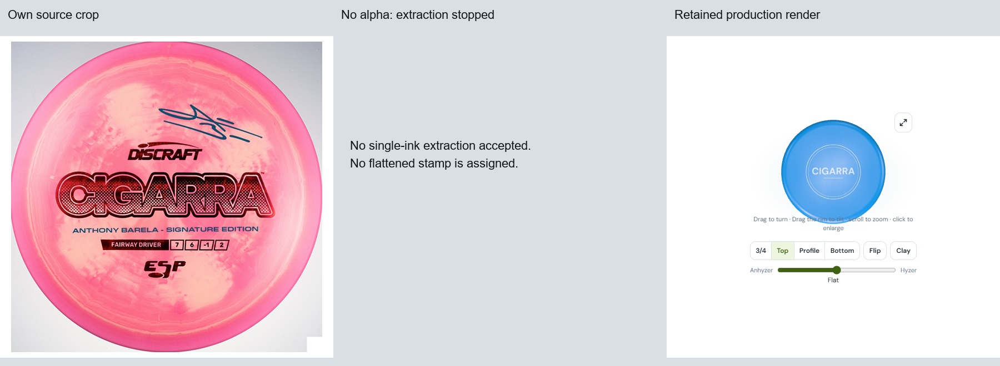

[Source crop](../assets/discraft-stamp-sweep/batch-2/cigarra-source-crop.jpg) · [Production viewer](../assets/discraft-stamp-sweep/batch-2/after-cigarra-viewer.png)

## Crank — FOIL-RISK — EXTRACTED

Recorded alternate: **Reaper Discs**, [page](https://reaperdiscs.com/products/discraft-esp-crank) · [original](http://reaperdiscs.com/cdn/shop/files/discraft-esp-crank-V5745-default.jpg?v=1697956825); verified 900×900 px. Source SHA-256 `bb3f7a9f046cebb9e183b4567c5f0906e59362aa5b4d1ebea436f2c2d12c199e`.

**One ink verified. 20.230 KB.** Full disc 885 px; complete ink 597 px; target **67.457627%** of full disc. Asset square 682 px; ink/asset 87.536657%. Source ink bounds `[139, 312, 736, 726]`; source centre axes `[[8, 893], [13, 887]]`. Native renderer physical fraction 67.457629% (within 0.0002 percentage points).

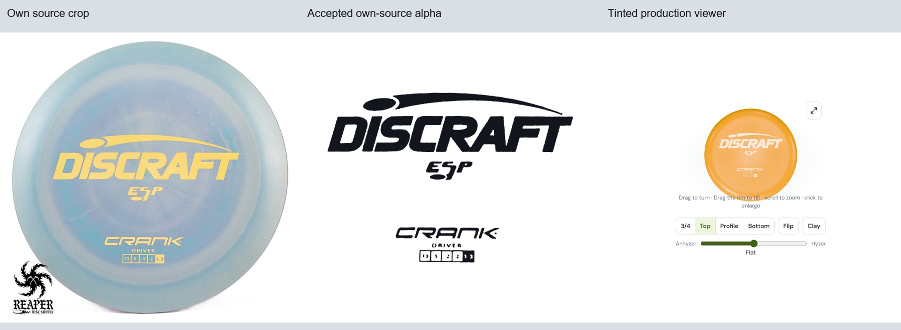

[Source crop](../assets/discraft-stamp-sweep/batch-2/crank-source-crop.jpg) · [Production viewer](../assets/discraft-stamp-sweep/batch-2/after-crank-viewer.png)

[Measurement bounds](../assets/discraft-stamp-sweep/batch-2/crank-measurement.jpg) · [Source ink detail](../assets/discraft-stamp-sweep/batch-2/crank-ink-detail.jpg) · [Alpha PNG](../../public/stamps/discraft/crank.png)

## Drone — FOIL-RISK — FALLBACK

Recorded alternate: **Reaper Discs**, [page](https://reaperdiscs.com/products/discraft-esp-drone-se-bar-stamp) · [original](http://reaperdiscs.com/cdn/shop/products/discraft-esp-drone-bar-stamp-C5230.jpg?v=1638687279); verified 1500×1500 px. Source SHA-256 `0a4ed39b0a42253de073e38f3eb4b793a9394b68e16142baf5551b36d34ab8d4`.

**Fallback retained. Ink count: 1. New asset: 0.000 KB; no placement assigned.** Single reflective silver foil overlaps pale blue plastic and white glare through fine Discraft detail. Complete separation is not reliable without guessing; fallback retained.

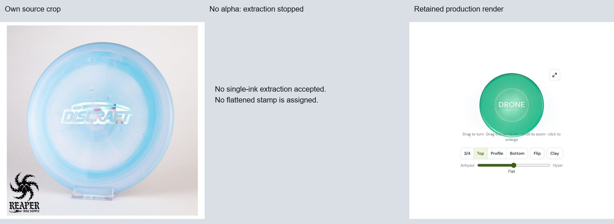

[Source crop](../assets/discraft-stamp-sweep/batch-2/drone-source-crop.jpg) · [Production viewer](../assets/discraft-stamp-sweep/batch-2/after-drone-viewer.png)

## Flick — EXTRACTED

Recorded alternate: **Reaper Discs**, [page](https://reaperdiscs.com/products/discraft-esp-flick) · [original](http://reaperdiscs.com/cdn/shop/products/discraft-esp-flick-HI4499-default.jpg?v=1691812427); verified 900×900 px. Source SHA-256 `5ba9d731e1d6009eac914f87bcba3bba28347e14717380e2c77790a42a6c61e9`.

**One ink verified. 15.093 KB.** Full disc 897 px; complete ink 602 px; target **67.112598%** of full disc. Asset square 689 px; ink/asset 87.373004%. Source ink bounds `[149, 299, 751, 713]`; source centre axes `[[1, 898], [9, 894]]`. Native renderer physical fraction 67.112601% (within 0.0002 percentage points).

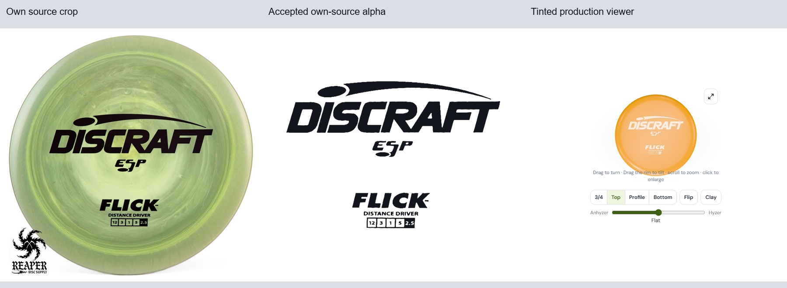

[Source crop](../assets/discraft-stamp-sweep/batch-2/flick-source-crop.jpg) · [Production viewer](../assets/discraft-stamp-sweep/batch-2/after-flick-viewer.png)

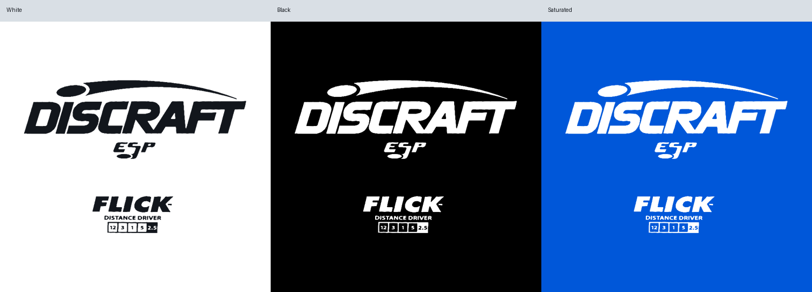

[Measurement bounds](../assets/discraft-stamp-sweep/batch-2/flick-measurement.jpg) · [Source ink detail](../assets/discraft-stamp-sweep/batch-2/flick-ink-detail.jpg) · [Alpha PNG](../../public/stamps/discraft/flick.png)

## Hallux — FALLBACK

Recorded alternate: **Marshall Street**, [page](https://www.marshallstreetdiscgolf.com/product/esp-hallux-ricky-wysocki-first-run) · [original](https://s3.amazonaws.com/media.marshallstreetdiscgolf.com/wp-content/uploads/2026/05/27080244/Hallux_ESP_First-Run_Ricky-Wysochi-2X_00-scaled-6.webp); verified 2560×2495 px. Source SHA-256 `7b32a63fea98b80b458dd3847e50e033e62f855b8f179d96fe3ae692cc7d6850`.

**Fallback retained. Ink count: unverified. New asset: 0.000 KB; no placement assigned.** Blue main art and dark first-run/flight strip cannot be verified as one ink from this source. Fallback retained rather than silently merging ink regions.

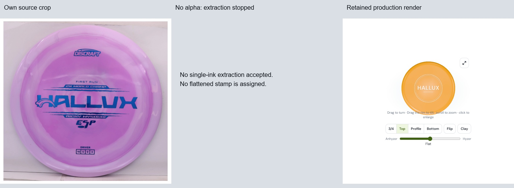

[Source crop](../assets/discraft-stamp-sweep/batch-2/hallux-source-crop.jpg) · [Production viewer](../assets/discraft-stamp-sweep/batch-2/after-hallux-viewer.png)

## Joy — FOIL-RISK — EXTRACTED

Recorded alternate: **Marshall Street**, [page](https://www.marshallstreetdiscgolf.com/product/esp-joy-paige-pierce-first-run) · [original](https://s3.amazonaws.com/media.marshallstreetdiscgolf.com/wp-content/uploads/2026/07/20142705/Joy_ESP_Paige-Pierce_First-Run_00-scaled-3.webp); verified 2560×2464 px. Source SHA-256 `eb6bbf4233fc0c03f2e264337b3f41b9e3898d3bd51bff22624369a0dd7c1058`.

**One ink verified. 134.937 KB.** Full disc 2335 px; complete ink 1681 px; target **71.991435%** of full disc. Asset square 1742 px; ink/asset 96.498278%. Source ink bounds `[400, 359, 2081, 2006]`; source centre axes `[[71, 2406], [73, 2400]]`. Native renderer physical fraction 71.991437% (within 0.0002 percentage points).

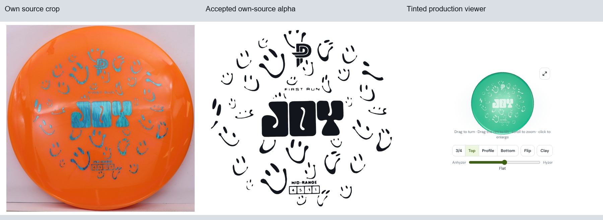

[Source crop](../assets/discraft-stamp-sweep/batch-2/joy-source-crop.jpg) · [Production viewer](../assets/discraft-stamp-sweep/batch-2/after-joy-viewer.png)

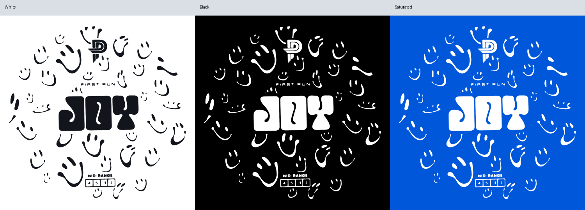

[Measurement bounds](../assets/discraft-stamp-sweep/batch-2/joy-measurement.jpg) · [Source ink detail](../assets/discraft-stamp-sweep/batch-2/joy-ink-detail.jpg) · [Alpha PNG](../../public/stamps/discraft/joy.png)

## Luna — CONTROL-UNCHANGED

Recorded alternate: **Reaper Discs**, [page](https://reaperdiscs.com/products/discraft-esp-luna) · [original](http://reaperdiscs.com/cdn/shop/files/discraft-esp-luna-PP1265_034f7459-49db-4949-8a23-16cc51f8d644.jpg?v=1712351143); verified 900×900 px. Source SHA-256 `8490f009568c36e81102839638481e0441d15f2ea019f35511ef6530891a5abc`.

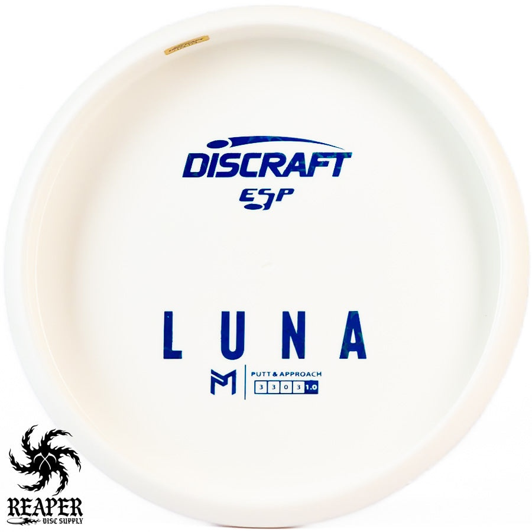

Actual retained provenance: **Discraft**, [approved pilot page](https://www.discraft.com/paul-mcbeth-luna-mcbethluna). Alternate revision above was not transferred. Existing placement 66.308594%; asset 17.545 KB, unchanged.

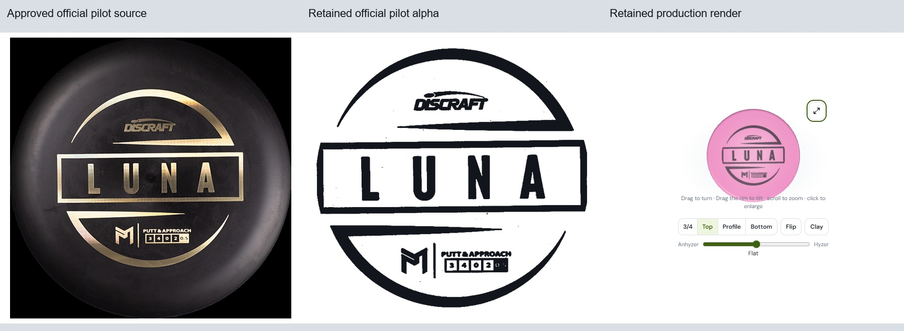

[Source crop](../assets/discraft-stamp-sweep/batch-2/luna-source-crop.jpg) · [Production viewer](../assets/discraft-stamp-sweep/batch-2/after-luna-viewer.png)

## Malita — EXTRACTED

Recorded alternate: **Marshall Street**, [page](https://www.marshallstreetdiscgolf.com/product/esp-malita-paul-mcbeth) · [original](https://s3.amazonaws.com/media.marshallstreetdiscgolf.com/wp-content/uploads/2026/07/06152705/Malita_ESP_Paul-McBeth_00-scaled-1.webp); verified 2560×2445 px. Source SHA-256 `d2097bc5eb23715c361f77fb93711180c2038439d057cdf42c461e9b4019e2b4`.

**One ink verified. 73.000 KB.** Full disc 2356 px; complete ink 1542 px; target **65.449915%** of full disc. Asset square 1611 px; ink/asset 95.716946%. Source ink bounds `[522, 470, 2064, 1956]`; source centre axes `[[120, 2471], [50, 2406]]`. Native renderer physical fraction 65.449916% (within 0.0002 percentage points).

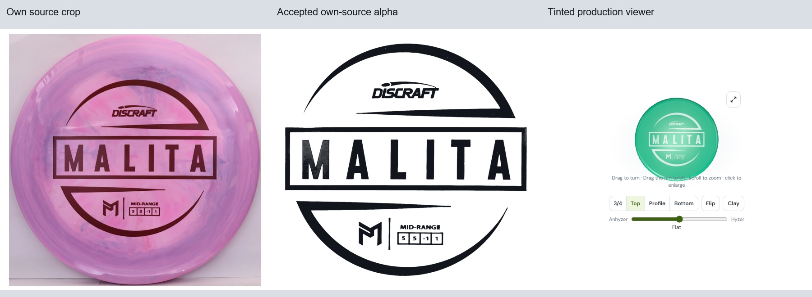

[Source crop](../assets/discraft-stamp-sweep/batch-2/malita-source-crop.jpg) · [Production viewer](../assets/discraft-stamp-sweep/batch-2/after-malita-viewer.png)

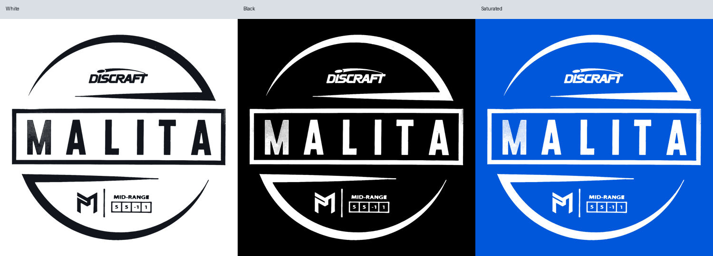

[Measurement bounds](../assets/discraft-stamp-sweep/batch-2/malita-measurement.jpg) · [Source ink detail](../assets/discraft-stamp-sweep/batch-2/malita-ink-detail.jpg) · [Alpha PNG](../../public/stamps/discraft/malita.png)

## Malta — FOIL-RISK — FALLBACK

Recorded alternate: **Marshall Street**, [page](https://www.marshallstreetdiscgolf.com/product/esp-malta-paul-mcbeth-5x) · [original](https://s3.amazonaws.com/media.marshallstreetdiscgolf.com/wp-content/uploads/2026/05/06095223/Malta_ESP_Paul-McBeth_00-scaled-1.webp); verified 2560×2474 px. Source SHA-256 `792d94c837be38e059d09f197ccc78df29d964a7ec68c6848ca3be875543b5df`.

**Fallback retained. Ink count: 1. New asset: 0.000 KB; no placement assigned.** Trial mask loses patterned foil detail in the lower ring and fine number strip. Lower thresholds admit plastic swirls. Rejected on fidelity; fallback retained.

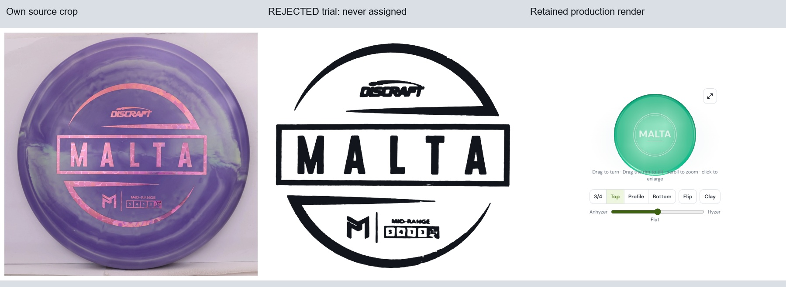

[Source crop](../assets/discraft-stamp-sweep/batch-2/malta-source-crop.jpg) · [Production viewer](../assets/discraft-stamp-sweep/batch-2/after-malta-viewer.png)

**Rejected trial only — never shipped.** The missing-detail/plastic problem is visible below; its alpha is not a runtime asset.

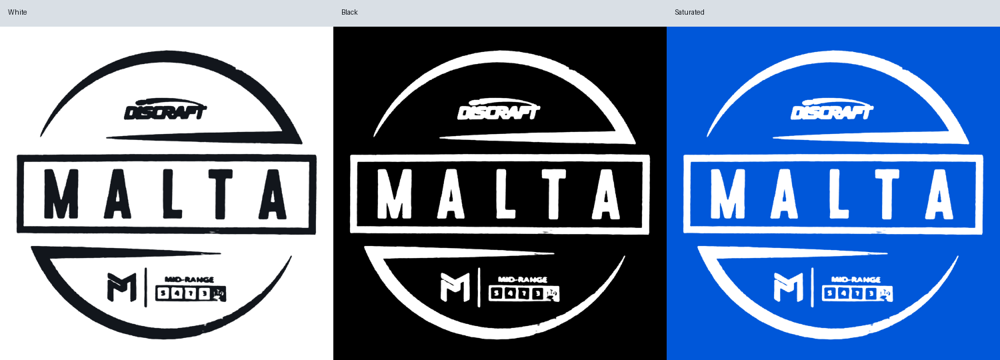

## Nuke OS — FOIL-RISK — FALLBACK

Recorded alternate: **Marshall Street**, [page](https://www.marshallstreetdiscgolf.com/product/esp-nuke-os-swirly) · [original](https://s3.amazonaws.com/media.marshallstreetdiscgolf.com/wp-content/uploads/2025/12/23113347/Nuke-OS_ESP_00-scaled-1.webp); verified 2560×2476 px. Source SHA-256 `30206c934d21c61a7cce9380cc94c9b79ce3b2282a620a6bccc10ebd53656090`.

**Fallback retained. Ink count: 1. New asset: 0.000 KB; no placement assigned.** Rainbow foil traverses blue/cyan hues also present in the plastic, especially ESP and Nuke OS/flight detail. Complete separation cannot be verified; fallback retained.

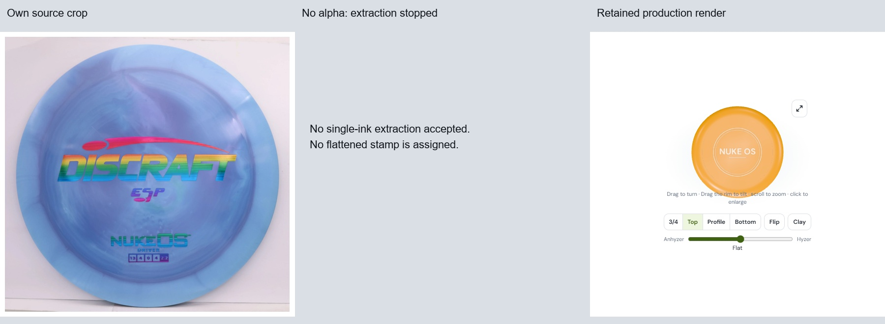

[Source crop](../assets/discraft-stamp-sweep/batch-2/nuke-os-source-crop.jpg) · [Production viewer](../assets/discraft-stamp-sweep/batch-2/after-nuke-os-viewer.png)

## Nuke SS — EXTRACTED

Recorded alternate: **Marshall Street**, [page](https://www.marshallstreetdiscgolf.com/product/swirly-esp-nuke-ss) · [original](https://s3.amazonaws.com/media.marshallstreetdiscgolf.com/wp-content/uploads/2026/09/21115208/Nuke%20SS_ESP_00-scaled.webp); verified 2560×2484 px. Source SHA-256 `862cbcebb04b127f2c05ef3b71343eaee15db31fe360cabdacce65129ba9e9b1`.

**One ink verified. 130.700 KB.** Full disc 2367 px; complete ink 1696 px; target **71.651880%** of full disc. Asset square 1782 px; ink/asset 95.173962%. Source ink bounds `[457, 840, 2153, 1812]`; source centre axes `[[105, 2469], [66, 2433]]`. Native renderer physical fraction 71.651881% (within 0.0002 percentage points).

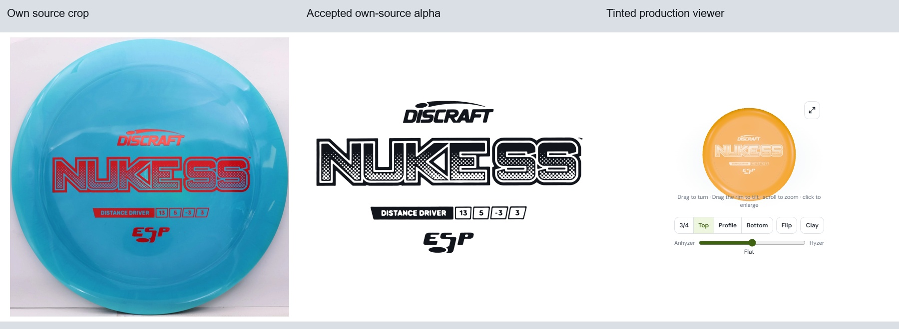

[Source crop](../assets/discraft-stamp-sweep/batch-2/nuke-ss-source-crop.jpg) · [Production viewer](../assets/discraft-stamp-sweep/batch-2/after-nuke-ss-viewer.png)

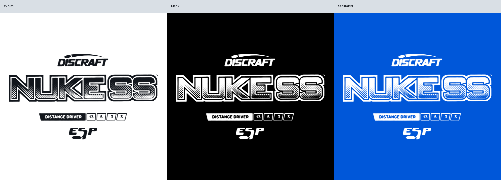

[Measurement bounds](../assets/discraft-stamp-sweep/batch-2/nuke-ss-measurement.jpg) · [Source ink detail](../assets/discraft-stamp-sweep/batch-2/nuke-ss-ink-detail.jpg) · [Alpha PNG](../../public/stamps/discraft/nuke-ss.png)

## Raptor — EXTRACTED

Recorded alternate: **Marshall Street**, [page](https://www.marshallstreetdiscgolf.com/product/esp-raptor-ricky-wysocki-2x) · [original](https://s3.amazonaws.com/media.marshallstreetdiscgolf.com/wp-content/uploads/2025/12/15095126/Raptor_ESP_Ricky-Wysocki-2X_00-scaled-1.webp); verified 2560×2499 px. Source SHA-256 `3c7b7960b4a98cf1833ca6b54d882656fc1cd6b5b1694c494a77d5bba24c5320`.

**One ink verified. 113.365 KB.** Full disc 2425 px; complete ink 1626 px; target **67.051546%** of full disc. Asset square 1716 px; ink/asset 94.755245%. Source ink bounds `[485, 519, 2111, 2033]`; source centre axes `[[99, 2500], [25, 2450]]`. Native renderer physical fraction 67.051548% (within 0.0002 percentage points).

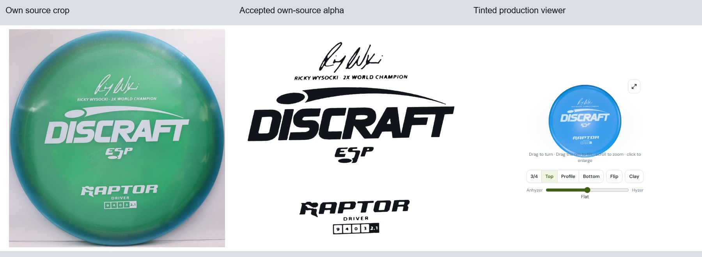

[Source crop](../assets/discraft-stamp-sweep/batch-2/raptor-source-crop.jpg) · [Production viewer](../assets/discraft-stamp-sweep/batch-2/after-raptor-viewer.png)

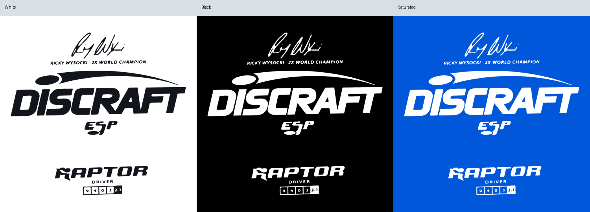

[Measurement bounds](../assets/discraft-stamp-sweep/batch-2/raptor-measurement.jpg) · [Source ink detail](../assets/discraft-stamp-sweep/batch-2/raptor-ink-detail.jpg) · [Alpha PNG](../../public/stamps/discraft/raptor.png)

## Scorch — EXTRACTED

Recorded alternate: **Reaper Discs**, [page](https://reaperdiscs.com/products/discraft-esp-scorch) · [original](http://reaperdiscs.com/cdn/shop/files/discraft-esp-scorch-E7143-default.jpg?v=1723518595); verified 900×900 px. Source SHA-256 `71533c517f76af944cf1cedd97fbe868d6faa843618d5ae6224c6d33fbfa03c3`.

**One ink verified. 18.024 KB.** Full disc 892 px; complete ink 601 px; target **67.376682%** of full disc. Asset square 681 px; ink/asset 88.252570%. Source ink bounds `[146, 303, 747, 712]`; source centre axes `[[5, 897], [18, 880]]`. Native renderer physical fraction 67.376682% (within 0.0002 percentage points).

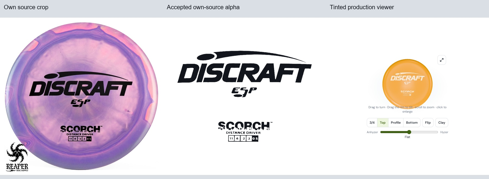

[Source crop](../assets/discraft-stamp-sweep/batch-2/scorch-source-crop.jpg) · [Production viewer](../assets/discraft-stamp-sweep/batch-2/after-scorch-viewer.png)

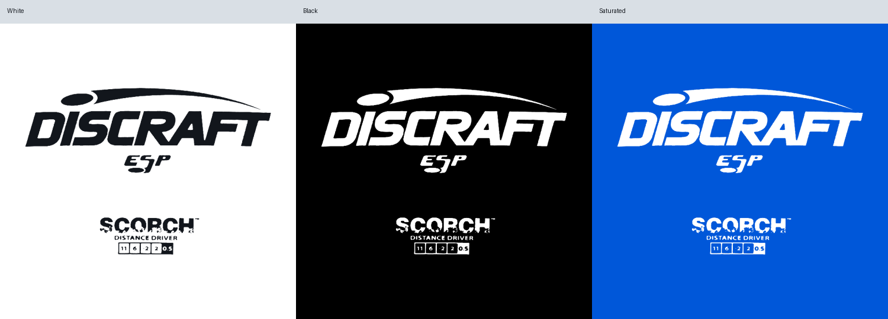

[Measurement bounds](../assets/discraft-stamp-sweep/batch-2/scorch-measurement.jpg) · [Source ink detail](../assets/discraft-stamp-sweep/batch-2/scorch-ink-detail.jpg) · [Alpha PNG](../../public/stamps/discraft/scorch.png)

## Sled — EXTRACTED

Recorded alternate: **Marshall Street**, [page](https://www.marshallstreetdiscgolf.com/product/esp-sled) · [original](https://s3.amazonaws.com/media.marshallstreetdiscgolf.com/wp-content/uploads/2026/07/20133151/Sled_ESP_00-scaled-9.webp); verified 2560×2534 px. Source SHA-256 `7047f3e7f889583877f6d6b643d45987c1f3067000e676716f9fc3381aea1c04`.

**One ink verified. 67.966 KB.** Full disc 2412 px; complete ink 1598 px; target **66.252073%** of full disc. Asset square 1790 px; ink/asset 89.273743%. Source ink bounds `[443, 888, 2041, 2004]`; source centre axes `[[47, 2459], [69, 2479]]`. Native renderer physical fraction 66.252075% (within 0.0002 percentage points).

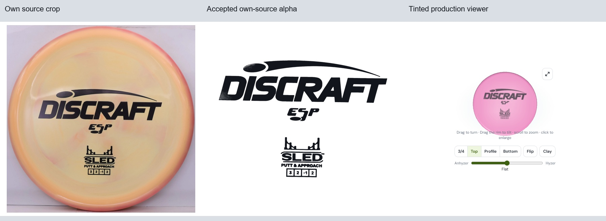

[Source crop](../assets/discraft-stamp-sweep/batch-2/sled-source-crop.jpg) · [Production viewer](../assets/discraft-stamp-sweep/batch-2/after-sled-viewer.png)

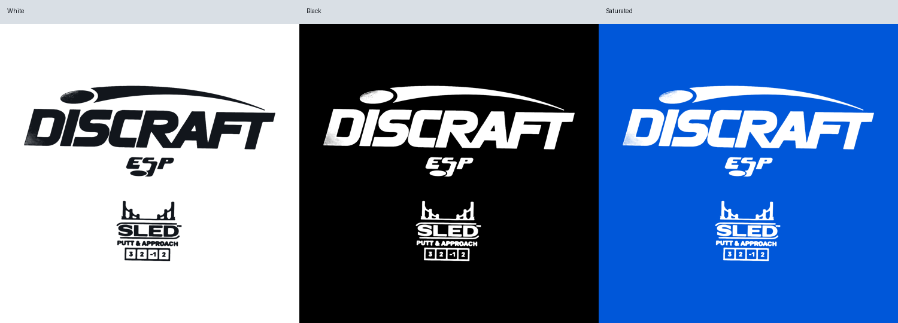

[Measurement bounds](../assets/discraft-stamp-sweep/batch-2/sled-measurement.jpg) · [Source ink detail](../assets/discraft-stamp-sweep/batch-2/sled-ink-detail.jpg) · [Alpha PNG](../../public/stamps/discraft/sled.png)

## Sol — FOIL-RISK — FALLBACK

Recorded alternate: **Marshall Street**, [page](https://www.marshallstreetdiscgolf.com/product/esp-sol-paige-pierce) · [original](https://s3.amazonaws.com/media.marshallstreetdiscgolf.com/wp-content/uploads/2026/06/16104706/Sol_ESP_Paige-Pierce-5X_00-scaled-1.webp); verified 2560×2509 px. Source SHA-256 `b38940294746ead509f22082f13473dc57e5208fa6afd1a0b7e54d07d256c403`.

**Fallback retained. Ink count: unverified. New asset: 0.000 KB; no placement assigned.** Silver upper signature/wordmark and dark lower SOL/flight strip cannot be verified as one ink. Reflective fine flight detail is also low contrast; fallback retained.

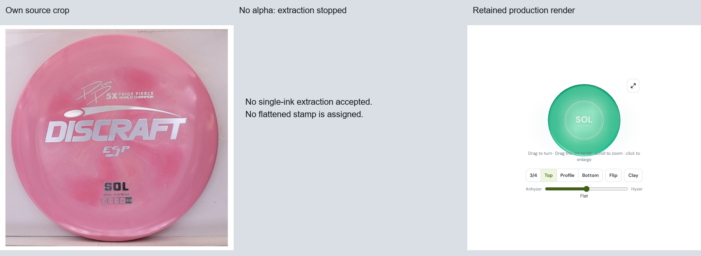

[Source crop](../assets/discraft-stamp-sweep/batch-2/sol-source-crop.jpg) · [Production viewer](../assets/discraft-stamp-sweep/batch-2/after-sol-viewer.png)

## Stalker — EXTRACTED

Recorded alternate: **Reaper Discs**, [page](https://reaperdiscs.com/products/discraft-esp-stalker-paige-pierce-5x) · [original](http://reaperdiscs.com/cdn/shop/files/discraft-esp-stalker-VV2018-default.jpg?v=1703830740); verified 900×900 px. Source SHA-256 `053165c0f9b8c1ae0422ee862d31903e1940d42cda22d6f9039bf49f9d7a9cfa`.

**One ink verified. 25.731 KB.** Full disc 890 px; complete ink 597 px; target **67.078652%** of full disc. Asset square 643 px; ink/asset 92.846034%. Source ink bounds `[140, 220, 737, 715]`; source centre axes `[[6, 896], [24, 876]]`. Native renderer physical fraction 67.078652% (within 0.0002 percentage points).

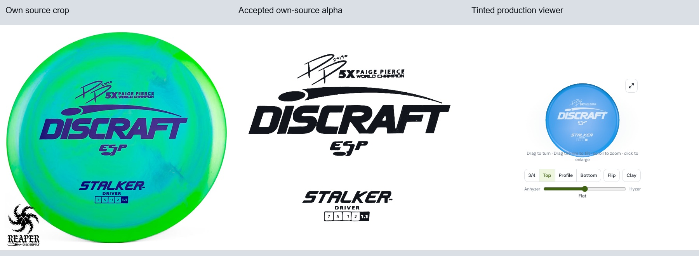

[Source crop](../assets/discraft-stamp-sweep/batch-2/stalker-source-crop.jpg) · [Production viewer](../assets/discraft-stamp-sweep/batch-2/after-stalker-viewer.png)

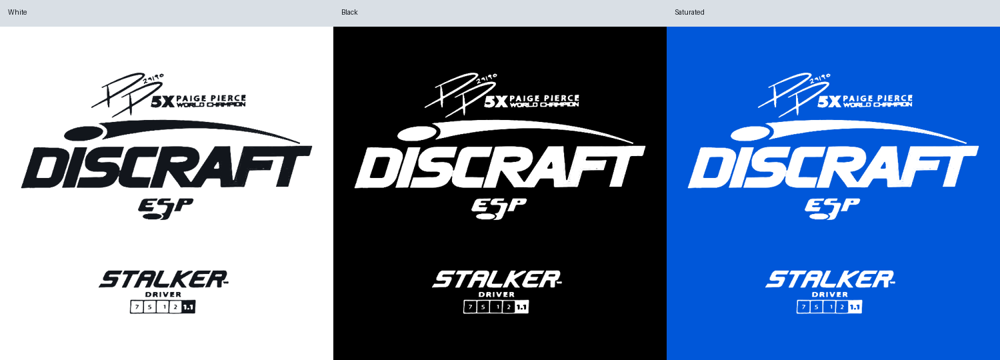

[Measurement bounds](../assets/discraft-stamp-sweep/batch-2/stalker-measurement.jpg) · [Source ink detail](../assets/discraft-stamp-sweep/batch-2/stalker-ink-detail.jpg) · [Alpha PNG](../../public/stamps/discraft/stalker.png)

## Swarm — FOIL-RISK — EXTRACTED

Recorded alternate: **Marshall Street**, [page](https://www.marshallstreetdiscgolf.com/product/esp-swarm) · [original](https://s3.amazonaws.com/media.marshallstreetdiscgolf.com/wp-content/uploads/2024/08/26135020/Swarm_ESP_00-scaled-1.webp); verified 2560×2410 px. Source SHA-256 `177c98ce17778a9f0212c0c385be0ca45556a49ace84dff7bb48fdcb08736815`.

**One ink verified. 95.381 KB.** Full disc 2364 px; complete ink 1553 px; target **65.693739%** of full disc. Asset square 1760 px; ink/asset 88.238636%. Source ink bounds `[479, 829, 2032, 1922]`; source centre axes `[[68, 2419], [16, 2380]]`. Native renderer physical fraction 65.693741% (within 0.0002 percentage points).

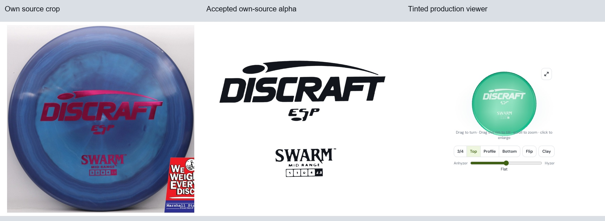

[Source crop](../assets/discraft-stamp-sweep/batch-2/swarm-source-crop.jpg) · [Production viewer](../assets/discraft-stamp-sweep/batch-2/after-swarm-viewer.png)

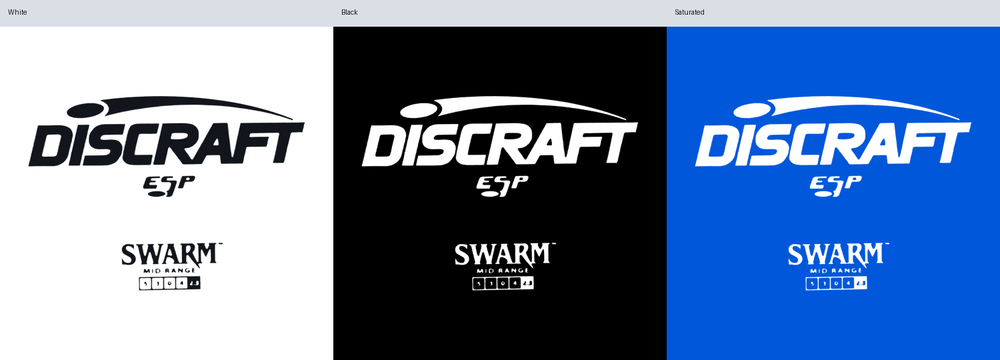

[Measurement bounds](../assets/discraft-stamp-sweep/batch-2/swarm-measurement.jpg) · [Source ink detail](../assets/discraft-stamp-sweep/batch-2/swarm-ink-detail.jpg) · [Alpha PNG](../../public/stamps/discraft/swarm.png)

## Undertaker — EXTRACTED

Recorded alternate: **Marshall Street**, [page](https://www.marshallstreetdiscgolf.com/product/swirly-esp-undertaker) · [original](https://s3.amazonaws.com/media.marshallstreetdiscgolf.com/wp-content/uploads/2026/09/21115047/Undertaker_ESP_00-scaled.webp); verified 2560×2499 px. Source SHA-256 `8809329a07bb58c8956666d5ccc4d8114b3d4d80fe337503513a902c8dd582bc`.

**One ink verified. 258.385 KB.** Full disc 2387 px; complete ink 1767 px; target **74.025974%** of full disc. Asset square 1879 px; ink/asset 94.039383%. Source ink bounds `[459, 802, 2226, 1899]`; source centre axes `[[96, 2478], [54, 2441]]`. Native renderer physical fraction 74.025977% (within 0.0002 percentage points).

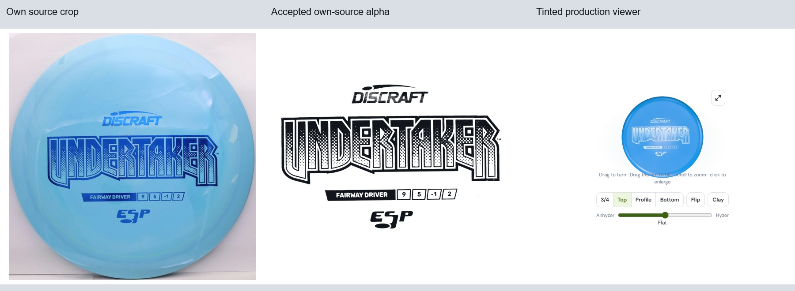

[Source crop](../assets/discraft-stamp-sweep/batch-2/undertaker-source-crop.jpg) · [Production viewer](../assets/discraft-stamp-sweep/batch-2/after-undertaker-viewer.png)

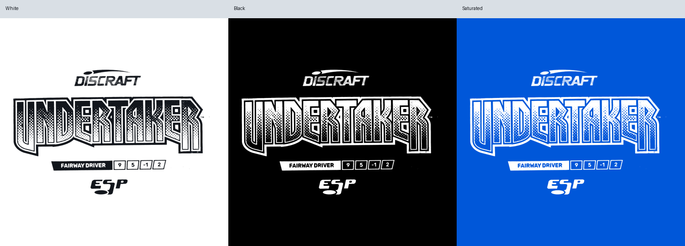

[Measurement bounds](../assets/discraft-stamp-sweep/batch-2/undertaker-measurement.jpg) · [Source ink detail](../assets/discraft-stamp-sweep/batch-2/undertaker-ink-detail.jpg) · [Alpha PNG](../../public/stamps/discraft/undertaker.png)

## Venom — FOIL-RISK — FALLBACK

Recorded alternate: **Marshall Street**, [page](https://www.marshallstreetdiscgolf.com/product/esp-venom-3) · [original](https://s3.amazonaws.com/media.marshallstreetdiscgolf.com/wp-content/uploads/2025/12/15092641/Venom_ESP_000-scaled-2.webp); verified 2560×2548 px. Source SHA-256 `837f5f74612d42e05cd772f72c0f7234ee0096bf62b81e41ea77f389617ccae2`.

**Fallback retained. Ink count: 1. New asset: 0.000 KB; no placement assigned.** Trial mask loses patterned foil within the wordmark and fine flight strip. Rejected on fidelity; neither Venom catalog approval is assigned.

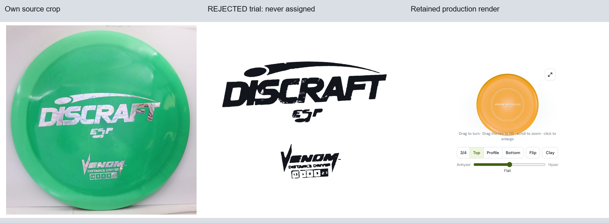

[Source crop](../assets/discraft-stamp-sweep/batch-2/venom-source-crop.jpg) · [Production viewer](../assets/discraft-stamp-sweep/batch-2/after-venom-viewer.png)

**Rejected trial only — never shipped.** The missing-detail/plastic problem is visible below; its alpha is not a runtime asset.

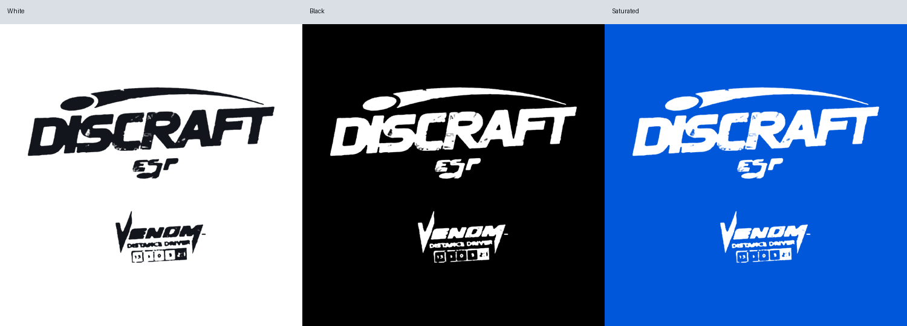

## Vulture — FOIL-RISK — FALLBACK

Recorded alternate: **Reaper Discs**, [page](https://reaperdiscs.com/products/discraft-esp-vulture) · [original](http://reaperdiscs.com/cdn/shop/products/discraft-esp-vulture-S5682-Default.jpg?v=1679879507); verified 900×900 px. Source SHA-256 `745b897c034f9529aa411308d1011cdf26832780b7dfaad9820752e87351bb4f`.

**Fallback retained. Ink count: 1. New asset: 0.000 KB; no placement assigned.** Trial mask breaks the signature, wordmark outline and tiny champion/flight detail where patterned foil overlaps plastic hues. Rejected on fidelity; fallback retained.

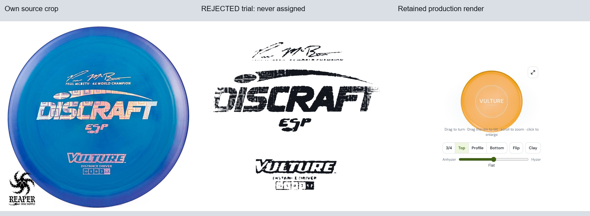

[Source crop](../assets/discraft-stamp-sweep/batch-2/vulture-source-crop.jpg) · [Production viewer](../assets/discraft-stamp-sweep/batch-2/after-vulture-viewer.png)

**Rejected trial only — never shipped.** The missing-detail/plastic problem is visible below; its alpha is not a runtime asset.

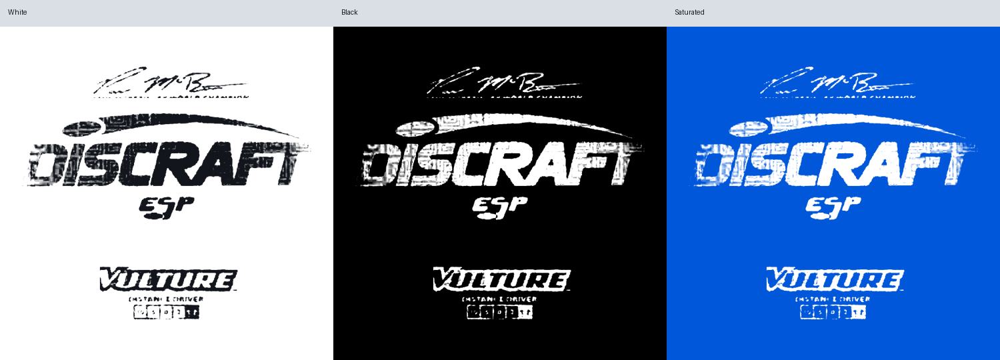

## Zone — FOIL-RISK — CONTROL-UNCHANGED

Recorded alternate: **Marshall Street**, [page](https://www.marshallstreetdiscgolf.com/product/esp-zone-paul-mcbeth-6x) · [original](https://s3.amazonaws.com/media.marshallstreetdiscgolf.com/wp-content/uploads/2026/09/21120043/Zone_ESP_Paul%20McBeth%206X_00-scaled.webp); verified 2560×2514 px. Source SHA-256 `2b83a7789237cb4c63bfe219e9f45b6f735ac765d2e6ee2ea4719477f9c87e01`.

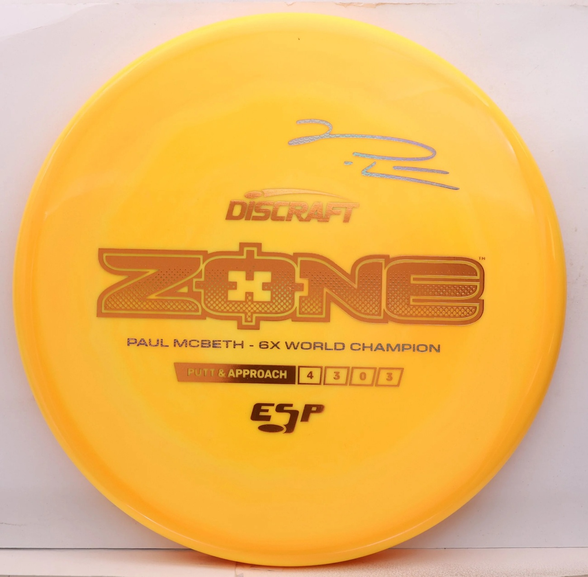

Actual retained provenance: **Discraft**, [approved pilot page](https://www.discraft.com/z-line-zone-zzone). Alternate revision above was not transferred. Existing placement 69.433594%; asset 32.006 KB, unchanged.

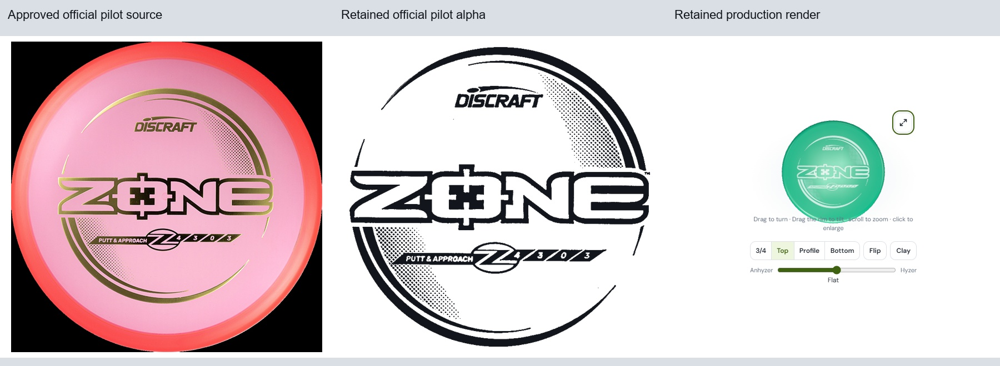

[Source crop](../assets/discraft-stamp-sweep/batch-2/zone-source-crop.jpg) · [Production viewer](../assets/discraft-stamp-sweep/batch-2/after-zone-viewer.png)

## Zone OS — FOIL-RISK — FALLBACK

Recorded alternate: **Reaper Discs**, [page](https://reaperdiscs.com/products/discraft-esp-zone-os) · [original](http://reaperdiscs.com/cdn/shop/files/discraft-esp-zone-os-VV2006-default.jpg?v=1703829541); verified 900×900 px. Source SHA-256 `b5cbe31a5eeb30ff0153aed51c0d0d31b69701476758b5e804e79c805bc65249`.

**Fallback retained. Ink count: 1. New asset: 0.000 KB; no placement assigned.** Trial mask cannot retain the complete ESP, ZONE OS and flight strip through rainbow foil reflections. Rejected on fidelity; fallback retained.

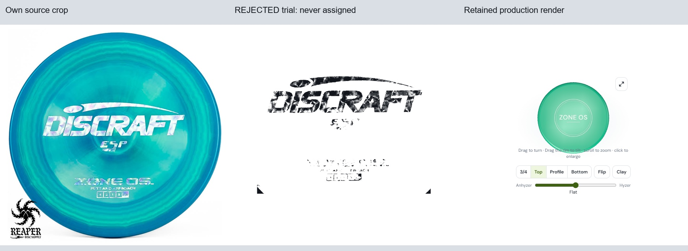

[Source crop](../assets/discraft-stamp-sweep/batch-2/zone-os-source-crop.jpg) · [Production viewer](../assets/discraft-stamp-sweep/batch-2/after-zone-os-viewer.png)

**Rejected trial only — never shipped.** The missing-detail/plastic problem is visible below; its alpha is not a runtime asset.

## Zone SS — EXTRACTED

Recorded alternate: **Marshall Street**, [page](https://www.marshallstreetdiscgolf.com/product/esp-zone-ss) · [original](https://s3.amazonaws.com/media.marshallstreetdiscgolf.com/wp-content/uploads/2026/09/21115500/Zone%20SS_ESP_00-scaled.webp); verified 2560×2463 px. Source SHA-256 `2d9606dab677e568e76aa96063500b1f477f039f3fbe299407886df93b684b71`.

**One ink verified. 110.497 KB.** Full disc 2384 px; complete ink 1698 px; target **71.224832%** of full disc. Asset square 1762 px; ink/asset 96.367764%. Source ink bounds `[436, 865, 2134, 1745]`; source centre axes `[[96, 2470], [22, 2406]]`. Native renderer physical fraction 71.224832% (within 0.0002 percentage points).

[Source crop](../assets/discraft-stamp-sweep/batch-2/zone-ss-source-crop.jpg) · [Production viewer](../assets/discraft-stamp-sweep/batch-2/after-zone-ss-viewer.png)

[Measurement bounds](../assets/discraft-stamp-sweep/batch-2/zone-ss-measurement.jpg) · [Source ink detail](../assets/discraft-stamp-sweep/batch-2/zone-ss-ink-detail.jpg) · [Alpha PNG](../../public/stamps/discraft/zone-ss.png)
