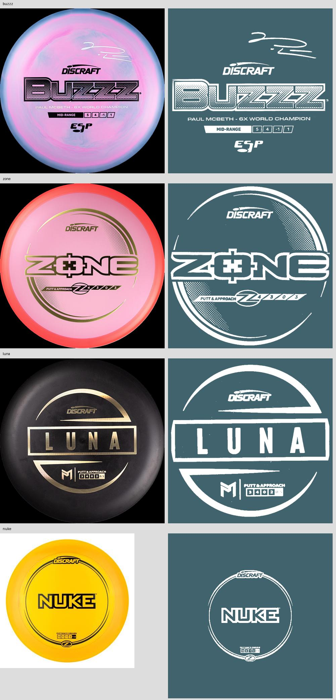

# Discraft stock stamp pilot

Built on October 16, 2026, from main `38a8c4a` in the dedicated `codex/discraft-stock-stamps` worktree. That main already includes the non-overmold photo-edge cleanup merge. No photo loader, cleanup, worker, upload, crop, or photo geometry code was changed.

## Rights and scope

Rights basis supplied by Freddy: written permission from Gerry Andrews, Discraft marketing, by email on October 15, 2026, to use official Discraft disc imagery and the Discraft logo on Disc Atlas **while it remains a free resource**. This repository records the supplied authorization; it does not contain the private email. If Disc Atlas becomes paid or monetized, licensing must be revisited with Discraft before continued use. Permission covers **Discraft only**. There is no new logo use outside the stamps.

Three clean extractions ship: **Buzzz, Zone, Luna**. **Force and Nuke remain unchanged** because the available headline images do not support a clean complete extraction. This uses the request's explicit smaller-honest-pilot allowance, and is not a claim that all five passed. Their before/after captures are retained as controls.

## Characterization

`public/disc3d/stamp.mjs` generated a 512px canvas with two rings, an uppercase name and underline. Its contrast rule chooses dark `rgba(18,22,28,.72)` on light plates or white at .78 alpha on darker plates. A transparent MeshStandardMaterial puts this canvas on a RingGeometry that follows `topHeight` at +.012cm, with polygon offset. Radius remains `min(Rs × .78, 6.2cm)`, inside the shoulder. This implementation preserves that geometry, material and ink rule.

| Surface | Before pilot | Pilot behavior / load boundary |
| --- | --- | --- |
| Detail viewer | Generated stamp on a separate mesh | Official alpha replaces the canvas design after the visible selected disc requests it; generated stamp while loading or on failure |
| Pop-out | Separate viewer, same props/module | Same stock design and ink, reusing decoded mask |
| Bag pulled discs | **No generated stamp mesh**; optional personal photo | Adds a stamp mesh only for a pulled, assigned Discraft disc without a personal photo; maps through the existing bag envelope and upright quarter-turn |
| Pocketed bag discs | Bare plate or personal photo | No stamp image request until pulled |
| Storage rack pulled / lost discs | `collection3d/stage.mjs` `discModel`, generated stamp | Same mesh now accepts catalog art; personal photo still hides it |
| Storage/list thumbnails | `atlas-art.mjs` cached top-down model, **no generated stamp** | IntersectionObserver draws alpha over a private copy of that image; atlas cache is never modified |
| Atlas markers at all LODs | Cached top-down model, **no generated stamp** | Unchanged; zero stamp requests |

The photos were a useful pattern for asynchronous readiness, cancellation on disposal and private-surface precedence. The stamp implementation is separate: no changes to photo loading or cleanup. It keeps at most twelve completed decoded masks in an LRU; textures belong to each consumer and stop accepting asynchronous updates after disposal. Missing images retain the generated fallback. Thumbnails release their temporary textures after painting or going offscreen.

## Pipeline and schema

A separate `source-data/stamp-manifest.json` keeps this narrow reviewed grant apart from `photo-manifest.json`, whose unrelated third-party assignments remain excluded. Extending the photo manifest would conflate full-color photos with tintable artwork and imply permission for material that has not been reviewed.

Each entry has these required string fields:

```json
{
  "id": "7446eb39abe5",
  "brand": "Discraft",
  "mold": "Buzzz",
  "asset": "stamps/discraft/buzzz.png",
  "sourceURL": "https://www.discraft.com/paul-mcbeth-6x-esp-buzzz-signature-series-pmebuzzz",
  "capturedAt": "2026-10-16",
  "rightsBasis": "Discraft permission, 2026-10-15, free resource"
}
```

`prepare_data.py` calls `stamp_manifest.validate_stamp_manifest` against the completed catalog, then emits **only** `stampAsset` on assigned records. `validate_data.py` uses the same rights validator and also requires exact correspondence between manifest assignments and catalog fields. It rejects non-Discraft targets even if an entry lies about its brand, unknown IDs, mold mismatches, duplicate assignments, missing files, paths outside `public/stamps/discraft`, non-PNG paths, unofficial source hosts and missing/altered free-resource rights language. Capture dates cannot predate the grant. The renderer independently gates the brand and local asset path.

Asset filenames use lowercase letters, digits and hyphens directly inside `stamps/discraft/`, matching the renderer's path gate. No manual `public/data.json` edits. The pipeline regression compares generated data to the branch's main ancestor: all 2,434 identities, flight numbers, production metadata, ordering and meta fields match after removing the three new `stampAsset` fields. Rated count remains 1,182.

Run with UTF-8 Python on Windows (the existing CSV contains UTF-8 characters):

```powershell
python -X utf8 prepare_data.py
python -X utf8 validate_data.py
python -X utf8 tests/stamp_manifest_test.py
node tests/discraft-stamps-browser.mjs
node tests/atlas-3d-perf.mjs
```

The extraction/test script requires Pillow and NumPy. Browser tests use the existing `PLAYWRIGHT_MODULE` and `PLAYWRIGHT_EXECUTABLE_PATH` overrides where the dependencies are bundled rather than installed in the worktree.

## Official sources and extraction verdicts

Every source is that mold's own **first/headline product image**, captured October 16. Source URL receipts and unchanged image bytes live under `source-data/stamp-sources/`; they are never served as disc textures. No generative image tool, tracing, replacement lettering, reconstructed linework, or cross-mold borrowing was used. The user-mentioned reference image was not present in the checkout; Buzzz was sourced directly from its official page.

`scripts/extract-discraft-stamps.py` reproducibly classifies source pixels with per-image color/brightness thresholds and plate bounds. Buzzz needs separate black-foil and silver-foil thresholds; Zone separates gold/black foil from pink; Luna separates gold from charcoal. Cropping retains aspect ratio and radial padding fits **every** alpha pixel inside the existing circular mesh. Outputs have white RGB and extracted alpha only. At runtime `source-in` replaces RGB with the existing stamp ink, so original plastic and foil colors cannot enter the disc material. The full Buzzz signature, wordmark, mold lettering, champion line, ESP mark and flight box are retained because they are actually present in its source. Luna's McBeth mark and Zone's own refreshed design come only from their respective images.

| Mold | Official product page | Source / verdict |
| --- | --- | --- |
| Buzzz | [Paul McBeth ESP Buzzz](https://www.discraft.com/paul-mcbeth-6x-esp-buzzz-signature-series-pmebuzzz) | 1024px PNG, `pmebuzzz_26_r_esp_buzzz_1.png`. **Ship.** Full refreshed ESP design, including silver signature and champion line, black wordmark/ESP/flight box and halftone name. Fine details remain limited by viewing size. |
| Zone | [Z Line Zone](https://www.discraft.com/z-line-zone-zzone) | 1024px PNG, `zzone_%2026_r_z_zone_4.png`. **Ship.** Current refreshed circular gold/black design, original dotted regions and flight-number strip; no McBeth signature added. |
| Luna | [Paul McBeth Luna](https://www.discraft.com/paul-mcbeth-luna-mcbethluna) | 1024px PNG, `mcbethluna__0002_stk_luna_1.png`. **Ship.** Gold circle/name-box design and original McBeth symbol/flight box. A chroma test removes pale plastic speckle without reconstructing artwork. |
| Force | [Paul McBeth ESP Force](https://www.discraft.com/disc-golf/distance-driver/paul-mcbeth-6x-esp-force-signature-series-pmeforce6x) | Advertised headline image is only 400px, `pmeforce6x_img_8926%20force.png`. **Do not ship.** Holographic highlights overlap the plastic's colors; extracting the complete wordmark/signature/tiny Force and number-box design would require guessing missing shapes. The corresponding large URL returned 404. |
| Nuke | [Z Line Nuke](https://www.discraft.com/z-line-nuke-znuke) | 400px JPG, `znuke_max-br_1.jpg`. **Do not ship.** Main name and rings isolate, but the tiny number box and wordmark lose fidelity. Candidate mask remains in source-data for review, not in the manifest/public assets. The corresponding large URL returned 404. |



Production PNG payload: Buzzz about 41KB, Zone 32KB, Luna 18KB; about **91KB total**, fetched only by consumers that show them. This is not an atlas startup payload.

## Atlas-scale decision

Keep atlas markers exactly as they were. Evidence: `lod.mjs` caps full cached art at 96 CSS pixels; mid and low levels are 64 and 24. At 96px the current stamp footprint is at most about 56px across. Buzzz's original flight-box characters shrink below a CSS pixel; signature strokes and halftones are also subpixel. The 96px thumbnail proof below shows the overall design is recognizable but the fine lettering is not reliably readable. At 24/64px it cannot become legible. Fetching the full sweep for those markers would buy little readable information. This decision preserves all existing atlas LOD/cache/scheduling code and the performance budget.

Visible list/storage thumbnails can carry recognizable design because their row already supplies the readable mold name. They load independently through their IntersectionObserver and never change or populate the atlas's shared stamp-free image cache. Larger pulled/viewer/pop-out surfaces provide the detailed inspection.


## Verification and visual evidence

`tests/stamp_manifest_test.py`: **6/6 pass**. Includes the required lying-brand assignment to an Innova Destroyer, invalid identity/rights/source/path/missing-file cases, exact manifest-to-output correspondence, catalog-only-new-field invariant, and alpha containment inside the circular stamp surface.

`tests/discraft-stamps-browser.mjs` serves the actual app and baseline renderer files from the main ancestor on the same GPU. It records all five requested molds before/after in the viewer and bag, plus pop-out and thumbnails. It verifies tint switching, failed-image fallback, disposal before a delayed image completes, storage mesh replacement, and photo/clay precedence. The bag proof uses the production renderer with a 24-disc capacity and a large pulled disc; no signed-in account is changed. Viewer control images for Destroyer, Comet, Force, Nuke and clay are byte-identical. The photo's decoded pixel texture is identical and the stamp remains hidden; GPU screenshot quantization can differ by one channel level on a few pixels, so the test compares the decoded photo directly. No photo code was changed.

Related geometry, LOD, bag/collection-layout and photo regression suites: **91/91 pass**. Existing viewer and pop-out browser suites pass, including desktop/phone interaction, clay, theme and context disposal. Existing catalog-artwork rights gate and production build pass. Independent code review found no critical/important issue. The existing viewer suite caught a caption regression during verification; the fix preserves the original PDGA-dimension/shape provenance and changes only the stamp description.

| Mold | Viewer before → after | Bag before → after |
| --- | --- | --- |
| Buzzz | [before](assets/discraft-stock-stamps/before-buzzz-viewer.png) → [after](assets/discraft-stock-stamps/after-buzzz-viewer.png) | [before](assets/discraft-stock-stamps/before-buzzz-bag.png) → [after](assets/discraft-stock-stamps/after-buzzz-bag.png) |
| Zone | [before](assets/discraft-stock-stamps/before-zone-viewer.png) → [after](assets/discraft-stock-stamps/after-zone-viewer.png) | [before](assets/discraft-stock-stamps/before-zone-bag.png) → [after](assets/discraft-stock-stamps/after-zone-bag.png) |
| Luna | [before](assets/discraft-stock-stamps/before-luna-viewer.png) → [after](assets/discraft-stock-stamps/after-luna-viewer.png) | [before](assets/discraft-stock-stamps/before-luna-bag.png) → [after](assets/discraft-stock-stamps/after-luna-bag.png) |
| Force (unchanged) | [before](assets/discraft-stock-stamps/before-force-viewer.png) → [after](assets/discraft-stock-stamps/after-force-viewer.png) | [before](assets/discraft-stock-stamps/before-force-bag.png) → [after](assets/discraft-stock-stamps/after-force-bag.png) |
| Nuke (unchanged) | [before](assets/discraft-stock-stamps/before-nuke-viewer.png) → [after](assets/discraft-stock-stamps/after-nuke-viewer.png) | [before](assets/discraft-stock-stamps/before-nuke-bag.png) → [after](assets/discraft-stock-stamps/after-nuke-bag.png) |

[Buzzz pop-out](assets/discraft-stock-stamps/after-buzzz-popout.png), [Destroyer](assets/discraft-stock-stamps/after-destroyer-viewer.png), [Comet](assets/discraft-stock-stamps/after-comet-viewer.png), [user photo](assets/discraft-stock-stamps/after-user-photo.png), [clay](assets/discraft-stock-stamps/after-clay.png), [thumbnail baseline](assets/discraft-stock-stamps/before-thumbnails.png). Raw surface verdicts: [verification.json](assets/discraft-stock-stamps/verification.json).

Unchanged performance gate: **PASS**, 7 desktop / 3 phone warm repetitions, original 1.15× frame multiplier, 1.5/3ms slack, +1 long-task allowance, both independent and paired checks; 167.38 seconds. [Full raw report](assets/discraft-stock-stamps/perf.json).

| Device / metric | 2D median | 3D median | Limit | Paired median excess |
| --- | ---: | ---: | ---: | ---: |
| Desktop flight p95 | 4.2ms | 4.2ms | 6.33ms | -1.64ms |
| Desktop 1× p95 | .8ms | 1.2ms | 2.42ms | -1.22ms |
| Desktop long tasks | 0 | 0 | 1 | -1 |
| Phone flight p95 | 13.8ms | 13.7ms | 18.87ms | -2.87ms |
| Phone 1× p95 | 3.1ms | 3.6ms | 6.565ms | -3.08ms |
| Phone long tasks | 2 | 3 | 3 | 0 |

One full gate is a pass on this machine, not a statistical stability claim. No threshold, repetition count, workload, atlas geometry, flight data, position, class palette or photo implementation was changed. No push, merge, deployment or live feel check was performed.

## Full sweep

The renderer requires no per-mold code. For each additional current rated mold: verify its own canonical headline stock line, save official source bytes/URL/capture date, isolate the entire alpha without reconstruction, inspect fine details at large size and circular containment, add a reviewed manifest entry, rerun prepare/validate and capture the surfaces. Do not attach art to historical/variant approvals based on a similar name. Reject ambiguous extractions and keep their fallback.

Estimate for about 90 molds: 15–30 minutes each for clean high-contrast imagery (roughly 23–45 hours), plus 4–8 hours for source/identity review, batch regression and visual checking. Holographic, multicolor or low-resolution sources can add substantial time and may remain unshippable. **Discraft may simply share the original transparent/vector stamp art files if asked**; that would preserve finer detail and likely reduce the sweep to about 1–2 working days of assignment, export and QA. Asking is a future human follow-up; no message was sent to Discraft.
