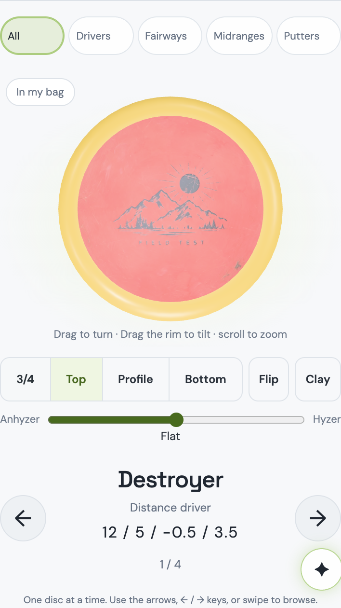
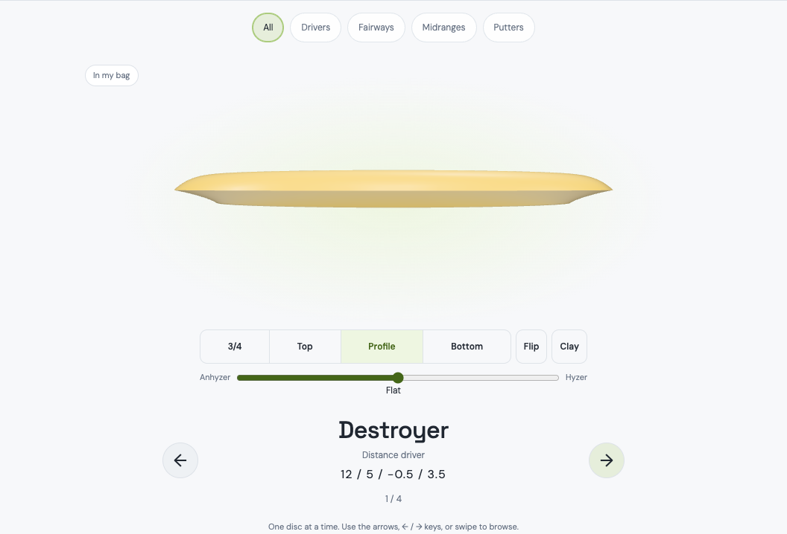
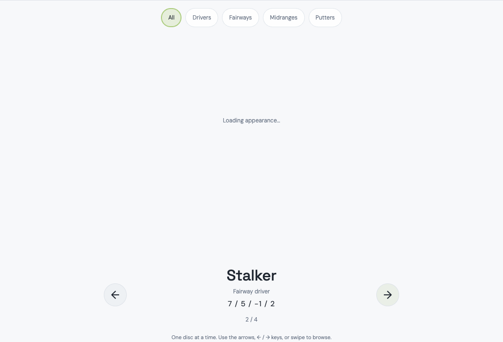
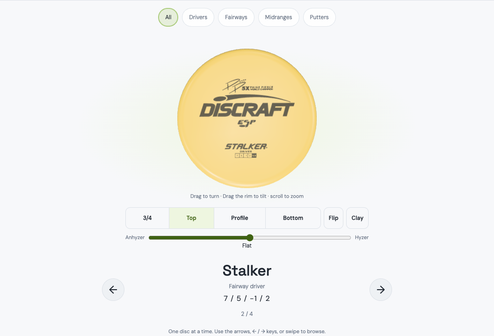

# Gallery fixes landing

October 20, 2026. Claude Opus 5.5, Freddy's Mac (Apple M4, macOS 15.7.3, Node 24.21.0, Playwright 1.64.1, `HeadlessChrome/156.0.8078.4`). Branch `claude/gallery-fixes-landing` off `origin/main` at `da381b7` (PR #30), in the worktree `.claude/worktrees/gallery-fixes-landing`. Local commits only; push, PR, merge and the deploy that follows are Freddy's.

Freddy ruled on October 19 to land the Gallery fixes. The repaired gate's Phase 5 judgment stands as their accepted cost: phone long tasks 6 against the Mac-derived limit of 1, every one the owner-photo continuation on alternate Destroyer returns. Frame checks pass and desktop is clean. This build composes the fixes onto current main, verifies them, and re-takes the gate receipt on the composed tree. It does not chase the 6.

**Result:** the fixes compose onto main with one textual conflict, resolved by intent. All 32 unit suites pass, and 28 of 30 browser suites pass at their defaults, intro strict 0 px among them. The other two fail identically on untouched main because of a D3D11 flag, and pass on the Metal path. All three fixes are demonstrated on desktop and phone. The repaired Gallery gate, re-run on the composed tree in a verified quiet window, **passes every check**. Phone long tasks are 1, 3 and 1 per warm rep, a median of 1 against the limit of 1, where Phase 5 had 9, 3 and 6. Every long task still carries the owner-photo signature (68–70 ms), and desktop has 0. This is better than Phase 5, not worse. The accepted cost has not gone; it fires less often on this tree. Details and the one trace below.

## The composition

Source: the pushed stack tip **`8c865ab`** on `claude/gallery-gate-repair`, checked equal to `origin/claude/gallery-gate-repair` before starting. Its merge base with main is `e59e67e` (PR #19). It carries, in order: the three fixes (`c3956cf`), the Phase 1 attribution (`4e5930a`), the retained experiment (`fb382fe`), the hunt Phases 2–5 docs and evidence, the gate repair (`edd49bc`) and the per-platform baselines (`41ae177`). The composition is one merge commit, **`629dd74`**, so the stack's history comes along intact. There is no separate gate PR, because the gate repair's ancestry runs through the fixes.

Product and test files the stack changes relative to the merge base, and where each came from:

| File | From `c3956cf` (the three fixes) | From `fb382fe` (the experiment) | Later stack commits |
| --- | --- | --- | --- |
| `web/index.html` | Gallery added to the My Bag section bar after Storage; the Storage Rack / All Discs toggle removed; the album moved out of Storage | — | — |
| `public/my-bag.js` | `gallery` section with its own header; Storage shows the rack only; `storageMode` and its handlers removed; Gallery keeps the Storage list below it | — | — |
| `public/my-bag.css` | Storage-mode styles removed; the neutral **Loading appearance…** stage; `touch-action:pan-y` on the stage | — | — |
| `public/all-discs-gallery.js` | Session camera pose (seeded Top, restored across flips with `getPose`/`applyPose`); the hide-until-ready reveal hold on the shared viewer's photo/stamp flags; stale-arrival cancellation; theme-change re-hide; viewer reattach only when detached | Animation cancellation moved before the visibility write in `render()` | — |
| `tests/all-discs-browser.mjs`, `tests/bag-collections-browser.mjs` | Navigation updated to the Gallery section | — | — |
| `tests/gallery-fixes-browser.mjs` | The functional fixes test and the Gallery perf gate | — | `edd49bc`: D3D11 only on Windows; per-platform baseline and report files; machine and renderer recorded per run |
| `package.json` | `test:bag:gallery-fixes` | — | — |

The hunt and repair commits (`4e5930a`, `12b939f`, `607312f`, `4c853e9`, `d5b08cb`, `a589784`, `41ae177`, `ae9bf56`, `8c865ab`) change only `docs/` and `graphify-out/`. No product change outside the two sources was needed.

### Drift since the fixes were built, and how each was resolved

Main moved 54 commits past the merge base: compare-viewer polish, glare and stamp levelling, Halo plastic, Halo band sampling and Halo v2, clay leftovers, the intro reveal with its settle repaint, the map audit, the U1 dot hit-radius fix and sweep, and the audit rulings. Four of the stack's files were also touched on main.

| File | Main's change | Resolution |
| --- | --- | --- |
| `public/all-discs-gallery.js` | Halo (`e3b37f2`, `6e52245`): imports `haloBand`/`haloModel` and adds them to the inline `v.update({...})` props | **Textual conflict**, the only one in product code. The fixes replaced that inline call with a `props` object, so the reveal hold can read `props.photoURL` and the stock asset. Resolved by the fixes' structure with main's two Halo fields kept in `props`. Without them a Halo copy in Gallery would lose its dyed band. Composed file = stack version + main's import + the two fields, nothing else. |
| `public/my-bag.js` | Halo maps, thumbnails, the detail appearance, the My Map key and the photo upload header | Auto-merged, separate hunks. Verified line for line: composed − main = the stack's change, composed − stack = main's change. |
| `public/my-bag.css` | Photo-aligner levelling controls | Auto-merged, separate hunks; same two-way check. |
| `package.json` | `test:atlas:intro`, `test:photo-level`, `test:halo`, `halo-plastic.mjs` in `test:disc3d` | Auto-merged; same two-way check. |
| `graphify-out/*` | Regenerated by several merges | Took main's copy in the merge; regenerated whole in the Graphify commit. |

Semantic drift, checked beyond the text:

- **The shared viewer.** Main changed `public/disc3d/viewer.mjs` for Halo, adding the band, its material and the cache key. Every API the fixes read is unchanged: `getPose`, `applyPose`, `debug.photo.userData.photoReady`/`photoFailed`, the stamp map's `userData.stampAsset`/`stampFailed`, `catalogStampAsset`, and `debug.renderNow`. Readiness and pose handling are untouched. A Halo band adds no asynchronous load, so the reveal hold needs no Halo case.
- **The removed Storage toggle.** No code or test on main uses `data-storage-mode`, `#storageModes` or `storageMode`. The one remaining reference is the fixes' own assertion that the toggle is gone (`tests/all-discs-browser.mjs`).
- **The experiment's ordering** holds in the composed file: `cancelAnimationFrame` then `getAnimations().forEach(a=>a.cancel())`, then `visibility='hidden'` and `data-appearance='loading'`.
- **Fences:** no data, pipeline, migration, worker or catalog file is in the composition; the atlas map, score ordering, tiers, the colorblind palette and the neutral/personal boundary are untouched. The gate file and its baselines are exactly the stack's.

## Suites on the composed tree

Run serially on `629dd74` ([summary.log](assets/gallery-fixes-landing/suites/summary.log), per-suite logs alongside; [run-suites.sh.txt](assets/gallery-fixes-landing/suites/run-suites.sh.txt)).

**Unit:** every retained non-browser `node:test` suite, the same discovery main's audit write-ups use (`tests/*.mjs` that import `node:test`, excluding `*-browser.mjs`): **32 suites, 250 tests, 250 pass, 0 fail** ([unit.log](assets/gallery-fixes-landing/suites/unit.log)).

**Browser, 30 suites; 28 pass at their defaults, 2 fail at their defaults and pass on the Metal path:**

| Area | Suites | Result |
| --- | --- | --- |
| Atlas | `atlas-organic`, `atlas-depth`, `atlas-3d`, `atlas-persist`, **`atlas-intro-reveal`**, `atlas-stamps`, `atlas-speed-band`, `my-map` | All pass. Intro strict: `pixelEquivalent: true` on desktop and phone, reveal vs direct and reduced vs direct, `Buffer.equals` on the `#map` PNGs, so 0 px ([measurements](assets/gallery-fixes-landing/suites/atlas-intro-reveal-measurements.json)). |
| Gallery and bag | `all-discs`, `bag-collections`, `bag`, `bag-demo`, `bag-memorial`, `bag-3d`, `bag-overmold`, `bag-scene`, `bag-v13`, `bag-staging`, `bag-spin-pocket`, `bag-map-controls`, `bag-popup`, `bag-tips`, `bag-pulled-sizing` | All pass. |
| Near the composed code | `halo-plastic`, `disc-appearance`, `photo-stamp-level`, `disc3d`, `disc3d-popout` | All pass. |
| Pre-existing on this Mac | `bag-pulled-quality`, `non-overmold-photo-edge` | Fail at their defaults (`'low' !== 'high'` on the pulled look; a 20 s wait on the Bag scene's pulled photo relief). |

The two failures are not this landing's. Both suites hard-code `--use-angle=d3d11`, the flag Phase 4 showed falls back to SwiftShader on macOS, and both fail in the Bag scene, not the Gallery. Classified with two control runs ([classify.log](assets/gallery-fixes-landing/suites/classify.log)):

| Run | `bag-pulled-quality` | `non-overmold-photo-edge` |
| --- | --- | --- |
| Composed tree, default flags (D3D11 → SwiftShader) | exit 1 | exit 1 |
| Untouched `origin/main` `da381b7`, default flags | **exit 1, same assertion** | **exit 1, same timeout** |
| Composed tree, `BAG3D_CHROMIUM_ARGS=--enable-gpu` (Metal) | **exit 0** | **exit 0** |

They are the same platform-flag defect the Gallery gate had, in two more suites. The gate repair does not touch them, and fixing them is outside this landing's fences; noted for Freddy.

Browser suites rewrite their tracked proof images (42 files under `docs/assets/atlas-intro-reveal`, `docs/assets/atlas-stamps`, `docs/photo-stamp-orientation`); those were restored, so the composition commit's evidence is main's.

## The three fixes, demonstrated on the composed tree

An ignored driver ([demo.mjs.txt](assets/gallery-fixes-landing/demo/demo.mjs.txt)) mirrors the gate's own fixture on a separate port and state. It uses the local Wrangler auth/D1/R2 fixture, the routed Google sign-in, and the gate's four copies: an owner-photo Destroyer in the bag, and stock Stalker, Buzzz and Luna in storage. It ran on desktop (1440 × 900) and phone (390 × 844, DPR 2, touch) with the Metal flags, on `629dd74` with no product file modified, with zero page errors ([demo.json](assets/gallery-fixes-landing/demo/demo.json)). **All three fixes pass on both devices.**

| Fix | What was checked | Desktop | Phone |
| --- | --- | --- | --- |
| 1. Gallery is its own section | Section bar reads Bag · My Map · Storage · Gallery · Lost; Storage shows its rack with no mode toggle and the gallery hidden; Gallery's header reads Gallery | pass | pass |
| 2. Opens on Top, the chosen view sticks | Opens on `top`; Profile chosen, then five flips Stalker → Buzzz → Luna → **Destroyer (photo)** → Stalker, view `profile` at every stop; Bottom chosen **on the photographed Destroyer**, carried off it to the Stalker and back on | pass | pass |
| 3. No pop-in on the Stalker flip | Fresh page; Stalker stock art held at the network; Destroyer (photo) → Stalker: stage `loading`, viewer `visibility:hidden`; frames sampled every animation frame until resolved: 30 hidden while not ready, 15 visible once ready, **0 visible before ready** | pass | pass |

| Sections | Opens on Top (phone) | Profile on the photographed Destroyer | Stalker pending (art held) | Stalker resolved |
| --- | --- | --- | --- | --- |
|  |  |  |  |  |

Every other screenshot is in [demo/](assets/gallery-fixes-landing/demo/). The resolved Stalker opens on Top because the fix-3 check starts from a fresh page load, which is a new Gallery session.

## The gate receipt on the composed tree

Run on October 20, 2026, 00:19:59–00:26:54, on `629dd74`, with the lid open, on AC power, under `caffeinate -dims`. A gatekeeper script ([window.py.txt](assets/gallery-fixes-landing/gate/window.py.txt)) sampled every 30 s ([watch.jsonl](assets/gallery-fixes-landing/gate/watch.jsonl)). It recorded power, load, total idle, the background daemons that wake on this Mac (Spotlight, Photos analysis and library, cloud photos, media analysis, Messages' BlastDoor, backup, software update) and any headless Chromium, `workerd` or Wrangler process. It started the runs only after **five consecutive quiet samples**: AC, idle at least 85%, daemons at most 5% combined, nothing else measuring. A 45-minute limit would otherwise have reported the gate as owed.

The machine was **not** quiet at first. At 00:17 Photos analysis was at 57.6%, its library at 27.1% and cloud photos at 4.8%; just before that, Messages' BlastDoor was at 77% and Photos' image conversion at 36%. The five qualifying samples followed, 00:17:52–00:19:57: idle 89.4–94.8%, daemons 0.0%, load 1.6–2.6 (the Claude app and its idle sessions). **During the runs: 14 samples, the largest gap 31 s, daemons 0.0% in every one, nothing foreign measuring.** Idle dipped to 73% only while the gate's own browser was drawing. [window.log](assets/gallery-fixes-landing/gate/window.log) ends `QUALIFIES`.

Three runs, serially in that window:

1. **The Gallery gate, the receipt:** `node tests/gallery-fixes-browser.mjs`. Exit 0, functional checks all true, zero page errors. It renders on `ANGLE (Apple, ANGLE Metal Renderer: Apple M4, Unspecified Version)` with `--enable-gpu`, per the report's own `renderer` and `machine` blocks. It was graded against the committed Phase 5 Mac baseline `before.darwin.json` (phone warm 1 / 0 / 0, median 0). Report: [after.darwin.composed.json](assets/gallery-fixes-landing/gate/after.darwin.composed.json); log: [gate-after.log](assets/gallery-fixes-landing/gate/gate-after.log).
2. **A diagnostic before replay** on the composed tree (`--before`). It serves the shipped `e59e67e` Gallery sources over everything main has gained since, to check the committed baseline still describes this tree. It does not replace the baseline: the gate had already read the committed file, and the file was restored from `HEAD` afterwards. [before.darwin.composed-replay.json](assets/gallery-fixes-landing/gate/before.darwin.composed-replay.json).
3. **The Atlas perf gate** as collateral (`node tests/atlas-3d-perf.mjs`, defaults 7 / 3). It is **green on every check, 0 long tasks on both devices**, 155.65 s ([atlas-perf.json](assets/gallery-fixes-landing/gate/atlas-perf.json)).

| Device | Metric | Mac baseline (Phase 5, committed) | Phase 5 judgment | **Composed tree** | Limit | Paired median excess | Verdict |
| --- | --- | ---: | ---: | ---: | ---: | ---: | --- |
| Desktop | fly p95 | 1.7 | 2.7 | **2.4** | 3.455 | −1.055 | pass |
| Desktop | still p95 | 0.4 | 0.5 | **0.5** | 1.96 | −1.56 | pass |
| Desktop | long tasks | 0 | 0 | **0** | 1 | −1 | pass |
| Phone | fly p95 | 6.2 | 6.2 | **6.2** | 10.13 | −4.03 | pass |
| Phone | still p95 | 0.1 | 0.3 | **0.1** | 3.115 | −3.015 | pass |
| Phone | long tasks | 0 | 6 (FAIL) | **1** | 1 | 0 | **pass** |

| Phone, per rep | Cold | Warm 1 | Warm 2 | Warm 3 | Longest per warm rep |
| --- | ---: | ---: | ---: | ---: | --- |
| Phase 5 judgment | 6 | 9 | 3 | 6 | 69 / 69 / 69 ms |
| Composed tree | 6 | 1 | 3 | 1 | 68 / 69 / 70 ms |
| Diagnostic before replay, composed tree | 0 | 0 | 0 | 0 | — |

Desktop is 0 in every row of all three. Reveal latency (recorded, not gated) matches Phase 5: desktop median 17.0 ms (17.0 in Phase 5), phone 17.9 ms (17.6).

### Owner-photo class, broken out

The gate counts tasks; it does not class them. One warm phone repetition of the composed after build was therefore traced on the same Metal path right after the window, with Phase 5's probe and analysers (`probe5.mjs`, `analyze.py`, `microtasks.py`, `microtasks2.py`, copied unchanged into this worktree's ignored `outputs/`). It ran on AC with the daemons idle; it was not inside the watcher's window. Evidence in [trace/](assets/gallery-fixes-landing/trace/), with the gzipped trace and its sha256 [manifest](assets/gallery-fixes-landing/trace/manifest.json).

| Traced phone rep (4×, Metal) | Long tasks | Owner-photo continuations (one per Destroyer arrival) | Their wall time |
| --- | ---: | ---: | --- |
| Phase 5, shipped build | 0 | 60 | all 23.4–28.5 ms |
| Phase 5, fixes | 15, all owner-photo | 60 | 45 at about 24 ms; 15 at 68.9–71.9 ms, alternate returns from flip 123 on |
| **Composed tree** | **0** | 60 | **all 23.2–27.6 ms, median 24.2** ([microtasks.log](assets/gallery-fixes-landing/trace/microtasks.log)) |

Reading: the gate's composed long tasks match the class by every signal the report carries. Their longest are 68–70 ms, exactly the heavy mode's 69 ms; they fall only on the phone; desktop is 0; and there is no click-frame, reveal-frame or readback class on this path. The traced rep simply did not enter the heavy mode, so all 60 continuations stayed at the shipped build's ~24 ms. That fits the gate's own spread: Phase 5's reps were 9 / 3 / 6, the composed tree's are 1 / 3 / 1. The heavy mode still occurs, less often in these runs. Its cost per occurrence is unchanged. **The accepted cost stands as named; on this tree it fires less often.**

Why it fires less often is not established and was not chased, per the fences. Main never touched `reliefTexture()` in `public/disc3d/photo.mjs`, the code the continuation runs. It did change `public/disc-photo.mjs`, through glare softening (`491fc01`), stamp levelling (`d65577e`) and Halo sampling. The gate's fixture photo passes through that module's `preparePhoto`, so the bytes the continuation decodes may differ from Phase 5's. Run-to-run variance, which Phase 5 already showed at 9 / 3 / 6, is the other candidate. Nothing in the composition touched either path.

Against the brief's stop condition: the composed tree does **not** measure materially worse than Phase 5. On every check it is equal or better, and the one check Phase 5 failed now sits at its limit.

## Evidence and reproduction

- [assets/gallery-fixes-landing/suites/](assets/gallery-fixes-landing/suites/): summary, every suite log, the classification runs, the intro-strict measurements, the run scripts.
- [assets/gallery-fixes-landing/demo/](assets/gallery-fixes-landing/demo/): `demo.json`, 22 screenshots, the driver as text.
- [assets/gallery-fixes-landing/gate/](assets/gallery-fixes-landing/gate/): the receipt's reports, logs, watcher samples and window script.
- Reproduce from the worktree root on a quiet Mac under `caffeinate -dims`: `node tests/gallery-fixes-browser.mjs` (the gate; it reads the committed `before.darwin.json` and writes `after.darwin.json`), then the suites as in `run-suites.sh.txt`, then `node outputs/gallery-fixes-landing/demo.mjs` from the driver copy.

## Fences held

The gate is untouched: limits, margins, baselines, repetitions and the 241-flip workload are the stack's, and the committed `before.darwin.json` / `after.darwin.json` are Phase 5's. The composed run's reports are kept under this landing's evidence, not over them. The 6 owner-photo tasks were not chased. No product change outside `c3956cf` and `fb382fe`, other than keeping main's two Halo props in the conflict. No data, pipeline, migration, worker or catalog change. No push, PR or merge.

## For the landing PR body

> Lands the Gallery fixes (`c3956cf`) and the animation-ordering experiment (`fb382fe`), with the Gallery gate repair and the hunt's Phases 1–5 evidence. **Accepted cost, per Freddy's October 19 ruling:** the fixes cost phone long tasks in one class, the owner-photo continuation on Destroyer returns. Sometimes it runs about 45 ms heavier than the shipped build's (~69 ms against ~24 ms). Phase 5's judgment measured a median of 6 against a Mac-derived limit of 1, which was red. The re-run on this composed tree measured 1 (reps 1 / 3 / 1), which is at the limit and passes. That is the named price of the no-pop-in fix, not chased here, and it may read red again on a run where the heavy mode fires more often. Frame checks pass on both devices, desktop has 0 long tasks, and the Atlas perf gate is green. Two Bag-scene suites (`bag-pulled-quality`, `non-overmold-photo-edge`) fail on macOS at their defaults on main too, because they still request D3D11; both pass on the Metal path. After merge this changes site code and needs a deploy.
