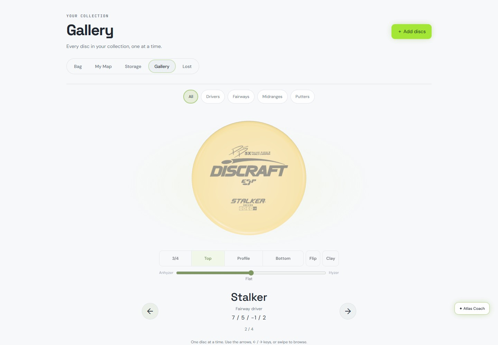

# Gallery per-flip performance hunt — Phases 1–2

October 17, 2026. **Phase 2 retained a one-file experiment; Gallery and Atlas phone perf gates remain red. Stop for Freddy.** See Phase 2 below for results, regressions and screenshots. Phase 1 attribution is retained as historical evidence.

The built Gallery has real phone main-thread stalls outside the gate. The dominant reproducible task is the **shared owner-photo promise continuation / `reliefTexture()` CPU work**, repeated when returning to Destroyer. It is also present in the historical build. These PC captures do **not** establish a new >50 ms block on every flip, or explain the Mac’s 241-task result. A Gallery-specific extra style-flush boundary is visible, but it is not proven to explain that Mac signature. Do not turn this into a claimed universal diagnosis or a green perf gate.

## Base and boundaries

- Worktree: `C:/Users/user/.codex/worktrees/gallery-perf-hunt/disc-atlas`; branch `codex/gallery-perf-hunt` from fetched `origin/codex/all-discs-gallery-fixes`, **`c3956cf1956af6863b415a2b1a5a1bcc4940c4f7`**.
- Before: **`e59e67e10f263718a47ca4fd842a70db630d5987`**, replaying the exact four sources used by the existing test: `web/index.html`, `public/my-bag.js`, `public/my-bag.css`, `public/all-discs-gallery.js`. Authentication/fixture setup precedes replay; the checkout never changes revision.
- In Phase 1, product code, shared viewer/photo code, Atlas code, tests, gates, limits, margins, repetitions, and quality settings were unchanged. Only this document and diagnostic evidence were committed. No push, PR, merge, or deployment.
- Graphify located the Gallery, viewer, photo/stamp modules and existing harness before source inspection. No graph rebuild was needed for this documentation-only investigation.

## Method: exclude the harness, then compare it

Built the unmodified site with `node scripts/build-workers.mjs` and served its output through the repository’s local auth/D1/R2 fixture on `https://localhost:8951`. State lives in ignored `outputs/gallery-perf-hunt/state`, separate from the gate’s state/port. Used the same four owned copies: processed owner-photo Destroyer, stock Stalker, Buzzz and Luna. No external sign-in/service was used.

**Real browser:** headed Chromium **151.0.7922.34**, bundled Playwright **1.62.1**, Node **24.21.0**, Windows, NVIDIA RTX 3070 / ANGLE D3D11. Desktop **1440 × 900, DPR 1, CPU 1×**; phone **390 × 844, DPR 2, coarse pointer, CPU 4×**. Arguments: `--use-angle=d3d11 --enable-gpu`. Shared defaults remain 80/56 segments, maximum DPR 2, photo size 1024; nothing was lowered. Machine-wide quietness was not independently certified. No other profiling/build/test job from this task ran concurrently.

Three diagnostic input modes:

1. **Ordinary input, paced:** real browser mouse input on the Next button, with 140 ms between operations. All recorded clicks are `isTrusted: true`. No synthetic DOM click, forced `debug.renderNow()`, or readiness polling in the navigation loop.
2. **Ordinary input, wait-ready:** the same real button input, waiting for actual photo/stamp readiness and the Gallery’s loading state to finish before the next click. This closes the fixed-pacing confound while still omitting synthetic clicks and forced draws.
3. **Gate-style flip loop:** the existing gate’s rAF → synthetic click → `debug.renderNow()` → readiness-wait sequence, copied into a temporary probe. The gate file itself was never edited. This isolates that scheduling combination; it is not a rerun of the entire gate.

Each run-of-flips capture contains **241 navigation operations**, before and after. Single-flip captures deliberately select **Luna → owner-photo Destroyer**. The paired before/after runs use matching input sequences; captures that follow the single flip start their 241-operation block on Destroyer → Stalker. The trace-free controls start their block on Luna → Destroyer (61 photo returns rather than 60), identically within each pair. Warm-up visits all four copies. Profiles cover flips, not the gate’s 120 still draws, cold/warm repetition medians or paired pass/fail calculation. **No diagnostic here substitutes for repository-default acceptance.**

Recorded CDP timeline events, renderer-main `RunTask` intervals, callback/async-script source locations and stacks, input markers, and a `PerformanceObserver` for `longtask`. CPU sampling was a separate capture. A first exploratory capture exposed **537.180 ms in `CpuProfiler::StartProfiling`**; it is excluded from the findings below. Subsequent sampled captures initialize profiling before `hunt:start` and before resetting the observer. Timeline-only and tracing-disabled controls prevent treating profiler startup as a product stall.

## Results: diagnostic counts, not gate verdicts

Counts below are the page’s Long Tasks observer, not an invented threshold or a new test limit. Every run has 241 flips and zero page errors.

| Device / input | Before | After | Recording |
| --- | ---: | ---: | --- |
| Desktop, ordinary paced | 1 | 0 | Timeline only |
| Phone, ordinary paced | 63 | 59 | Timeline only |
| Phone, ordinary paced | 61 | 63 | **Tracing disabled** |
| Phone, ordinary wait-ready | 80 | 84 | Timeline only |
| Phone, gate-style loop | 60 | 96 | Timeline only |
| Phone, gate-style loop | 62 | 106 | **Tracing disabled** |

The additional CPU-sampled after gate-style run recorded 68. These are different diagnostic conditions, all retained, not retries selected to obtain a pass. Do not compare their absolute counts to the supplied headless gate medians of PC 8 or Mac 241. The full repository-default gate was not rerun or changed in Phase 1.

The ordinary-input tracing-disabled runs prove that the >50 ms work is **not solely a test-harness or trace artifact**. However, the large gate-style before/after count difference does not carry over at the same magnitude to either real-input comparison. Scheduling, added instrumentation and headed/headless conditions matter; this investigation does not resolve all those interactions.

## Task attribution

[Task-by-task CSV](assets/gallery-perf-hunt/tasks.csv) records **527 renderer-main task intervals over 50 ms** across the retained captures, with timestamps, flip/mold markers, source callback, script/frame phase, and separate style/layout/paint maxima. [Full task details](assets/gallery-perf-hunt/task-details.json) preserve the underlying callback metadata/stacks. The source column identifies the representative application callback in a task, not a claim that every millisecond belongs to one function.

CDP `RunTask` counts and the Long Tasks API occasionally differ by one or two intervals; both counts are retained in [summary.json](assets/gallery-perf-hunt/summary.json). They are distinct instrumentation boundaries and are not substituted for each other. In particular, the paced after phone trace has 60 >50 ms renderer tasks but 59 Long Tasks API entries; the wait-ready traces have 86/84 after and 81/80 before. Gate assertions continue to use their original observer.

### 1. Dominant real task: shared photo preprocessing, not one task per mold

Trigger: leave the photo copy, then return to it. The native phone 241-flip traces contain **60 requests to the same owner-photo route in each variant**. The before trace attributes 60 long renderer tasks to `public/disc3d/photo.mjs`; the after trace attributes 58 (some other photo work falls below the cutoff). The three stock-stamp copies do not produce this same promise task on every arrival.

Source chain, unchanged between the two revisions:

- `public/disc3d/viewer.mjs:251–255` releases the old photo, rebuilds the copy, and calls `photoSurface(..., {relief:true})` for the next photo.
- `public/disc3d/photo.mjs:39–48`, `acquirePhoto()`, owns the fetch/decode/texture promise. Its `release()` at L48 deletes the entry and disposes/aborts its resources when the last reference goes away. It does not retain a released photo as an LRU entry. This accounts for the repeated requests and preprocessing on return.
- The resumed async callback at **`public/disc3d/photo.mjs:45`** creates the texture and calls **`reliefTexture()` at L19**. That function reads a 512 × 512 canvas, builds luminance/histogram data, and computes the 3 × 3-neighborhood relief map synchronously. Readback and those loops execute on the main thread.

**One-flip trace:** before Luna → Destroyer has a **71.290 ms** task, including a **59.504 ms** `PROMISE_RESOLVE` callback at source character 3230 of `disc3d/photo.mjs`. The after counterpart has a **199.500 ms** photo task with **182.525 ms** in the same callback, plus an 80.238 ms input/frame task and a 57.552 ms scheduled viewer draw. Those variable durations are observations, not a stable regression ratio; the separate after CPU capture’s photo task is **74.139 ms**.

**Run trace:** the paced after phone series has **58 photo tasks**, median **114.968 ms**, versus 60 in the before series. In the CPU-sampled after gate-style series, **59 of 68** long tasks include `reliefTexture()` in their sampled call tree. It accounts for **3,009.263 ms inclusive sampled wall time**, of which `getImageData()` accounts for 408.191 ms; the long-task sample total is 4,331.446 ms. This is sampling under 4× throttling, not exact CPU timing. The long-run sample provides clearer relief-loop attribution than the single-flip sample, where optimized/native work often retains the enclosing L45 callback location.

**Phase check:** browser-only wrappers timed the existing bitmap/canvas/GL calls without replacing their work. In the after single-photo control, the synchronous bitmap call was **1.1 ms**, canvas draw **2.1 ms**, readback **6.3 ms**, and longest `texSubImage2D` call **7.9 ms**; the photo continuation task was **63 ms**. Before values were 2.0 / 2.8 / 9.4 / 9.5 ms, with an 85 ms photo task. Thus **a single blocking decode or upload call is not the dominant >50 ms operation in these samples**; synchronous photo-processing work around those calls dominates. This does not rule out a different GPU path on the Mac, nor measure the entire asynchronous decode interval as synchronous time.

### 2. Gallery/frame delta: extra style flush and changed scheduling

The concrete new flush boundary is `public/all-discs-gallery.js:59–60`: write `visibility='hidden'`, then call `host.getAnimations()`, before the remaining text/attribute mutations. The trace records `UpdateLayoutTree` with the call stack at **`render():60`**. The same click later flushes again through **`stampTexture():34` → getComputedStyle(document.body).fontFamily** after the intervening DOM writes.

For example, the ordinary after-phone task at **121663699683 µs** is **50.033 ms**: Gallery callback 31.673 ms, separate style recalculations 4.017 and 2.380 ms, then layout 5.644 ms. In a gate-style task at **121584562511 µs**, the root is **80.778 ms** and the two style recalculations cost **13.170 / 10.920 ms**. It is combined script/style/layout/frame work, not a demonstrated 80 ms texture upload.

The baseline already calls `getAnimations()` (**historical L81**), but after updating the copy, when earlier viewer/style reads have already flushed work. It also reattaches/resizes each time. The fixes remove repeated attachment, restore the camera pose, move cancellation before the DOM updates, hide until appearance readiness, and defer reveal across another rAF. The before and after pipelines therefore schedule different frame combinations even though their shared texture implementations are identical.

The traced gate-style series has **38 Gallery/frame tasks + 58 photo tasks** after, versus **60 photo tasks** before. With ordinary wait-ready input, the split is **20 Gallery + 6 viewer + 60 photo** after and **6 Gallery + 15 viewer + 60 photo** before. These are task-source groupings, not a proof that cancellation alone causes the whole excess. In the CPU-sampled run `getAnimations()` is a much smaller aggregate hotspot than photo relief. The current evidence supports investigating the added flush; it does **not** prove an exclusive per-flip offender or a fix for the Mac result.

### Alternatives and limits

| Suspect | Finding |
| --- | --- |
| Gate or trace is the only source of long tasks | Ruled out: ordinary `isTrusted` input still produces long tasks with tracing disabled. Gate scheduling can still amplify/count different combinations. |
| One new texture-readiness block on every flip | Not established. Most PC native stalls follow photo returns; the same work exists before. A total near 241 does not identify which flips/tasks are responsible. |
| Neutral hold’s polling alone | No sampled long callback is exclusively the small readiness/reveal check. Do not remove the hold to improve numbers. |
| Stock-stamp network decode on every flip | Not supported by the recurring photo-promise stacks. Warm stamp masks and newly created per-copy canvas textures are distinct from the owner-photo relief path. |
| GPU upload as the proven main cause | Not supported by the timed single-flip calls. A scheduled viewer draw can independently exceed 50 ms; the Mac GPU path remains unprofiled. |
| GC as the main native-series cause | Not supported: the largest recorded GC span inside the paced native long tasks was about 2.036 ms after / 1.769 ms before. Some gate-style tasks include larger GC work, up to 20.095 ms. |
| Atlas regression | Not investigated or changed here. The supplied quiet-Mac Atlas pass remains the environmental control; no Atlas fix or gate rerun is claimed. |

## Platform gap

**Unexplained by the available evidence.** Freddy’s supplied quiet-Mac gate medians (desktop 61, phone 241) and original PC result (phone 8) are historical gate observations, not traces. This PC used ANGLE D3D11 on an RTX 3070; no Mac trace/GPU/CPU sample was available. There is no basis here to attribute the difference to Metal, decode, GPU upload, GC, or the neutral hold alone.

The needed next evidence is a Mac trace with flip markers and renderer-main task/CPU stacks around one of the purported per-flip tasks, plus its before replay. Keep the full unchanged gate workload/default repetitions. Check whether tasks cluster on the photo returns, are scheduled viewer draws, or repeatedly contain the L60/L34 style boundaries. Matching the aggregate task count to the number of clicks is insufficient, especially when a single photo arrival can create multiple long tasks.

## Phase 1 proposed experiment — approved for Phase 2 on October 17

**Gallery-only candidate:** in **`public/all-discs-gallery.js` only**, move the existing animation query/cancellation before the first visibility/DOM write. This tests the specifically observed added style-flush boundary with the smallest change. Keep synchronous hiding **before** `v.update()`, every readiness/failure/revision guard, and the separate paint-before-reveal rAF. Keep pose restoration and the dedicated Gallery section exactly as implemented. Cancelling the old animation before hiding still occurs in the same input task, while the previous copy is displayed, before changing viewer props.

This is a **candidate experiment, not a demonstrated remedy for 241 Mac tasks**. Do not implement it as an asserted fix or widen into feature work. First review this attribution and the unresolved Mac signature. After explicit approval, a successful experiment must remove the measured flush/excess without restoring pop-in, then meet the original PC and quiet-Mac gates and all specified functional/regression checks. A green diagnostic count would not satisfy acceptance.

The other evidenced opportunity is avoiding repeated decoded-photo/relief work on revisit, potentially through bounded resource reuse. That would touch **`public/disc3d/photo.mjs`** and its resource lifetime/clear/reset contract; it is shared photo-texture pipeline work, not a Gallery-only change. **STOP-and-sequence applies: do not implement that lane before the glare + leveling port lands and Freddy approves the sequence.** No change to `public/disc-albedo.mjs` is proposed. The shared path’s ownership, privacy clearing and memory lifetime deserve a dedicated review; if that becomes the required fix, re-seating Phase 2 is reasonable. It must not be improvised here to force a green count.

## Evidence and reproduction

- [Summary, observer controls, phase timings and CPU samples](assets/gallery-perf-hunt/summary.json)
- [All long-task rows](assets/gallery-perf-hunt/tasks.csv) and [full callback/phase details](assets/gallery-perf-hunt/task-details.json)
- [Trace manifest with raw/archive SHA-256 checksums](assets/gallery-perf-hunt/manifest.json). Twelve gzip-compressed CDP traces include the native phone before/after single flips and 241-flip runs, wait-ready runs, gate-style comparisons, CPU samples, and phase-call controls. Decompress the selected trace and load its JSON in Chromium DevTools Performance or another Chrome-trace viewer. `hunt:start`, `hunt:flip:N`, and `hunt:end` delimit the measured input window; source names and task timestamps correspond to the CSV.

Full uncompressed traces and screenshots, including desktop diagnostics and the discarded profiler-startup exploration, remain in ignored `outputs/gallery-perf-hunt/` in this worktree. The compressed evidence and tables are approximately **31.9 MB**; start with the summary/CSV and a single-flip trace, not the whole bundle. No auth storage-state file or database is included in the evidence.

**Local-only reproduction:** the temporary probe and analysis scripts remain at `C:/Users/user/disc-atlas/outputs/gallery-perf-hunt-driver.mjs`, `gallery-perf-hunt-analyze.py`, `gallery-perf-hunt-cpu.py`, and `gallery-perf-hunt-package.py`. They are ignored diagnostic tools, not versioned product/gate changes. A fresh checkout cannot execute this probe without obtaining those scripts and adapting the runtime paths; these commands describe this retained PC setup, not a portable Mac runner. The committed traces, task tables and checksums can be inspected independently of the probe. Local reproduction uses the worktree’s installed-dependency junction, bundled Playwright, and local fixture:

```text
node scripts/build-workers.mjs
node node_modules/wrangler/wrangler-dist/cli.js d1 migrations apply disc-atlas-accounts --local --config tests/auth.wrangler.jsonc --persist-to outputs/gallery-perf-hunt/state
node node_modules/wrangler/wrangler-dist/cli.js dev --config tests/auth.wrangler.jsonc --local --port 8951 --ip 127.0.0.1 --local-protocol https --inspector-port 0 --persist-to outputs/gallery-perf-hunt/state
```

In a second terminal, run the probe from the worktree. Use `--setup=true --setupOnly=true` once against a fresh isolated fixture; then select matching `--phase=before` / `--phase=after`, `--device=phone` / `desktop`, and `--mode=native` / `native-ready` / `gate`, with `--headless=false`. `--tag=timeline` is the unsampled timeline capture; `--samples=true --tag=cpu` adds CPU samples; `--instrument=true --onlySingle=true --tag=phases` times the existing bitmap/canvas/GL calls; `--trace=false --single=false --tag=observer` is the tracing-disabled 241-flip control. The probe defaults to one single flip followed by a separate 241-flip capture. None of these options edits a gate or changes its acceptance criteria.

## Verification and stopping point

Checked archive decompression/checksums, trace JSON, input counts/trust, before/after source replay, per-task source/phase rows, recorded page errors, and protected-file diffs against `c3956cf`. Product and gate hashes remain unchanged. The shared viewer/photo/albedo sources are also byte-identical between the historical and fixes revisions. No product regression suite or full performance acceptance rerun was needed to validate a documentation-only Phase 1; no new pass is claimed for either.

**Historical Phase 1 stopping point:** Freddy approved the bounded experiment on October 17. The shared photo cost, observed Gallery flush delta and unexplained Mac signature remain separate findings. Phase 2 follows.

## Phase 2 — one-file style-flush experiment

October 17, 2026. Freddy approved this bounded experiment on top of **`4e5930a`**. **Retained locally as `fb382fe`; promising movement, acceptance incomplete.** Phone long-task median fell **55 → 42**, near the fresh before-variant median **44**, but the unchanged Gallery gate still exits **1** on paired long tasks (**+1**). Atlas also exits **1** on phone long tasks. Neither gate is green. Historical PC performance and the Mac signature have not been recovered or explained.

### Exact change and decision

Only **`public/all-discs-gallery.js:59–60`** changes product behavior: the existing animation query/cancellation now runs before the first visibility write. Hiding still runs synchronously before `v.update()`. Pose restoration, readiness/failure/revision guards, and the separate paint-before-reveal rAF remain intact. Shared viewer, texture, Atlas, quality and data code are unchanged. **`reliefTexture()` is untouched.**

The prewritten retain-and-regress rule is applied to the material movement toward the contemporaneous baseline: **55 → 42**, a **23.6%** median reduction, versus baseline **44**. This is a promising local improvement, **not a passed paired gate or demonstrated causal fix**. Two paired repetitions still exceed the allowance. Baseline drift and block-order measurement prevent claiming the reorder alone caused recovery. This is not a clean negative that exonerates the flush. Retain the isolated experiment for Freddy's judgment; no landing is asserted. Independent read-only review found no guard regression and agreed provisional retention under “roughly baseline” is defensible with these limits.

### Method and drift

Unchanged Gallery test defaults: **7 desktop / 3 phone warm repetitions**, one cold per device, **241 flips + 120 still draws per repetition**, same four owned fixture copies and historical source replay. Margins, limits, quality, independent-median and paired calculations are untouched. No repetition, evidence-only, executable or GPU overrides were set for a performance run. Once each, serially: pre-experiment after, fresh before replay, post-experiment after, then Atlas. No unchanged-implementation retry was selected for a better result. The later evidence-only screenshot driver contributes no measured perf rows.

Runtime: bundled **Node 24.19.0**, **Playwright 1.62.1**, installed **Chromium revision 1234**, Windows, default ANGLE D3D11 / GPU-enabled arguments. Desktop **1440 × 900 / CPU 1×**; phone **390 × 844 / DPR 2 / CPU 4×**. Historical fixes/Phase 1 used Node 24.21.0; runtime parity with them is not claimed. This task ran no concurrent build, test or profile during measured loops. Machine-wide quietness was not independently certified.

The fresh pre-experiment control already measured phone **56, 55, 49**, versus recorded **13, 8, 7**. Fresh before replay measured **39, 51, 44**, versus recorded **2, 2, 3**. This drift precedes the experiment and limits interpretation; all rows are retained.

### Recorded PC comparison requested alongside the experiment

The first two columns preserve the fixes write-up, including **phone 8 vs limit 3, desktop 0**. The post-experiment column is this run. Limits and post paired excesses here are recalculated against the **recorded** before rows using unchanged formulas. This is a **cross-session comparison**, not the fresh gate verdict or controlled causal attribution.

| Device | Warm metric | Before variant | Pre-experiment after | Post-experiment after | Limit | Post median paired excess | Post result |
| --- | --- | ---: | ---: | ---: | ---: | ---: | --- |
| Desktop | Navigation/draw p95, ms | 2.8 | 2.8 | 4.2 | 4.72 | -0.52 | Pass |
| Desktop | Still-draw p95, ms | 0.2 | 0.2 | 0.3 | 1.73 | -1.43 | Pass |
| Desktop | Long tasks, count | 0 | 0 | 0 | 1 | -1 | Pass |
| Phone | Navigation/draw p95, ms | 12.9 | 14.3 | 19.4 | 17.835 | 1.795 | **FAIL** |
| Phone | Still-draw p95, ms | 1.2 | 1.4 | 1.4 | 4.38 | -2.88 | Pass |
| Phone | Long tasks, count | 2 | 8 | 42 | 3 | 39 | **FAIL** |

### Fresh same-session comparison — actual Gallery verdict

The default before replay supplies the actual post-run baseline. Its long-task limit mechanically becomes **44 + 1 = 45** under the untouched gate, not a widened constant. The pre-experiment column below is the fresh control; the recorded 8 remains above.

| Device | Warm metric | Before variant | Pre-experiment after | Post-experiment after | Limit | Post median paired excess | Post result |
| --- | --- | ---: | ---: | ---: | ---: | ---: | --- |
| Desktop | Navigation/draw p95, ms | 4 | 3.4 | 4.2 | 6.1 | -1.785 | Pass |
| Desktop | Still-draw p95, ms | 0.3 | 0.2 | 0.3 | 1.845 | -1.545 | Pass |
| Desktop | Long tasks, count | 0 | 0 | 0 | 1 | -1 | Pass |
| Phone | Navigation/draw p95, ms | 18.7 | 22.4 | 19.4 | 24.505 | -4.745 | Pass |
| Phone | Still-draw p95, ms | 1.3 | 1.5 | 1.4 | 4.495 | -3.095 | Pass |
| Phone | Long tasks, count | 44 | 55 | 42 | 45 | 1 | **FAIL** |

Phone pairs: **39 → 41, 51 → 42, 44 → 48**. Excesses after +1: **+1, −10, +3**; median **+1**, so the gate correctly **fails** despite independent medians **42 ≤ 45**. Desktop long-task medians stay **0 → 0 → 0**. Full cold/warm distributions: [before](assets/gallery-perf-hunt/phase2/before-variant-fresh.json), [pre-experiment](assets/gallery-perf-hunt/phase2/pre-experiment-fresh.json), [post-experiment](assets/gallery-perf-hunt/phase2/post-experiment.json). Historical fixes evidence remains unchanged in `docs/images/storage-all-discs-fixes/`.

### Atlas collateral gate at defaults

Unchanged gate, **7 desktop / 3 phone**, alternating 2D/3D, **241 flight + 120 still draws**, no `PERF_REPS*` overrides. Wall-clock **172.96 s**. The file is Gallery-specific, but the requested collateral gate ran regardless.

| Device | Metric | 2D median | 3D median | Limit | Median paired excess | Result |
| --- | --- | ---: | ---: | ---: | ---: | --- |
| Desktop | flight p95 | 4.7 | 6 | 6.905 | -1.15 | Pass |
| Desktop | 1x p95 | 1.1 | 1.9 | 2.765 | -0.765 | Pass |
| Desktop | long tasks | 0 | 1 | 1 | -1 | Pass |
| Phone | flight p95 | 12.2 | 16 | 17.03 | -1.78 | Pass |
| Phone | 1x p95 | 2.7 | 3.7 | 6.105 | -2.35 | Pass |
| Phone | long tasks | 7 | 11 | 8 | 2 | **FAIL** |

Atlas exits **1** on phone long tasks: **11 vs 7**, limit **8**, paired **+2**. The older fixes run also had a red Atlas phone long-task gate (8 vs 3, limit 4). This run establishes neither a new collateral regression nor an Atlas pass. [All distributions/decisions](assets/gallery-perf-hunt/phase2/atlas-defaults.json). The unresolved Mac signature remains unresolved.

### Full regression and functional acceptance

**74 unit tests passed.** Unchanged **album, bag, Storage/Lost and demo** browser suites all exited **0**; demo passed all seven checks. Storage/Lost phone p90s: **17.8 / 18.0 ms**. The default post-experiment Gallery run passed all four functional assertions before failing perf. [Exit codes](assets/gallery-perf-hunt/phase2/regression-exits.json), individual logs in the same directory, and [functional samples](assets/gallery-perf-hunt/phase2/functional.json) are retained.

A separate evidence-only driver repeats delayed-response checks, adds four Top flips, then uses real browser button input for **Destroyer → Stalker → Destroyer → Stalker**, with 25 ms waits between completed inputs. It measures no perf workload.

- Gallery remains **Bag · My Map · Storage · Gallery · Lost**; Storage has its rack. [Navigation](images/gallery-perf-phase2/after-navigation.png), [rack](images/gallery-perf-phase2/after-storage-rack.png).
- Top remains `top, top, top, top` across [Stalker](images/gallery-perf-phase2/after-top-flip-1.png), [Buzzz](images/gallery-perf-phase2/after-top-flip-2.png), [Luna](images/gallery-perf-phase2/after-top-flip-3.png), [Destroyer](images/gallery-perf-phase2/after-top-flip-4.png). Original Profile/angle/bottom persistence and neutral asset-failure checks also pass.
- Delayed photo and Stalker stock art each record **zero visible-before-ready frames**. [Pending Stalker](images/gallery-perf-phase2/after-stamp-pending.png) stays neutral; [resolved Stalker](images/gallery-perf-phase2/after-stamp-ready.png) has its real stock stamp.
- Rapid flips record **43 rAF samples / 22 compositor screenshots**, **zero visible-before-ready samples**. All compositor frames were inspected in the [contact sheet](images/gallery-perf-phase2/fast-stalker-contact-sheet.jpg); both first Stalker arrivals were also inspected at full size: [001](images/gallery-perf-phase2/fast-stalker-frame-001.jpg), [010](images/gallery-perf-phase2/fast-stalker-frame-010.jpg). The resolved stamp is present at both first captured arrivals; **no default-look flash was observed**. All frames are retained beside those files. This verifies this recorded PC sequence, not every device or inter-frame instant.



[Diagnostic driver source](assets/gallery-perf-hunt/phase2/functional-driver.mjs.txt) is retained as plain text, not a modified gate. To reproduce, copy it to an ignored `.mjs` path, create `outputs/gallery-perf-phase2/functional/after.json` from the post-experiment report, and run from the repo root with `GALLERY_FIXES_EVIDENCE_ONLY=1` and the same `PLAYWRIGHT_MODULE`. It uses the local Wrangler/auth/D1/R2 fixture on 8843; no session/secret state is included. Its perf rows are retained input, **not a second measurement**.

### Reproduction, verification and stopping point

Measured commands, in order: `node tests/gallery-fixes-browser.mjs`, `node tests/gallery-fixes-browser.mjs --before`, `node tests/gallery-fixes-browser.mjs`, `node tests/atlas-3d-perf.mjs`. Runtime prefix was `C:/Users/user/.cache/codex-runtimes/codex-primary-runtime/dependencies/node/bin/node.exe`; `PLAYWRIGHT_MODULE=C:/Users/user/.cache/codex-runtimes/codex-primary-runtime/dependencies/node/node_modules/playwright`. No gate file changed.

Unit command: `node --test tests/bag.mjs tests/bag-values.mjs tests/bag-3d-layout.mjs tests/bag-pulled-sizing.mjs tests/bag-demo.mjs tests/collection-layout.mjs tests/all-discs-order.mjs`. Then serially run `tests/all-discs-browser.mjs`, `tests/bag-browser.mjs`, `tests/bag-collections-browser.mjs`, `tests/bag-demo-browser.mjs` with that runtime. Every exit code and log is retained.

Syntax, changed-file ESLint and whitespace checks passed. AST-only `graphify update .` ran with environment/credential/document exclusions verified; no topology change was detected, so committed graph outputs stayed untouched. Independent read-only review found no guard regression. Final diff/protected-file checks against `4e5930a` confirm only the named product file plus report/evidence changes. Historical generated fixes evidence was restored; Phase 2 results are separate. [SHA-256 manifest](assets/gallery-perf-hunt/phase2/sha256.json) covers committed Git blob bytes (`git show HEAD:<path>`), so text checksums remain portable across Git line-ending conversions.

**STOP for Freddy.** Keep `fb382fe` as the separate local experiment and commit this report/evidence separately. Both perf gates remain red. No second experiment, `reliefTexture()` work, push, PR, merge or deploy. Freddy's quiet-Mac re-run remains the landing judge; this run makes no landing claim.
