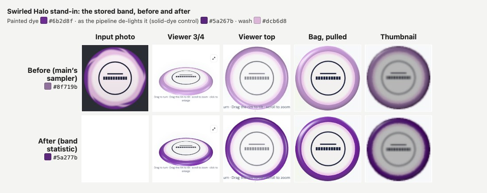

# Halo band sampling: store the band's dye, not the wash

October 18, 2026. Branch `claude/halo-band-sampling` from `main` at `cad422a` (PR #23 merged). This is a colour-sampling fix inside the photo pipeline. Geometry, renderers, data and the `photo_rim_color` contract are unchanged.

## The failure

Freddy Level-saved his real Halo disc, the "Title Town Tussle" tournament stamp. The band rendered in the right place, but its colour came out washed near-white, while the band in his photo is saturated purple.

His disc is the hard case, not an edge case. The dye is swirled: a pale pink-lavender wash bleeds across the inner part of the band, and the purple concentrates toward the outer edge, unevenly around the circle.

## A stand-in for his disc

Freddy's photo is not in the repo (the repo is public). [`tests/fixtures/halo-swirl.mjs`](../tests/fixtures/halo-swirl.mjs) stands in for it: a deterministic, pure-JS painting.

- **Plate:** pale (`#efe7ec`), with a dark tournament-style stamp.
- **Wash ring:** pink-lavender (`#dcb6d8`) from 0.72 R, so the wash already covers the seam.
- **Dye:** saturated purple (`#6b2d8f`, the ground truth). Its front wanders around the circle between 0.84 and 0.92 R, and spiral wash streaks cut back into it.
- **Light:** lit like a phone photo, with a 12% top-to-bottom falloff and the rim's curvature darkening the last 5% of the radius.

The browser suite uploads it through the real editor as a Halo Star Wraith. The Node tests feed the same pixels to `delightPixels` directly. The Node harness reproduces the browser's stored values exactly: the PR #23 drawn Wraith band is `#ffeaff` both ways.

**Which target is reachable.** De-lighting normalises the whole photo and the plate before any band is sampled: exposure brings the plate into a sane band, and white balance neutralises a near-white plate. So a solid band of the dye, with no wash, painted on the same plate and lit the same way (the *solid-dye control*), comes out as **`#5a267b`**, not `#6b2d8f`.

That is the colour this pipeline can store for this dye. The stored plate and the photo inside the shoulder are in the same de-lit space, so the band should be too. The tolerance used throughout, chosen from this characterisation:

- ΔE76 within 6 of the control;
- hue within 8°;
- at least 85% of its chroma.

## Characterisation (before any fix)

| Swirl, measured in Node | Colour | L / C / h | ΔE76 to `#6b2d8f` |
| --- | --- | --- | --- |
| Ground-truth dye | `#6b2d8f` | 32 / 62 / 316° | 0 |
| Solid-dye control (what de-lighting makes of the dye) | `#5a267b` | 27 / 55 / 316° | 8.4 |
| **Stored today** (de-lit, ceiling, median) | **`#8e709a`** | 52 / **27** / 317° | **40.1** |
| Same median on the raw photo (no de-lighting) | `#a77fb1` | | 40.3 |
| De-lit median without the luminance ceiling | `#997ca1` | | further than today |

Only **40%** of the 512 samples are nearer the dye than the wash. The per-ring medians, inner to outer, are `#d9b4d6` → `#c7a1ca` → `#83559c` → `#6e2e91`: the outer ring alone is the dye.

**The three working hypotheses, tested:**

1. **The per-channel median over a mixture: confirmed. This is the dominant cause.** The wash covers most of the annulus, so the median lands on a pastel between wash and dye. The hue is right (317°); the chroma is less than half the dye's.
2. **The luminance ceiling: refuted.** It discards the brightest samples, which here are wash, so it pulls the median slightly *toward* the dye (`#997ca1` without it, `#8e709a` with it).
3. **The de-lighting lift: refuted on a pale plate, confirmed on a dark one.** On the swirl, de-lighting darkens: raw `#a77fb1` against de-lit `#997ca1` without the ceiling, because the pale plate's exposure comes down. PR #23's drawn Wraith is the other way round. Sampled raw, its band is exactly `#e9c8f7`. Its whole error is exposure: the dark purple plate is lifted by about 1.44×, the band clips toward white, and it is stored as `#ffeaff`. That is a separate cause, and it does not apply to Freddy's pale disc.

## The fix: a Halo-only band statistic

`bandColor(data, size, inner)` in [`public/disc-albedo.mjs`](../public/disc-albedo.mjs) sits beside `rimColor`, which is untouched.

- **Same reading as `rimColor`:** the same annulus, the same transparent-pixel skip and the same glare ceiling, read on 8 rings instead of 4 for a finer radial read.
- **Grouping:** the samples are grouped by colour with k-means, k = 3, seeded deterministically. Distances are in Lab with lightness weighted ×0.5, so shading on one dye stays one group. Groups closer than ΔE 12 merge.
- **The band is the group that sits furthest out**, among groups holding at least 15% of the samples. The dye runs to the edge; the wash bleeds in from the plate side. Its colour is the group's per-channel median. That is a group's typical colour: not an area average, and not the single most saturated pixel.
- **A uniform band is a single group**, so a clean two-tone band reads exactly as `rimColor` read it.

`delightPixels` takes `bandInner` and samples the band at the same point as the rim: after de-lighting, before the glare pass. `preparePhoto` and the editor pass `rimInner` for an overmold and `bandInner` for a one-piece mold. The sheet still sends the band only for a Halo copy, in the same `X-Atlas-Photo-Rim-Color` header, into the same `photo_rim_color` column. Levelling re-samples, so Freddy's disc picks up the fix when he Level-saves it once more.

## Results

| Fixture | Ground truth | Before | After | Tolerance |
| --- | --- | --- | --- | --- |
| **Swirl** (browser, real editor and Worker) | `#6b2d8f` → control `#5a267b` | **`#8f719b`** (main's editor) | **`#5a277b`** | pass |
| Swirl + a clipped glare wedge across the band | same | `#9b7aa2` | `#5c267c` | pass |
| Swirl, dye front pushed out to 0.91 R (23% of samples) | same | `#b59ab6` | `#5a277b` | pass |
| Swirl, harder-lit rim (darkening from 0.88 R) | same | `#83688e` | `#4e226a`: hue and chroma held, darker | the rim's own shading is baked in, as for any sample |
| PR #23 drawn Wraith (uniform band) | `#e9c8f7` | `#ffeaff` | `#ffeaff` | unchanged: see below |
| Blue band on red (Destroyer-like, uniform) | `#2f5fb8` | `#2f5fb8` | `#2f5fb8` | exact |
| White band with red plate bleed (Rollo-like) | `#f4f1ee` | `#f4f1ee` | `#f4f1ee` | exact |
| PR #23 photographic Destroyer composite (browser) | `#2f5fb8` | `#2b58ab` | `#2b58ab` | unchanged |

On screen, outside the photo, the fixed swirl band is nearer the dye than the old one at every outer ring. Inside the shoulder the photo is the same photo (the browser suite asserts both).

### The Wraith does not move, and why

Its band is uniform, so the new statistic and the old one agree (`#ffeaff`). The gap to the drawn `#e9c8f7` is **entirely exposure normalisation**: sampled raw, the band is exact. The same lift is applied to the Wraith's plate (drawn `#5b2a86`, stored `#6c339e`) and to every pixel of its photo, including the band's own slice between the seam and the shoulder.

Moving the stored band toward `#e9c8f7` would mean exempting the band, and only the band, from exposure. The generated band would then disagree with the photo's band slice right beside it by ΔE ≈ 18 (`#ffeaff` against `#e9c8f7`), which shows as a step at the shoulder. It would also disagree with the lifted plate. The overmold fence is not what blocks it: the Halo path is separate. Photo consistency is.

This affects dark-plate Halos only. For a pale plate like Freddy's, de-lighting does not lift. If dark-plate Halos turn out to read too pale in practice, the honest fix is in how exposure treats band pixels, applied to the photo and the band together. That is not part of this change.

### Known limit

A band group must hold at least 15% of the samples. A full ring of table showing past a loose aligner circle is 12.5%, so it can never be read as the band. Dye that covers less than that reads as the wash, as it did before, and never worse:

| Dye front | Dye share of samples | Stored |
| --- | --- | --- |
| 0.88 R (fixture) | 37% | `#5a277b` |
| 0.91 R | 23% | `#5a277b` |
| 0.92 R | 17% | `#866795` (transition) |
| 0.93 R | 13% | `#bca0bb` (the wash; the old median gave `#bba0ba`) |

## Fences

- **Overmold sampling: byte-identical.** `main`'s `disc-albedo.mjs` and this branch's were run on dark, white and glare-wedged rims, and on the swirl treated as an overmold, at 256, 512 and 1024 px. Pixels, plate colour and rim matched in **30 of 30** comparisons, including the plain plate path with band sampling on. `rimColor` is untouched. The PR #12 suite's Pixel rim stays `#101418`.
- **Plate sampling and the photo: unchanged.** `bandColor` only reads the de-lit pixels. Unit tests assert the pixels and the plate colour are identical with and without band sampling, and that glare softening does not change the band.
- **Rendering: unchanged.** `tests/halo-plastic-browser.mjs`, run against a built `main`, draws **every disc on every surface at max pixel difference 0**: the viewer at 3/4 and top, the pulled bag disc and the thumbnail. That includes the controls (the same photo on Star, a Halo copy with no photo, the Pixel) and both swirl copies.
- **The rest of PR #23 stands:** the `photo_rim_color` column and header, the plastics list, re-sample on Level, no migration.

## Suites

Run October 18, 2026, on Freddy's Mac (Playwright Chromium 1248, `BAG3D_CHROMIUM_ARGS=--enable-gpu` as the PR #23 runs needed), one suite after another.

| Suite | Result |
| --- | --- |
| `test:halo` (now includes `tests/halo-band-sampling.mjs`, 7 tests) | pass |
| `tests/halo-plastic-browser.mjs` against built `main` (`cad422a`) | pass: swirl `#5a277b` (main's editor `#8f719b`); every surface of every disc max diff 0 |
| `test:disc3d`, `test:bag`, `test:bag:overmold` | pass |
| `test:photo-rim` | pass (overmold rim sampling and the one-piece null hold) |
| `test:photo-textures` | pass (node half 39/39 and the Worker browser half; re-level keeps the overmold rim) |
| `test:photo-level` | pass |
| `test:photo-edge`, `test:photo-edge:atlas` | pass |
| `tests/non-overmold-photo-edge-browser.mjs` against built `main` | pass: stamp, halo, wraith, clean and Pixel all max diff 0; Pixel rim `#101418` |
| `test:my-map`, `test:appearance`, `tests/photo-glare-ab-browser.mjs` | pass |
| `photo-gestures` (the Chromium-only part of `test:photo-phone`) | pass |
| `test:atlas:3d:perf` (default settings, margins not loosened) | **pass**, first run |
| **WebKit trio** of `test:photo-phone` (`photo-compression`, `photo-editor-contract`, `photo-source-chooser`) | **not run: needs the PC re-run before merge, as for PR #23.** WebKit is not installed on this Mac. These suites exercise `preparePhoto`, whose return value gained `bandColor`, and the editor contract pins exact pixels, colour and WebP |

## After deploy

Freddy's re-Level of his real disc is the final gate: Edit → **Level stamp** → confirm → save. Expect the band to read as his purple. If it still reads pale, the likely reason is the 15% floor: dye on less than about a seventh of the annulus between 0.82 and 0.98 R. The stored value will tell which.

## Not in this change

- **The three-zone v2:** pale centre, wash ring and purple band.
- **Catalog Halo, default band colours, owner-picked band colours:** rejected in the PR #23 recon.
