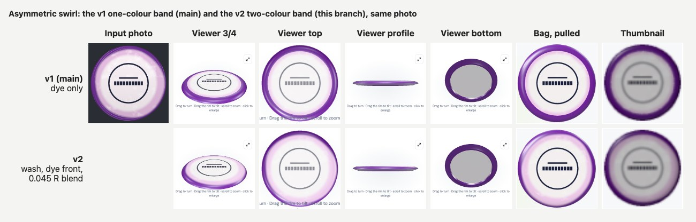
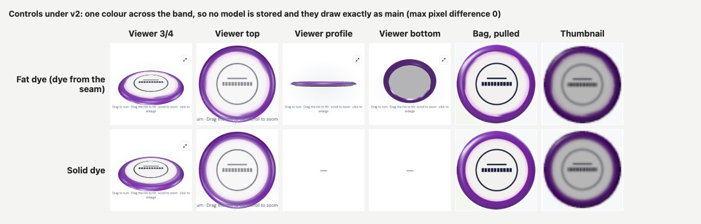
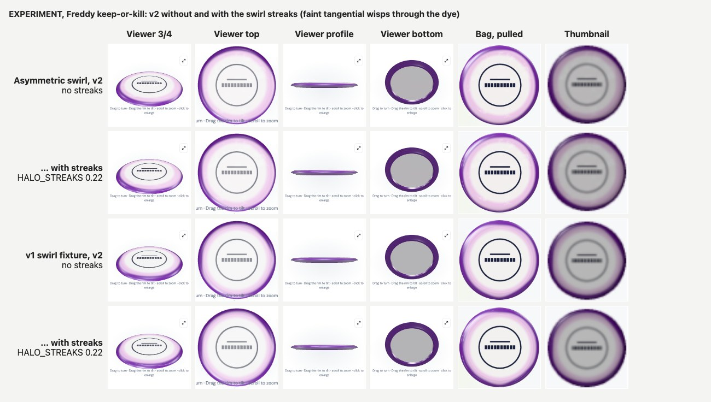
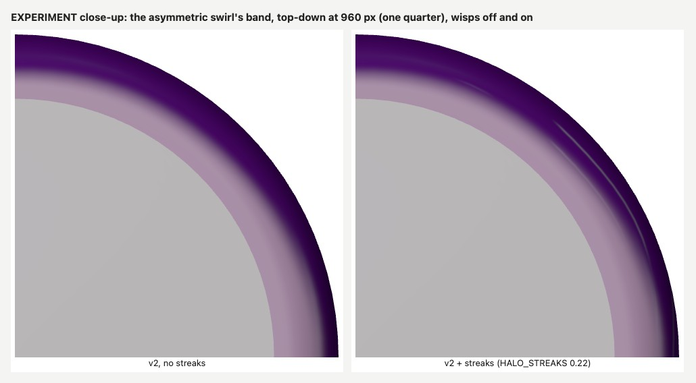

# Halo v2: the two-colour band (wash, dye front, soft blend)

October 18–19, 2026. Branch `claude/halo-band-v2`, in its own worktree, from `main` at `408d575` (PR #24 merged). Commits:

| Commit | What |
| --- | --- |
| `6e52245` | Core v2: sampling, storage (migration 0012), rendering in every band renderer |
| `082a276` | Suite: v2 vs `main`, the v1/v2 sheets, a light-free check of the rendered front |
| `97d3791` | **EXPERIMENT, Freddy keep-or-kill: swirl streaks.** Revert this one commit to ship v2 without them |

**Migration status: `0012_photo_halo.sql` is authored and NOT applied remotely.** It must be applied before this Worker deploys; see *Storage*.

## Why

On PR #24 Freddy said "better, absolutely" to his real Title Town Tussle Wraith (Halo Star), but the band was **too fat**, and the front of the disc is **two colours, not one**. On the real face, the band is mostly a wide white wash ring, and the purple owns only the outer lip.

His ruling: don't shrink the band, include both colours. The dye's character, in his words, is flowy, brushed on and swirly, most visible at the edge. The front advances and retreats around the circle and feathers into the wash. There is no flat zone and no hard ring.

## 1. Recon (before building)

**Where the band colour lands today.** One split of the disc's lathe at the rim seam (`R − PDGA rim width`) puts the whole rim piece in the band material. Measured from `shape.mjs`:

| Mold | Rim seam Ri/R | Photo edge Rs/R | Sampled annulus | Generated top face |
| --- | --- | --- | --- | --- |
| Wraith | 0.801 | 0.827 | 0.817–0.980 | 0.827 → 1.0, up-facing to the nose (normal y 1.0 → 0.65) |
| Destroyer | 0.791 | 0.816 | 0.808–0.980 | 0.816 → 1.0 (normal y → 0.71) |
| Aero | 0.908 | 0.931 | 0.915–0.980 | 0.931 → 0.996, then a short vertical wall |

- **The rim piece covers three faces:** the up-facing top from the seam to the nose, the outer wall (drivers have almost none, putters a short one), and the down-facing underside (wing, foot and inner rim wall).
- **The photo covers the top only up to Rs.** So the band seen on top is generated from Rs out to the nose.
- **The sampled annulus starts just inside the photo's edge.** On the Wraith, 0.817–0.827 lies under the photo and the rest of the annulus is generated.
- **Every renderer paints that piece one colour:**
  - the detail viewer and pop-out;
  - the bag scene, resting and pulled;
  - the thumbnails, the Atlas and the My Map lens (atlas-art);
  - storage racks (instanced) and pulled rack discs;
  - Lost (graveyard).

**What the numbers imply.** v1 paints dye across the whole generated top, 0.827–1.0 R on a Wraith, a band 0.17 R wide.

- If Freddy's dye front sits near 0.94 R, the real purple is 0.06 R wide, so v1 renders it about **2.9× too fat**. That matches his "roughly three times wider".
- The PR #24 swirl fixture's front sits at about 0.88 R, so v1 overstates it by about 1.6×.
- So the model needs two things: a wash colour inside the front, and the front's radius per angle.

**The representation, named before writing it:**

- the dye (unchanged, `photo_rim_color`);
- the wash, `#rrggbb`;
- the dye front as a **ring of 16 radii** at evenly spaced photo angles, interpolated around the circle by periodic Catmull-Rom.

## 2. Sampling the wash and the dye front

`bandModel(data, size, inner)` in `public/disc-albedo.mjs`. It runs at save, beside the dye and at the same point in de-lighting: after it, before the glare pass. `bandColor` (PR #24's dye) was refactored into shared helpers, and its output is **byte-identical to `main`'s in 18/18 fixture cases**.

1. **Groups.** These are PR #24's colour groups: 8 rings × 128 angles, the glare ceiling, k-means in Lab, merged under ΔE 12.
   - The **dye** is the group furthest out (≥ 15% of samples), unchanged.
   - The **wash** is the innermost other group that is also ≥ 15% and inward of the dye.
   - No such wash means no model: the disc keeps the v1 one-colour band.
2. **Dye share per sample.** On 16 finer rings × 128 angles, each sample is projected onto the wash→dye line **in linear light**.
   - A first prototype that used the nearer Lab centre put the front **0.0155 R too far out**. A 50/50 mix in light looks lighter than the Lab midpoint.
   - The wash colour is the median of the samples nearer the wash.
3. **Front per angle.** The front is the seam side of the band plus the wash's share of the band at that angle. That is sub-ring precise and keeps a symmetric feather unbiased.
   - It is smoothed around the circle (a Gaussian, σ = 3 of 128 angles, 8.4°). The real front wobbles, it doesn't zigzag.
   - It is then kept at 16 angles.

**Floors and sanity.** The PR #24 rule carries over: a group must hold 15% of the samples to be dye or wash. A ring of table past a loose aligner circle (12.5%) can therefore never become either.

| Case | Stored |
| --- | --- |
| Asymmetric swirl | wash + front (range 0.867–0.951 R) |
| PR #24 swirl | wash + front (0.867–0.925 R) |
| Dye only at the lip (front 0.91 R) | front near the edge (mean > 0.90 R) |
| Dye from the seam ("fat") | **none: v1 fat band** |
| Solid dye | **none: v1** |
| Dye under 15% of the band (0.93 R) | **none: v1** (the wash as the band, as PR #24) |
| PR #23 drawn Wraith, Destroyer composite, Rollo-like | **none: v1** (one colour) |

### The extended fixture

`tests/fixtures/halo-swirl.mjs` has a new `asym` variant, closer to Freddy's zoomed crop:

- **Marbled plate and wash:** white clouds through pale pink.
- **A lopsided dye front:** it advances on one side and retreats on the other, wobbling (`asymFront`).
- **The feather:** the purple feathers into the wash over 0.045 R (`ASYM_FEATHER`).
- **Wisps:** faint white wisps run tangentially through the dye.
- **The ground truth:** `drawnFront(angle)` is where the dye's share crosses one half.
- **A control:** a `washOnly` variant gives the wash's control colour.

### Tracking, measured

| Front estimator (asymmetric swirl, 360 angles) | RMS | Worst | Bias |
| --- | --- | --- | --- |
| Nearer Lab centre (prototype) | 0.0158 R | 0.0215 R | +0.0155 R |
| Binary dye/wash call on the linear line | 0.0114 R | 0.029 R | −0.0075 R |
| **Linear dye share, 16-radius ring (shipped)** | **0.0101 R** | **0.0278 R** | −0.0061 R |
| Same, 32-radius ring | 0.0101 R | 0.028 R | −0.0061 R |

**The tolerance, and why it holds:** front RMS ≤ 0.015 R and worst ≤ 0.035 R. Both sit inside the 0.045 R feather, so the rendered soft edge always overlaps the drawn one. Whether it reads as "his" front is a call a person makes about where the colour turns, and a blend that wide carries that call.

- **The bias** (−0.006 R, the front slightly inward) follows the de-lighting's residual gain on the band. The quadratic light field is fitted on the plate and extrapolated outward, and it scales wash and dye together. It is not the estimator.
- **The wash** is stored as `#ba9eb9` against its control `#bca1bb`: **ΔE 1.3**.
- **The dye** is unchanged: `main`'s editor and this branch store the **same** `photo_rim_color` for the same photo (asserted in the browser suite).

## 3. Storage

| | |
| --- | --- |
| Column | `bag_discs.photo_halo TEXT`, migration **`migrations/accounts/0012_photo_halo.sql`** (authored here, **not applied remotely**: Freddy applies remote migrations) |
| Form | `'#rrggbb'` (the wash) + 16 bytes as hex, each `r/R = 0.5 + byte/510` (0.002 R steps): **39 characters per disc** |
| Check | NULL, or length 39, `#` + hex (same style as 0008/0011) |
| Why 16 radii | 16 and 32 track equally (table above): the front is low-order, and a person reads a wobble, not per-degree detail. 16 radii resolve up to the 7th harmonic. 32 would cost 71 characters for no measured gain |
| Save flow | One new header on the existing photo `PUT`, `X-Atlas-Photo-Halo` (validated `#` + 38 hex), sent only for a Halo copy. `DELETE` clears it with the photo. The bag list returns it. No new endpoint |

**Deploy order (important).** After this Worker deploys, the bag list `SELECT` and the photo `PUT` both name `photo_halo`. **Apply 0012 to the remote D1 first.** If the Worker deploys without it, the bag list and photo saves fail. Local test runs apply it to their own D1, as they do for every migration.

**Backwards compatibility.**

- **v1 rows stay as they are.** Every existing row has `photo_halo` NULL and draws exactly as today: the browser suite shows **every disc without a model at max pixel difference 0 against `main`**. That covers v1 Halo bands, the controls, the Pixel and plain discs.
- **Re-levelling stores the full model.** A re-Level (or a replaced photo) under v2 re-samples everything.
- **Clearing.** Removing the photo clears it.
- **Plastic changes.** A plastic switched away from Halo hides the model, as it hides the band.

## 4. Rendering the two-colour band

`public/disc3d/halo-shader.mjs` patches each renderer's own band material. The plastic, lighting and finish are the same; only the diffuse colour changes, and it composes with atlas-art's existing slope shading.

**The vertex attribute.** Each vertex of a v2 band's lathe carries `haloCoord`. Only v2 geometry gets it; every other geometry is unchanged. It holds:

- the radius as a share of R;
- the cosine and sine of the photo angle (`atan2(z, x)`, the same frame `photo.mjs` maps the texture in);
- how much the surface faces up: `smoothstep(0.2, 0.45, normal.y)`. That is 1 on the top face to the nose, and 0 on walls and underside.

It is computed before any renderer moves or scales its geometry, so the bag's transforms keep it.

**The fragment.** Per fragment:

1. The front at this angle, by the same Catmull-Rom sum as `halo.mjs` `frontAt`.
2. `dye = smoothstep(front − h, front + h, r)`, with the span set so the 10–90% blend is **`HALO_FEATHER` = 0.045 R**.
3. Colour = wash → dye on the top face, dye everywhere else.

**The rim wall and underside stay full dye.** Freddy's underside photo shows purple all the way round, and that part of v1 was right.

**Why 0.045 R.** It matches the evidence:

- the asymmetric fixture's drawn feather is 0.045 R;
- read back from its own photo, the 10–90% width is **0.042 R** (interquartile 0.040–0.045), and 0.040 R on the PR #24 swirl;
- rendered, it measures 0.044–0.047 R in albedo.

**Where it's wired:**

| Surface | v2 |
| --- | --- |
| Detail viewer and pop-out | yes (`haloRimMaterial`; clay still shows one piece) |
| Bag scene, resting and pulled (detail look) | yes, per copy |
| Thumbnails, Atlas, My Map lens (atlas-art) | yes |
| Pulled rack disc, Lost graveyard (`discModel`) | yes |
| Storage racks at rest (instanced) | v1 dye: they stand edge-on, where only the rim wall shows, and that is full dye in both models |

**The rendered front, measured without the light.** atlas-art draws the asymmetric swirl top-down at 960 px three times under the same light: v2, and the v1 band in the dye and in the wash. Per pixel, (v2 − dye) / (wash − dye) is the wash's share: diffuse light, specular and reflections all cancel. A first attempt that divided v2 by v1 alone was fooled by clearcoat, which adds equally to both.

Along 16 rays:

| | Result |
| --- | --- |
| Rendered front vs drawn front | within **0.021 R** at every angle; the lopsided side in the right place |
| Blend, 10–90% (albedo) | **0.044–0.047 R** (HALO_FEATHER 0.045) |
| Blend as seen (Neutral tone mapping) | 0.037–0.044 R: the bright wash sits in the tone curve's shoulder, so it reads slightly crisper, still soft |

**Performance.** The front and wash are baked at save. Render time reads two uniforms and a 16-float array: no per-frame sampling and no new texture fetch.

## Before / after

v1 (`main`'s editor and renderer) against v2, for the same asymmetric-swirl photo, in the viewer at 3/4, top, profile and bottom, the pulled bag disc and the thumbnail.

- **On top:** the wash ring with a lopsided purple lip.
- **Underside:** stays full purple.
- **Inside the photo:** identical.

**Two colours is a model, not a new look.** The fat-dyed and solid-dyed controls store no model, so they draw exactly as `main` does: max pixel difference 0, along with every other control.

## 5. EXPERIMENT, swirl streaks (commit `97d3791`, Freddy keep-or-kill)

Faint light wisps run around the ring through the dye: on top past the front, on the rim wall and on the underside, echoing the white wisps in Freddy's underside photo.

- **Strength:** `HALO_STREAKS` = 0.22, the wisps' peak lightening toward white.
- **Shape:** the radius sets each streak, the angle bends it and breaks it into lengths.
- **No shimmer:** wisps fade out (`fwidth`) wherever they would be finer than about 2 px, so a small disc never shimmers. At thumbnail size they are effectively off.
- **Scope:** v2 discs only. v1 and non-Halo renders are unchanged, which the suite asserts against the core commit.

At the evidence-sheet size they barely show, by design. The close-up is where to judge them:

**To kill it:** `git revert 97d3791`. That was checked in a scratch worktree: unit tests 19/19 and lint clean. The suite's streak-off guard becomes a harmless no-op.

## Fences

- **Overmold.** `rimColor` and the overmold path are untouched. The Pixel stores `#101418`, and PR #12's photo-edge suite passes against `main` at max diff 0.
- **Plate sampling and non-Halo rendering:** byte-identical.
- **No catalog Halo:** photo discs only.
- **The PR #24 drawn-Wraith note, re-checked.** Its band is uniform, so it stores no model and stays the v1 lifted `#ffeaff`. For a two-colour band, the wash is sampled from the same de-lit pixels as the photo, so the generated wash ring continues the photo's own wash slice at the shoulder. The de-light lift applies to wash and dye alike. On a pale plate like Freddy's there is no lift.

## Suites

Run October 19, 2026, on Freddy's Mac (Playwright Chromium 1248, `BAG3D_CHROMIUM_ARGS=--enable-gpu` as for PR #23 and #24), one suite after another, at `97d3791` (the experiment included).

| Suite | Result |
| --- | --- |
| `test:halo` (now with `tests/halo-band-v2.mjs`, 7 new tests) | pass |
| `tests/halo-plastic-browser.mjs` against built `main` (`408d575`) | pass: dye unchanged; v2 swirl wash `#ba9eb9`; front RMS 0.0101 / worst 0.0278 R; on screen within 0.021 R, blend 0.044–0.047 R; **every unmodelled disc and surface max diff 0** |
| Same suite against the core commit (`HALO_REFERENCE=v2`, experiment before/after) | pass: unmodelled discs max diff 0 |
| `test:accounts`, `test:disc3d`, `test:bag`, `test:photo-rim`, `test:photo-textures`, `test:photo-level` | pass |
| `test:photo-edge`, `test:photo-edge:atlas` | pass |
| PR #12 photo-edge suite against built `main` | pass: Pixel rim `#101418`; max diff 0–1 of 255, within its GPU tolerance |
| `test:my-map`, `test:appearance`, `test:atlas:3d`, `test:atlas:stamps`, `test:bag:album`, `test:3d:polish`, `tests/photo-glare-ab-browser.mjs`, `photo-gestures` | pass |
| `test:bag:browser`, `:overmold`, `:collections`, `:memorial`, `:scene`, `:pulled-sizing`, `:pulled-quality`, `:demo`, `:popup`, `:spin`, `:tips`, `:3d` | pass |
| `test:bag:staging` | **fails, and fails identically on clean `main` (`408d575`):** "8 out with details (1440): demo-04 inside the canvas", the demo disc 6 px past the canvas's left edge. Demo discs carry no photo or Halo band; pre-existing, not this branch |
| `test:atlas:3d:perf` (default settings, margins not loosened) | **pass**, first run |
| **WebKit trio** of `test:photo-phone` | **not run: needs the PC**, as for PR #24 |

## Before merge

- **Remote migration:** apply `0012_photo_halo.sql` to the remote D1 *before* deploying (Freddy).
- **The Windows WebKit trio** of `test:photo-phone` (`photo-compression`, `photo-editor-contract`, `photo-source-chooser`): run on the PC (HuckTwin), as for PR #24. WebKit is not installed on this Mac, and these suites exercise `preparePhoto`, whose result gained `haloModel`.
- **Graphify:** run `graphify update .` on the PC and commit it in-branch. On this Mac the pinned `graphifyy[sql]==0.9.91` has no build for the system Python (3.9.6), and no newer Python is installed. Installing one meant fetching a toolchain from the internet, which was not done. For PR #23 the refresh was also done on the PC (`7769753`).
- **The experiment:** keep or kill `97d3791`.
- **Final gate (after merge, migration and deploy):** Freddy re-Levels the Title Town Wraith once. Pass is the render's front reading like his photo, by his eye: a white ring, a soft purple edge, a purple underside.
