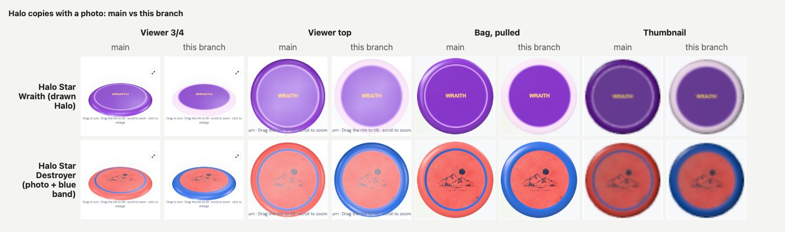
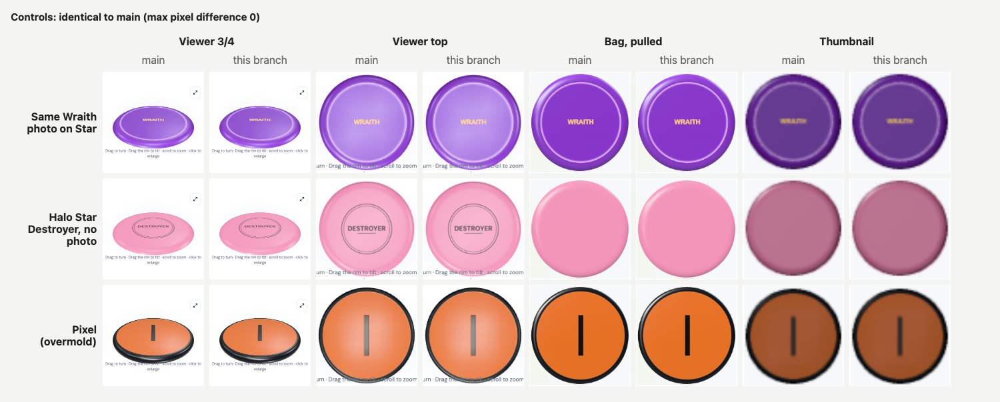

# Halo plastic: the two-tone band, as plastic

Built October 17, 2026, on `main` at `15eeb9b`. Read with the recon, [`halo-plastic-recon.md`](halo-plastic-recon.md).

**Scope (Freddy's call after the recon): option A, photo discs only.**

- A bag copy whose plastic is a Halo plastic and which has a photo shows its dyed band.
- The band's colour is sampled from that photo when it is saved, into the existing `photo_rim_color` column.
- No migration, no default band colour, no catalog change. Without a photo, a Halo copy draws in one colour, as before.

Halo is a colourway, not a construction, and the code keeps it apart from overmolds everywhere:

- `overmold.mjs`, the PDGA overmold list and flags, `bagRimColor` and every overmold code path are untouched.
- On an overmold mold, the overmold path wins and the band is ignored. Its rim piece already *is* the second colour.
- No label or copy calls a Halo band an overmold. The viewer's accessible label says "with its Halo band in a second dye colour".

## What a photographed Halo copy looks like now

Two Halo Star copies, each added through the real editor:

- **Wraith:** the photo-edge suite's drawn Halo (purple plate, pale band from 0.80 R).
- **Destroyer:** the repo's photographic Destroyer fixture, set inside a blue band dyed from 0.76 R. This is the "photographic Halo" case.

On `main`, both draw the photo up to the shoulder and then generated plastic *in the plate colour* outside it. The band shows only as the thin sliver of the photo between the band's edge and the shoulder. That is the "band underneath" look. On this branch, the generated rim outside the shoulder is the band, in the colour sampled from the photo. The photo itself is untouched.

| | Wraith (drawn band `#e9c8f7`) | Destroyer (dyed band `#2f5fb8`) |
| --- | --- | --- |
| Stored `photo_rim_color` | `#ffeaff` | `#2b58ab` |
| Panel, top view, ring at 0.94 R: `main` → branch | `#9b63d3` (plate) → `#f6e5f7` (band) | `#f3807c` (plate) → `#5d86e0` (band) |
| Photo reach | 0.8274 R (the shoulder, unchanged) | 0.8165 R (the shoulder, unchanged) |

The Wraith's sample is brighter than the drawn band because de-lighting normalises exposure. The photo's own pixels are lifted by the same correction, so on the model the band outside the shoulder continues the band seen inside it.

## Controls: identical to main

`tests/halo-plastic-browser.mjs` was run with `EDGE_REFERENCE` set to a built checkout of `main`. It draws every surface through `main`'s tree first, then through this branch, in one run on one GPU. Three controls matched `main` with **max pixel difference 0** in all four surfaces (viewer 3/4, viewer top, bag pulled, thumbnail):

- the same Wraith photo on Star plastic;
- a Halo Star Destroyer with no photo;
- the Pixel overmold.

The PR #12 photo-edge suite was also run against `main` in its own reference mode. See *Suites*.

## How it works

**The fact: `public/disc3d/halo.mjs`.**
- `HALO_PLASTICS` is `['Halo Star', 'Halo S-Blend']`: exactly the Halo options in `source-data/bag-plastics.json`. A unit test keeps the two in step.
- `isHalo(plastic)` is an exact, case-insensitive name match. "Halo" alone is not a Halo plastic: Latitude 64's Halo is a mold.
- `haloBand(item)` returns the copy's `photo_rim_color`, but only while the copy is Halo *and* has a photo; otherwise it returns null.

This follows the overmold precedent: a pure list in a pure module, which Node tests read. The difference is that the key is the copy's plastic, not the mold's PDGA record.

**Sampling: `public/disc-photo.mjs` and `public/my-bag.js`.**
- The editor already ran the overmold rim sampler (`rimColor` in `disc-albedo.mjs`) at save. For an overmold, `rimInner` is the seam, as before.
- For a one-piece mold it now samples the outer ring from `Ri/R`, the band's seam, as `bandColor`. That sample is kept apart from `photoRimColor`.
- At save the sheet sends `photoRimColor || (isHalo(plastic) ? bandColor : null)` in the existing `X-Atlas-Photo-Rim-Color` header. So only a Halo copy ever stores a band, and every other one-piece copy still stores NULL. `test:photo-rim`'s "non-overmold photo is not rim-matched" still holds.
- The contract is the same as `photo_rim_color`'s for overmolds:
  - **Replacing** the photo re-samples.
  - **Levelling** a saved photo re-samples from the stored texture.
  - **Removing** the photo clears the band (the Worker nulls both columns).
- The Worker, D1 and the migrations are untouched.

**Rendering: one split, reused.**
- A Halo copy with a band asks `discGeometry` for the existing rim-seam split: the same `overmoldProfile`, with the seam at `R − PDGA rim width`, and the same `groupRim`. Nothing in the geometry is forked.
- The band uses the renderer's existing second plastic material. It gets the plate's finish (`roughness`, `clearcoat`): only its colour differs.
- The photo's reach still follows the mold alone (`photoSurface(…,{overmold})`), so a Halo photo stops at the shoulder `Rs`. Between `Ri` and `Rs` the photo covers the band and shows the band as photographed; outside `Rs` the generated band shows.

Wired the same way in every renderer the overmold split reaches:

| Surface | Where |
| --- | --- |
| Detail viewer and pop-out | `disc3d/viewer.mjs` (`haloBand` prop; via `disc3d.js` sync, `my-bag.js` `detailAppearance`, `all-discs-gallery.js`) |
| Bag scene, resting and pulled (detail look) | `bag3d/viewer.mjs`, `bag3d/disc-features.mjs`, `bag3d/bag-layout.mjs` |
| Thumbnails and Atlas discs (incl. My Map lens) | `disc3d/atlas-art.mjs`, `disc3d/thumbnails.mjs`, `atlas-map.js` (`data-halo-band`, `BagApp.mapHaloBands`) |
| Storage racks and Lost graveyard | `collection3d/stage.mjs`, `racks.mjs`, `graveyard.mjs`, `collection-scenes.js` |

**Clay mode shows a Halo copy as the one piece it is:** one clay material, and no rim piece in the cross-section. Themes and the colourblind-safe palette are untouched. A band colour never comes from a theme.

## Known simplifications and limits

- **Clean boundary.** Real Halo dye bleeds: the colours swirl. The generated band meets the plate at a clean seam, and it is one flat colour. Inside the shoulder the photo still shows whatever bleed was photographed. Feathering would need vertex colours or a shader hook, which was out of scope.
- **The band starts at the rim seam.** The seam is `R − rim width`: 0.79 R on a Destroyer, 0.91 R on an Aero. A real band that starts well outside the seam would be sampled partly from plate. The sampler takes the median over 4 rings × 128 angles, starting 8% of the rim width past the seam.
- **Existing photos have no band yet.** Photos saved before this change on one-piece molds have `photo_rim_color` NULL, by the migration-0011 contract (no inference for old rows). To show a band on a Halo copy that already has a photo: open Edit, use **Level stamp**, confirm and save. That re-samples from the stored texture, with no re-upload. Replacing the photo also works. The same applies when a copy with a photo is switched *to* a Halo plastic later.
- **Switching away from Halo hides the band without deleting it.** The stored sample stays, and `haloBand` ignores it unless the plastic is Halo. Switching back shows it again. The suite covers both.
- **No catalog Halo.** Catalog molds on the Atlas show the mold, not a plastic. Halo appears only where a copy is: bag views, storage, Lost, and the My Map lens.
- **Freddy's own Halo disc was not rendered.** This session had no access to production D1 or R2. The photographic Destroyer composite stands in for it. To check the real disc: make sure its plastic is "Halo Star", then Level and save its photo once.

## Suites

Run October 17, 2026, on Freddy's Mac (darwin, Playwright Chromium 1248), one suite after another.

| Suite | Result |
| --- | --- |
| `test:halo` (new: 5 node tests + browser) | pass |
| `tests/halo-plastic-browser.mjs` with `EDGE_REFERENCE` = `main` | pass: controls max diff **0** vs `main` in all four surfaces |
| `test:disc3d` (now includes `tests/halo-plastic.mjs`) | pass (29 node tests, browser, pop-out) |
| `test:bag` | pass |
| `test:photo-rim` | pass (non-overmold photo still stores no rim sample) |
| `test:photo-textures` | pass. Node half 39/39, browser half pass (see note 1) |
| `test:photo-level` | pass |
| `test:photo-edge`, `test:photo-edge:atlas` | pass (see note 2) |
| `tests/non-overmold-photo-edge-browser.mjs` with `EDGE_REFERENCE` = `main` | pass: stamp, halo (Star), wraith, clean and Pixel all **max diff 0** vs `main` (panel, bag pulled, storage pulled) |
| `test:my-map`, `test:appearance`, `test:atlas:3d`, `test:atlas:stamps`, `test:bag:album` | pass |
| `test:bag:browser`, `:overmold`, `:collections`, `:memorial`, `:scene`, `:staging`, `:pulled-sizing`, `:demo`, `:popup`, `:spin`, `:tips`, `:3d` | pass |
| `test:bag:pulled-quality` | pass (see note 2) |
| `test:3d:polish`, `tests/photo-glare-ab-browser.mjs` | pass |
| `test:photo-phone` | **partly run.** `photo-gestures` passes on Chromium. `photo-compression`, `photo-editor-contract` and `photo-source-chooser` hard-code WebKit, which is not installed on this Mac (`webkit-2370` missing). Run them on the Windows desktop, or after `npx playwright install webkit` |
| `test:atlas:3d:perf` (default settings, margins not loosened) | **pass**, first run |

1. **One real fix, found by the regression.** `tests/photo-editor-races.mjs` runs `my-bag.js`'s save handler in a `vm` sandbox and hands it the module's imports. The handler's new `isHalo` call was missing from that sandbox, so 2 tests failed and 3 hung, and the npm chain stalled. The fixture now passes the real `isHalo`. A new test there checks that the band header is sent only for a Halo copy, and that an overmold rim sample still wins. On the first pass the browser half hit a one-off `ECONNRESET` from the local Wrangler server; run on its own it passed.
2. **Mac Chromium flags.** `test:photo-edge`, `:photo-edge:atlas` and `test:bag:pulled-quality` default Chromium to `--use-angle=d3d11`, the Windows backend. On this Mac that means no WebGL context, or the software path where the bag reports `low` quality. They were rerun with `BAG3D_CHROMIUM_ARGS=--enable-gpu`, which they already support, and all pass. The suites themselves were not changed.

## Files

- New: `public/disc3d/halo.mjs`, `tests/halo-plastic.mjs` (added to `test:disc3d`), `tests/halo-plastic-browser.mjs` (`npm run test:halo`), `docs/halo-plastic/*.jpg`.
- Tests changed: `tests/photo-editor-races.mjs` (the sandbox gets `isHalo`; one new test).
- Changed:
  - `public/disc-photo.mjs`, `public/my-bag.js`, `public/disc3d.js`, `public/all-discs-gallery.js`, `public/atlas-map.js`;
  - `public/disc3d/{viewer,atlas-art,thumbnails}.mjs`;
  - `public/bag3d/{viewer,disc-features,bag-layout}.mjs`;
  - `public/collection3d/{stage,racks,graveyard}.mjs`, `public/collection-scenes.js`;
  - `tests/photo-edge-shared.mjs`: `addDisc` takes an optional `plastic`;
  - `package.json`.
- Untouched:
  - `public/disc3d/overmold.mjs`, `shape.mjs`, `mesh.mjs`, `photo.mjs` (the shoulder cut), `stamp.mjs` (the catalog stamp path);
  - `public/disc-albedo.mjs`, `workers/`, `migrations/`, `public/data.json`, `source-data/`, themes and CSS.

## Not done here

- **Graphify refresh.** `graphify` is not installed on this Mac (the adoption ran in a Windows uv environment), so `graphify update .` was not run. Run it on the Windows checkout before this merges, and commit the refresh with this work.
