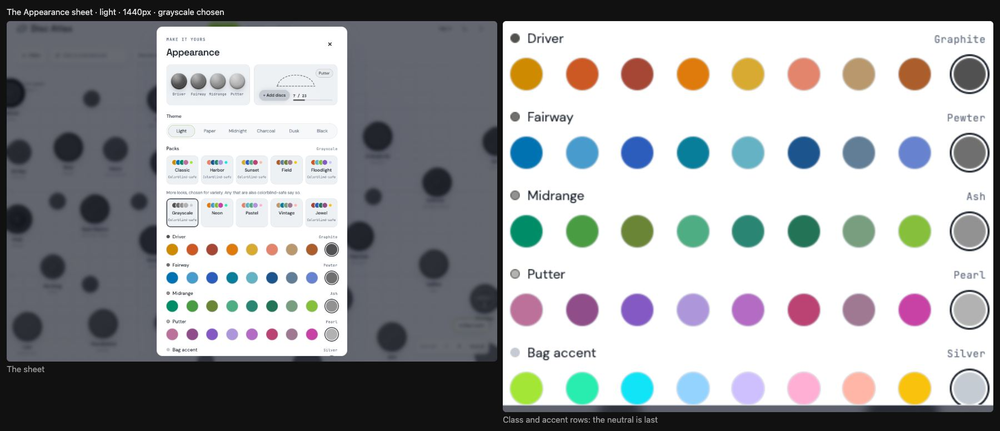
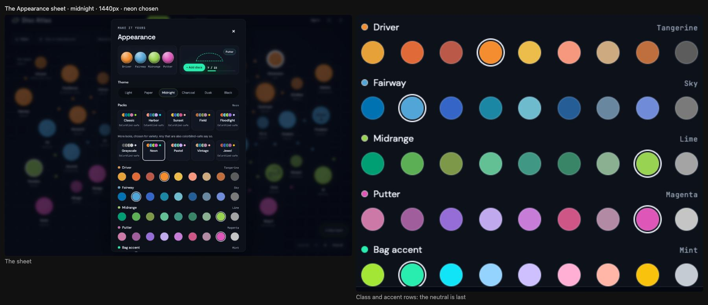
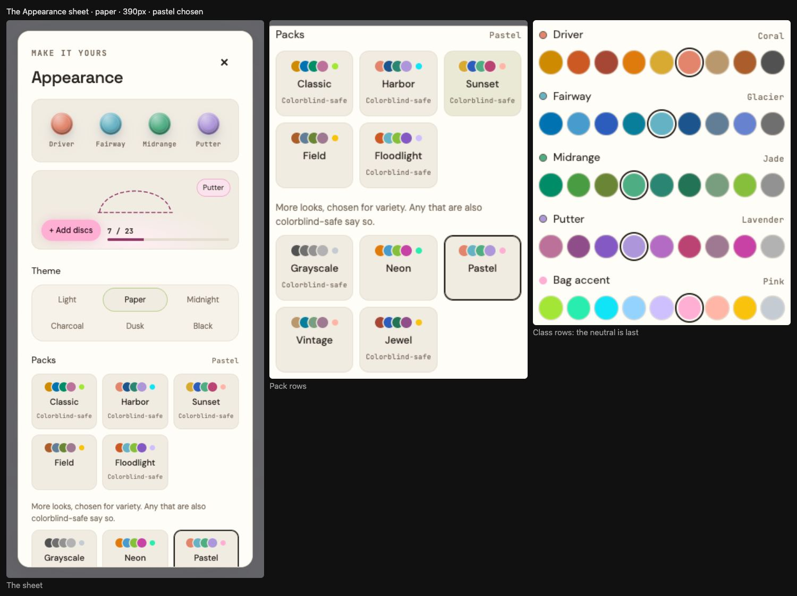
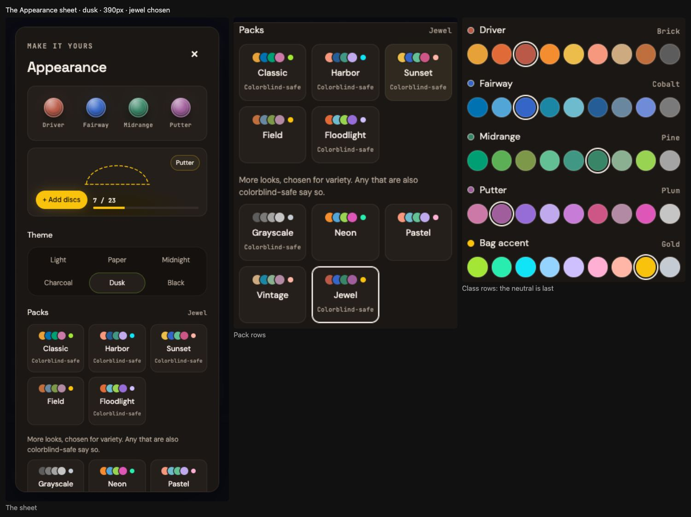
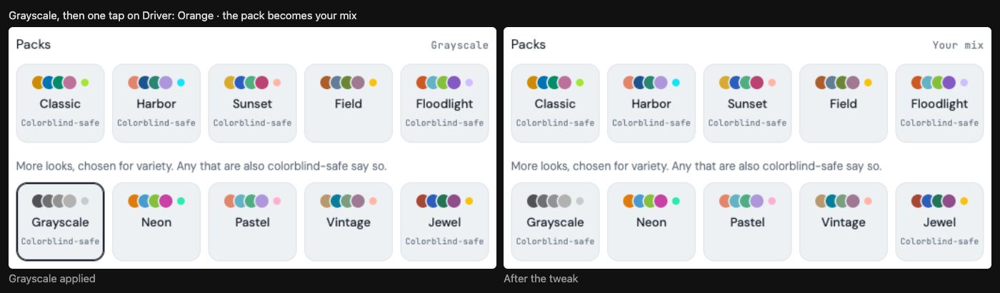
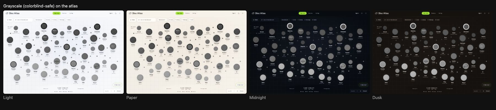
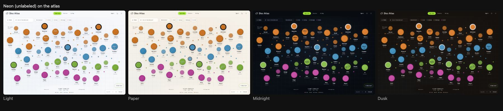
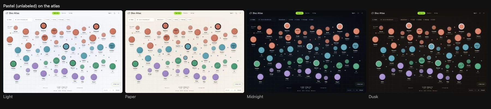
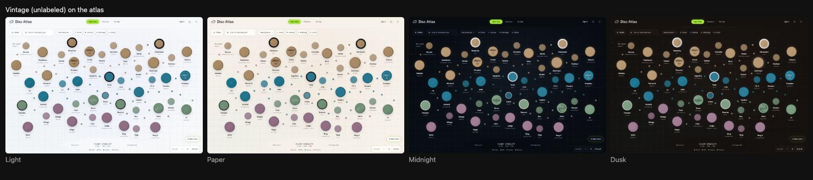
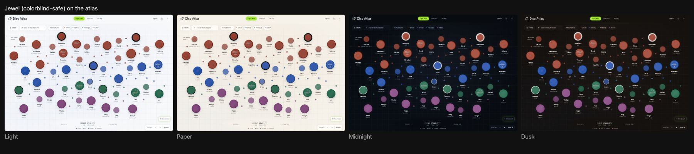

# More packs: a second row, chosen for variety

Branch `claude/more-packs`, based on `origin/main` at `8e91dc7` (the merge of PR #33, display
customization, October 20, 2026). These are local commits only: nothing is pushed, merged or deployed.

Freddy asked for this on October 20, 2026, after looking at display customization live: more variety in
the packs, as a second row that doesn't have to be colorblind-safe. One grayscale pack, plus enough other
looks to fill the row.

## What landed

A second row of five packs in the Appearance sheet, below the original five, under a plain caption:

> More looks, chosen for variety. Any that are also colorblind-safe say so.

| Pack | Driver | Fairway | Midrange | Putter | Accent | Normal vision | Protan / deutan | Label |
| --- | --- | --- | --- | --- | --- | --- | --- | --- |
| Grayscale | Graphite | Pewter | Ash | Pearl | Silver | 0.104 | 0.104 | Colorblind-safe |
| Neon | Tangerine | Sky | Lime | Magenta | Mint | 0.202 | 0.049 | None |
| Pastel | Coral | Glacier | Jade | Lavender | Pink | 0.090 | 0.033 | None |
| Vintage | Sand | Ocean | Sage | Mauve | Coral | 0.091 | 0.027 | None |
| Jewel | Brick | Cobalt | Pine | Plum | Gold | 0.127 | 0.068 | Colorblind-safe |

Each number is the closest pair of class colors in OKLab, taking the worse of light and dark. The
colorblind column takes the worse of full-severity protanopia and deuteranopia, using the same Machado
simulation the original packs were designed and tested with. The label law hasn't changed: a pack carries
the label only if it measures at or above 06C's 0.065 floor. Neon, Pastel and Vintage don't, so they ship
without it, the same way Field does.

Two of the row did clear the floor, so they have the label:

- **Grayscale** tells the classes apart by lightness alone. The Machado matrices leave a neutral gray
  unchanged, so protanopia and deuteranopia keep the full 0.104 step between grays.
- **Jewel** clears by a small margin, at 0.068.

The original row, for comparison (unchanged): Classic 0.076, Harbor 0.077, Sunset 0.100, Field 0.012
(unlabeled), Floodlight 0.131.

### The directions

- **Grayscale**: four neutral grays, Driver darkest down to Putter lightest, with the Silver accent.
- **Neon**: the highest-chroma swatches of the Driver, Midrange and Putter rows (Tangerine, Lime,
  Magenta), the brighter Sky rather than Cobalt for Fairway, and the Mint accent. Normal-vision spread is the widest of any pack,
  0.202.
- **Pastel**: the light, soft end of each row, with the Pink accent.
- **Vintage**: muted heritage tones. Sand, Ocean, Sage and Mauve, with the Coral accent. It shares only
  Mauve with Field, so the two read as different looks.
- **Jewel**: deep, saturated tones. Brick, Cobalt, Pine and Plum, with the Gold accent.

Every candidate went through the measurement script before it was chosen. Some that lost out: a Cobalt
version of Neon, which was darker and at 0.052 still under the floor; Brick, Navy, Pine and Plum for Jewel,
which fell to 0.034 because Navy sits too close to Plum; and three other Vintage mixes, all between 0.027
and 0.030.

## Where the grays come from

Neon, Pastel, Vintage and Jewel are new mixes of swatches that were already in the catalog. Grayscale was
the only pack that needed new values: one neutral gray at the end of each class row, marked `neutral` in
`public/display-palette.js`.

| Row | Swatch | Light | Dark | Light L | Dark L |
| --- | --- | --- | --- | --- | --- |
| Driver | Graphite | `#515151` | `#5c5c5c` | .435 | .475 |
| Fairway | Pewter | `#6f6f6f` | `#7a7a7a` | .542 | .580 |
| Midrange | Ash | `#929292` | `#a4a4a4` | .660 | .719 |
| Putter | Pearl | `#b2b2b2` | `#c5c5c5` | .764 | .823 |

They follow the catalog's own discipline. Light values sit inside L .43–.77, and dark themes lift each one
by .04 to .06 L, within the .08 the hued swatches are allowed. Each gray is a true gray (equal channels,
chroma 0). The ladder goes up at least .1 L per class, in both tones. Paper takes the light values and Dusk
takes the dark ones, as with every other swatch.

**Why the grays are in the rows, and where they sit on the ladder.** A gray has to be selectable on its
own. When Grayscale is applied, each row shows its gray as the chosen swatch, and if one class is tweaked,
the other three grays have to stay real choices. That puts a gray in every class row, and every row now has
nine swatches. Then the original build's guarantee had to keep holding: every mix-and-match combination
keeps its four classes at least 0.065 apart under normal vision. The grays come close to the catalog's
low-chroma swatches (Steel, Sage, Mauve, Sand). So the four gray lightnesses were chosen by search: the
widest even ladder that still keeps every one of the 6,561 combinations (9 × 9 × 9 × 9) at least 0.07
apart in light and dark. The search only found that ladder with Driver darkest and Putter lightest. The
other order collides with Sage and Mauve.

- Closest combination on `origin/main` (4,096 combinations): Classic, Ocean, Teal, Classic in light, at
  0.076.
- Closest combination now (6,561): Classic, Classic, Ash, Mauve in dark, at **0.072**. That is still above
  the 0.065 floor the test enforces. The sheet's note, "Curated colors only, so every mix still reads well",
  still holds.

## What did not change

- **The original five packs**: same ids, names, swatches, accents and labels. A new test pins them
  literally.
- **Every existing swatch value**: no existing value changed. The only edited lines in
  `public/display-palette.js` are a trailing comma on the last swatch of each row, one comment line, and the
  two lines that build the catalog's swatch and pack entries.
- **The default**: untouched visitors still get no style element and nothing saved, which is today's
  06C set and lime.
- **The saved-mix shape**: still `{classes: {distance, fairway, mid, putter}, accent, stamp}` in
  `disc-atlas-display`. A mix saved by the October 20 build loads and paints byte for byte as before. I
  loaded three saved mixes (a Harbor tweak with gold foil, Field, and an older mix with no stamp key) into
  both `origin/main`'s `display-palette.js` and this one. The normalized prefs and the CSS they wrote were
  identical. A new test pins one of them. A variety pack saves exactly the same shape.
- **Field and the rest of the first row** keep their places. Arrow keys move through all ten packs as one
  radio group, so the right arrow on Floodlight goes to Grayscale.

The only code that changed is the palette catalog (`public/display-palette.js`), the Appearance sheet
(`public/appearance.js`, `public/appearance.css`) and their tests.

## Proof

All suites ran from this worktree. Browser suites ran in Chromium with `--enable-gpu` through
`tests/display-harness.mjs`.

| Suite | Result |
| --- | --- |
| `tests/display-palette.mjs` on `origin/main` (baseline) | Pass, 16 tests |
| `tests/display-palette.mjs` (extended) | Pass, 21 tests |
| `tests/display-customization-browser.mjs` (extended) | Pass |
| `tests/palette.mjs`, the 06C colorblind suite, against the local site | Pass, 144 checks |

What the catalog tests add:

- The neutral discipline: one per row, last in the row, a true gray, inside the L range and dark lift, a
  ladder of at least .1 L.
- The original five pinned literally.
- The variety row: five packs in order, no two packs the same mix, and only Grayscale uses the neutrals.
- Every pack resolving on all six themes. For each theme, each class value is the swatch's value for that
  theme's tone, it is written into that theme's CSS rule, and the accent reaches each theme's bag.
- The label test, which covers all ten packs and records each pack's normal and colorblind numbers.
- The backward-compatibility test.
- The any-combination test now runs over 6,561 combinations and reports the closest one.

The 06C colorblind suite (`tests/palette.mjs`) still covers exactly the labeled set. It reads the labeled
packs from the catalog, so it now includes Grayscale and Jewel. Their rendered tokens clear the floor in
all six themes, for normal vision, protanopia and deuteranopia. The lowest is Jewel at 0.068. Every
marker boundary in those packs still has 3:1 contrast against its map background.

The browser suite now checks:

- Each class row has nine swatches.
- There are ten packs, with labels exactly on Classic, Harbor, Sunset, Floodlight, Grayscale and Jewel.
- The caption sits between the two rows, with five packs in each row on desktop.
- The right arrow on Floodlight applies Grayscale.
- Grayscale sets all five settings, shown as the chosen swatch in each row, and the root tokens are the
  four grays.
- The preview's Add discs button wears the Silver accent.
- Tapping Neon and then one swatch turns it into "Your mix", and the tweak is saved.
- The atlas markers, legend and type chips agree with the palette under Grayscale, in both Light and
  Midnight. Midnight wears the lifted ladder.

Screenshots come from `tests/more-packs-evidence.mjs`.

**The sheet, desktop:** Grayscale chosen in Light, Neon in Midnight

**The sheet, phone (390 px):** Pastel in Paper, Jewel in Dusk. On a phone the pack grid is three wide, so
each row of five wraps to three and two, with the caption between them.

**A tweak:** Grayscale, then one tap on Driver: Orange, and the pack name becomes "Your mix"

**Each variety pack on the atlas:** Light, Paper, Midnight, Dusk

## Left as it is

- No free hex anywhere. The grays are designed swatches, like every other value in the catalog.
- No new accents. Silver, Mint, Pink, Coral and Gold were already in the catalog.
- The neutrals are not used by any first-row pack, and the first row is not reordered.
- The sheet note and the Reset behavior are unchanged.
