# Non-overmold photo discs must not grow a rim

Branch `codex/non-overmold-photo-edge`, from `main` at `0dedf8a` (the PR #8 merge). October 16, 2026.
Freddy's report, from the deployed PR #7 build: his 30-stamp Wraith reads as if a rim was added (the
pattern changes near the edge instead of running to it), and his Halo Star Wraith in Storage renders its
edge band like an overmold rim. His rule: no overmold unless the PDGA says so, however the photo looks.

## What it was

All three surfaces (detail panel, My Bag's pulled disc, Storage's pulled disc) draw the photo from the
same mesh, `photoGeometry()` in `public/disc3d/photo.mjs`. The photo is mapped top-down onto the
disc's whole diameter, but the mesh it is drawn on stopped at **`Rs`, the shoulder**, on one-piece discs.
On a Wraith that is 0.827 R. Past it, the shoulder slopes down to the nose (0.827 R → R, 1.8 cm), and
nothing drew the photo there, so it showed bare plate-coloured plastic. From the top that ring is
about a third of the disc's area (1 − 0.827² = 32%). The plate colour is the one the editor measures
from the photo (`#d1d2d3` for the stamp fixture, `#6c339e` for the halo), so the ring looked like a
piece of plastic in its own colour: a rim.

The mechanism, checked against the alternatives the brief listed:

| Candidate | Finding |
|---|---|
| Photo radius | **The cause.** The photo mesh reaches 0.8274 R on both Wraiths (`Rs/R`); the photo's own outer annulus, 0.827–1.0 R, is never drawn. |
| Material split | None. Both Wraiths have `overmold:false` and one material in the panel, bag and rack. `photo_rim_color` is null, since no rim was sampled at upload. |
| Relief step at the seam | None. The photo mesh hugs the top (+0.003 cm) and the relief map only covers the photo. The "rim" is just the shoulder's own shading, in plate colour. |
| Classification | Correct. The Wraith is not on the overmold list, and the Pixel is. |

Why the halo looked like an overmold in particular: its band starts at 0.80 R, so the photo drew a thin
sliver of it (0.80–0.827 R), and then the plate-purple shoulder took over. That gives purple, a thin
lilac line, then a purple outer ring: the silhouette of a rim piece in a second colour.

The measurement: brightness around rings of the top-view render. Each cell is the ring's mean colour and
how many times its brightness crosses its own mean (the stamp's stripes cross dozens of times; plain
plastic doesn't cross).

| Ring | Stamp, panel, before | Stamp, panel, after | Halo, panel, before | Halo, panel, after |
|---|---|---|---|---|
| 0.80 R | `#aea6a3` · 68 | `#aea6a3` · 68 | `#ba8eeb` · 0 | `#ba8eeb` · 0 |
| 0.88 R | `#f3f4f5` · **0** | `#b4a78a` · 50 | `#9657d3` (plate) | `#fae8fa` (band) |
| 0.94 R | `#f0f1f2` · **0** | `#9d9d9d` · 46 | `#9b63d4` (plate) | `#f6e6f7` (band) |
| 0.97 R | `#eeeff0` · **0** | `#a19d8b` · 58 | `#8e4dc9` (plate) | `#f6e5f7` (band) |

The bag's pulled disc reads the same (stamp 0 → 48/46/50 crossings; halo `#9048cc` → `#fae7f8` at 0.88 R).
All numbers are in [metrics.json](assets/non-overmold-photo-edge/metrics.json).

## The fix

`photoGeometry(shape, {overmold, edge})`. With `edge` on a one-piece disc, the photo mesh follows the
disc's real top profile: the dome out to the shoulder as before, then the profile's own shoulder points
(`topProfile()`, new in `shape.mjs`, from the same trace the lathe spins) down to the nose. The UV of
each vertex is still its own top-down position, so the shoulder takes the photo's outer annulus: the
pixels the camera actually saw there. The photo's edge pixels carry the face to the edge. Nothing is
invented or stretched, and the photo's own transparent edge feather still ends at the nose.

Two details keep it seated on the slope:
- Each vertex stands off the surface along the profile normal, 0.003 cm as before, plus its own chord
  sag (`R(1 − cos π/64)` ≈ 0.013 cm) where the surface faces outward. Between vertices it then never
  dips under the disc mesh on the shoulder, whatever the disc mesh's own segment count (20–80).
- Normals come from the profile analytically, so the scene lights the band over the shoulder exactly as
  it lights the plastic.

Overmold discs ignore `edge`: the same code path, the same arrays, photo stops at `Ri`. Callers that
pass `edge: true`: the detail viewer (panel + pop-out), the bag (pocket photo and pulled detail photo)
and the Storage/Lost collection models. The atlas's top-down renders (My Map's photo discs and the
My Bag list thumbnails) followed in a second commit: see [Atlas top-down renders](#atlas-top-down-renders-thumbnails-and-my-map).

Nothing else moved: no classification change, no stored data, no upload pipeline change, and
`public/data.json` is untouched. Freddy's existing photos render the new way as soon as this deploys.

## Screenshots

Fixtures, uploaded through the real editor on a local Wrangler + D1:
[stamp](assets/non-overmold-photo-edge/fixture-stamp.png) (Wraith: diagonal stripes and a "30"
running to the physical edge), [halo](assets/non-overmold-photo-edge/fixture-halo.png) (Wraith: purple,
a pale band from 0.80 R to the edge), [pixel](assets/non-overmold-photo-edge/fixture-pixel.png) (Pixel
control: orange plate to the seam, a dark rim piece). Before is the pre-fix `photo.mjs` from `0dedf8a`,
served in place of the working copy in the same run, on the same GPU.

### (a) Full-front stamp, Wraith

| | Before | After |
|---|---|---|
| Panel, 3/4 | 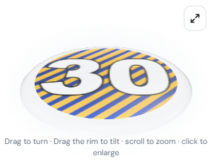 | 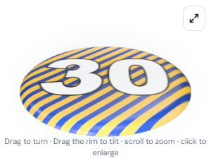 |
| Panel, top | 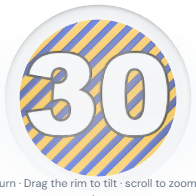 | 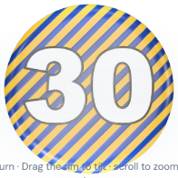 |
| My Bag, pulled | 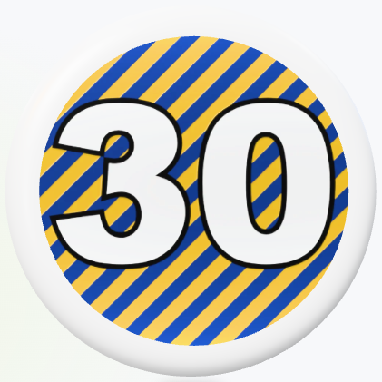 |  |
| Storage, pulled | 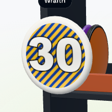 | 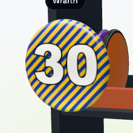 |

### (b) Halo band, Wraith

| | Before | After |
|---|---|---|
| Panel, 3/4 | 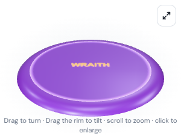 | 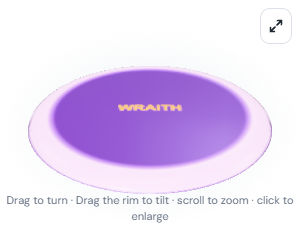 |
| Panel, top |  | 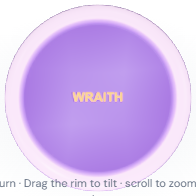 |
| My Bag, pulled |  | 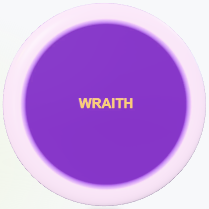 |
| Storage, pulled | 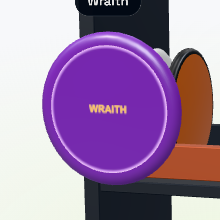 | 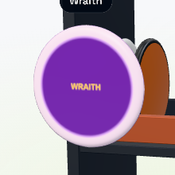 |

### Control: Pixel (true overmold)

| | Before | After |
|---|---|---|
| Panel, 3/4 | 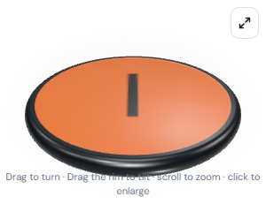 |  |
| Panel, top |  |  |
| My Bag, pulled |  |  |
| Storage, pulled | 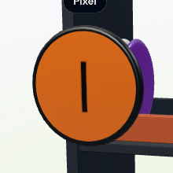 |  |

The Pixel's photo mesh is byte-identical before and after (FNV hash `cdc4fef9` over positions, UVs,
normals and index; photo stops at 0.9057 R = its seam; rim `#101418` = its stored sample). Its renders:

| Surface | Max channel difference | Pixels that moved |
|---|---|---|
| Panel 3/4 | 0 | 0 of 69,300 |
| Panel top | 1 | 7 of 37,636 |
| My Bag pulled | 0 | 0 of 177,241 |
| Storage pulled | 1 | 6 of 48,400 |

The one-level, single-digit-pixel differences are GPU noise on the same mesh (the brief's "not a pixel"
holds for the geometry; the GPU canvas is not pixel-deterministic, as noted for Plan 16).

## Cost

The photo mesh of a one-piece disc goes from 2,048 to 3,840 triangles (64 segments × 30 profile steps
in place of 64 × 16). Overmold photos stay at 2,048, and photo-less discs have no photo mesh. That's
the only per-frame change: no shader, texture, tier or pixel-ratio change, so PR #6's photo tiers
(256/512/1024) and the pulled disc's detail look are as they were (`test:bag:pulled-quality` green).
Measured in the panel at the 1024 tier, 120 forced frames closed by a pixel read, RTX 3070:
0.044–0.047 ms per frame before, 0.058–0.062 ms after, inside run-to-run noise (other runs: 0.045–0.080).
In the bag, each one-piece photo disc adds 1,792 triangles, about 43k for a bag of 24 photo discs.

## Tests

- `npm run test:photo-edge` (new, `tests/non-overmold-photo-edge-browser.mjs`, about 65 s): the three
  fixtures in all three surfaces, before and after in one run. It asserts stripes cross every ring from
  0.88 R to 0.97 R (≥ 20 times), the halo's outer rings are the band's colour (every channel ≥ `0xc8`),
  the Wraiths stay one piece with one material and no rim sample, and the before half reproduces the
  plain ring. For the Pixel: the mesh hash is identical, the rings read the same, the rim is the stored
  sample, and no surface moves more than 0.2% of pixels by more than 8 levels. `EDGE_BEFORE=0` skips the
  before half; `EDGE_BASE` names another pre-fix commit.
- `test:photo-textures` (the suite that owns `photoGeometry`): for the Wraith, Destroyer and Aviar
  (driver, driver, putter), the `edge` photo reaches the nose (1.000–1.002 R) and its UV reaches the
  photo's edge. Every vertex sits on or above the top profile, and every triangle faces the way its
  normals do. Without `edge` it still stops at the shoulder. For the Pixel and the Atlas, `edge` gives
  the same arrays as before. Results:
  [edge-geometry.json](assets/non-overmold-photo-edge/edge-geometry.json).
- Existing suites on this branch, run one after another on the RTX 3070: `test:photo-textures`,
  `test:photo-rim`, `test:disc3d`, `test:bag`, `test:bag:pulled-sizing`, `test:bag:pulled-quality`,
  `test:bag:overmold`, `test:bag:collections`, `test:bag:browser`, `test:bag:scene` and `test:appearance`
  are all green. `test:bag:scene` failed once with `clock.pauseAt: Cannot fast-forward to the past`
  (`tests/bag-scene-browser.mjs:99` pauses the fake clock 50 ms ahead of a `Date.now()` read, which a slow
  step can overrun). That's a race in the test, not in the photo code, and it passed on both reruns.
  The atlas suites and perf gate were not run for that first commit, which left atlas code unchanged (see below).

One `test:photo-edge` run (of eight) timed out in fixture setup, with the add-disc dialog never closing
after Save, before any change was exercised. The next run passed. It now saves a failure screenshot and
the dialog's text if it recurs.

## Atlas top-down renders (thumbnails and My Map)

The atlas's cached top-down images (`atlas-art.mjs`) draw the My Bag list thumbnails
(`disc3d/thumbnails.mjs`) and My Map's photo discs, and they still stopped at the shoulder, so the same
plate-coloured ring showed there. `photoOf()` now passes `edge: true` to `photoSurface()`, as every
other surface does. Overmolds ignore it, so their photo mesh is the same arrays as before. Classification,
stored data and `public/data.json` are untouched.

`npm run test:photo-edge:atlas` (new, `tests/non-overmold-photo-edge-atlas-browser.mjs`, about 60 s)
uploads the stamp Wraith and the Pixel through the real editor, as `test:photo-edge` does. It then reads
the list thumbnail's canvas (62 px on screen, 128 px image) and the My Map marker's own art canvas
(full level, 192 px). The before half serves the pre-fix `atlas-art.mjs` from `500dae4` in place of
the working copy, in the same run and on the same GPU. Crossings of the ring's mean brightness:

| Ring | Thumb, before | Thumb, after | My Map, before | My Map, after |
|---|---|---|---|---|
| 0.85 R | `#b8b9ba` · 0 | `#887b51` · 40 | `#b9babb` · 0 | `#897c50` · 42 |
| 0.88 R | `#b1b2b3` · 0 | `#6f6b4a` · 50 | `#b1b2b3` · 0 | `#6a6949` · 48 |
| 0.91 R | `#a9aaab` · 1 | `#5e624c` · 47 | `#a9aaab` · 1 | `#5c614b` · 53 |
| 0.94 R | `#a0a1a2` · 2 | `#686650` · 42 | `#a1a2a3` · 2 | `#656550` · 42 |
| 0.97 R | `#838485` · 2 | `#5d5a38` · 42 | `#838485` · 2 | `#5a5937` · 42 |

The before half's 1–2 crossings on the shoulder are the key light's highlight arc over plain plastic.
The Pixel control is **byte-identical** in both surfaces (max channel difference 0 of 16,384 and
36,864 pixels), and the catalog still classifies Wraith one piece and Pixel overmold. Full numbers are in
[atlas-metrics.json](assets/non-overmold-photo-edge/atlas-metrics.json).

| | Before | After |
|---|---|---|
| Stamp, list thumbnail (3×) |  | 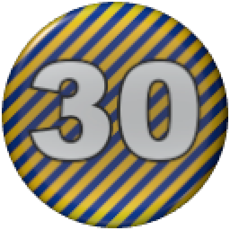 |
| Stamp, My Map (3×) |  | 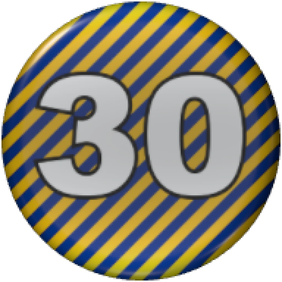 |
| Pixel, list thumbnail (3×) |  |  |
| Pixel, My Map (3×) |  |  |

**Cost.** A photo disc's photo mesh goes from 2,048 to 3,840 triangles, drawn once per cached image,
never per frame. A fresh art context drawing the Wraith's photo at the full level, 60 renders (new
colours, so none is a cache hit), mean per render with the readback into its image: 0.148 ms before,
0.128 ms after, 0.122 ms for the same disc without a photo (RTX 3070). That is inside the noise.

**Suites.** `test:atlas:3d`, `test:my-map` and `test:photo-rim` (which checks the atlas's outer-ring
pixels for an overmold photo) are green. The perf gate (`test:atlas:3d:perf`) never reaches the changed line:
it flies the signed-out main atlas, whose discs carry no `photoURL`, so `photoOf()` returns before
`edge` is read. At the default 3 phone repetitions it failed in both runs with the change, on **phone long
tasks** (3D median 9 against a limit of 7, then 7 against 7 with a paired excess). The one run of the pre-fix
line passed. Other sessions' browsers were open on the same machine. The two builds run identical code in
the gate, so this is the gate's noise at 3 repetitions, not this change. At `PERF_REPS_PHONE=7` (desktop 3), both pass:

| Medians, 2D / 3D | Desktop flight p95 | Phone flight p95 | Phone 1x p95 | Phone long tasks (limit) |
|---|---|---|---|---|
| Before (`edge` off) | 4.3 / 5.1 ms | 17.7 / 18.0 ms | 3.2 / 3.9 ms | 6 / 6 (7) |
| After | 4.7 / 4.8 ms | 17.2 / 14.3 ms | 3.4 / 3.8 ms | 4 / 4 (5) |

## Freddy's feel check after deploy

- 30-stamp Wraith: the pattern runs to the edge, with no added rim.
- Halo Wraith in Storage: the band is the photo's own, with no purple outer ring.
- Pixel: unchanged, with its black overmold rim.
- The My Bag list thumbnail and My Map photo disc of the 30-stamp Wraith: stripes to the edge too.
