# Photo cleanup: only the disc survives

Branch `codex/photo-edge-cleanup`, from `main` at `38a8c4a` (the PR #9 merge). October 16, 2026.

Freddy's feel check of PR #9: the one-piece edge fix works on his Wraith, but his photo of it wasn't
perfectly aligned, and bits of his fingers and the table show baked into the texture. Then, on the same
build, his Destroyer shows his fingers and his DD3s read misaligned, where before PR #9 they looked clean.
His ruling: people take imperfect photos; take the stuff out automatically; only the disc matters. And
"more like it was before, but just include these fixes": keep the Wraith win, restore the clean look, and
heal the photos already stored **without re-upload**.

## What it was (characterization)

`tests/photo-cleanup-characterize-browser.mjs` draws four phone-like photos (`tests/photo-cleanup-fixtures.mjs`:
a disc on a busy wood table, lit from the upper left, with a soft shadow, a darker shoulder and a glare arc),
runs them through `preparePhoto()` exactly as the aligner's Use photo does (the upload is byte-equal to it,
`test:photo-textures`), and compares the stored WebP with ground truth: for every texture pixel, where in the
photo the aligner took it from, and whether that is disc, table or finger.

| Fixture | Framing | Class | Foreign in the stored texture, by ring | Shown before PR #9 | Shown after PR #9 |
|---|---|---|---|---|---|
| DD3, blue | 2% of the photo right, 1% up, 3% large | **Misalignment**: a crescent of table inside the crop; the disc itself cut on the far side | table 6% at 0.88 R, 29% at 0.91, 44% at 0.94, 56% at 0.97 | 0% | 7.6% of the disc |
| Leopard, red | centred, 7% large | **Misalignment** (generous circle): a ring of table all round | table 17% at 0.91 R, 100% from 0.94 R | 0% | 12.3% |
| Destroyer, purple | exact | **Occlusion at the rim**: two fingers and a thumb on the outer annulus | skin 1% at 0.85 R, 4% at 0.88, 8–9% from 0.91 R | 0% | 1.8% |
| Thunderbird, green | exact | control | none | 0% | 0% |

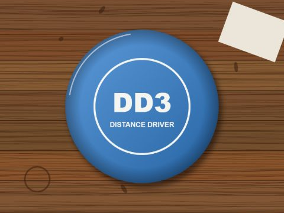   

(Fixture photo; then each stored texture with its ground truth: table magenta, fingers cyan.)

Every foreign pixel lies outside the shoulder (`Rs` is 0.81 R on the DD3, 0.82 on the Destroyer, 0.88 on the
Leopard). That is exactly why Freddy's discs looked clean before PR #9 and not after: the shoulder cut-off
was hiding the outer annulus, and PR #9 put it on view. PR #9 damaged nothing; it exposed what was baked in.
The DD3 symptom ("misaligned") is the same bake: the disc's centre sits at (−0.072, 0.027) of the crop, so
its stamp is off centre on the model, and the crescent shows on one side of the shoulder. Numbers:
[characterize.json](assets/photo-edge-cleanup/characterize.json).

## The fix

### Load time: stored textures heal for display (`public/disc3d/photo-clean.mjs`)

`acquirePhoto()` (photo.mjs) is the one loader behind every surface: the detail viewer and pop-out, My Bag's
pocket and pulled discs, Storage and Lost, the list thumbnails and My Map (atlas art). Each stored photo now
gets a **cleanup plan**, made once per stored texture (its URL names its version) from a 256 px read of the
stored WebP, and shared by every size and surface. A photo the plan leaves alone decodes exactly as before;
a changed one is drawn from the plan at its tier. Plans and cleaned images are made in a module worker
(`photo-clean-worker.mjs`), with the same functions on the main thread as a fallback. Nothing stored
changes, and the plan is a pure function of the stored pixels (seeded RANSAC, no clocks, no randomness).

1. **The disc's real edge.** Along 180 rays from the centre, colour steps where the inside is the disc's
   own colour and the outside is a colour the disc's face never shows. A disc is a rigid circle, so its edge
   is the one circle that many rays agree on: a seeded RANSAC over the steps, scored so that a ray that
   should see the edge and does not costs two that do, then a least-squares fit (algebraic, then
   Gauss-Newton on geometric distance, which removes the algebraic fit's pull toward small circles on a
   partial arc). "The face's colours" is a chromaticity histogram of the middle of the crop, learned only
   from smooth pixels: the antialiased edge of white ink on red runs through every pink between them, and
   would vouch for wood or skin. Neutral pixels compare by brightness, so a grey table is foreign to a
   disc whose only neutral is white ink.
2. **Re-registration.** An edge that crosses the crop, with foreign colour outside it, is the photo's real
   edge: the texture is re-centred and re-scaled so it lands on the model's nose (inset 0.8% so the edge's
   blend with the table stays out), with the existing antialiased feather on the new edge. These are the
   user's own pixels, moved. Where the crop had cut the disc off, its own edge pixels are extended outward
   along its radius. A circle wholly inside the crop is a generous framing **or** the disc's own band or
   stamp ring; it is re-scaled only when what lies outside it is foreign *and busy* (wood grain, carpet,
   a table's shadow: mean neighbour difference ≥ 4 levels). Plastic is smooth: a band of pale yellow on a
   purple disc measures 0.41 and stays.
3. **Outer-annulus cleanup.** From 0.80 R to the nose: connected patches of colour the face never shows that
   touch the edge, span under 150°, and have a smooth core (at least 16 pixels and 15% of the patch: skin
   and wood have one; an antialiased stripe edge or a glare line is only ever a thin line). Each patch,
   with two pixels of margin, is replaced by the disc's own pixels at the same radius just past both ends
   of the patch, blended by angular distance (extension, in the spirit of PR #9; nothing generated).
   Anything the face shows (stamp art continuous with the face) and anything that runs all round (a band,
   a rim) stays. Nothing inside 0.80 R is touched.

Overmolds: their photos stop at the seam, and the Pixel's dark rim piece is a ring all round; its plan is
"untouched". Classification is untouched everywhere.

### Upload time: the aligner snaps to the disc (`public/disc-photo.mjs`)

`snapToDisc(image, options)` runs the same edge finder on the raw photo, around the aligner's ring (radius
0.7–1.25 of it, centre within 0.3), and returns the framing that puts the ring on the disc's edge (inset
0.5%). Here the outermost well-supported circle wins: a band can gather as many rays as the edge, and the
disc's edge is always outside it. The aligner runs it when it opens and 350 ms after each drag, pinch,
key or slider settles. When the edge is at least 1.5% away, the ring **visibly moves** onto the disc and the
aligner says "Snapped the ring to your disc's edge." with **Undo**. Undo puts the ring back, says "Ring back
where you put it.", and stops snapping for that photo until **Snap to edge**. Use photo never snaps on the
way out: what is saved is what was on screen. Snapping sets only centre and size (the circle), never the
tilt sliders.

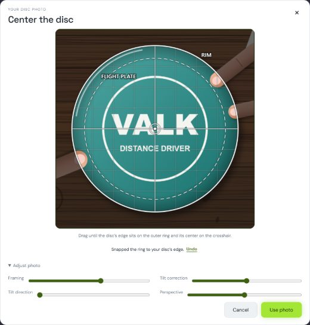 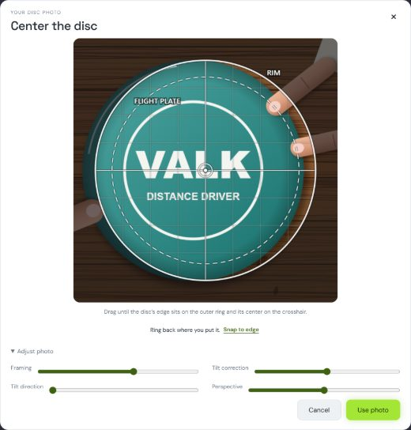

(A fresh photo, off centre and held by fingers: snapped on opening; and after a nudge by hand and Undo.)

## Proof

`npm run test:photo-cleanup` (new): `tests/photo-cleanup-taxonomy-browser.mjs` (about 15 s, no server) and then
`tests/photo-edge-cleanup-browser.mjs` (about 2 min, local Wrangler + D1). The second one uploads the fixtures
and PR #9's stamp, halo and Pixel **through the real editor with main's own `disc-photo.mjs` served in place
of the working copy**, so the stored textures are made exactly as Freddy's were. Every surface then draws
them first with main's `photo.mjs` (before) and then with the working copy (after), in one run on one GPU.

Foreign hue (table or skin) per ring, before → after, on the texture the panel's photo mesh actually draws
(1024 tier, read back from the GPU texture) and on the other surfaces:

| | 0.88 R | 0.91 R | 0.94 R | 0.97 R | Stamp ring centre |
|---|---|---|---|---|---|
| DD3, panel texture | 5.6 → **0** | 28.7 → **0** | 43.0 → **0** | 54.5 → **0** | 0.075 R → **0.0001 R** off |
| DD3, list thumbnail | 2.1 → 0 | 23.3 → 0 | 38.7 → 0 | 42.4 → 0 | |
| DD3, My Map | 3.5 → 0 | 26.0 → 0 | 39.3 → 0 | 45.0 → 0 | |
| Leopard (generous), panel texture | 0 → 0 | 17.2 → **0** | 100 → **0** | 100 → **0** | |
| Leopard, thumbnail / My Map | 0 / 0 | 20.2 / 20.4 → 0 / 0 | 91.5 / 89.9 → 0 / 0 | 71.3 / 71.4 → 0 / 0 | |
| Destroyer (fingers), panel texture | 3.1 → **0** | 4.1 → **0** | 4.1 → **0** | 5.1 → **0** | |
| Destroyer, thumbnail / My Map | 2.4 / 3.0 → 0 / 0 | 4.4 / 4.2 → 0 / 0 | 4.3 / 4.2 → 0 / 0 | 4.4 / 5.6 → 0 / 0 | |
| Destroyer, My Bag pulled | 0 → 0 | 0 → 0 | 1.2 → 0 | 3.4 → 0 | |

Byte for byte: the Thunderbird control and PR #9's stamp, halo and Pixel draw **identical** textures before
and after (same hash on the panel texture and on the list thumbnail), and their plans are "untouched". The
stamp still runs to the edge; the Pixel keeps its rim.

| | Before | After |
|---|---|---|
| DD3 (misaligned), panel top | 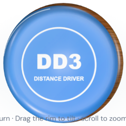 | 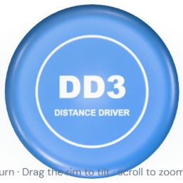 |
| Leopard (generous), panel top | 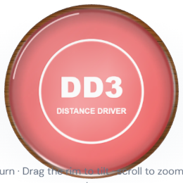 | 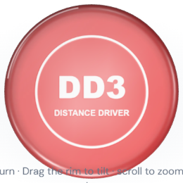 |
| Destroyer (fingers), panel top | 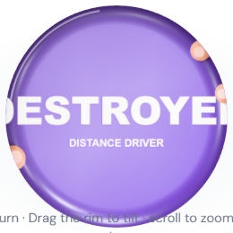 | 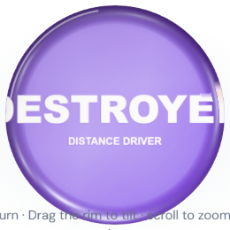 |
| Thunderbird (control) |  | 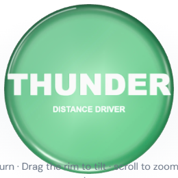 |
| PR #9 stamp | 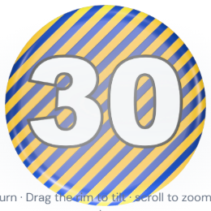 |  |
| PR #9 halo |  | 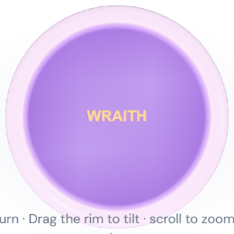 |
| PR #9 Pixel |  |  |
| DD3, My Bag pulled | 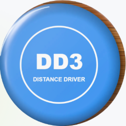 | 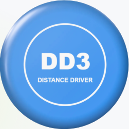 |
| Destroyer, My Bag pulled |  | 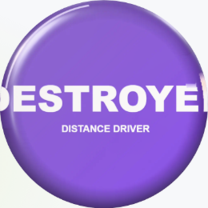 |
| Destroyer, Storage pulled | 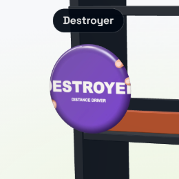 |  |
| DD3, list thumbnail / My Map |   |   |
| Destroyer, list thumbnail / My Map |   |  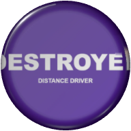 |

Purity: for every stored texture, two plans made on the main thread and the worker's plan are identical
(report and mask), two cleaned images at each tier are identical, and the panel's texture is exactly the
plan's 1024 image. Each stored texture is planned once per page however many surfaces and tiers draw it
(8 plans for 8 textures on the page that drew the bag, the list, My Map and the panel).

The fresh upload: snapped on opening, cleared its Undo when nudged by hand, snapped back once settled,
Undo kept the hand framing (and stayed), Snap to edge snapped again. The saved texture needs no
re-registration (plan: no edge), its fingers are cleaned at load, and the panel shows no table or skin.
All numbers: [metrics.json](assets/photo-edge-cleanup/metrics.json).

## Failure taxonomy

From `tests/photo-cleanup-taxonomy-browser.mjs` ([taxonomy.json](assets/photo-edge-cleanup/taxonomy.json)), which
asserts each line:

**Fixed**
- Misalignment crescent (off-centre framing): re-registered on the true edge (fit within 0.002 of truth,
  92 of 93 rays in view), table gone, stamp centred. The far side, cut off by the old crop, is the disc's
  own edge pixels extended outward along its radius.
- Generous framing, table all round, on wood and on a plain grey table (soft shadow and noise read as busy;
  plastic does not). Fit within 0.005 of truth.
- Fingers at the rim (on the annulus, outside 0.80 R): one patch per finger, replaced by the plastic either
  side.
- New uploads: the aligner snaps hand misalignment away before it bakes in.

**Bounded**
- **A foreign colour the disc also has.** On a tan disc held by fingers, skin is mostly the face's own
  colour: only two small patches (4.6° each) are cleaned, the rest of the fingers stay. Same for wood on a
  brown disc. Evidence: 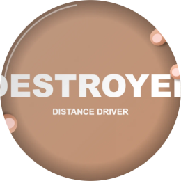 → 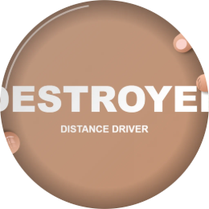
- **A smooth ring all round in a colour the face never shows** is treated as plastic, never re-scaled:
  that is what protects a Halo-style band (a pale yellow band from 0.90 R on purple is found as a full
  circle, foreign and smooth, busy 0.41, and stays byte-identical). The cost: a generous framing on a
  perfectly uniform, shadowless surface of one colour would stay too. The plain grey table fixture,
  with its shadow, is cleaned.
- **Fill quality.** The gap fill blends the plastic either side at the same radius. On plain plastic it
  is invisible; next to stamp art that runs to the edge it carries that art's colour across the gap (on
  the Destroyer, a short white streak from the "R" that is cut off at the rim). Glare arcs are kept, they
  are the disc's own light.
- **Small misalignment.** An edge under 1.2% off centre is not re-registered, and the aligner's snap ignores
  misses under 1.5% (moving the ring for less would fight the user's hand). A sliver of table up to that
  width (about 6 px of a 1024 px texture, on one side of the nose) can remain unless the annulus pass
  takes it as a patch.
- **Overmolds** are not cleaned beyond their seam (their photo stops there anyway); the rim piece keeps its
  stored colour.

**Impossible, scoped out**
- **A hand across the face.** A finger laid across the disc to 0.45 R is real occlusion: the disc's art
  under it is not in the photo. Its skin is in the face, so it is "the face's own colour" and nothing is
  touched, by design: no generative fill, nothing invented (Plan 22). Retake the photo. Evidence:
  
- **The part of a finger inside 0.80 R** stays for the same reason, even when its annulus part is cleaned.

## Cost

Per stored texture, once per page: a plan, about **16–77 ms** on the main thread for the seven textures
(RTX 3070 desktop; 114–148 ms average in the worker across runs, while the bag scene loads around it), off the main
thread in the worker. Untouched textures cost nothing more. A changed texture costs one cleaned image per
tier it is drawn at: **59–91 ms** at 1024 px, **15–18 ms** at 256 px, also in the worker. Nothing runs per
frame; the cleaned image is the texture, cached as photo textures always were. The aligner's snap is
**16–41 ms** per run on a 1600 × 1200 photo, after a gesture settles. A plan is a few hundred bytes, plus a
128 KiB cell index and 8 bytes per masked cell when patches are found; up to 64 are kept.

## Tests

- `npm run test:photo-cleanup` (new): taxonomy and proof, above.
- `tests/photo-cleanup-characterize-browser.mjs` (new): the characterization table above.
- Existing, all green on this branch: `test:photo-textures`, `test:photo-rim`, `test:photo-edge`,
  `test:photo-edge:atlas`, `test:disc3d`, `test:bag`, `test:bag:browser`, `test:bag:pulled-sizing`,
  `test:bag:pulled-quality`, `test:bag:overmold`, `test:bag:collections`, `test:bag:scene`,
  `test:appearance`, `test:my-map`, `test:atlas:3d`.
- One `test:photo-cleanup` run (of four) failed in fixture setup: the local Worker answered "Disc saved. Its
  photo could not save" for one upload made with main's own `disc-photo.mjs`, before any cleanup code ran.
  The rerun passed. It saves `failure-add.png` and the dialog's text if it recurs.
- `test:photo-phone`: its WebKit halves cannot launch in this environment (Playwright's WebKit is not
  installed in the shared browser runtime). Its four suites pass on Chromium: gestures, editor contract,
  source chooser, compression. `photo-gestures-browser.mjs` now sets `data-photo-snap="off"` on the page:
  it measures raw gesture maths, and a snap 350 ms after release would race its readings.

## Freddy's feel check after deploy

Without re-applying or re-uploading anything:
- Destroyer: his fingers gone from the rim.
- DD3s: read aligned, stamp centred, no table crescent.
- 30-stamp Wraith: the pattern still runs to the edge.
- Pixel: unchanged.
- One fresh imperfect photo, taken the normal way: the aligner snaps the ring to the disc and says so.
