# Glare experiment (A/B): baseline is the champion

**Status: accepted.** Freddy judged the pairs below on October 15, 2026: the experiment beats today's look, so both commits stay. `SOFTEN_GLARE` remains the kill switch: `false` restores the old output byte for byte.

Branch `codex/photo-glare-orientation`, base `main` at `5b50637`. Part 1 is the commit on top of the Part 2 commit, so it could be dropped without touching Part 2.

## What changed, and what did not

The baseline in `public/disc-albedo.mjs` is untouched: the quadratic light fit, white balance, bounded exposure and the existing 50% glare pull run exactly as before, and write every pixel exactly as before. The experiment is one extra pass (`softenGlare`) that runs **after** the baseline and rewrites only pixels inside an accepted hotspot.

- **Kill switch:** `SOFTEN_GLARE` at the top of `disc-albedo.mjs`. `false` means the pass never runs and the output is the baseline, byte for byte. Tests can also pass `{softenGlare:false}`.
- **No global change:** no exposure, contrast, saturation or white-balance change anywhere. The plate colour the disc is matched to is measured *before* the pass, so it is identical in every case.
- **Which pixels:** a connected patch of pixels well above the fitted light (luminance more than 1.3× the light field) that contains clipped, colourless glare (the baseline's own glare test) **and** has a soft halo. Room-light glare fades out over several pixels. Crisp white ink drops to the plate within a pixel or two, so a patch whose near-neutral halo averages under 3 px (at 1024 px) around its clipped core is treated as ink and left alone. So are glints of under 6 clipped pixels.
- **What happens to them:** glare is treated as light added on top of the plastic. Each pixel gives up the excess it carries, in the light's own colour, over the plastic around it. The "plastic around it" is a pull-push interpolation of the untouched neighbours. Because only the light-coloured excess is removed, a yellow stamp next to a hotspot keeps its colour (its bytes are unchanged in the test). Excess up to 0.3× the plastic's own luminance passes untouched, which is why the patch edge cannot show a seam. Anything above that is compressed smoothly toward 0.55×. That leaves a soft sheen, not a hole. A clipped pixel has no colour left, so it takes the surrounding plastic's colour under that same sheen. No pixel is ever brightened.

**Honesty note:** a blown highlight holds no recoverable detail. Where the sensor clipped, whatever was underneath (stamp ink, scuffs, the plastic's exact shade) is gone. This pass softens how the glare *looks*, replacing the white blot with a sheen in the colour of the plastic around it. It cannot restore what the glare erased. If glare sits on top of a stamp, the stamp under it stays lost.

## The pairs

Every case shows the photo, the baseline (today), the experiment and a map of every changed pixel (magenta). Below that are the same two textures on the real 3D detail viewer: the Pixel's mold, the matched plate colour, the 3/4 view and the top view. The bright patch on the right of every 3D disc is the viewer's own lighting, and it is the same on both sides. All textures are the real 1024 px upload size. Regenerate them with `node tests/photo-glare-ab-browser.mjs`.

### No glare (must be identical)

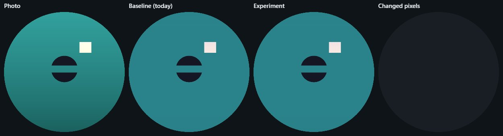
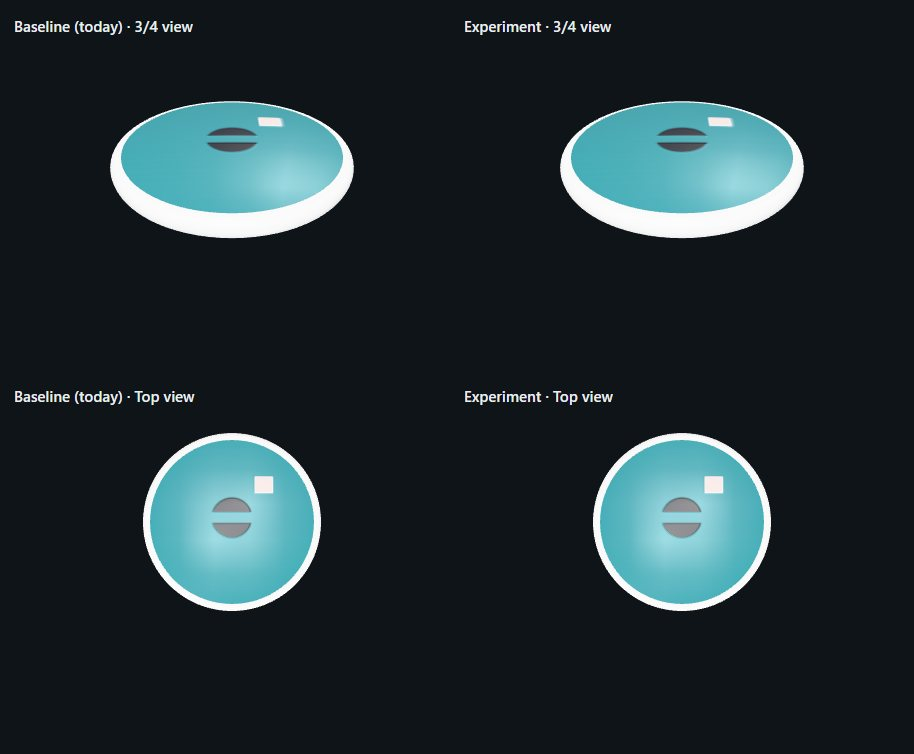

### Real photo fixture (`tests/fixtures/stamped-disc.webp`): the repo's only real-style photo

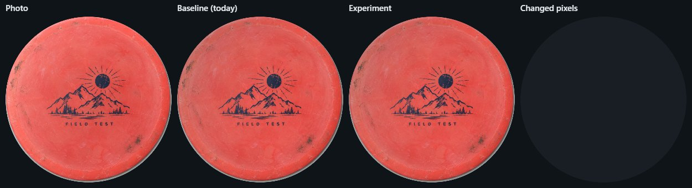
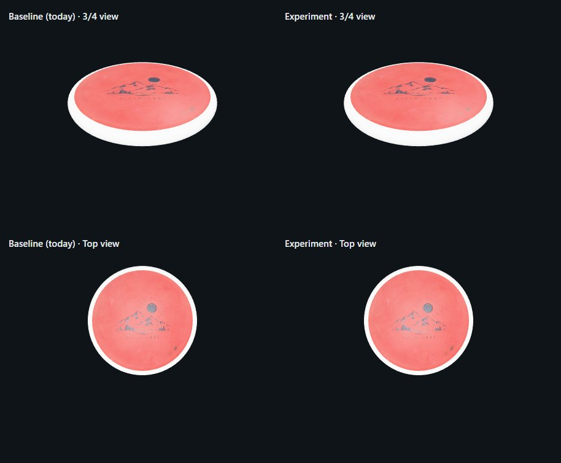

### Hotspot (a bulb reflected off the gloss)

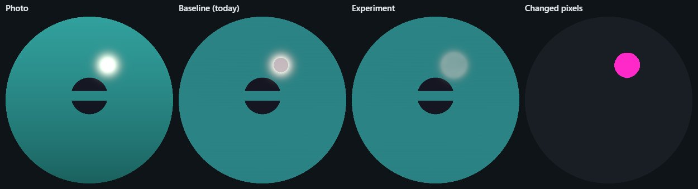
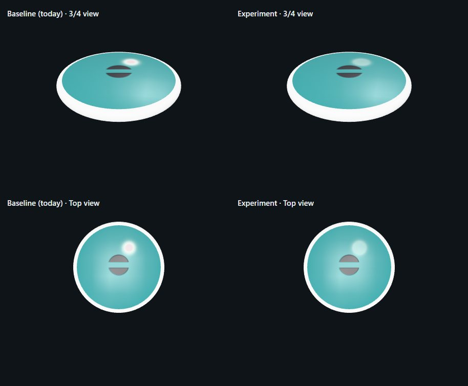

### Hotspot on the stamp's edge, with yellow ink beside it

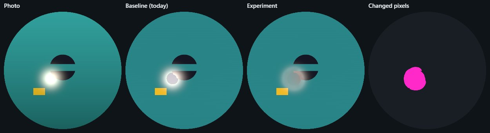
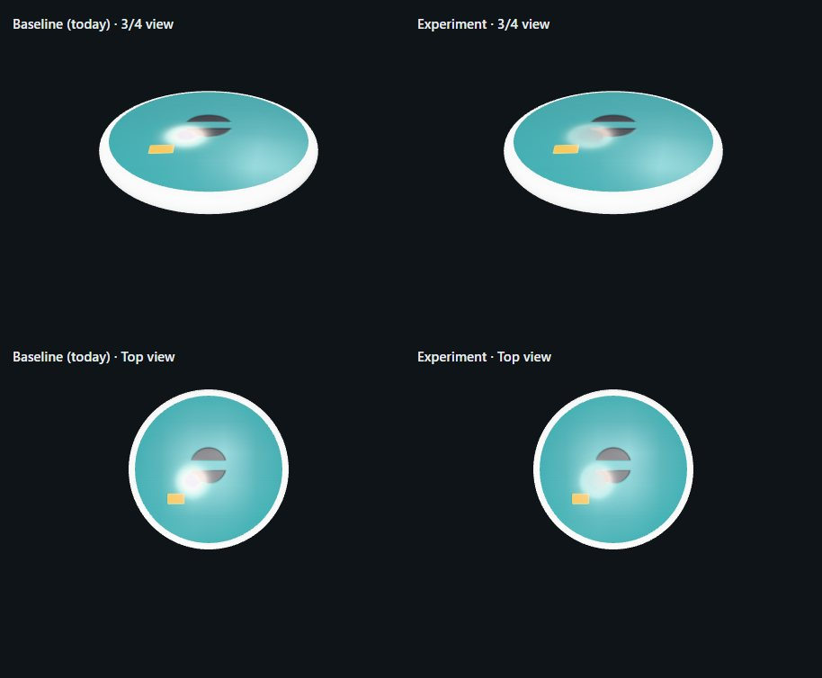

### Tube-light streak

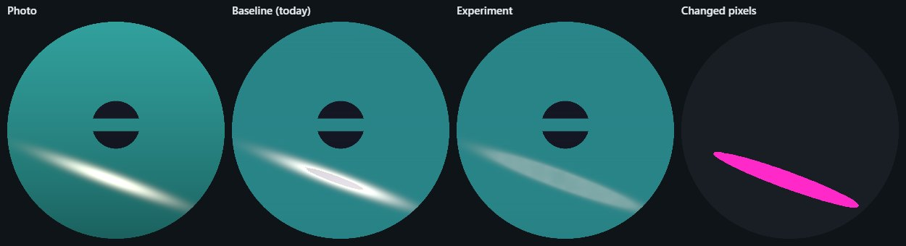
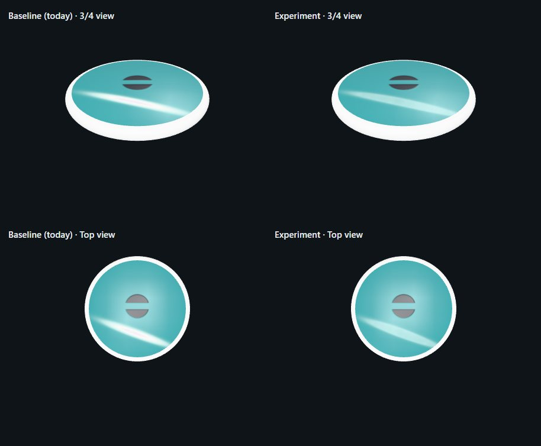

### Dark disc

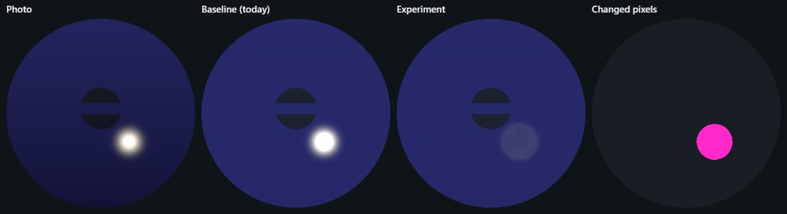
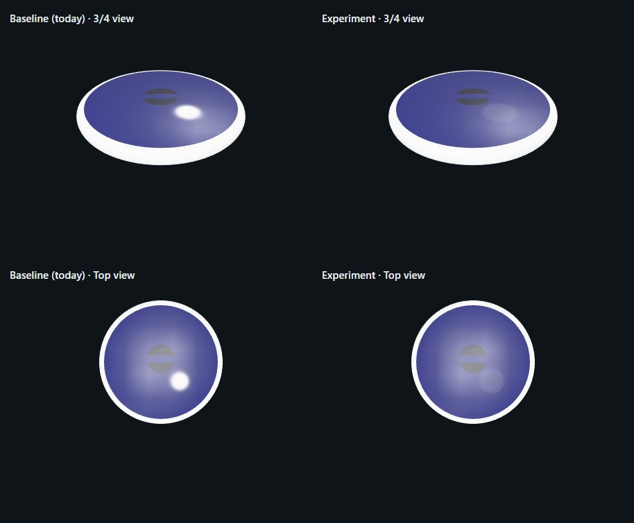

### Clipped white ink (the ink guard: must be identical)

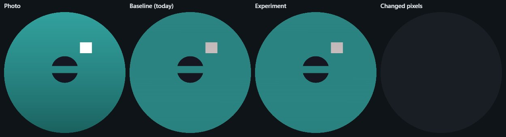
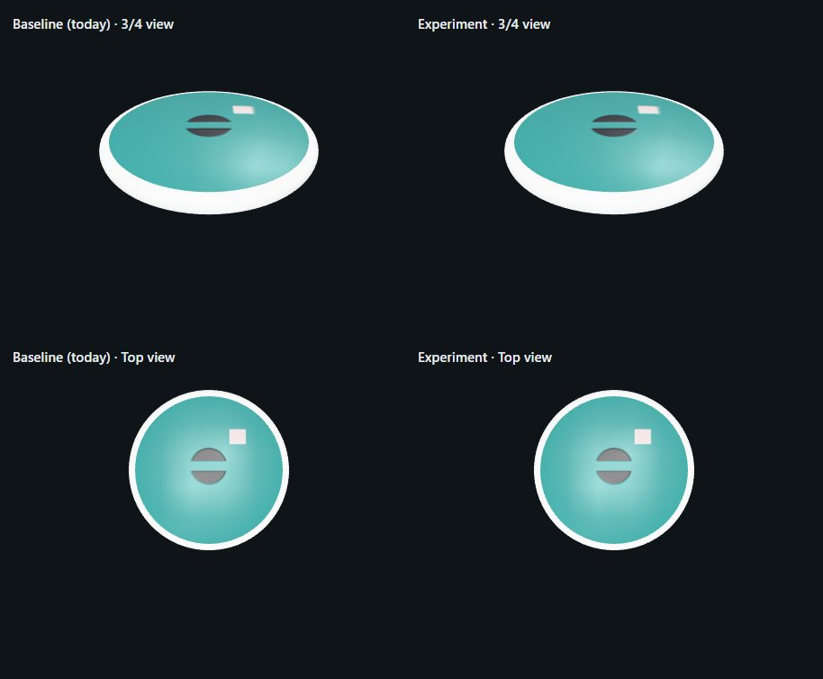

## Numbers

The figures are measured on the 1024 px textures, from [results.json](photo-glare/results.json). "Highlight" means every pixel where the fixture added glare of at least 0.3 (linear). "Error" is the mean distance of that region's luminance from the same photo shot without glare, run through the baseline: the target the softening aims for.

| Case | Pixels changed | Outside the glare | Highlight luminance, baseline → experiment | Reduction | Error vs. no-glare, baseline → experiment | Plate colour |
| --- | --- | --- | --- | --- | --- | --- |
| no-glare | **0** | 0 | — | — | — | identical |
| fixture (real photo) | **0** | 0 | — | — | — | identical |
| white-ink-clipped | **0** (patch seen and refused) | 0 | — | — | — | identical |
| hotspot | 18,974 | 0 | 0.551 → 0.340 | 38% | 0.362 → 0.151 | identical |
| hotspot-on-stamp | 30,359 | 0 | 0.674 → 0.331 | 51% | 0.521 → 0.178 | identical |
| tube-streak | 45,957 | 0 | 0.803 → 0.350 | 56% | 0.613 → 0.160 | identical |
| dark-disc | 29,517 | 0 | 0.954 → 0.055 | 94% | 0.925 → 0.025 | identical |

In every case, no changed pixel got brighter, and no pixel without glare in the fixture (added light under 0.005) changed. Non-highlight regions are byte-identical, not merely close: the tolerance is zero.

Automated checks:

- `tests/photo-albedo.mjs`, part of `npm run test:photo-textures`, runs the same cases at 512 px. It covers: the kill switch restores the baseline byte for byte; no-glare and clipped white ink are identical; only glare pixels change, each one darker; highlight luminance drops at least 35%; error drops at least 55%; the matched colour is unchanged; the yellow ink beside the hotspot is unchanged.
- `tests/photo-glare-ab-browser.mjs` re-checks the same claims on 1024 px textures in Chromium and writes the pairs.
- All existing photo suites pass with the experiment on: `test:photo-textures` (unit and Worker), `test:photo-phone` (compression, gestures, editor contract, source chooser).

## Limits

- **Only clipped glare is touched.** A soft sheen with no clipped core (veiling glare) is left exactly as the baseline has it. That is deliberate: without a clipped core there is no safe way to tell glare from light ink.
- **White ink and glare that touch are one patch.** If a hotspot runs into clipped white ink, the ink is softened with it.
- **Glare over a stamp:** the fill there is a blend of the stamp and plate around it, so the sheen can come out a muddy mix. See "hotspot-on-stamp": the navy ring's edge under the glare stays brown-pink in both versions.
- **Dark discs:** a faint inner ring remains where the clipped core meets the halo (visible in "dark-disc" at full size).
- **Cost:** per 1024 px export on this desktop (Node, median of 5 runs), with no hotspot the pass adds a 4 MB copy and one scan, about 30 ms (75 → 105 ms). With a hotspot it adds about 120 ms (63–77 → 180–199 ms). A phone will be several times slower. `preparePhoto` runs the pass again at 768 or 512 px only when the 1024 px encode is over the byte cap.
- **Not changed, but seen:** the *baseline* already pulls clipped white ink halfway to grey (its glare test cannot tell ink from glare). You can see that in the "white-ink-clipped" strip. The experiment leaves that behaviour exactly as it is.

## Freddy's decision

**Experiment wins** (October 15, 2026): both commits stay. If real photos later show a problem, set `SOFTEN_GLARE=false` (byte-identical to the old output); Part 2 does not depend on it.

Real photos are the true test. The synthetic cases above are built to be measurable, and the repo has only one real photo, which has no glare. The best check is one of Freddy's own glare photos through both settings.
