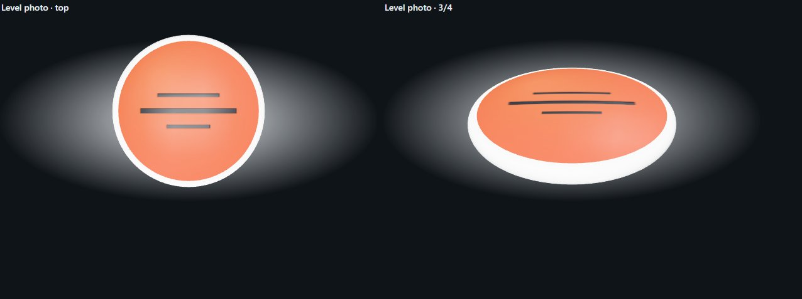
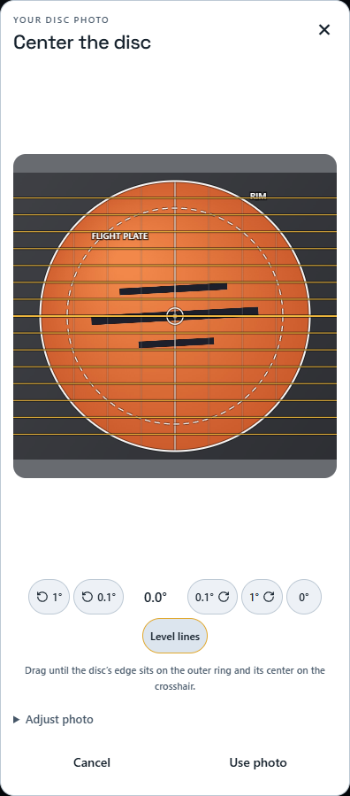
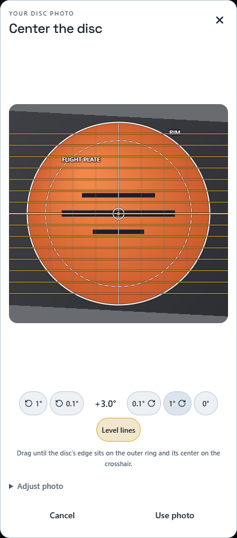
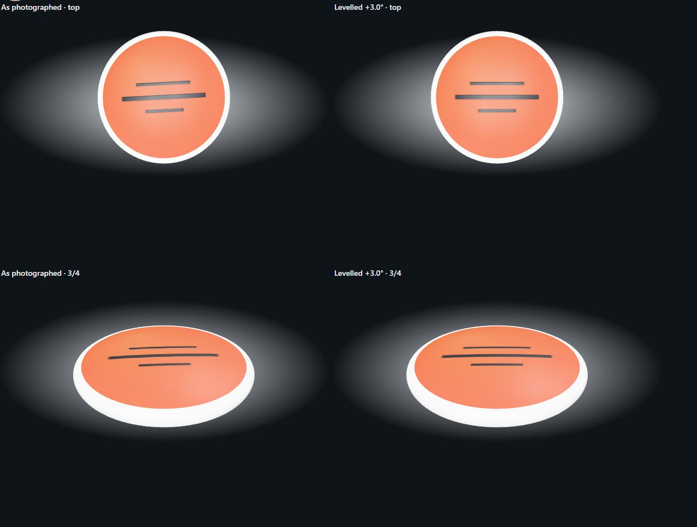
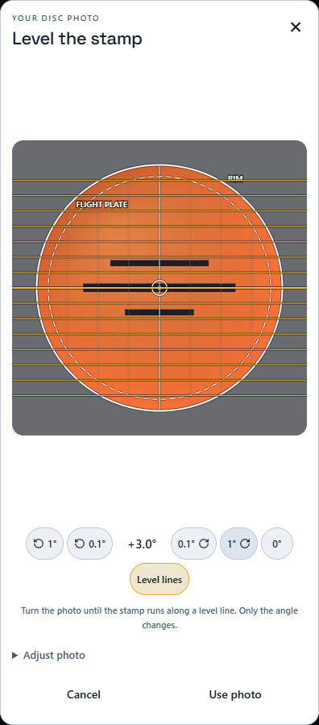
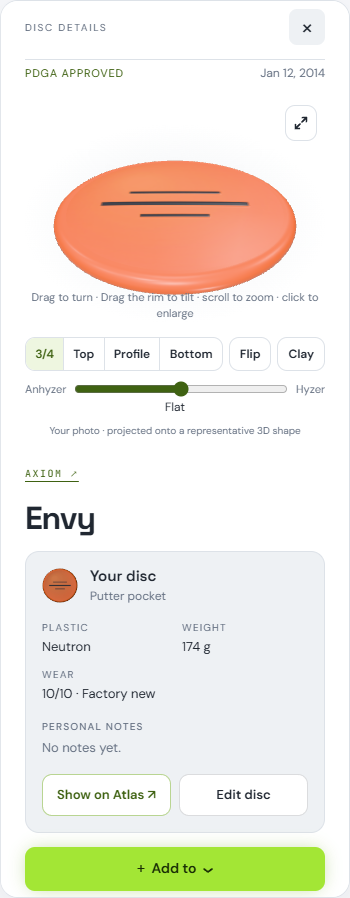

# Photo stamp orientation: levelling tools

Freddy's report (October 14, 2026): his photographed Pixel, floating in the 3D viewer, reads crooked — "it could have been me that didn't line it up right." The aligner gave him no way to land the stamp level, and no way to fix it after saving without re-shooting. Branch `codex/photo-glare-orientation`, base `main` at `5b50637`; this is the first of the branch's two commits and stands on its own (the glare experiment sits on top of it).

## Where rotation lives

Measured with a level test photo (a long dark bar and two "text" bars on an orange plate) through today's pipeline; angles in degrees, clockwise positive as on screen ([results.json](photo-stamp-orientation/results.json)).

1. **The texture keeps whatever angle the photo had.** The aligner had no rotation control at all. Its "Tilt direction" slider (`angle`) only orients the tilt and perspective correction; with tilt 1 and no perspective it moves nothing. So a disc photographed a few degrees off is baked into the texture a few degrees off. Level photo → texture: **−0.03°**.
2. **The detail viewer adds none.** The photo maps to the plate by planar UVs (photo top at the disc's far side, no rotation or mirror), and every preset view sits at azimuth 0 with the disc flat and unflipped. Level photo in the panel viewer: **−0.11°** top view, **−0.05°** 3/4 view.
3. **A second source, found and fixed: discs floating out of the bag.** A disc slid out of the 3D bag rests beside it, turned to face the camera. That turn was the shortest arc from the disc's face to the camera (`setFromUnitVectors`), which also rolls the disc about its face whenever the camera looks from above and to one side, as the bag's cameras do: about −4.6° under the page camera, −5.7° home, −3.3° front. Measured on the real bag viewer at `5b50637`: a level stamp floated **−5.32°** crooked. That is very likely what Freddy saw, alone or on top of a photo that was slightly off. Fixed in `public/bag3d/viewer.mjs` (`uprightFacing`): the disc still faces the camera square on, now with its own up on the screen's up. After the fix: **−0.02°**.

   | Before (main) | After |
   | --- | --- |
   |  |  |

4. **Named, not changed:** the hyzer/anhyzer slider rolls the disc on purpose (default Flat). Dragging turns the camera, the user's own choice. The bag's ambient float rocks the whole bag ±0.57° on an 8 s cycle; that is motion, centred on level, and off under reduced motion. Not measured: a disc lifted on hover in the bag's top view, and the Storage rack's pulled disc.

## Tools added (`public/disc-photo.mjs`, `public/my-bag.css`)

- **Fine rotation.** A level row under the photo, always visible, on a phone too: **↺ 1°, ↺ 0.1°, the angle readout, 0.1° ↻, 1° ↻**, and **0°**, which snaps back to exactly zero. Nudges land on exact tenths (three 0.1° nudges give exactly 0.3, not 0.30000000000000004). A **Rotate** slider (−180° to 180° in 0.1° steps) sits in "Adjust photo" beside the other controls. Keyboard: `[` and `]` nudge 0.1°, with Shift 1°. Clockwise is positive; the crop turns about the disc's centre and nothing moves into or out of the circle.
- **Level reference.** A **Level lines** toggle draws amber horizontal lines edge to edge across the frame, every eighth of the radius, with the centre line heavier. They run past the rim, so a stamp edge or a line of text can be laid along the nearest one. Like the other guides, they are drawn on their own canvas: in the test the upload with them on is byte-identical to the pipeline's output.
- **How it works:** a new `rotate` option in `photoPoint` turns the output coordinates before the existing crop math. At 0 it is skipped outright, so a 0° crop is the old arithmetic and the old bytes.

| As photographed (−3°), level lines on | After +3.0° |
| --- | --- |
|  |  |

## Correcting a saved photo

The disc sheet now offers **Level stamp** beside a saved photo, whenever no new photo is in progress. It opens the saved texture itself (the original photo was never uploaded, by design) in the aligner's **level-only** mode. The title reads "Level the stamp", and only the angle can change: framing, tilt and perspective are hidden, and drag, pinch, wheel and arrow keys do nothing. Use photo, then Save, sends it through the same `preparePhoto` ladder (1024 → 768 → 512 px, WebP .86 → .4, 512 KiB cap), the same `PUT /api/bag/discs/:id/photo` route and the same Worker validation as any photo.

- It is not delighted again (the texture already is the albedo), and the disc's colour is left alone.
- On an overmold disc, the photo-matched rim colour (from `codex/photo-rim-color`, merged in) is measured again from the saved texture and sent with the re-upload, so levelling keeps it instead of clearing it. The Worker test checks it stays within 4 levels per channel.
- **Adjust** reopens levelling on the same saved texture, not on the re-export, so trying several angles still costs one resample in total.
- Sampling is pixel centre on pixel centre, so at 0° the crop is an exact copy of the stored pixels.

**Quality, honestly:** levelling a saved photo costs one bilinear resample of the stored 1024 px texture (a slight softening, at most half a pixel) plus one more lossy WebP encode. Measured at 0° (resample-free, encode only): PSNR **48.7 dB** against the saved texture, with a worst single channel off by 36 levels at the odd edge pixel. The outermost pixel ring of the circle is feathered once more. Re-shooting is still the sharpest result. Levelling the saved photo is the no-reshoot fix, and it is close.

| In the editor harness | Through the real Worker (local D1/R2) |
| --- | --- |
|  |  |

## Proof

`tests/fixtures/crooked-stamp.jpg` is a 1600 × 1200 phone-style photo whose stamp is turned 3° counterclockwise. It is generated by `tests/photo-level-measure.mjs`. Stamp angles are read by second moments of the stamp's pixels. On 3D renders, the same view is drawn again with a stamp-free blank, and a stamp pixel is one that lost the plate's warmth, so the scene's light, the gloss and the background cancel out.

| Check | Result |
| --- | --- |
| Crooked photo, texture as photographed | −3.01° |
| …after +3.0° in the aligner: texture / top / 3/4 | −0.03° / −0.14° / −0.03° |
| Saved crooked, re-exported at 0° | −3.02° (unchanged), PSNR 48.7 dB |
| Saved crooked, re-levelled +3.0° after saving: texture / top / 3/4 | −0.01° / −0.09° / −0.03° |
| Same flow through the real Worker (`test:photo-textures`) | −3.00° → −0.03°, 27,628 bytes, colour kept |
| Floating out of the bag, level photo: before / after | −5.32° / −0.02° |
| 0° export vs `5b50637`'s `disc-photo.mjs` (three framings) | pixels, colour and WebP bytes identical |
| 0° export vs `f31fd41` (existing contract suite, Chromium and WebKit) | identical |
| `photoPoint` with `rotate:0` vs without (1,500 points) | bit-identical (`Object.is`) |

Suites: `npm run test:photo-level` (`tests/photo-stamp-level-browser.mjs`: all of the above except the Worker row), `tests/photo-math.mjs` (rotation math), and `tests/photo-textures-browser.mjs` (Worker save, re-level, save). All existing photo suites pass: `test:photo-textures`, `test:photo-phone`. The source-chooser suite's pinned default options now include `rotate: 0`.

## Freddy's acceptance run on his Pixel

After a deploy:

1. My Bag → edit the Pixel. The photo row shows **Level stamp** next to Replace and Remove.
2. Tap **Level stamp**. The saved photo opens under "Level the stamp".
3. Tap **Level lines**, then use **↺ / ↻ 0.1°** (and 1° for big moves) until the stamp's text runs along an amber line. **0°** resets.
4. **Use photo**, then **Save**.
5. Open the bag, slide the Pixel out so it floats beside the bag, and check the stamp reads straight. Then open its details: top and 3/4 views read straight too.

For a new photo the same row is in the aligner from the start, so the stamp can be landed level before the first save.
