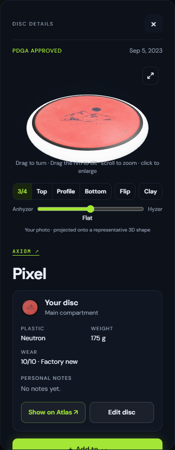
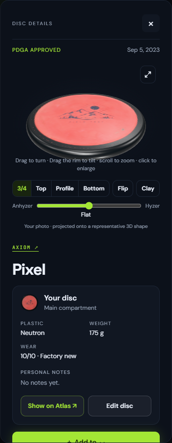

# Photo rim in the viewer and bag animation

October 15, 2026. Branch `codex/rim-viewer-bag-animation`, from `main` at
`3930a0c1` (PR #6). Two independently landable parts; local commits only.

## Part 1: characterize the rim path

The reported deployed white rim **did not reproduce through the normal bag
detail path on the requested base**. The untouched `test:photo-rim` passed,
including real D1/R2 saved samples, a fresh reload, panel and pop-out in both
themes. This distinction matters: the existing saved sample already reached
those viewers, albeit as a pre-resolved `colors.rim`. There is no evidence here
that Freddy needs to reapply his photo, nor evidence identifying his deployed
build/cache/account state as the cause.

| Surface | Resolution on the base merge |
| --- | --- |
| Bag interior, standing pockets, pulled discs | `bag-layout.mjs` calls `bagRimColor(item)`; both bag and detail-quality meshes use that rim. Explicit → attached photo sample → existing black fallback. |
| Storage rack instances and pulled Storage discs | `collection-scenes.js` passes `bagRimColor(item)` to `racks.mjs` / `stage.mjs`. Same existing black fallback. |
| Lost/graveyard models | Same collection input and `discModel()`; same existing black fallback. |
| Bag list, collection list, personal detail thumbnail | `my-bag.js` passes `bagRimColor(item)` into thumbnail attributes. `thumbnails.mjs` forwards that to `atlas-art.mjs`, whose missing-rim fallback is black in Light, white in dark themes. |
| Personal map/lens artwork | `publishBagColors()` resolves via `bagRimColor(item)` into the existing map rim map; `atlas-art.mjs` applies the same theme fallback. |
| Detail viewer panel | `detailAppearance()` already computed `bagRimColor(item)` into `colors.rim`. `disc3d.js` forwarded that color, **but discarded raw `photo_rim_color` and `texture_key` inputs**. `viewer.mjs` only understood explicit `colors.rim` → theme. |
| Viewer pop-out | Copies the panel's `state.props`. Already worked with the pre-resolved color; inherited the missing raw-input contract. |
| Catalog-only illustrations/viewer | No physical saved copy; unchanged theme fallback, no automatic sample. |
| Photo editor/preview | Shows the photo itself. Sampling happens at Apply, never in a render. Its rim color input represents explicit user intent. |

### Change and proof

Extend the existing `bagRimColor(item, fallback = null)` with an optional surface
fallback. All existing callers keep identical behavior. The viewer now calls
that same resolver instead of maintaining its own explicit-rim precedence path.
The bag detail input carries the stored sample and attachment key through
`Disc3D.sync`, including delayed hidden-panel mounting and the copied pop-out
props. `colors.rim` remains the explicit choice.

Order: **explicit rim → attached photo's stored rim → existing surface fallback**.
Clay still swaps the materials above this decision. The pre-existing bag and
collection black defaults are preserved, as are the Light/dark viewer and
thumbnail defaults. No migration, upload, sampling, storage, geometry, lighting,
or non-photo rendering change.

The extended suite makes a black-rim Pixel from the stamped-disc fixture, saves
it through the actual editor/API, reloads it, then supplies the saved inputs
directly to the viewer without caller-side rim resolution. Before the change it
fails with **`#ffffff versus #101418`**. It also covers the normal bag path,
explicit purple override, removal restoring theme colors, and clay, for **panel
and pop-out in Midnight and Light**. Stored samples are read without reapplying
the photo between viewer openings.

| Raw saved-input viewer, before (white) | Same saved input, after |
| --- | --- |
|  |  |

These are synthetic stamped Pixel screenshots, not Freddy's photo. The before
image isolates the missing viewer API contract. For transparency, the normal
bag-detail integration already showed a dark rim on the base:
[integration before](assets/rim-viewer-bag-animation/viewer-integration-before.png).

Freddy's feel check after deployment: open his photographed Pixel in the 3D
viewer in dark mode; its stored black rim should show immediately in both views.
If his exact disc still differs, capture the deployed revision and its saved
`texture_key`, `rim_color`, and `photo_rim_color` before changing its photo.

Validation: extended `test:photo-rim` passed with zero page errors; the 7 overmold
unit cases passed. Read-only independent review found no actionable issue;
before/after screenshots were visually inspected. Logs: ignored
`outputs/photo-rim-baseline.log`, `photo-rim-red.log`, `photo-rim-green.log`,
and `rim-units.log`.

