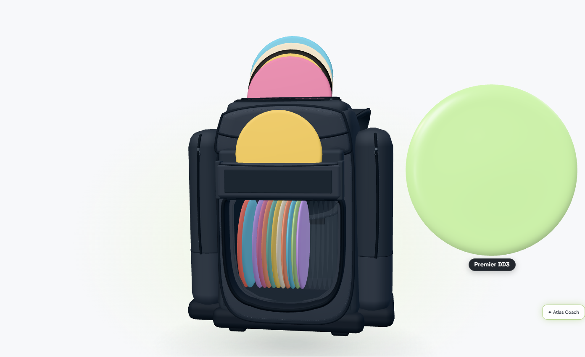
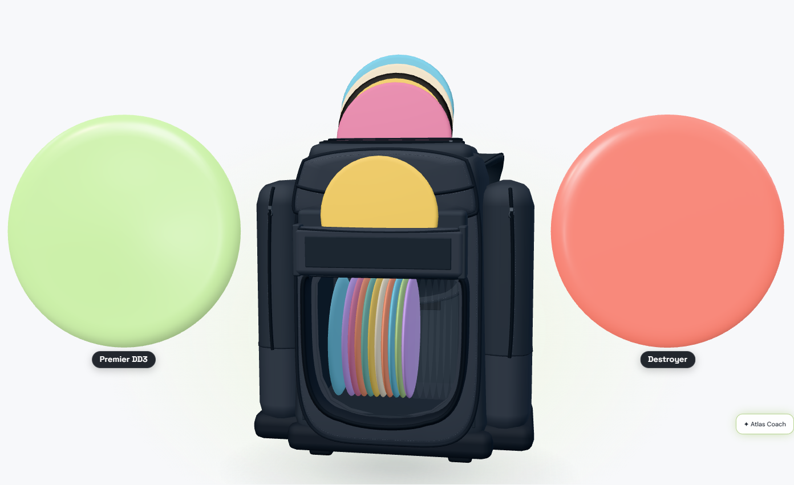
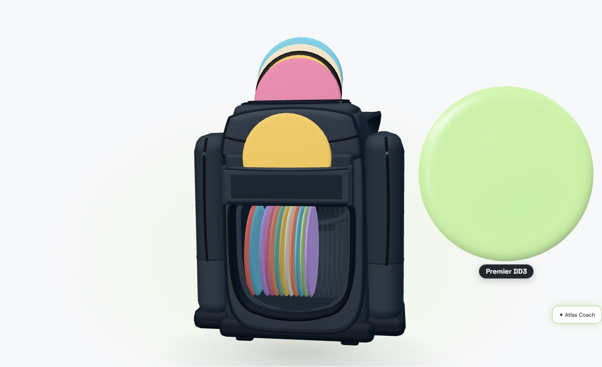
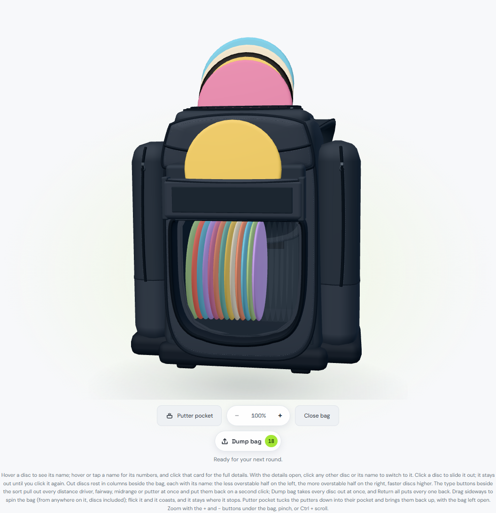
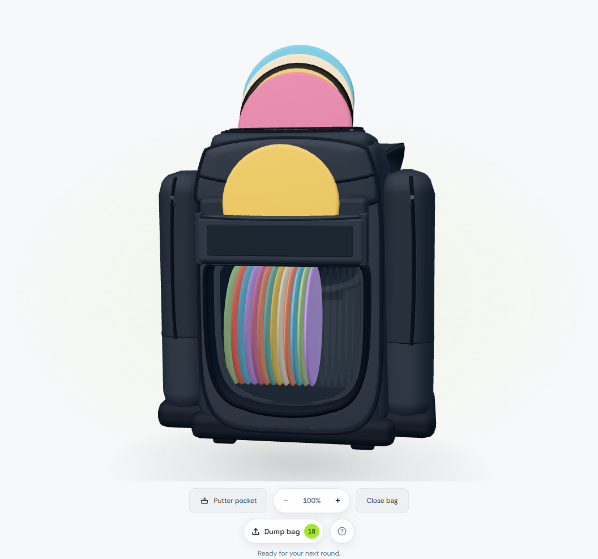
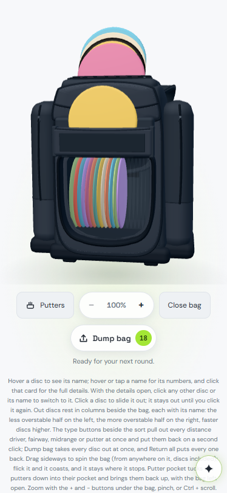
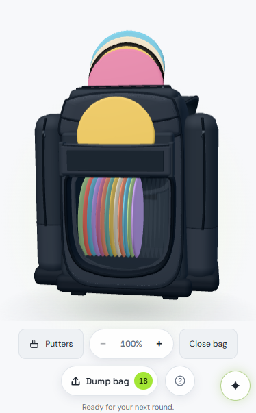
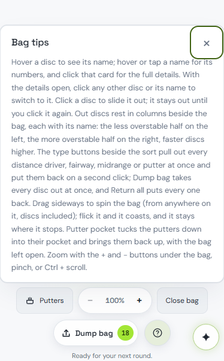
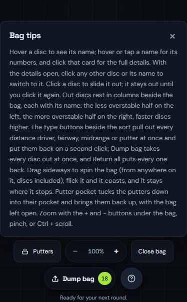

# Photo rim in the viewer and bag animation

October 15, 2026. Branch `codex/rim-viewer-bag-animation`, from `main` at
`3930a0c1` (PR #6). Parts 1–2 were completed October 15. Part 3 was added
October 16 as a separate, independently landable commit; local only.
Part 4 was added October 16 as its own local commit.

## Part 1: characterize the rim path

The reported deployed white rim **did not reproduce through the normal bag
detail path on the requested base**. The untouched `test:photo-rim` passed,
including real D1/R2 saved samples, a fresh reload, panel and pop-out in both
themes. This distinction matters: the existing saved sample already reached
those viewers, albeit as a pre-resolved `colors.rim`. There is no evidence here
that Freddy needs to reapply his photo, nor evidence identifying his deployed
build/cache/account state as the cause.

| Surface | Resolution on the base merge |
| --- | --- |
| Bag interior, standing pockets, pulled discs | `bag-layout.mjs` calls `bagRimColor(item)`; both bag and detail-quality meshes use that rim. Explicit → attached photo sample → existing black fallback. |
| Storage rack instances and pulled Storage discs | `collection-scenes.js` passes `bagRimColor(item)` to `racks.mjs` / `stage.mjs`. Same existing black fallback. |
| Lost/graveyard models | Same collection input and `discModel()`; same existing black fallback. |
| Bag list, collection list, personal detail thumbnail | `my-bag.js` passes `bagRimColor(item)` into thumbnail attributes. `thumbnails.mjs` forwards that to `atlas-art.mjs`, whose missing-rim fallback is black in Light, white in dark themes. |
| Personal map/lens artwork | `publishBagColors()` resolves via `bagRimColor(item)` into the existing map rim map; `atlas-art.mjs` applies the same theme fallback. |
| Detail viewer panel | `detailAppearance()` already computed `bagRimColor(item)` into `colors.rim`. `disc3d.js` forwarded that color, **but discarded raw `photo_rim_color` and `texture_key` inputs**. `viewer.mjs` only understood explicit `colors.rim` → theme. |
| Viewer pop-out | Copies the panel's `state.props`. Already worked with the pre-resolved color; inherited the missing raw-input contract. |
| Catalog-only illustrations/viewer | No physical saved copy; unchanged theme fallback, no automatic sample. |
| Photo editor/preview | Shows the photo itself. Sampling happens at Apply, never in a render. Its rim color input represents explicit user intent. |

### Change and proof

Extend the existing `bagRimColor(item, fallback = null)` with an optional surface
fallback. All existing callers keep identical behavior. The viewer now calls
that same resolver instead of maintaining its own explicit-rim precedence path.
The bag detail input carries the stored sample and attachment key through
`Disc3D.sync`, including delayed hidden-panel mounting and the copied pop-out
props. `colors.rim` remains the explicit choice.

Order: **explicit rim → attached photo's stored rim → existing surface fallback**.
Clay still swaps the materials above this decision. The pre-existing bag and
collection black defaults are preserved, as are the Light/dark viewer and
thumbnail defaults. No migration, upload, sampling, storage, geometry, lighting,
or non-photo rendering change.

The extended suite makes a black-rim Pixel from the stamped-disc fixture, saves
it through the actual editor/API, reloads it, then supplies the saved inputs
directly to the viewer without caller-side rim resolution. Before the change it
fails with **`#ffffff versus #101418`**. It also covers the normal bag path,
explicit purple override, removal restoring theme colors, and clay, for **panel
and pop-out in Midnight and Light**. Stored samples are read without reapplying
the photo between viewer openings.

| Raw saved-input viewer, before (white) | Same saved input, after |
| --- | --- |
|  |  |

These are synthetic stamped Pixel screenshots, not Freddy's photo. The before
image isolates the missing viewer API contract. For transparency, the normal
bag-detail integration already showed a dark rim on the base:
[integration before](assets/rim-viewer-bag-animation/viewer-integration-before.png).

Freddy's feel check after deployment: open his photographed Pixel in the 3D
viewer in dark mode; its stored black rim should show immediately in both views.
If his exact disc still differs, capture the deployed revision and its saved
`texture_key`, `rim_color`, and `photo_rim_color` before changing its photo.

Validation: extended `test:photo-rim` passed with zero page errors; the 7 overmold
unit cases passed. Read-only independent review found no actionable issue;
before/after screenshots were visually inspected. Logs: ignored
`outputs/photo-rim-baseline.log`, `photo-rim-red.log`, `photo-rim-green.log`,
and `rim-units.log`.

## Part 2: measurement before implementation

`tests/bag-animation-perf.mjs` drives the real signed-out **18-disc demo bag** in
desktop Chromium: Dump bag → Distance (the current UI's Drivers category) →
Midrange → Return all. Each action finishes before the next, with 300 ms between
actions. Six cycles; discard cycle 1 for warm-up and report medians across the
remaining five. Per-frame rAF intervals, main-thread long tasks, renderer CPU
submission time, actual GPU timer-query time, canvas ratios, quality states,
and complete `BagScene.place()` time are retained in JSON. No live account.

Machine: Windows, Chromium 156, ANGLE D3D11, NVIDIA RTX 3070, 1440 × 1000 at 2×.
This is a fast discrete GPU. These results do not establish integrated-GPU
performance or reproduce Freddy's exact deployed browser state. Local headless
frame cadence is roughly 2.8 ms; raw intervals are useful for the paired
comparison, not a claim about another display's refresh rate.

Baseline, captured before any animation code change:

| Action | Frame median / p95 (ms) | GPU median (ms) | Layout median / total (ms) | Long tasks |
| --- | --- | --- | --- | --- |
| Drivers | 2.9 / 8.3 | 0.63 | 3.5 / 414.3 | 0 |
| Midranges | 2.8 / 5.6 | 0.72 | 2.9 / 414.1 | 0 |
| Stow | 2.8 / 2.9 | 2.29 | 1.7 / 9.3 | 0 |

The dominant measured CPU section is the repeated HTML target/name placement,
not drawing submission (~0.5 ms). Drivers performs 105 placements in the second
cycle; Midranges 139. Name measurement interleaves `offsetWidth`/`offsetHeight`
reads with style writes and reparents every label on every placement. Camera
and size animation events can also request placement twice in one renderer
frame. Controlled probes and the final change follow.

Controlled response-only ablations (same five-run medians, before product changes):

| Probe | Drivers p95 (ms) | Midranges p95 (ms) | Interpretation |
| --- | --- | --- | --- |
| Skip HTML placement | 2.9 | 2.9 | Eliminates the category spikes; dominant measured work. |
| Force the old 2.4 M-pixel cap | 8.4 | 8.3 | GPU time falls to 0.37/0.42 ms, but category frame spikes remain. Raw fill is not dominant on this GPU. |
| Disable detail quality/material switches | 8.4 | 8.3 | Shader/material changes do not explain the spikes. Existing `compileAsync` warm-up retained. |
| Bypass separate 300 ms size interpolation | 8.4 | 8.3 | Does not improve frame spikes. Keep the 650 ms restage + 300 ms size behavior. |

The plain demo has no photo decodes, so textures cannot explain its baseline
cost. A separate stamped-photo demo repeats the same repro to check that case;
it is labeled separately from the required unmodified demo.

The initial layout change batched measurements, retained label nodes, and
consolidated layout events. It reduced category placement totals only to
356/357 ms. A deeper profile of the **base revision** broke down the remaining
work: Drivers/Midranges spent **149/171 ms** projecting the bag silhouette, plus
**126/121 ms** in duplicated `discRects()` calls (five-run medians; each placement asked once for
hit targets and again for names). Freezing only the footprint in a response-only
probe lowered category p95 to **5.6/5.6 ms**. This justified eliminating duplicate
bounds work and holding the collision footprint during a desktop glide.

The validated photographed fixture exposed a separate cost: Drivers had a
**116.6 ms median maximum frame**, with **one 76 ms main-thread long task** in
the cold cycle. Skipping detail photo trade-ups in a base-revision probe reduced
the median maximum frame to **36.1 ms** while leaving the category p95 at 8.4 ms.
That isolated the trade-up/relief/upload path from the steady placement cost.
The first attempted photo fixture used an invalid texture-key format and never
loaded; that diagnostic was discarded. The accepted fixture uses the private
photo-route format and asserts that all 18 starting photos really show at 256.

### Final change

- Measure each disc's screen rectangle once per placement, sharing it between
  hit targets and names. Read name dimensions together, then write positions;
  keep unchanged name nodes attached. The new regression observed **1,456**
  unnecessary removals during the pre-fix Drivers glide, and zero after.
- Hold the bag's collision silhouette during a desktop count-size animation,
  keyed to that staging operation. Re-measure at rest or a new stage, and while
  the user turns the bag or switches its view. This avoids rebuilding/projecting
  the floating bag's mesh vertices for every moving name. The planner and the
  final live collision calculation are unchanged; phone silhouettes stay live.
- Emit one layout event at the end of a renderer frame when camera pull, zoom,
  and size changes coincide. Labels still follow the current live rim.
- On desktop, request higher photo tiers after the entire staging timeline
  settles. Keep the current tier mid-flight. If a decode begun before another
  click finishes during its glide, hold the visible photo until that glide ends.
  Retain the old photo handle until its replacement can show. A disposed held
  detail photo falls back to the still-attached bag photo. Phones bypass this
  deferral. The hold follows actual slide/spot/camera motion as well as the
  deadline: a resize restage with no new duration cannot release an existing
  slide early. The first fully settled renderer frame starts every deferred
  request, even if ambient frames are disabled.

No canvas resolution policy change: the measured fill cost did not justify it
on this GPU. Same shaders/material switches, `compileAsync` warm-up, premium
lathe, lighting, sizes/floor, 650 ms restage, 300 ms size glide, upright pose,
phone presentation, and settled photo/relief tiers. The atlas and its performance
gate have no code changes. Storage and Lost scenes have no Part 2 changes.

### Paired results

Five-run medians, same plain demo repro and instrumentation:

| Action | Frame median before → after (ms) | Frame p95 before → after (ms) | Placement total before → after (ms) | Long tasks before → after |
| --- | --- | --- | --- | --- |
| Drivers | 2.9 → 2.8 | 8.3 → 5.5 | 414.3 → 182.5 | 0 → 0 |
| Midranges | 2.8 → 2.8 | 5.6 → 2.9 | 414.1 → 167.5 | 0 → 0 |
| Stow | 2.8 → 2.8 | 2.9 → 2.9 | 9.3 → 7.6 | 0 → 0 |

There were **zero long tasks across all five warmed cycles** before and after.
The median cadence is already near the local 2.8 ms floor; the useful gains are
the tail frames and **56–60% less placement CPU work**, not a large median FPS
claim. Plain Drivers median maximum frame: **36.1 → 24.9 ms**; Midranges:
**19.5 → 11.1 ms**. First-cycle click/planner/GPU spikes remain: plain Drivers
max was **55.6 → 72.3 ms** (0 → 1 long task, 53 ms after). Cold results varied
across rechecks; this change does not remove every initial stall.

Photographed demo (all 18 use the stamped fixture, distinct from plain demo):

| Action | Frame median before → after (ms) | p95 before → after (ms) | Median maximum frame before → after (ms) | Warm long tasks |
| --- | --- | --- | --- | --- |
| Drivers | 2.8 → 2.8 | 8.4 → 5.5 | 116.6 → 25.0 | 0 → 0 |
| Midranges | 2.8 → 2.8 | 8.3 → 5.5 | 19.4 → 16.7 | 0 → 0 |
| Stow | 2.8 → 2.8 | 2.9 → 2.9 | 11.1 → 11.1 | 0 → 0 |

Cold photographed Drivers max: **116.7 → 61.1 ms**, with staging long tasks
**1 (76 ms) → 0** in the final pair. Deferral moves the
decode/relief/upload work past the glide; it does not make that work free. These
windows measure staging, not a guarantee of zero CPU work during the subsequent
quality-settle period. Final photo runs additionally record long tasks during
the following 300 ms so that moving work out of the glide is visible in the data;
that tail had no long tasks in this final six-cycle capture.

The repository design-vision workflow also calls for **4× CPU slowdown**.
Same demo, viewport, GPU, six-cycle method, CDP CPU rate 4:

| Action | Frame median before → after (ms) | p95 before → after (ms) | Median maximum frame before → after (ms) | Median long-task count before → after |
| --- | --- | --- | --- | --- |
| Drivers | 2.9 → 5.6 | 36.1 → 19.4 | 141.8 → 102.8 | 2 → 1 |
| Midranges | 5.5 → 5.6 | 30.5 → 16.7 | 108.3 → 83.4 | 1 → 1 |
| Stow | 5.4 → 5.5 | 8.3 → 8.4 | 63.8 → 58.3 | 0 → 0 |

Median category placement CPU totals fall **435.4 → 194.3 ms** and
**425.3 → 188.6 ms**. Tail frames improve substantially; median cadence does
not improve in this stressed run. Click/planner stalls remain (median long-task
time: Drivers 150 → 67 ms, Midranges 81 → 66 ms). These are CPU-throttled
measurements, not an emulation of a slower GPU. Add `--cpu4` to reproduce.

[Committed metrics](assets/rim-viewer-bag-animation/animation-metrics.json)
include per-frame intervals and long-task records for every plain/photo
before/after cycle, canvas dimensions, and probe summaries. Full CPU/GPU timing
arrays are also retained in ignored `outputs/bag-animation/`. Run locally with
`node tests/bag-animation-perf.mjs <tag> none`; add `--photos` for the photo case.
`--base` serves the two animation files from `3930a0c1` without moving HEAD.
Probes are response overrides, never shipped product flags. Browser suites and
benchmarks ran serially to avoid GPU contention and shared asset-build races.
This checkout used the bundled Playwright module and installed GPU Chromium
via `PLAYWRIGHT_MODULE` and `PLAYWRIGHT_EXECUTABLE_PATH`; a normal dependency
install can use the script's default `playwright` import.

### Verification and feel checks

The new photo-tier regression failed before deferral (2,587 sampled visible
upgrades during motion). Its final check also requires the expected tier and
relief after settling; merely leaving a stale 256 photo cannot pass. The
review-found shrink/enter case timed out before the held-handle membership fix,
then passed: pull one photographed disc to 1024, Dump the full bag, and every
small disc still shows its 256 photo. Independent review has no unresolved
findings. A deliberately delayed photo response also checks a rapid next-stage
click, and a separate pull requires settled 1024 + relief with ambient motion
disabled. The delayed-response case caught and fixed the resize restage's
premature deadline release before final verification.

Comparing baseline/final settled state records gives **identical** disc
positions, spot scales, shown diameters, materials, lathe segments, plate/rim
colors, and canvas pixel ratio/dimensions at each of the three repro stops.
The pulled-quality suite itself is unmodified.

| Verification | Result |
| --- | --- |
| `test:bag` | 71 unit cases pass |
| `test:bag:pulled-sizing` | Pass: desktop floor/bounds/300 ms glide/live labels, dense bag, phone 360/390/430 |
| `test:bag:pulled-quality` | Pass, unmodified; rechecked after the final motion gate: 1024/512/256, relief, full pixel ratio, upright/still stamp, phone |
| `test:bag:staging` | Pass: 13 checks, desktop/phone counts through 24, three themes, simultaneous stow, reduced motion |
| Remaining 12 registered bag scripts | Pass: demo, browser, overmold, memorial, collections, scene, v13, 3d, spin, controls, popup, switch-dump |
| `test:disc3d`, `test:photo-textures`, `test:appearance` | Pass |
| New animation regressions | Pass: retained label nodes, current tier during motion, eventual detail tier/relief |
| New transition regressions | Pass: large → all-out base visibility, delayed response across a next click, ambient-off settled 1024 + relief |
| Changed-file ESLint | 0 errors; the same 2 pre-existing viewer `renderNow` warnings |

The first sizing run failed its cross-page phone bag-size comparison: it was
comparing two different phases of the ambient float. That comparison now uses
`bagRect(pullGoal)` on both pages, the same resting pose and the same 1 px
tolerance. All live bag collision/above-bag checks are retained. The corrected
suite passed; review found no weakened assertion. The initial failure log is
preserved. No pulled-quality assertion was changed.

Logs are under ignored `outputs/rim-bag-suites/`, `outputs/final-rim-bag-results.json`,
and `outputs/*-final.log`; the earlier failed/diagnostic captures are retained.
All **16 registered bag scripts** passed. Older unregistered interaction/tweak
files flagged by PR #5/#6 were not changed or included in that claim.

Freddy's feel check after deployment: full bag out, click Drivers (Distance in
the current toolbar), then Midrange; the pull/restage should glide. Also try
rapid category reversals and a single large photographed disc → Dump bag.
Quality should resolve sharply after motion, with no disappearing photos. A
slower GPU may still be fill-bound at 4.7 M pixels: this machine's numbers clear
that suspect here, not on Freddy's hardware. No animation pixel-budget hold was
added without that evidence.

## Part 3: cap pulled discs at the bag silhouette

October 16, 2026. Desktop `max = min(previous max, projected bag width)`.
The width comes from the existing `bagRect(factor)` projection of the bag's
mesh silhouette at the sizing planner's resting camera, in CSS pixels. It
includes the bag's side pockets, excludes the discs in its pockets, and excludes
the shadow. Width is the honest comparison for a face-on circular disc beside
the bag: the disc cannot span more screen width than the bag it came from.
Using the taller body/handle height would permit a disc wider than the bag.
The collision rectangle still includes standing pocket discs; those discs do
not enlarge the size cap. The same projected body box is reused when measuring
that collision rectangle.

### Measurement result: no trim at either reference size

The requested rule is enforced, but the 18-disc demo's existing maximum was
already below the actual silhouette width. No smaller central-panel measurement
or arbitrary padding was substituted to manufacture a trim.

| Viewport | Bag width, before → after | Bag height (context) | Max tier, before → after | Trim | Counts changed |
| --- | ---: | ---: | ---: | ---: | --- |
| 1440 × 1000 | 491.65 → 491.65 px | 618.14 px | 409.54 → 409.54 px | 0 px | None, 1–18 |
| 1280 × 900 | 433.81 → 433.81 px | 545.42 px | 359.00 → 359.00 px | 0 px | None, 1–18 |

Both dimensions use the planner camera, with the ambient float removed, rather
than comparing different moments of its bob. Before is Part 2's `7c1efbb`;
after includes only this cap. The one-disc and two-disc views below are fresh
captures of the final cap code; the cap is inert in these views.
[Per-count before/after measurements](assets/rim-viewer-bag-animation/cap-metrics.json)
retain the unrounded silhouette boxes, maximum, floor and decay at all 18
counts at both sizes, plus the phone checks.

| 1440 × 1000, one out | 1440 × 1000, two out |
| --- | --- |
|  |  |

| 1280 × 900, one out | 1280 × 900, two out |
| --- | --- |
|  |  |

The cap also applies when reusing a frozen curve at a new planning camera.
The shrink formula, zone bounds, label packing, 300 ms glide, and quality
thresholds are unchanged. Full-count floors remain **124.4482 px** at
1440 × 1000 and **96.6000 px** at 1280 × 900. The old headline sizing numbers
therefore remain valid in [the sizing write-up](bag-pulled-disc-sizing.md).

**Quality:** no disc at any of the 18 counts crosses a tier boundary at either
reference size. Diameters are unchanged, so the > 128 px detail look and canvas
pixel-ratio step-up, the > 256 px detail-photo rule, and device-pixel photo-tier
selection all remain in the same tiers. No quality setting was adjusted.

**Phone:** implementation untouched. Grown discs still top out at **80 px**
against a measured **236.95 px** bag at 390 px wide (one out is 50.31 px in
the demo); the desktop silhouette cap
does not run there. The browser suite additionally checks every sampled phone
disc against its measured resting bag width at 360/390/430, with 1, 2, 6 and all
out. Existing growth, unchanged camera, collision and original-scatter checks
remain in place.

### Proof and review

The new unit regression fails on the old planner (**411 !== 300**): a 300 px
body silhouette inside a larger collision footprint caps the maximum exactly,
including a frozen 411 px curve. Every count stays monotonic and the floor
stays pinned. The browser sizing suite now checks the actual body silhouette
width, bounds, collisions and monotonicity at **every count 1–18 at both
reference sizes**, and captures the four screenshots above. The existing
quality suite is unmodified. Independent read-only review found no actionable
issue.

| Final verification | Result |
| --- | --- |
| Bag unit suites | 73 passed (71 existing + cap and empty-pull regressions); final run uses the same six files with `--test-isolation=none` |
| `test:bag:pulled-sizing` | Pass: every reference count, pinned floors, no overlaps, labels, return, turned bag, details, dense bag and phone; 300 ms size glide reached in 295.6 ms |
| `test:bag:pulled-quality` | Pass, unmodified: detail look, 1024/512/256 photos, full pixel ratio, upright/still stamp and phone |
| `test:bag:staging` | Pass: 13 checks, desktop/phone counts 1–24 in three themes, category and return glides, resize and reduced motion |
| Changed-file ESLint / `git diff --check` | Pass, zero warnings or errors |

Captured with local GPU Chromium 156 / ANGLE D3D11. All four fresh screenshots
were visually inspected. Logs are retained under ignored `outputs/cap-*.log`;
the per-count measurements and screenshots are committed with this write-up.

Freddy's feel check after deployment: pull one disc out; it should read big,
but never bigger than the bag it came from. This commit adds the measured
limit; it does not claim a visual trim where the measurements show none.

## Part 4: bag instructions, one tap away

Freddy's October 15 request: keep the instructions, clean up the initial bag
view. The bag's always-visible paragraph is now a **Bag tips** popover, hidden
on load. Its text is unchanged, including punctuation. A small outlined help
icon sits beside Dump bag / Return all in their existing action row; no eye
icon was found in the site's current UI icon set. It uses the same round
control material and outline stroke language as the bag controls.

The trigger is a real button with an accessible name, `aria-controls`,
`aria-expanded`, and a 44 × 44 px hit area at every size. The nonmodal dialog
has a named heading and a 44 px close button; both buttons have visible
keyboard focus. Click/tap opens it and focuses close. Close, Escape, outside
press, or a second trigger press dismiss it and return focus to the trigger.
The shared `AtlasDropdown` controller coordinates it with the site's other
menus and handles view changes, scrolling and resize. Its card materials and
enter/exit motion come from the existing Add destination / rack popovers,
including the shared opacity-only reduced-motion policy.

The card prefers the space above the whole control cluster, with 8 px viewport
gutters. If scrolling brings the icon near the viewport top, it moves below
the action row. Its copy scrolls independently when necessary, while the
heading and close button remain visible. A phone scroll regression caught
the first version shrinking to just its header; the final positioning uses
the larger available space and keeps the controls clear.

**Separate hit areas:** the trigger is a sibling of Dump bag / Return all,
outside `[data-bag-canvas]`, the 3D stage, and the disc hit layer. The card
uses the browser's popover top layer. The tips dismissal listener neither
cancels the press nor stops propagation; an uncovered disc can dismiss tips
and slide out on the same first click. No renderer, gesture, picking or
disc-toggle code changed.

Outside dismissal restores focus after the matching pointer release or
cancellation, then the browser's compatibility click. A native 120 ms held
phone tap reproduced focus falling to the page body with an earlier restore;
the regression now checks both quick and held taps.

The removed paragraph has no placeholder or reserved height. The canvas
keeps its existing size; the figure and following content close up naturally:

| Viewport | Figure before | Figure after | Reclaimed height |
| --- | ---: | ---: | ---: |
| 1440 × 1000 | 1089.97 px | 986 px | 103.97 px |
| 390 × 844 | 810 px | 602 px | 208 px |
| 360 × 640 | 804.5 px | 564.5 px | 240 px |

Measurements: [tips-metrics.json](assets/rim-viewer-bag-animation/tips-metrics.json).

The same signed-out 18-disc demo bag was captured before product changes and
afterward in local Chromium. These are full bag-figure captures, so their
height change shows the reclaimed space rather than cropping it away.

| Desktop before | Desktop after, initial view |
| --- | --- |
|  |  |

| Phone before | Phone after, initial view |
| --- | --- |
|  |  |

| Phone tips open, Light | Phone tips open, Midnight |
| --- | --- |
|  |  |

**Scope / follow-up for Freddy:** `#storageSceneHint` and `#lostSceneHint`
remain unchanged and always visible. Whether those sibling bars should use
the same disclosure is a separate product decision.

### Part 4 proof and review

| Check | Result |
| --- | --- |
| `npm run test:bag` | 73 passed, zero failures |
| `test:bag:tips` | Pass at 1440 × 1000, 390 × 844 and 360 × 640: hidden load/reload, exact original text, close/Esc/outside/toggle, focus return, native quick/held phone taps, focus ring, 44 px targets, viewport/control clearance, scrolling, Light/Midnight and reduced motion |
| Real disc input in the tips suite | Pass: normal desktop/phone pull and return; an uncovered desktop disc dismisses open tips and slides out on the same click; no automatic details |
| `test:bag:popup` | Pass: all 7 checks, including desktop/phone popup and control geometry with 1–24 discs out at 1440/360/390 |
| Changed-file ESLint / `git diff --check` | Pass, zero warnings or errors |
| Independent read-only review | No actionable concerns, including a second pass over the held-tap fix |

The first tips regression failed on the old UI because no Bag tips button
existed. The scroll and held-tap regressions each reproduced their failures
before their fixes. Final tips runs reported zero page errors. All six
screenshots above were visually inspected. The original bag text and the
complete Storage/Lost hint markup were also compared directly against HEAD.

**Pre-existing test mismatch:** the broader legacy
`tests/bag-interactions-browser.mjs` fails at line 159 waiting for details to
open on the first putter click (its assertion is labeled “Oct 5 tweaks”).
The current Oct 7 popup contract deliberately keeps details closed until
the name's card is clicked. The identical failure was reproduced using
unchanged `7c8aea7` HTML/JS/CSS served from the ignored build directory, with
the checkout untouched. The current popup and new tips suites both verify
the intended first-click behavior. The legacy test was left unchanged.

Local logs: ignored `outputs/bag-tips-final.log`, `bag-tips-units-final.log`,
`bag-tips-popup.log`, `bag-tips-interactions.log` and
`bag-tips-interactions-baseline.log`. Browser captures used local GPU Chromium
156 / ANGLE D3D11 and the signed-out demo, with no live account changes.

Freddy's feel check: open My Bag—no instruction paragraph; tap the help
icon—the same words are one tap away. This is a local-only, independently
landable UI change; no push, merge or deployment.

