# Stamp look per disc, and extraction fidelity

Branch `claude/stamp-look-extraction`, off `main` dc038b6 (PR #49, the photo adder rework, landed). One branch, two
parts, folded together by Freddy on Oct 27, 2026. Part A, the per-disc stamp look, is the sheet and the renderers. Part
B, extraction fidelity, is the photo-to-asset extraction. They share no code: Part A's only touch on the photo path is
the One ink preview's colour (`disc-photo.mjs`, three lines). Step 0 found no collision.

**Status (Oct 27).** Part A is built and proven locally. Part B is built, and each pinned disc was reproduced on its
own photo first. The **Proxy** is letter-complete and the **Wraith** is ghost-free, on the same extraction settings. The
**Berg** is partly restored: its last missing letters are at its stored photo's contrast floor, and that trade-off is
Freddy's to rule on (§B.4). The letter fix changes extraction for **every** photo disc (flagged in §B.5). The ghost fix
is gated to see-through plastic.

## Part A: Freddy's ask

> "You should be able to change the color of the stamp per disc and the type of stamp, like the reflective one and
> stuff that we have, and everything. We should be able to do that per disc in the bag section edit section."

### A.0 What existed (the Step 0 map)

**Where the controls lived.** Only in the Appearance sheet (site menu, Appearance, Stamps): an ink swatch row, a finish
row and a live 3D Buzzz preview (`appearance.js`). The bag edit sheet had none. The per-disc finish was deferred on
Oct 20, 2026 ("LATER", `docs/display-customization.md`). This build is that un-deferral.

**Scope and persistence.** One global choice, saved **per browser**: localStorage `disc-atlas-display`
(`display-palette.js`), never on the account. So the Appearance stamp setting on the computer does not reach the phone,
by the display-customisation design ("no server migration").

**The full sets** (`display-palette.js` `STAMP_INKS`, `STAMP_FINISHES`):

| | |
|---|---|
| Inks (11) | Auto (today's near-black or white by the plastic), Black, White, Gold, Silver, Copper, Red, Blue, Green, Violet, Pink |
| Finishes (5) | Flat ink, Foil ("the reflective one"), Rainbow foil, Shatter foil, Spin foil |

**Who draws it.** Every consumer read the one global `DisplayPalette.stampStyle()`:

| Render | What it wears |
|---|---|
| Viewer, for an owned disc (personal lens, or opened from My Bag) | ink and finish, real foil |
| 3D bag, pulled stock disc or a Game asset disc | ink and finish, real foil |
| Storage rack's pulled disc, graveyard | ink and finish, real foil |
| My Map marker art | ink and finish, a frozen still |
| Bag list thumbnails | ink only, flat (a thumbnail cannot reflect) |
| All discs gallery | only Game asset photo discs |
| Photo sheet's One ink preview | ink only |

They agree, with one existing gap, not changed here: a **generated** stamp (the ring-and-name one, for molds with no
stock art) takes the ink in the viewer and the bag, but not in its list thumbnail, which draws only stock and Game asset
stamps in the player's ink.

**How a photo disc meets it.** Through its Look (`disc3d/photo-stamps.mjs`):

| Look | Stamp ink | Stamp finish |
|---|---|---|
| Photo | no (the stamp is in the photo) | no |
| Game asset, One ink | yes | yes |
| Game asset, Full color | no (it keeps its own colours) | yes, as a sheen (`stamp.mjs` `colorStyle`) |

The extracted design never changes. The Looks themselves are untouched by this build.

**What was missing, named before it was built.** Only storage. A per-disc choice that has to follow the account needs
two columns on `bag_discs`. This is the shape proposed and parked on Oct 20. No ink or finish was added.

### A.1 The build

- **Storage.** Migration `migrations/accounts/0016_stamp_look.sql` adds `stamp_ink` and `stamp_finish` to `bag_discs`.
  Both are nullable TEXT, CHECKed against the curated ids. **NULL follows Appearance**, so every existing row is
  unchanged. The Worker (`workers/bag.mjs`) reads and writes them. `validateDiscDetails` (`bag-values.js`) refuses
  anything off the sets. An edit that does not mention them keeps them, as the plastic finish does.
- **One resolver.** `DisplayPalette.stampStyleFor(choice)` returns the copy's own ink and finish, each part falling back
  to the Appearance setting. With no choice it returns exactly `stampStyle()`. Every renderer above now asks it with the
  copy's choice (`stampChoiceOf(item)`): the viewer (`app.js` through `BagApp.detailAppearance`), list thumbnails
  (`data-stamp-ink`/`-finish` on the row), My Map (`BagApp.mapStamps()`, the first copy per mold, like its colour), the
  3D bag (`placement.stamp` with a `stampStyleFor` mount option), storage and the graveyard (`discModel`'s
  `stampChoice`), the gallery, and the One ink preview (`createPhotoEditor`'s `stampInk`).
- **The sheet.** A **Stamp** group follows the plastic's Opaque · Clear: two of the sheet's own selects, **Ink** and
  **Finish**. Each one's first option is **Appearance (…)**, naming the current setting, and that is the default. The
  hint reads: "This disc only. Appearance sets the rest of your discs; a photo disc wears these on its Game asset look."
  It is not a new settings surface.

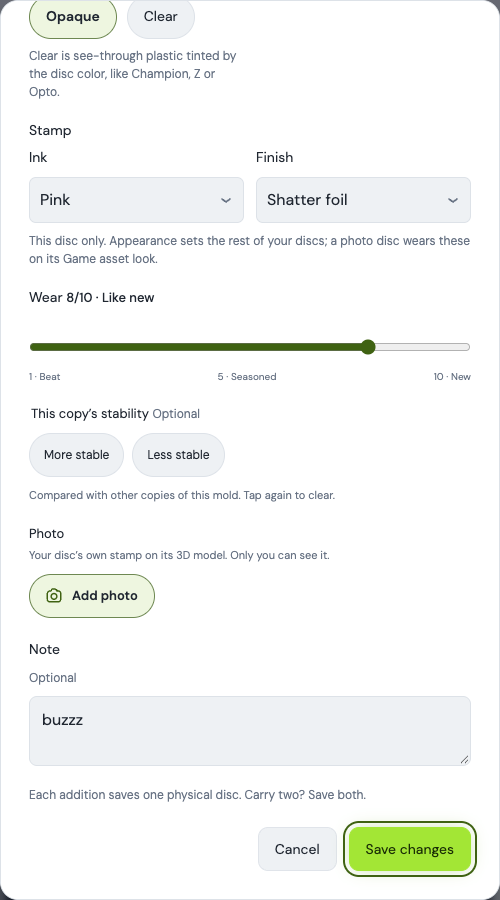
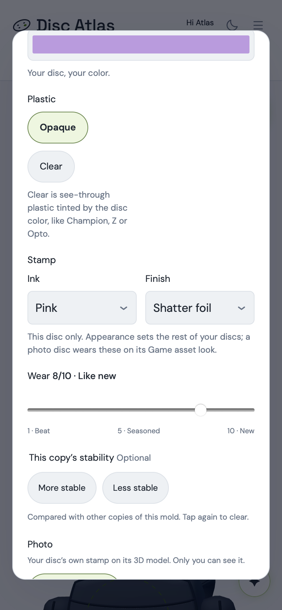

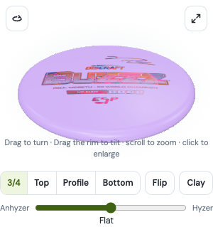

**A choice for Freddy (not decided silently).** A part left on Appearance follows **that device's** Appearance, because
the setting is per browser today. A disc set to Pink ink with its finish left on Appearance is pink everywhere, but
foil on a computer set to Foil and flat on a phone left at Flat. Set both parts and the disc is identical on every
device (proven below). The alternatives are (a) to save the device's current value into the untouched part on Save, or
(b) to move the Appearance stamp setting onto the account. Both are small, and neither is built.

### A.2 Evidence

| Check | Result |
|---|---|
| `tests/stamp-look.mjs` (new): ids agree across palette, validator and migration; untouched = `stampStyle()` for all 55 settings; part-by-part override; account persistence through edits, moves and fresh reads; the migration leaves rows on Appearance; the bag placement carries the choice | 6/6 pass |
| `tests/stamp-look-browser.mjs` (new): the sheet's sets and defaults, save and reload; Buzzz thumbnail re-inked while the untouched Luna thumbnail is **pixel-identical**; viewer finish per copy; My Map art keyed `style:pink/shatter`; pulled bag disc in shatter; **a WebKit phone on the same account** (its own Appearance at Auto/Flat) shows the choice in the sheet, the thumbnail and the viewer, and Luna follows the phone's own Appearance; back to Appearance from the sheet | pass |
| Untouched discs, main vs branch (`work/stamp-look-extraction/lab/identity.mjs`): a Buzzz, Luna and Destroyer bag under an Appearance gold foil, on dc038b6 and on this branch | **identical**: 3 list thumbnails (PNG data), 3 viewer top-view screenshots, 3 viewer stamp materials, the pulled bag disc's stamp layer |

**Standing suites (Oct 27, this branch with both parts, Mac, Chromium with `--enable-gpu`).**

| Set | Result |
|---|---|
| Unit set (`node --test` over `tests/*.mjs`, minus browser, evidence, perf and helper modules) | **341/344**. The three failures are `palette`, `prompt-4-stability-fixture` and `redesign`, which fail on main for environment only (they need a local server on :5173 or `outputs/`). Three tests were updated for the new fields or signature: `bag-demo` (the validator's exact output now carries `stamp_ink`/`stamp_finish: null`, as PR #44 did for `finish`), `photo-editor-races` (its fixture supplies the sheet's new `stampChoice`, as it does `finishChoice`) and, in the browser set, `clear-plastic` (it patches `extract()` by its exact signature line, which gained `seeThrough`) |
| Browser, 26 suites: display-customization, stamp-look, bag, bag-3d, bag-scene, bag-overmold, bag-collections, bag-memorial, my-map, all-discs, clear-plastic, clear-true-color, halo-plastic, photo-adder-rework, photo-stamp-one-click, photo-stamp-sync, photo-stamp-color-assets, photo-stamp-assets, photo-stamp-identity, spin-color-default, atlas-stamps, disc3d, bag-v13, photo-gestures, photo-stamp-level, photo-stamp-stall | **26/26 pass** |

## Part B: Freddy's ask

> "We're just missing letters sometimes — like there's just complete letters missing. For example, you could go check
> out the Berg, and I think the Proxy has a missing letter."
>
> "The Innova discs — we added the Proto Glow Wraith. On the backside of the disc, they pen the weight, and it's showing
> through because it's a Champion Proto Glow, so it's see-through, and it's showing the markings with the pen on the
> stamp, even though that's not supposed to be on the stamp — it's on the back."

### B.0 The evidence

Freddy authorised read-only copies of the three discs (Oct 27). One D1 SELECT on the three molds, with no account
columns read, and nine R2 GETs: each disc's stored photo, its one-ink asset and its colour asset. They went into the
ignored `work/stamp-look-extraction/input/`. Nothing on the account was written. All three wear **Full color**, and all
three assets were made between 13:04 and 13:08 on Oct 27 from the stored photos (the one-click path).

| Disc | Plastic | What the live asset lost |
|---|---|---|
| Kastaplast Berg | K1 Glow (gold foil on near-white) | "PUTT & APPROACH" read "U &A A"; the flight numbers "1/1/0/2" read "1" |
| Axiom Proxy | Eclipse (glow, an overmold) | "PUTT & APPROACH" read "U & AP ROA"; "Glow Plastic" read "G ow Plast c"; "-1" lost its minus; "AXIOM DISCS" broken |
| Innova Wraith | Proto Glow Champion | the penned weight on the back ("132", mirrored) and the gate blob beside it, drawn as stamp |

**Reproduced exactly.** The lab (§B.3) re-made each asset through the real page, from the same stored photo, on main.
The traced extractor's alpha matched the product's on all three (**0 differing pixels**), and every loss above is
present in the reproduction.

### B.1 Missing letters: the mechanisms, per disc

`disc-stamp-extract.mjs` judges design **by connected component**, so a small letter lives or dies whole. One size floor
does most of the damage: `MIN_AREA` (24 px at 1024, so 96 px at the 2048 px the assets are read at). It applies at the
strong stage (`specks`), after the half-peak trim (`sliver`) and in the weak pass. Small print is about 1% of the disc
tall, so its letters, a thin "l" or an "i" dot especially, sit just under it.

**Proxy: the size floor alone.** Every lost letter was **full-strength ink** dropped for size:

| Letter | Area | Peak ΔE | Rule |
|---|---|---|---|
| "l" of Glow | 78 px (3 × 34) | 48.9 | `sliver` |
| "i" of Plastic, stem and dot | 73 + 20 px | 52.8, 51.4 | `sliver` |
| "U" of PUTT | 84 px | 37.5 | `specks` |
| P, T, P, C and both stems of H | 46–93 px | 37–54 | `sliver` |

The trim had shaved them under the floor. The rule's own comment says it is meant for "a sliver too small **or too
faint**", that is, halo remnants. Its "small" clause also caught strong thin letters.

**Berg: three mechanisms stacked.** Its small print is faint gold foil on light glow plastic.
1. **The same size floor:** "PUTT"'s P, U and T (63–94 px, ΔE 16–21) went as `specks` and `sliver`.
2. **The weak pass's reach:** the digits are weak ink (ΔE 8.5–15, under `hi` 18). They were rejected for sitting
   3.6–4.6% of the size from strong design, against `NEAR` 3.5%, because the strong print above them was itself dropped
   by (1) and "APPROACH" is faint too.
3. **The photo's contrast floor:** "PROACH" and two of the slashes peak at only **ΔE 6.7–8.4**. The weak pass seeds at
   `hi2` = 8, an absolute floor; this plate's noise alone would allow 6.2. So they never become candidates at all.

**Not PR #45's trade.** On every lost letter on both discs, no pixel is "unknown" (no glare core) and none was dropped
by the stranded-stub rule. The accepted gap where glare crosses a stroke did not grow teeth here.

### B.2 The ghost: discriminators measured on the Wraith

Per component the extractor kept, measured on the Wraith's own photo:

| | Peak ΔE | Edge width at half its own contrast (px at 1024) | Colour (Lab chroma, hue) |
|---|---|---|---|
| Pen strokes (two groups, within 9% of the centre) | 21–25 | **5.5–6.4** | 11–12 at **hue 139**, the **plate's own green** (plate: 21 at hue 124), darkened |
| Printed elements (31 of them) | 64–90 | **1.7–2.3** | navy, hue −66, chroma 28–47 |
| Gate blob (centre) | 7.7 | 7.0 | lighter than the plate |

Three signals separate them, and all three are physics: what lies behind translucent plastic is **filtered by it** (the
plastic's hue), **diffused by it** (soft edges) and **attenuated** (faint). Mirror-reversal is real ("132" reads
backwards) but needs letter recognition. Position (the pen spots near the centre) also holds, but print sits there too
on many molds. Neither is used.

Two candidates were measured and refused:
- An edge width taken at the mask's boundary **inverted** the signal. Faint marks end near their own peak, strong
  print ends far down its ramp, so print read as softer. The width has to be taken where each mark crosses half its own
  contrast.
- On a neutral plate (the Berg, chroma 0.7) "same hue" means nothing. The test is distance from the line between grey
  and the plate's colour, so a gold print on a white plate is far from it.

The Raptor's shadow copies, measured without the clear pass, fall in the same class (plate hue, soft, faint). That is
consistent: they are the same physics, and on a Clear copy the clear pass removes them first.

### B.3 The build

All of it is in `public/disc-stamp-extract.mjs`, plus a `seeThrough` flag carried from the sheet through
`disc-photo.mjs` and `disc-stamp-worker.mjs`.

1. **A small mark is judged by the word it sits in.** `wordAreas` groups the print *as it lies on the disc* (the weak
   pass's levels, so faint letters count) wherever it sits within `WORD` (0.8% of the size) of itself. A mark under the
   speck size is kept at the strong stage and in the weak pass when its word holds at least `WORD_AREA` (3) speck sizes.
   A lone speck of the same ink still goes.
2. **The trim does not un-accept ink.** After the half-peak trim, a part that came from an accepted full-size mark, and
   still reaches `hi2`, stays. A crumb under a quarter of the speck size still goes, and faint slivers still go.
3. **Letters of one stamp sit together, transitively.** A weak mark beside a weak mark just accepted is beside the
   design too, up to `CHAIN` (3) steps from strong design, and a word reaches the design when any of its letters does.
4. **See-through plastic** (`seeThrough`, from `bag-values.js` `seeThroughPlastic`: a Clear copy, or any plastic named
   Champion). At the strong stage, before the weak pass, a component is behind the plate when all four hold, each
   against this disc's own print (its area-weighted median):
   - darker than the plate;
   - its colour within 6 ΔE of the grey-to-plate line;
   - edges at least 1.6× as soft;
   - at most half the contrast.

   It is dropped, and it and its fringe leave the weak pass and the words. Otherwise the weak pass re-admitted the pen
   through the divider bars it touches (seen, and fixed). The gate blob then has no design beside it, and goes as an
   ordinary weak mark.
5. **The illustrated-stamp ("layered") test** counts only full-size marks, so the restored small letters and fragments
   are drawn but never change what kind of stamp a disc is. Without this, a worn one-ink test fixture flipped to
   one-ink-from-layered on Clear (0.67 → 0.53 against 0.55). With it, 0.62. The layered status of all three pinned
   discs is unchanged.

### B.4 The pair gate, on one set of settings

| Disc | Before (main) | After (this branch) | Gate |
|---|---|---|---|
| Proxy | "U & AP ROA", "G ow Plast c", "3/3/1/0.5", "AXIOM DISCS" broken | "PUTT & APPROACH", "Glow Plastic", "3/3/-1/0.5", "AXIOM DISCS" | **letter-complete** (a nick inside the second P) |
| Wraith | pen "132" and the gate blob in the stamp | gone; every printed element intact | **ghost-free** |
| Berg | "U & A … A", "1" | "PUTT & A … A", "1 1 0 / 2" (the 2 broken) | **not complete**: "PROACH" and two slashes missing |

These are the Full color assets the page made (photo · main · branch):

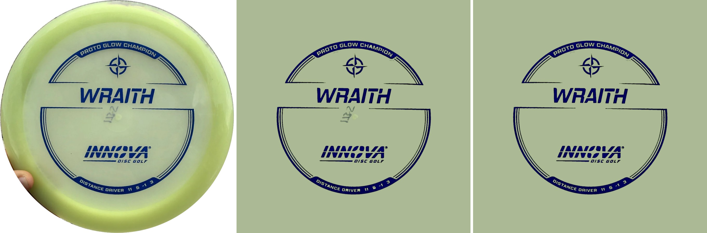
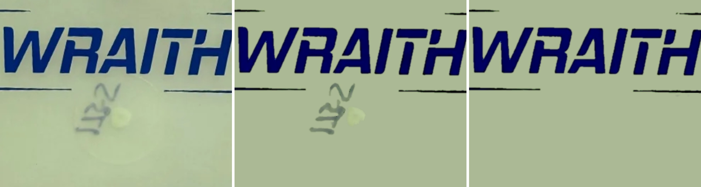
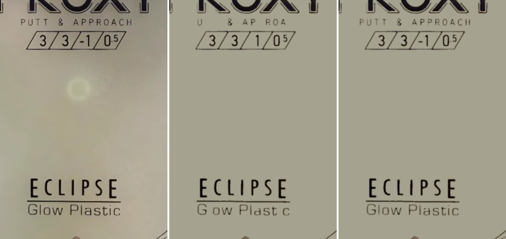
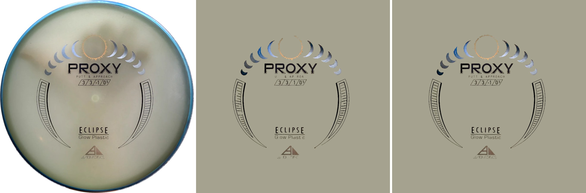
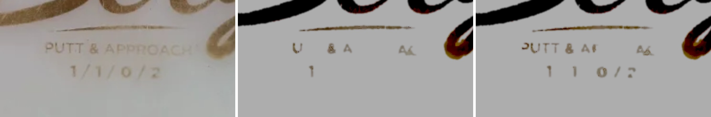
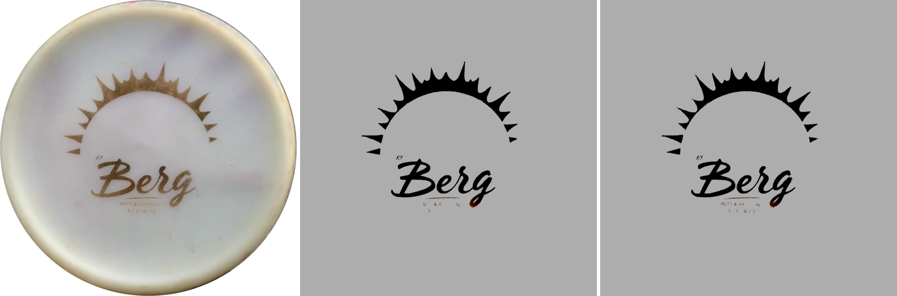

**The trade-off (STOP, Freddy's ruling).** The Berg's last letters are at ΔE 6.7–8.4 in this stored photo. Lowering
the weak seed floor from 8 to 6, which still respects each plate's measured noise, was tried in the lab. "PROACH" comes
back only as **fragments** ("Ar·nrr", below), not letters. That floor would apply to every disc, so the branch keeps 8.

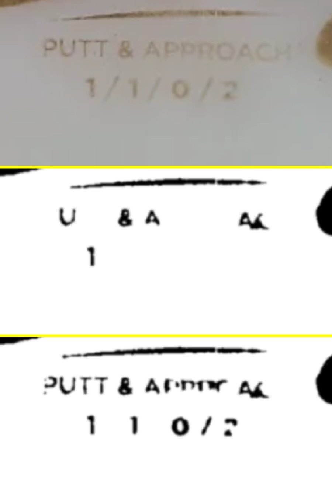

The options:
- (a) Accept the Berg as it now is.
- (b) Re-make the Berg from a sharper photo. "Use a higher-resolution original instead" in its sheet takes the camera
  original: a 2048 px read instead of the stored 1024 px texture. This is the likeliest to read PROACH, but it is not
  proven here because the original was not available.
- (c) Lower the floor anyway: fragments, on every disc.

**Not changed, seen in passing.** The Berg's gold foil comes out near-black in its Full color asset, on main as on this
branch. That is the colour pass's read of foil on a white plate, not a letter or ghost issue. It is left for its own
look.

### B.5 Blast radius, and the bag-wide report

- **The letter fixes (B.3.1–3) are global.** They change the extraction of **every** photo disc made or re-made after
  deploy. This is flagged for Freddy's ruling, as the brief asks. Existing assets on the account do not change until
  their owner taps Make again.
- **The ghost fix (B.3.4) is gated** to Clear copies and Champion plastics. On print alone it is byte-identical
  (tested), and it removes nothing on the Raptor (Clear).

Every photo disc available to this session, main against this branch, asset pixels at 2048 (alpha over half):

| Disc | Added | Removed | What changed |
|---|---|---|---|
| Berg (K1 Glow) | 1,034 | 0 | PUTT, and the digits 1 0 / 2 |
| Proxy (Eclipse) | 3,498 | 0 | the small print, the minus, AXIOM DISCS |
| Wraith (Proto Glow Champion) | 441 | 6,588 | the pen and gate blob out; specks of print in |
| Raptor (Z, Clear; stored photo from the clear-plastic work) | 863 | 406 | fragments inside RAPTOR and at a rim-ring gap; no plastic (its zero-residue tests pass) |
| Pixel (Electron; stored photo from the photo-adder work) | 1,336 | 62 | broken thin lines of the cube graphic joined; a few specks beside PIXEL |

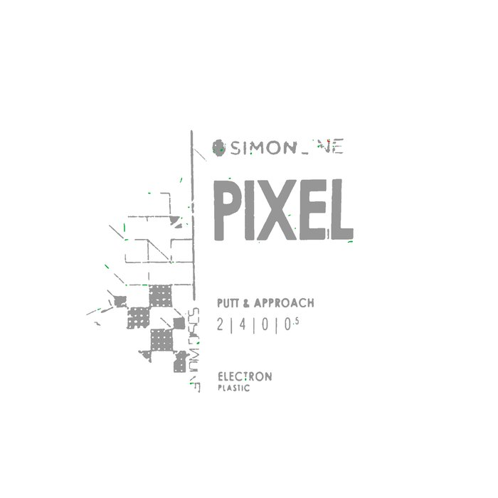

No disc lost a letter. **Not covered:** the rest of Freddy's photo discs. Reading them needs read-only access beyond the
three discs authorised. The same capture and diff runs over each one is the full report (`lab/capture.mjs`, then
`lab/analyse.mjs` and `lab/diffmap.mjs` with `TAG=fix-`).

### B.6 The lab

In the ignored `work/stamp-look-extraction/lab/`:

- `capture.mjs` takes the real product path on the local signed-in harness: a disc gets the stored photo, Game asset is
  tapped once, and the exact worker input and output are captured.
- `trace-build.mjs` makes a traced copy of the extraction modules that records every component dropped, with its rule.
- `analyse.mjs` re-runs a capture through the traced copy. It checks the traced alpha against the product's and draws a
  drop map per rule.
- `inregion.mjs`, `dprobe.mjs`, `measure.mjs` and `ghostprobe.mjs` give the per-letter and per-component numbers above.
- `zoom.mjs`, `colorpair.mjs` and `diffmap.mjs` draw the figures.
- `pull-live.sh` is the read-only pull script; in the end the reads were run by hand, without its email filter.

**Tests.** `tests/stamp-extraction-fidelity.mjs` (new, synthetic discs only, as the extractor suite is):
- small print under the speck size survives in a word, and a lone speck goes;
- on see-through plastic the pen goes, while the print and a soft mark of another colour stay, and print alone is
  byte-identical either way;
- `seeThroughPlastic` is the Champion family or Clear.

On main it fails: 0 of 10 small letters, and the pen kept.

## Fences kept

- PR #49 is not disturbed: the aligner, the one-sitting flow and the save snapshot are not touched. `disc-photo.mjs`
  gains two pass-through options, each defaulting to today's behaviour: the One ink preview's colour (Part A) and
  `seeThrough` to the extraction worker (Part B). The PR #49 suites (photo-adder-rework, photo-gestures) pass.
- No new inks or finishes. The clear and colour law (PR #46/#47) is untouched, and PR #45's zero-residue tests pass
  (`disc-stamp-clear`, `disc-stamp-color`). The Photo look is untouched.
- Freddy's live assets and photos: never written. The lab works on copies in the ignored `work/`. After deploy, his
  Berg, Proxy and Wraith change only when he taps Make again on each.

## Landing (Freddy's call)

Migration 0016 goes **remote before the Worker deploys**: a Worker that selects `stamp_ink` from a table without it
fails every bag read. Then `npm run build:workers && npm run deploy:workers`.
