# Gallery fixes — functional fixes pass; phone performance gate fails

October 17, 2026. Branch **`codex/all-discs-gallery-fixes`**, isolated worktree `C:/Users/user/.codex/worktrees/all-discs-gallery-fixes/disc-atlas`.

Fetched `origin/main` before creating the worktree and branch. Base SHA: **`e59e67e10f263718a47ca4fd842a70db630d5987`**, PR #19's merge. Local commit only; no push, merge, or deployment.

**Acceptance is incomplete:** the three functional fixes pass, but the Gallery phone long-task gate remains **red** at the repository's default 7 desktop / 3 phone warm repetitions. Final median count: **8**, baseline **2**, limit **3**. No margin, quality cap, repetition count, or shared rendering/texture implementation was changed to obtain a pass. Further performance work is stopped under Freddy's fence against widening this fix pass.

## 1. Gallery's own section

Collection navigation is now **Bag · My Map · Storage · Gallery · Lost**. The preceding Bag/My Map controls are unchanged. Gallery has its own header and opens the existing album directly. Storage has its Rack alone; its Rack / All Discs toggle and mode state were removed.

Album membership, copy-ID deduplication, lost exclusion, ordering, filters, badges, counters, wrapping and gestures are unchanged. Gallery keeps the shipped album's Storage list below it. Leaving/re-entering resets the album's filter/index as before; no new navigation persistence or user settings were added. The signed-out demo remains the same list-based experience with authenticated collection navigation hidden.

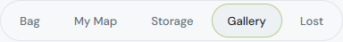

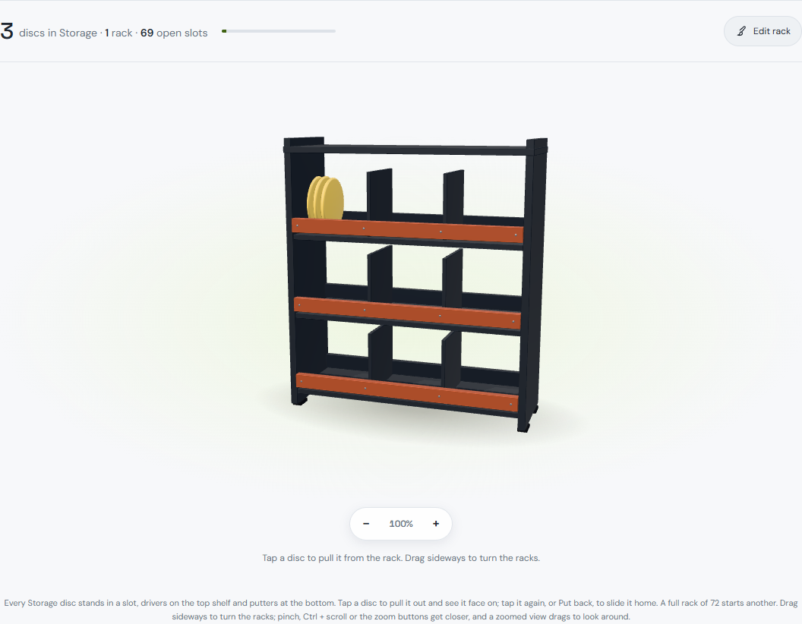

## 2. Top first, then keep the chosen view

The shared viewer's `update()` resets a changed mold to 3/4. Gallery now captures its current pose, performs that normal update, and restores its camera using the existing `getPose()` / `applyPose()` methods. A fresh Gallery session seeds **Top**. The shared viewer retains its own flip/tilt behavior; the session's camera choice belongs to Gallery only. Empty/unavailable entries retain that camera choice for the next renderable copy. Leaving Gallery resets it to Top for the next Gallery visit.

No shared viewer default or persistence was changed. Its source is byte-for-byte unchanged from the base.

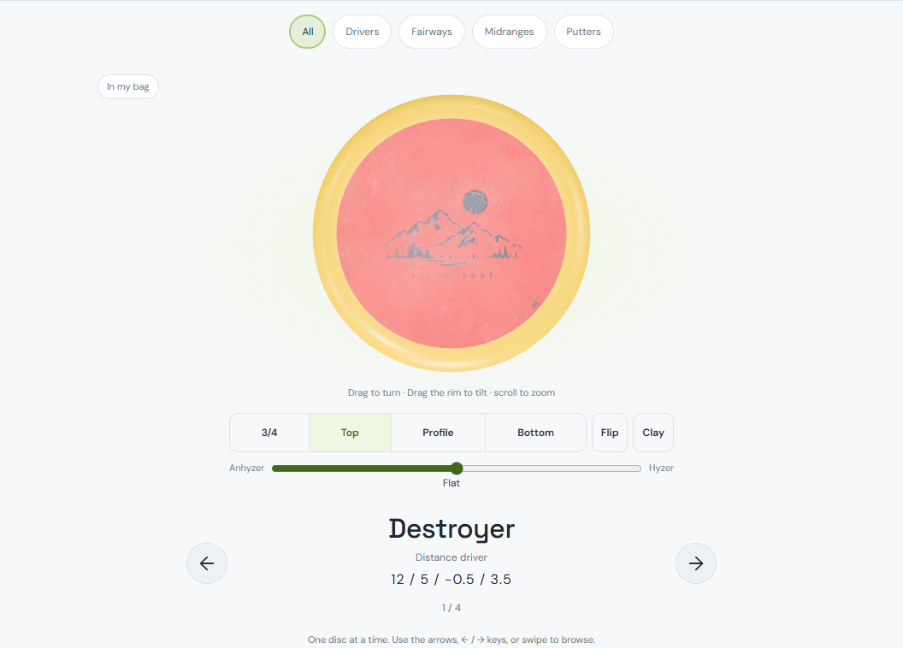

The test changes the view once to **Profile**, then advances through three different molds:

| First flip: Stalker | Second: Buzzz | Third: Luna |
| --- | --- | --- |
| 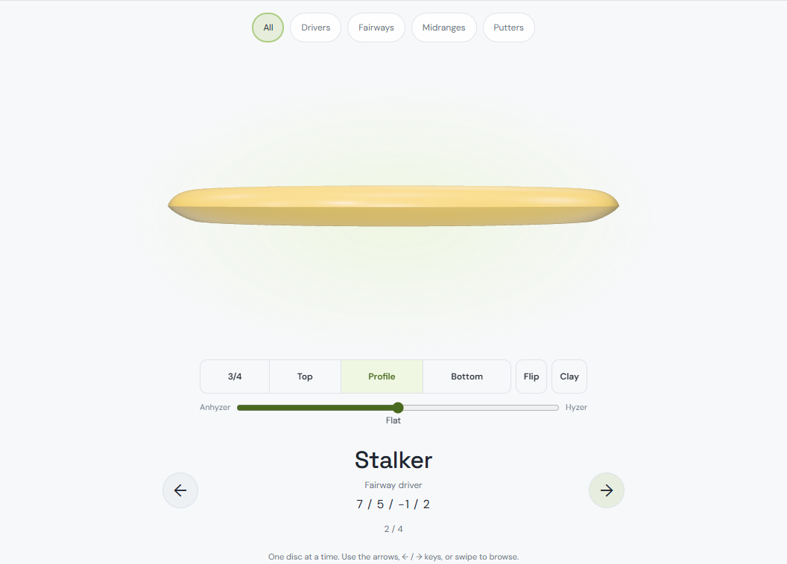 | 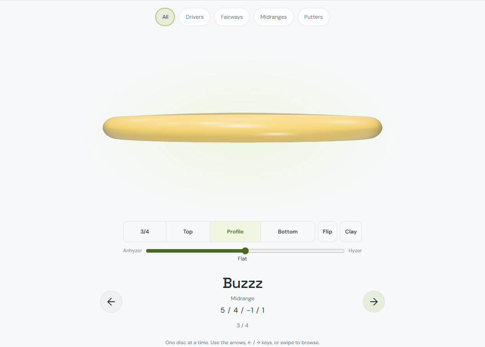 | 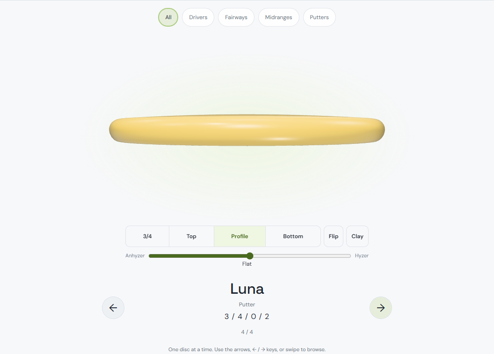 |

The recorded view sequence is `profile, profile, profile`. Additional checks select 3/4, Bottom and Top, flip backward, and verify each choice holds; filters also retain the view. Re-entering Gallery returns to Top.

## 3. Reveal after appearance is ready

Gallery hides its existing viewer synchronously before changing the copy. The stage keeps its layout and a neutral **Loading appearance…** placeholder. It observes the shared viewer's existing photo/stamp ready and failure flags, guards every callback against the current selection/revision, and waits a separate animation-frame turn after readiness so the shared renderer can draw the resolved appearance before exposure. Stale arrivals are cancelled. A failed appearance keeps the neutral stage and an explicit message; it never substitutes a generated-looking disc.

The viewer is reused; no second renderer or texture pipeline was built. The flags are read through the objects the shared viewer already exposes. Gallery also hides before a theme-driven appearance rebuild. Horizontal swipes remain active on the neutral stage, while the hidden viewer's controls wait for readiness. Shared loader code and other surfaces were not modified.

The test holds actual owner-photo and Stalker stock-stamp responses until after the pending screenshot, then releases them. Historical-source replay serves the four changed frontend files from the base SHA, after sign-in, without moving the checkout. In the final evidence replay the old Gallery showed **25 photo** and **48 stamp** sampled frames with a visible viewer before the corresponding asset was ready. The fixed Gallery recorded **0 / 0** such frames.

| Asset | Before: pending asset shows generated art | Fixed: pending asset stays neutral | Fixed: resolved appearance |
| --- | --- | --- | --- |
| Photo | 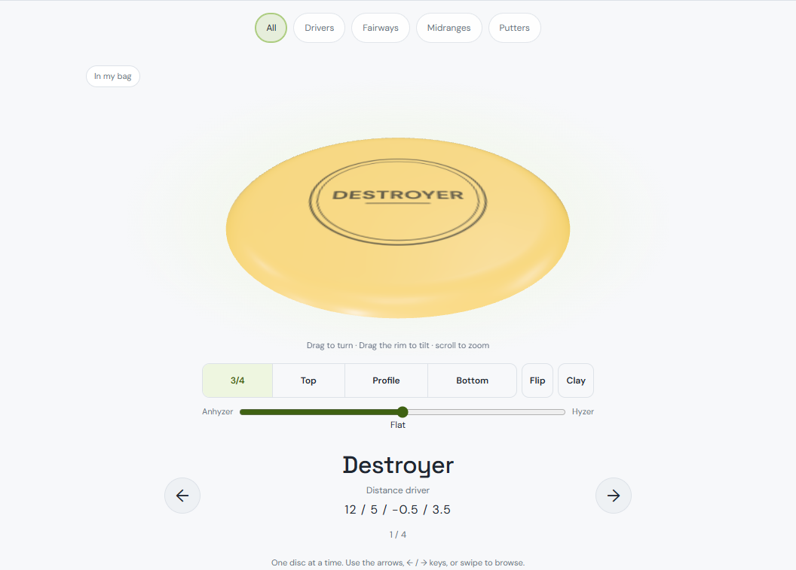 | 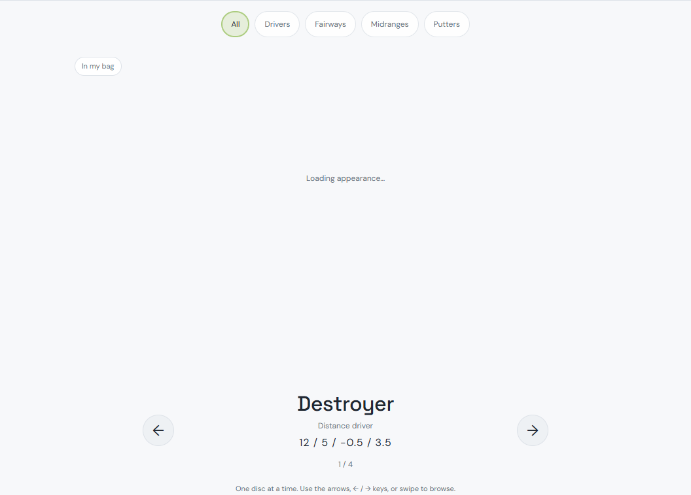 | 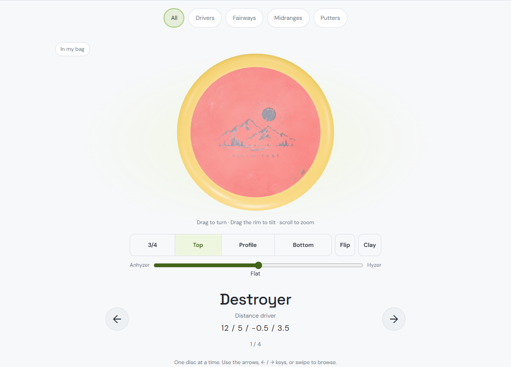 |
| Stock stamp | 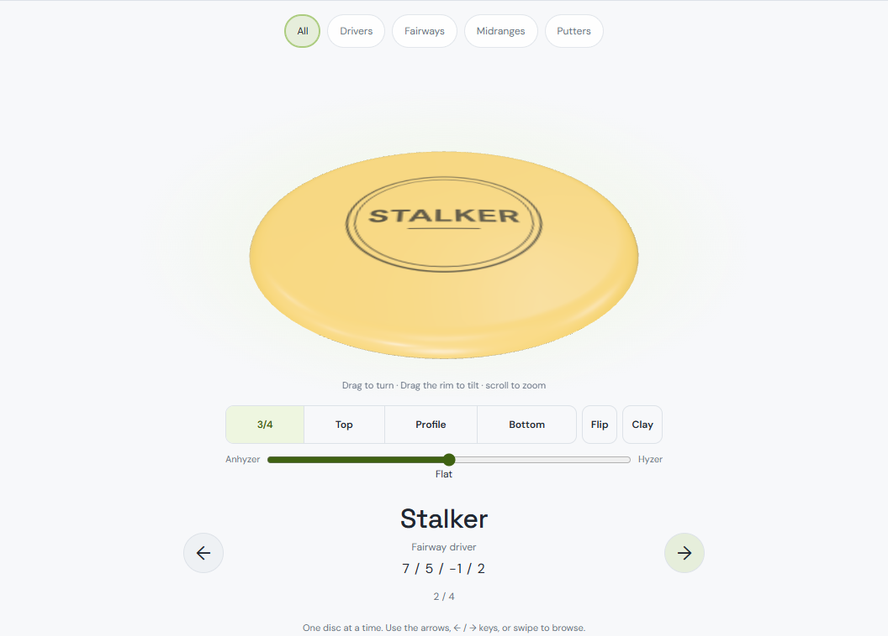 | 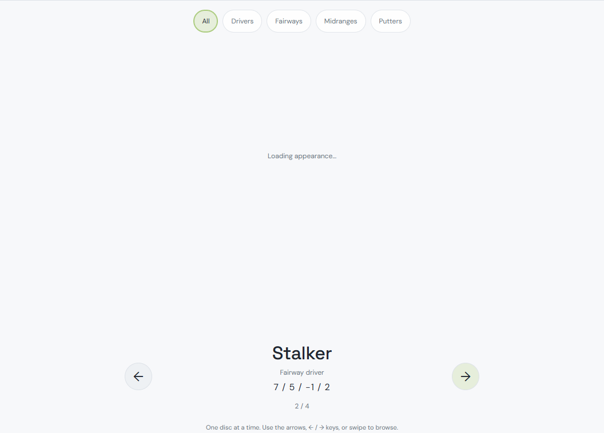 | 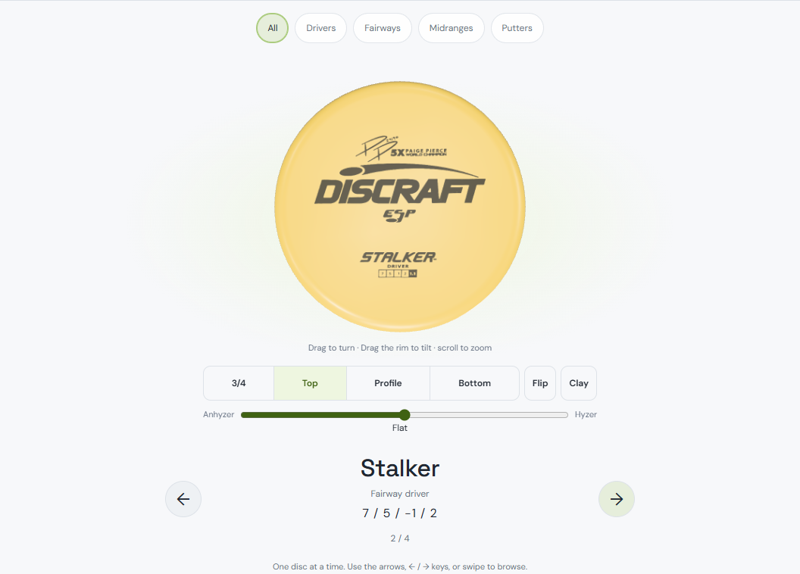 |

The sampler checks readiness metadata and computed host visibility on each animation frame; it does not classify canvas pixels. Screenshots independently show the pending/resolved looks, and the source's additional render turn supplies the draw-before-reveal barrier. This is controlled delayed-response evidence, not a claim about every network/device combination. Raw frame samples are in [before.json](images/storage-all-discs-fixes/before.json) and [after.json](images/storage-all-discs-fixes/after.json).

### Same pattern elsewhere — report only

- **Standalone/detail/pop-out disc viewer:** `public/disc3d/viewer.mjs`, `build()` assigns `stampTexture()` immediately; `update()` creates the photo surface and schedules rendering while it loads. `applyMaterials()` shows the generated stamp until `photoReady`. `public/disc3d/stamp.mjs`, `stampTexture()` initially draws the generated name/rings, then its `paint()` callback replaces them with the decoded stock alpha. `public/disc3d/photo.mjs`, `photoSurface()` starts hidden and becomes visible when `acquirePhoto()` resolves. Gallery adds the outer reveal guard; these shared behaviors remain unchanged elsewhere.
- **Bag, including Freddy's Stalker example:** `public/bag3d/viewer.mjs`, `syncLook()` creates a pulled stock disc's ink with `stampTexture()` and shows it while stock art loads; its callback replaces the geometry/art and invalidates. `platePhoto()` uses the same asynchronous photo surface, and the bag's photo/detail logic exposes a ready photo afterward. These are the existing entry points for default/generated-before-picture behavior. No bag fix was made here.

## Performance — repository defaults, with the numbers

Runtime: Windows x64, Node **24.21.0**, bundled Playwright **1.62.1**, installed Chromium revision **1234**, default ANGLE D3D11 GPU arguments. Desktop: **1440 × 900, 1× CPU**. Phone: **390 × 844, DPR 2, 4× CPU**. Viewer quality remains the shared defaults: 80 desktop / 56 coarse radial segments, DPR cap 2, detail photo tier 1024. Actual measurements retained one gallery canvas, two draw calls and the same per-copy triangle counts before/after.

Machine quietness was **not independently verified**; the Windows total-CPU counter was unavailable. The final Gallery timing run had no concurrent build/test run from this task. An earlier failed implementation run overlapped the unit suite briefly on desktop; it is retained as failed history, not used as the final result.

### Gallery adaptation

`tests/gallery-fixes-browser.mjs` uses **7 desktop / 3 phone** warm repetitions, one cold diagnostic per device, **241 real next-disc operations + 120 still draws** per repetition, and the repository's unchanged margins: `baseline × 1.15 + 1.5 ms` desktop, `+ 3 ms` phone; long tasks `baseline + 1`. Both independent medians and median paired excess must pass. Cold rows are diagnostic only. Source replay uses the exact base frontend; the API/catalog/viewer are unchanged between variants.

This adapts the repository's Atlas flight workload to Gallery navigation. Before and after Gallery runs are measured in blocks, **not** the Atlas gate's alternating variant order. Navigation/render CPU timings and still CPU timings are gated; click-to-ready/reveal latency is recorded separately and is not a gated metric. Results are local measurements, not a cross-machine baseline or a new sensitivity claim.

| Device | Warm metric | Before | Final | Limit | Median paired excess | Result |
| --- | --- | ---: | ---: | ---: | ---: | --- |
| Desktop | Navigation/draw p95, ms | 2.80 | 2.80 | 4.72 | −1.82 | Pass |
| Desktop | Still-draw p95, ms | 0.20 | 0.20 | 1.73 | −1.53 | Pass |
| Desktop | Long tasks, count | 0 | 0 | 1 | −1 | Pass |
| Phone | Navigation/draw p95, ms | 12.90 | 14.30 | 17.835 | −3.535 | Pass |
| Phone | Still-draw p95, ms | 1.20 | 1.40 | 4.38 | −2.995 | Pass |
| Phone | Long tasks, count | 2 | **8** | **3** | **+5** | **FAIL** |

Median of the warm repetition reveal-p95s: desktop **36.5 → 52.6 ms**, phone **83.7 → 109.2 ms**. The neutral hold trades the old immediate wrong-looking disc for a later correct reveal. These are reveal latency, not frame intervals or FPS.

The first implementation forced an extra synchronous draw and failed at phone p95 **17.8 ms** / **14 long tasks**. Deferring exposure to the viewer's scheduled render improved the CPU p95 but still failed at **7 long tasks**. Removing the redundant attach/layout read produced the final **8** count above. No retries of an unchanged implementation, reduced repetitions, widened tolerances, or quality downgrades were used to select a green run. Failed implementation reports are retained as [after-initial.json](images/storage-all-discs-fixes/after-initial.json) and [after-deferred.json](images/storage-all-discs-fixes/after-deferred.json).

The final default-repetition Gallery command exits **1** because of the phone long-task assertion. Further attribution/optimization is outside this bounded pass; no shared renderer/texture changes were improvised.

### Unchanged repository Atlas gate

The unchanged `node tests/atlas-3d-perf.mjs` was run separately at its actual defaults, with all `PERF_REPS*` overrides removed: **7 desktop / 3 phone**, serial alternating 2D/3D, 241 flight / 120 still frames. It also exits **1**, for the phone long-task check. Wall-clock: **162.23 s**. This protects the untouched Atlas and does not substitute for the Gallery measurements above.

| Device | Metric | 2D median | 3D median | Limit | Paired median excess | Result |
| --- | --- | ---: | ---: | ---: | ---: | --- |
| Desktop | Flight p95, ms | 3.3 | 4.0 | 5.295 | −1.295 | Pass |
| Desktop | 1× p95, ms | 0.7 | 1.0 | 2.305 | −1.405 | Pass |
| Desktop | Long tasks | 0 | 0 | 1 | −1 | Pass |
| Phone | Flight p95, ms | 10.0 | 13.6 | 14.5 | −0.9 | Pass |
| Phone | 1× p95, ms | 2.5 | 3.4 | 5.875 | −2.56 | Pass |
| Phone | Long tasks | 3 | **8** | **4** | **+3** | **FAIL** |

Full cold/warm distributions and decisions: [atlas-defaults.json](images/storage-all-discs-fixes/atlas-defaults.json). The Atlas product modules and gate are unchanged. These runs do not establish whether the phone long-task failures arise from host load, the respective workloads, or another cause; no Atlas or shared-pipeline fix is claimed or attempted.

## Regression and scope checks

- **74 unit tests passed**, including album ordering and the existing bag/collection suites.
- Three-fix browser assertions passed: placement, default Top, sticky view, photo/stamp reveal guards, and neutral asset-failure state.
- Independent read-only review found no critical/important product issues; its caveats about visibility sampling and diagnostic-only reveal latency are stated above.
- Adapted album browser suite **passed**: ownership, counters, filters, wrap, keyboard/touch navigation (including a swipe while appearance is loading), photos/Clay, slider gestures, reset, empty/unrated entries and demo boundary.
- Existing bag browser suite **passed**: CRUD/copies, capacity, all add surfaces, auth, focus containment/restoration and three themes at desktop/360 px.
- Existing Storage/Lost browser suite **passed**: empty/filled racks, actions, finishes, counts, lost/found, phone quality and overflow. Phone p90: Storage **17.3 ms**, Lost **17.1 ms**.
- Existing demo browser suite **passed all 7 checks**: read-only sample collection, detail viewing, sign-in/out boundaries and phone layout.
- Changed-file lint **passed with no diagnostics**; whitespace and protected-source scope checks passed.

`public/disc3d/`, `public/bag3d/`, `public/collection3d/`, the bag/collection scene implementations, APIs, catalog/data sources and `public/data.json` are unchanged. Graphify is refreshed AST-only, with environment/credential exclusions checked; no semantic extraction or LLM labeling is used.

Reproduction uses the existing local Wrangler/D1/R2 auth fixture and bundled Playwright via `PLAYWRIGHT_MODULE=C:/Users/user/.cache/codex-runtimes/codex-primary-runtime/dependencies/node/node_modules/playwright`. The worktree reuses installed dependencies through an ignored `node_modules` junction. The repeatable differential command is `npm run test:bag:gallery-fixes`: it replays the shipped frontend for the baseline, then runs the fixed Gallery with the same fixture/default repetitions. The historical metrics are evidence; collect both phases on the same machine for a new comparison.
