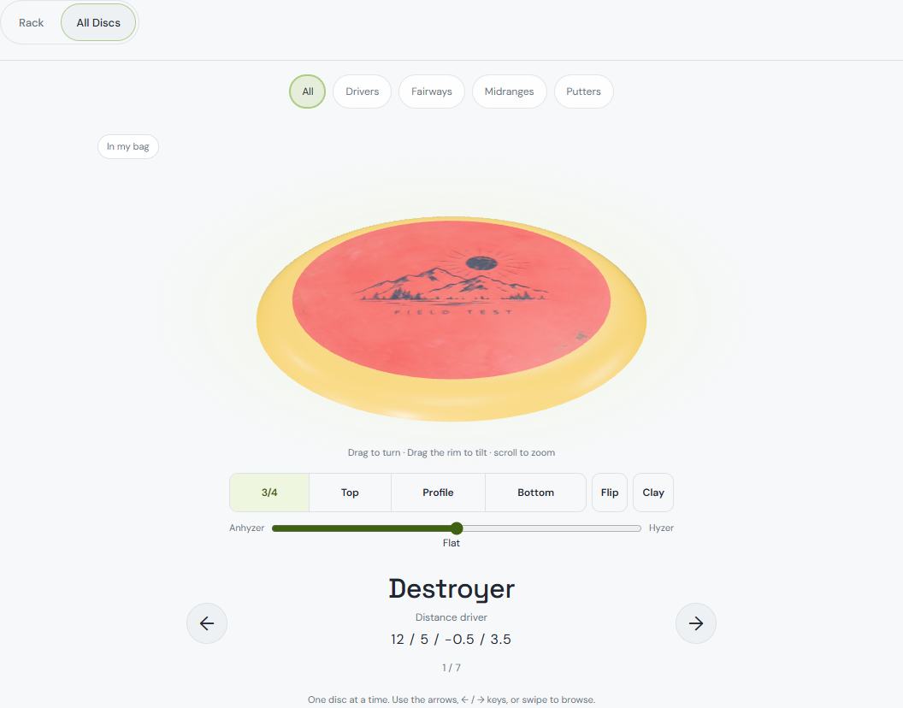
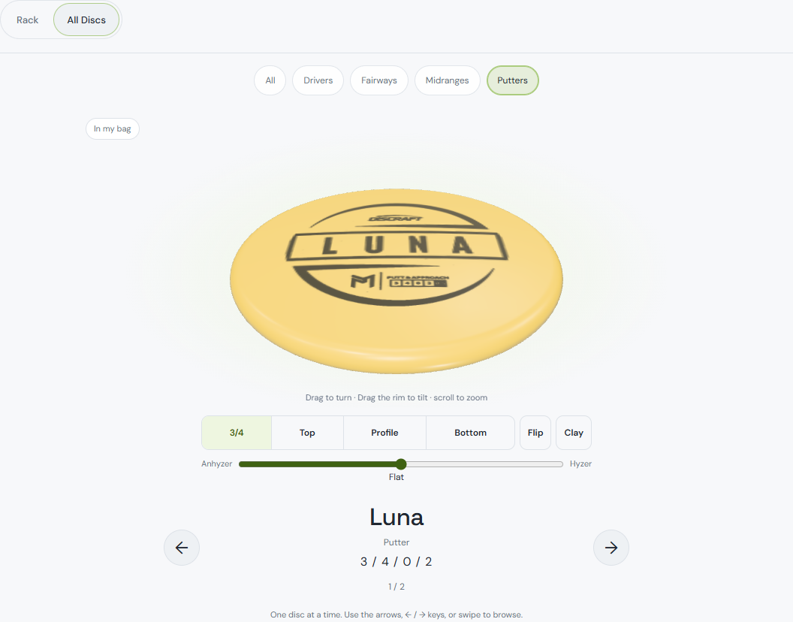
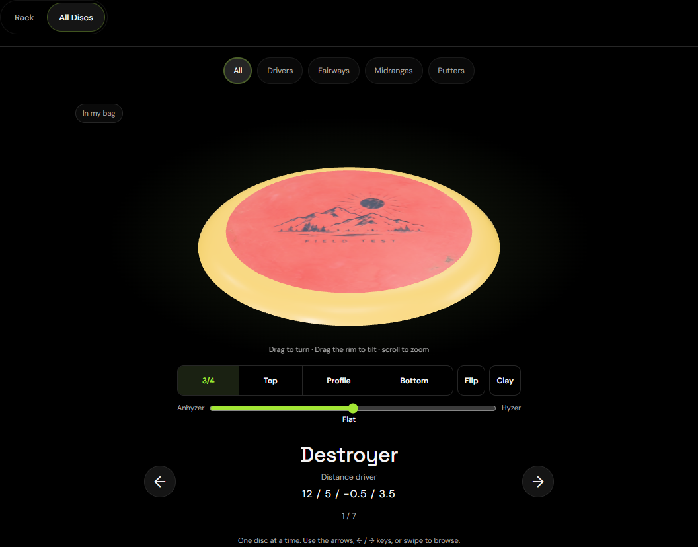
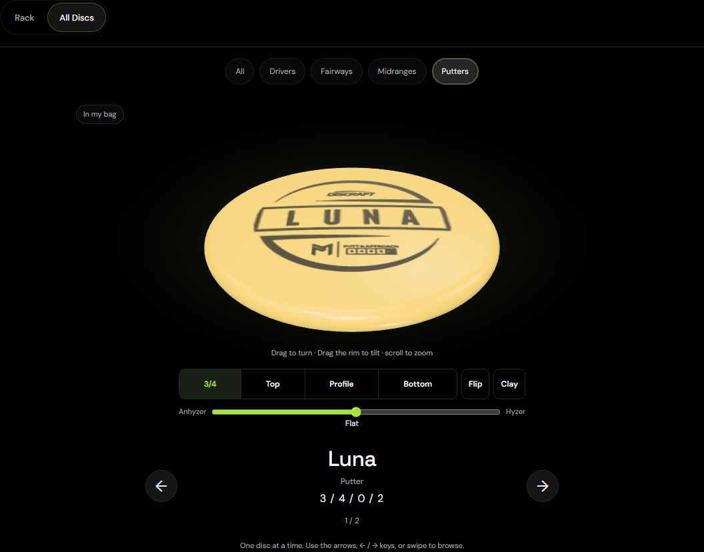
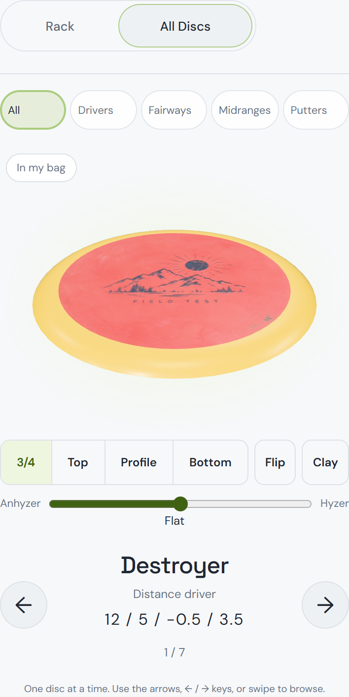
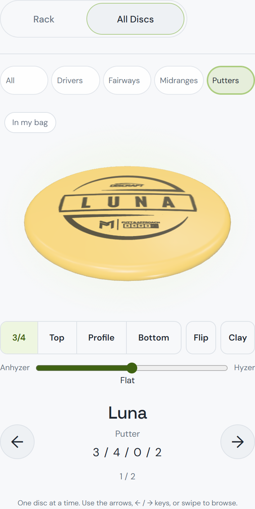
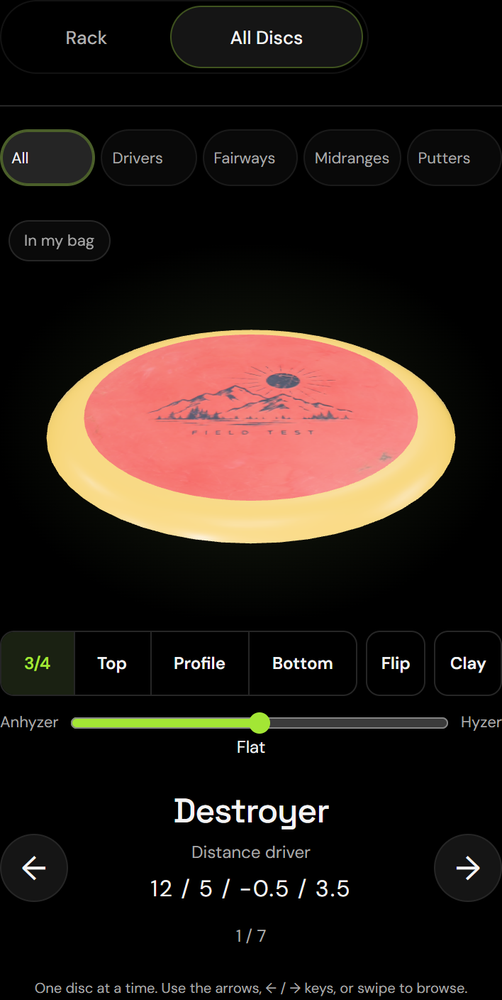
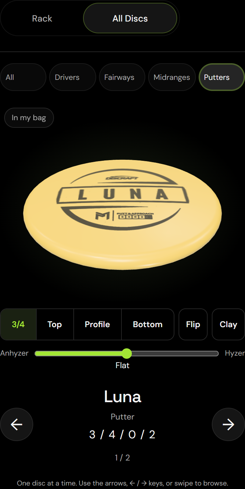

# Storage: All Discs collection gallery

Implemented October 17, 2026. Branch: `codex/all-discs-gallery`.

Fetched `origin/main` and created the branch at **`b517464b734cb7351380403aae2df0478c852553`**. This work is a local commit only: no push, merge, or deployment.

## Experience

Storage opens on **Rack**. **Rack / All Discs** uses the existing section-control treatment beneath the view picker. All Discs shows one owned copy in a large, centered stage, with its name, class, available flight numbers, a position counter, and previous/next arrows. Bag copies carry a quiet **In my bag** badge; storage copies do not.

**All / Drivers / Fairways / Midranges / Putters** each start at their first copy when selected. Both directions wrap, including one-disc albums. Empty collections/classes show a message, `0 / 0`, and disabled navigation. Arrows have 48 × 48 px targets. Keyboard arrows browse while the album is active, including when its canvas has focus. Form controls, navigation groups, and open dialogs retain their keys. Horizontal touch swipes browse; the shared viewer retains turning and pinch. Touches beginning on viewer buttons/sliders do not turn album pages.

Disc changes update the same viewer instance. The only album animation is a brief opacity arrival using `--dur-ui` and `--ease-out`; reduced motion skips it. Rapid changes cancel the prior arrival, and outdated lazy-load callbacks cannot mount a previous selection. Leaving the album disposes its WebGL viewer. Returning to Storage starts on Rack; album mode/filter/index are never persisted.

## Data characterization and ordering

The existing account collection is already the user's complete set of physical copies. `id` identifies an owned copy; `mold_id` identifies its catalog mold. Copies carry `in_bag`, `status`, `plastic`, `weight_g`, `wear`, `color`, optional `rim_color`, `texture_key` / `photo_rim_color`, notes, pocket, ordering and date metadata. They do **not** carry independent name/class/flight-number fields.

The album derives its union from that existing collection, removes every `status === 'lost'` copy regardless of membership, and deduplicates by **copy ID**. Multiple copies of one mold remain separate pages. Badge membership follows the existing bag convention, `in_bag !== false`; no new field or tag is stored.

Names resolve `catalogName`, then `name`, from the referenced catalog record. Class comes from the existing `bagClass` helper, including its category/speed fallback. Speed/glide/turn/fade come from that same record and appear only when all four exist as finite numbers. Missing catalog records remain represented honestly as unavailable; missing ratings are never fabricated.

The album reuses `rackOrder` for **distance → fairway → midrange → putter → unclassified** grouping. The rack currently uses the user's bag comparator inside a class, which can incorporate stability or custom order. That is not the album's required speed/name order, so the album supplies its own comparator: descending speed, name, then added date and copy ID for deterministic ties. Changing the bag sort does not reshuffle album pages. The existing rack comparator/order is untouched.

## Shared rendering and access

`public/all-discs-gallery.js` manages collection selection and navigation; it lazy-loads **`createDiscViewer` from `public/disc3d/viewer.mjs`**. No second renderer, geometry generator, material system, or photo pipeline was built. Default viewer quality comes directly from that factory: 80 radial segments on desktop, 56 with a coarse pointer, DPR capped at 2, and the viewer's 1024 px photo tier. The album passes the copy's existing photo URL, texture version, plate/rim colors and plastic, plus the mold's dimensions/model, stamp and overmold metadata. Preset views, flip, tilt, Clay, photo material behavior, and theme updates belong to the shared viewer.

The shared shape resolver can render real PDGA dimensions even when flight ratings are missing. Such copies still get their measured 3D view without a flight-number row. A copy with no supported shape data retains its metadata/counter and an explicit unavailable-view message.

**Demo characterization:** today's signed-out demo includes 18 bag copies and two storage copies, but Storage is a **list** there; the Storage scene/view picker is signed-in only. This work preserves that boundary. Demo visitors still browse the same Storage list, without new account/API access or a special alternate gallery. The new browser suite explicitly verifies this, and the existing demo suite passes.

The rack scene/modules, bag scene, Lost scene, collection APIs/data model and `public/data.json` are unchanged. The atlas map was not modified. No new user-data storage or settings were added.

## Verification

Commands use the project's existing local Wrangler/D1/R2 auth fixture and real Chromium/WebGL; no production account or service was changed.

This checkout used the bundled Playwright package through `PLAYWRIGHT_MODULE=C:/Users/user/.cache/codex-runtimes/codex-primary-runtime/dependencies/node/node_modules/playwright`, since its local Playwright package was absent. Browser runs were serial because they rebuild the same local asset directory.

- `node --test tests/all-discs-order.mjs tests/bag.mjs tests/bag-values.mjs tests/bag-3d-layout.mjs tests/bag-pulled-sizing.mjs tests/bag-demo.mjs tests/collection-layout.mjs` — **74 passing**.
- `node tests/all-discs-browser.mjs` / `npm run test:bag:album` — new suite covers entry, one viewer/canvas, all owned IDs and independent copies, lost exclusion, bag badge, stable class ordering, filters/counters, arrows/keys/swipes and both wrap directions, one-disc filters, 50 rapid flips without a stale photo, actual private photo rendering, Clay, slider gestures, mode reset/reload, empty and unrated cases, demo parity, and eight screenshots.
- `node tests/bag-browser.mjs` — **passed**: CRUD, capacity, add surfaces, auth, focus and desktop/phone theme checks.
- `node tests/bag-collections-browser.mjs` — **passed**: empty rack, 80 → 72 copy rack resizing, pull/put-back/move/remove, counts, finishes, loss/found flow, graveyard and phone quality/overflow checks. Its existing 72-disc phone rack check measured 22 draw calls and a 17.6 ms p90 frame interval on this run; this is a regression check, not an album performance benchmark.
- `node tests/bag-demo-browser.mjs` — **7 checks passed**, including no signed-out bag API calls and 390 px overflow.
- ESLint on the four changed JavaScript/test files — **passed with no diagnostics**. Repository-wide `npm run lint` reports **149 errors / 6,575 warnings** in existing vendored Three.js and `.claude/worktrees/distracted-bardeen-49e126` sources; these are outside this change. Full local log: `outputs/all-discs-lint.log`.
- `git diff --check` — passed. `scripts/build-workers.mjs` passed as part of each browser suite.

The new mode test first failed because the toggle did not exist. The review found that touch slider drags could also navigate. Its new regression was checked against the deliberately restored bug: dragging the slider incorrectly changed `7 / 7` to `6 / 7`; excluding interactive controls fixed it.

Graphify was refreshed with **`graphify update .`**, AST only, after checking that environment/credential files remain excluded. Documentation screenshots are excluded through `/docs/images/` to preserve the code-only corpus. No deep extraction, semantic pass, model key or LLM labeling was used. The graph's existing extraction gaps remain documented in `docs/graphify-adoption.md`.

## Screenshots

Local Chromium captures at 1440 × 1000 desktop and 390 × 844 touch viewports. Each image captures the complete album surface, including the mode toggle, active class filter, stage, metadata, arrows and counter. Phone surface captures extend vertically when needed; they are not presented as fitting every control in one viewport. Light and Black are the light/dark examples. All uses an uploaded photo; Putters shows the catalog Luna stamp through the shared viewer.

| View | All | Putters |
| --- | --- | --- |
| Desktop · Light |  |  |
| Desktop · Dark |  |  |
| Phone · Light |  |  |
| Phone · Dark |  |  |

Freddy's post-deploy feel check remains: **Storage → All Discs → browse the whole collection with arrows → Putters → browse those**. No deployment was performed here.
